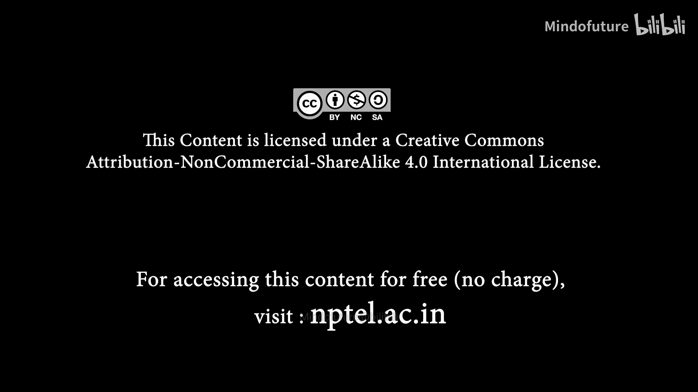
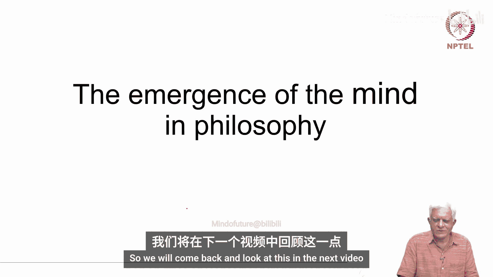

# 【印度理工学院】知识表示与推理 ｜ Knowledge Representation And Reasoning p04 P04_1.4-智力的新测试 -BV1c4zNBmEyF_p4-

So welcome back。So in this quest for building AI and AI is such a。

Popular word nowadays that everybody keeps talking about AI doing this， AI， doing that and so on。

How do we recognize？That we are looking at。Intelligent behavior。Or some kind of intelligence。

 some kind of embodied intelligence。 So Alan Turing said quite some time ago。That。

 the question of whether machines can think is itself too meaningless he said that we don't even know what his thinking mean and so on and he prescribed a test which he calls as the imitation game。

Which is now。Known as a tuuring test， so all of us call it the Turing test and he wrote about this in this paper in 1950。

Computing machine machinery and intelligence。So。What is steer test says。

What the imitation game says is that can a machine imitate a human being？So if you are a human judge。

And you are sitting on on a teletypepe in those days or in modern times if you are typing on your mobile phone。

Who is responding to you。From the other side， that somebody that you cannot see or something that you cannot see。

 Is it a human being。Or is it a machine。Duringuring said。

That if the machine can imitate human responses a significant portion of the times。

 then you must accept that。They are intelligent。But this。Test relies。

Exclusively on our ability to handle language essentially because in 1950 we were nowhere near。

The possibility that machines could。Interact with us in English， for example。嗯。

Though since then there has been rapid progress starting with this program called Eliza。

Which was written by Byizenboum。You know， which could you know take your inputs intent。

 twist it around and throw it back at you。And human beings are very good at anthropomorphizing about what we see essentially。

And。Nowadays， we have chat bots which make us think that。We are talking to an intelligent teacher。So。

 more recently。Hecctor leis。Has proposed。A new test。For intelligence。And。

You can read about this in this book which is meant to be a book meant。Lay persons， it's not a。

Textbook or very technical book。He says that given the advances in web data processing。

 corulpus based natural language processing。And clever distracting techniques。

It has become easy to build conversational chat bots that are impressive but lack intelligence。

And then he has proposed a new test。Which was originally also proposed by Terry Wininoglad。

And these are call this vinagrad schemas in his。あな。

And Hector Lesk says that this is like an alternate tu test。So， the idea behind。

Menogard schemas is that。You ask？Appointed multiple choice question。

That requires knowledge of the subject matter， so we want to emphasize。on。

The fact that the person or the entity。Of the machine responding to the question。

Should be able to do that only if the person or entity has knowledge about the domain。So。

 for example。In context where give can appear are statistically quite similar to those where receive can appear。

And yet the answer must change depending on which one is used so if us。

If a story is describing the word give。A story or a sentence。

All receive then their meaning changes quite a bit。

This would make the test Google proof in the sense that you cannot write a program which will you know access。

The net and look for similar questions and you know somehow discover the answer and throw it back at you。

We've got that process。Works without meaning essentially， you know。

 it is just looking at a way of recognizing text and you know generating answers based from there。

The claim is that doing better than guessing requires subjects to figure out what is really going on we see some examples。

Yes。So， the key test in minogram。schema is an for resolution。

 which means you have pronouns and you have to resolve as to what that pronoun is referring to。

So a winnugrad schema challenge consists of three parts。

A sentence or a brief discourse that contains the following。

Two noun phases of the same semantic class。For example， male。

 female inanimate group of objects or people。An ambiguous proun that may refer to either of the above9 noun phrases so your sentence must have two noun phrases。

And a pronoun which refers to one of them。And a special word。

And an alternate word such that if the special word is replaced by the alternate word。

The national's resolution of the pronoun changes so if you use word the first word then the pronoun refers to the first noun phrase and if you use instead the second word it will refer to the second noun phrase。

So， the idea behind the binenograd schema is to give one of those two sentences using one of those two words。

And then ask as to who does the panel refer to？So， the test is a question asking the identity of the ambiguous pronoun。

And two answer choices have to be given。And the user or the entity or the person answering the test or quiz must have to choose one of them。

So you see that。We are moved away from this facility of language that oh this machine can speak English so it must be like a human in some sense now we are saying that we are not testing your linguistic abilities。

😊，We are testing your reasoning abilities。 You are not this thing that can you。Reason enough。

To pick the correct choice out of two choices that are giving you。

So we'll look at some examples here。So， a machine will be given the problem in a standardized form which includes answer choices thus making it a binary decision problem。

 is it the first choice or is it the second choice and the claim。Is。That to be able to。

Do better than 50% because if you choose randomly you would expect to do 50% of the answers correct to do better than 50% you have to have。

Then。Enough knowledge about whatever is being spoken about。And。The ability to reason。

So let's look at a few examples here。This was given by Te Vienograd himself in 1972。

Such sentences are now named after him， so that is why you is call it a innuugt schema。So。

 the first sentence is。The city councilmen refused to demonstrateators the permit because they feared violence。

So the key word here is fear essentially。And there are two noun phrases here。

 one refers to the city councilman。And the other refers to the demonstrators essentially。

So you can see that in this example。If I ask you， who is there？

Then the answer would be city councilman。Because they are the ones who are refusing the demonstration demonstrators a permit because they are the ones who are fearing the violence。

If you replace feard with advocate。The same sentence with one word changed。

 the city councilmen refused to demonstrators a permit because they advocated violence。

Then you can see that the answer to who is they。Changes and now we are talking about the demonstrators。

To be able to make this choice。You need some amount of knowledge and some amount of reasoning with this is not possible。

Who does they refer to the demonstrators or the councilmen so you would give one sentence。

 one of those two sentences to the person being tested and the same question。

 the same two choice question and they should be able to choose the correct answer。

Here is another example this was used in the International Joint confluence on AI in 2016。

John took the water bottle out of the backpack so that it would be lighter。So， it is a pronoun。

Water bottle and backpack are the two noun phases that we have to decide as to what does that8 refer to so you can see that in this example。

It refers。To the backpack， I mean， if you understood how backpacks are and how you know。

The stuff that you add to that add to the weight of the backpack and if you take out something from the backpack then the backpack would become lighter。

So， you should you should know all that to be able to answer that question the other question is。

John took the water bottle out of the backpack so that it would be handy essentially。So。

 clearly seeing that the backpack would be handy doesn not make sense in this situation。

 so it must be the bottle essentially。So what does it refer to the backpack？All the bottle。So。

 the idea。That what Levesk is saying is that you give such tests to a machine。

 give many such questions to the machine。And these are not tests that you can consult the internet somehow and you know come up with the answer essentially。

 of course， when human beings consult the Internet， we make sense of the。

Whatever internet throws back at us because， you know， we have the cognitive abilities。

But would the internet have such kind of。Sentences and questions。

And their connection to this afo resolution problem that we are talking about it very unlikely so unless。

The answering entity。You can figure out whats going on， they would not be able to answer。

Here is a similar example。The trophy would not fit in the brown suitcase because it was too small。

Or the trophy would not fit in the brownze suitcase because it was too big。So， clearly。😊。

In the two sentences。It refers to different things in the first case。

In the first sentence it refers to the suitcase， the suitcase too small and therefore the trophy is not fitting into it。

In the second case， it refers to the trophy because it is too big and it is not fitting into the suitcase。

So， you need to be able to create a mental picture of what is happening to be able to answer this question。

What does it refer to in the trophy？And the suitcase。Here's another example。

The lawyer asked the witness a question， but he was reluctant to repeat it。So he。Clearly means。No。

Ler。The lawyer asked the witness a question but he was reluctant to answer it。So， he。

Clearly refers to the witness。And the distinction comes。By your understanding of these two phrases。

 repeat it or answer it is。So clearly the witness has to answer the question。

And therefore we are saying he was reluctant to answer it， it must be the witness。And the loyal。

Would have to repeat the question in case it was required so then he would be referring to the lawyer。

So who was reluctant， the lawyer or the witness？So this is a vinugrat。😊，Schema， which。Basically。

 shifts the。That if you want to that if you want to judge an entity on intelligence。

Well even if you want to judge it against human beings on intelligent。Then this is a test。

Which moves away from the。Facility of language。The linguistic ability of the agent。

Because we are fooled by saying that all this。Entity so articulated it must be intelligent。

But we are shifting the focus from language。To knowledge that this entity understands what we are talking about and。

In many ways， I also think it' is a good test。So we have spoken about inferences a little bit。

Well start on。References right now， but we will continue it。In the next video。

Whenever we talk about references， one key word that we often use is ontology。

So when you think about the world。You think of the world in terms of categories。It's a tree。

 That's the sky。 That's a glass。 that's a horse。 that's a。Cat and so on， essentially。

This process of naming things。Is sometimes referred to as defining an ontology。

 what is your vocabulary？In terms of which you describe the world。

And if you are going to create knowledge representation schemes for machines。

That is where we would have to start with， essentially。

You would have to start by saying that these are the things that we are talking about。So。

 if you look at the definition for the word ontology。It comes from philosophy to start with。

It says a branch of metaphysics， so metaphysics was something which people call as philosophy。😊，And。

In some sense， it was something which was separate from science a little bit。

So it was above physics in some sense。So when you say we are talking about ontology。

We are talking about the nature of being， essentially。What exists。So， when you say what exists。

 then obviously we think of entities， a cat exists， a tree exists and things like that。

So what is out there in the world。A more modern definition is。A set of concepts and categories。

In a subject area or domain that shows their properties and relations between them。So。

 here we are talking more explicitly about concept and categories。

 we mean the same thing with that basically classes essentially so mammal liard class。

 cats horror class and so on。And。What are the concepts， what are the classes。

 what are the categories that we will represent in our system？When we talk about a particular domain。

What are their properties， How will you store them， So we would say that mammals have two eyes。

 mammals circle their young mammals。Have two ears whatever the properties that we can talk about what moments would be associated with these categories essentially and the whole idea and we will see this later is compactness that if you can store the idea。

At a more general class， then it can be inherited to。More specific classes。

And the relations between them essentially so if you say that cat is a mammal and a mammal is an animal。

These are relations between categories。And you should be able to make inferences that for example。

Okay cat is an animal， essentially。We will spend a major part of the court course making such inferences。

A more modern definition given by Gruber 93 was an explicit specification of a conceptualization。

It basically means that you are defining formally。😊。

What is the concepts that you are talking about or conceptualization that you are talking about and you are giving an explicit specification this definition has become important。

In the modern world。In which the Internet。Connects。All of us together。And if you want to write。

Programs， which will do Internet commerce。The programs that you。

Will you know have sites selling to each other buying from each other and then you have to define what is it that you are selling。

 what is it that you are buying and all that kind of stuff。And you have to give this。

And explicit specification so that you know。Programs can understand。

What what the website is talking about。So， you might imagine writing a program and there are such programs already。

That you want to buy some product and it will search through many sites。And find you the cheapest。

The one who's selling it the cheapest essentially。Now。

 obviously if you are going to go through all the sites and then you have to you know go through their products。

 then you should be able to understand that this is what you are looking for and this is what it is。

And programs of course works synactically and therefore you need to have this explicit specification of whatever that you are talking about。

So representation starts with ontology， but we will spend a little bit more time as to how do we create。

The categories and the concepts that we are talking about。

 what is a vocabulary in which terms of which we would。Expressible knowledge。But， we will。

Do that in the next set。And when we do that。We will start with。This whole idea。About the mind。

 so it is not always that people thought that we have minds essentially。

And we will see how this whole notion of a mind came into being。And it's a mind which in some sense。

Allows us to represent。Or create models of the world。And reason with them。

So we'll come back and look at this in the next video。

