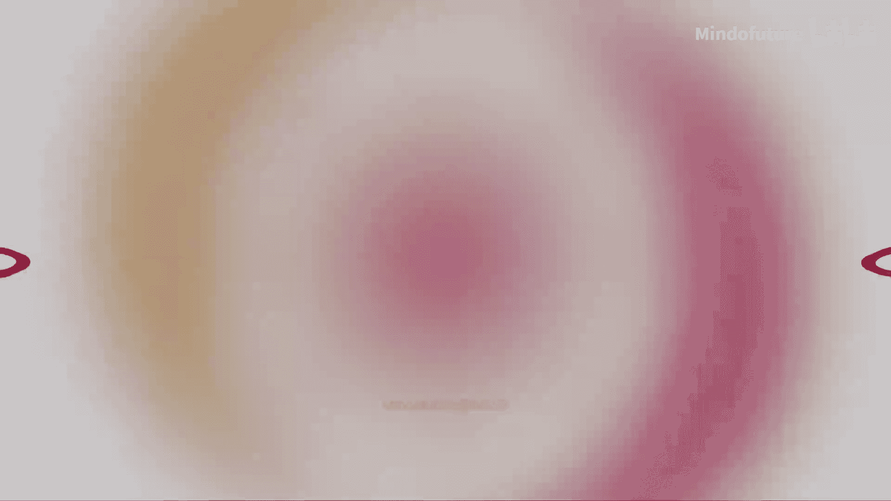
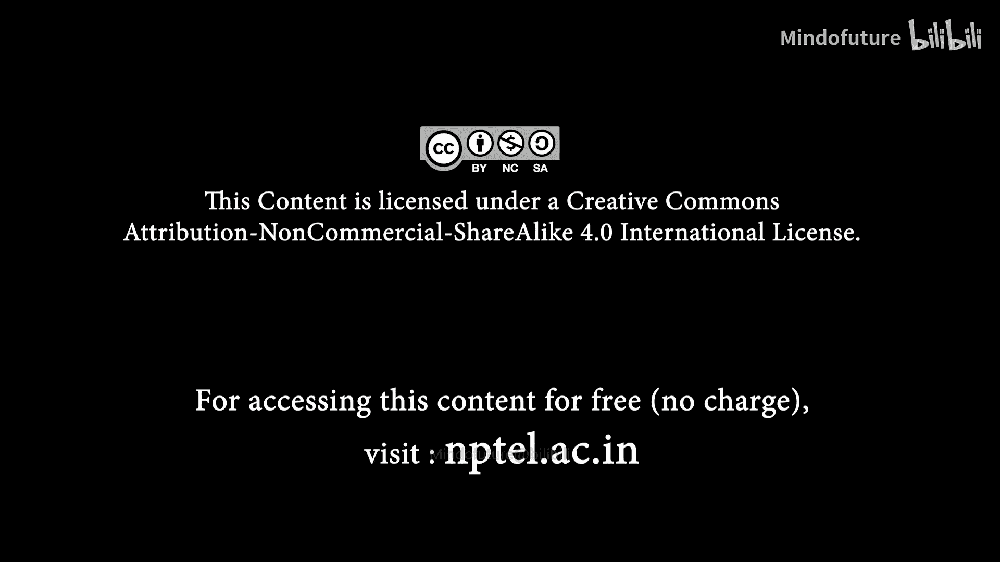
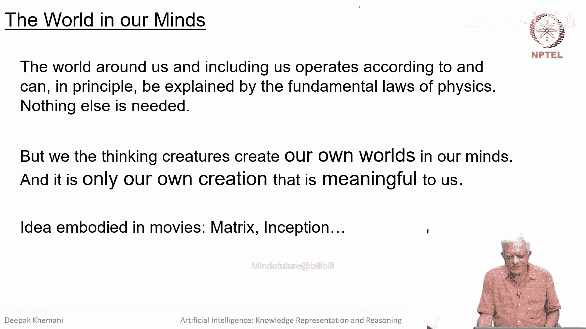

# 【印度理工学院】知识表示与推理 ｜ Knowledge Representation And Reasoning p05 P05_1.5-我们所理解的世界 -BV1c4zNBmEyF_p5-

Welcome back。We have everything。That for an agent to be intelligent。

 one of the things it needs to do。Is still。Create a model。Of the world。It is operating it。

All the domain that it is operating in。And reason with over that model。

So not only must the agent know。What is happening in the world it is。Operating in。

It must be able to make inferences from what it gets to know essentially。So。

 we discussed about inferences a little bit， we saw that there are three kinds of inferences essentially。

😊，Deduction， abduction and induction。We also mentioned that most of the time in this course。

 we will be looking at deduction because that is something which is closer to logic。

The other ones are kind of closer to， let's say， psychology。And things like that。

But we haven not yet spoken about the representation aspect because when we want to represent the world around us。

😊，How do we do that？So we will start by looking at how humans。Represent the world。Around us。

And then take cues from there to see how we can make a machine represent the world。

Allowlong us because in the end， whatever the machine is doing is for our benefit so whatever it is representing。

Must be understandable to us as well， essentially。So， let's look at that a little bit。

Our notion of the world around us and this is the Western thought that we are following here。

We pick it up。In medieval Europe。Which started。Wch by adapting the Greek ideas。

 so the Christian adaptation of the Greek ideas created a worldview in medieval Europe。😊。

And those ideas came from Plato。He said。Ne。The creator's ideas are the perfect ideas in some sense。

 they represent perfectness in some sense。And both our ideas。

 human ideas and the real world that we live in is a corruptible materialization of God's ideas essentially。

So， plato， we often。Asssoociate with ideal that in the sense that。Something which is。Abo。

Everyday human activity。 So when you say， for example。Platonic love。We basically mean。That。

 at some level。Which is。Not。Like romantic or sexual。Or you know mall。Down to earth characteristic。

 pronnic love is kind of pure essentially。And that is because Plato used to talk about these ideas of the creator's ideas or God's ideas which are。

Which are kind of。Perfect and that what we do and what we think are basically in some sense imperfect approximations of those ideas。

So， our thoughts are true to the extent that they are accurate copies of God's ideas；

 that was a platonic view。But his disciple， Aristotle， had other ideas。He said。

That human ideas are basically a reflection of。What we see in the world so when you think of an apple or when you think of a dog or when you think of a tree or when you conceptualize a dog or an apple or a tree。

😊，We are， essentially。Seeing things as we see them so our thoughts are a reflection of what is out there in the world。

So， they resemble the objects that they stand for essentially， so our thoughts are also like that。

So in this is called the correspondence theory of truth。And one of the well known philosophers。

 Ludwig withtgenstein had this picture theory of language， it said that you know， words and language。

 they are like represent pictures of what you are seeing out there。Of course。

 this is not a detailed accurate description， but that is a basic idea that what you are talking about and what you see is about what is。

Out there。So， in that view about the world is as we see it to be。😊，The earth was flat。

Because we see it to be flat and at the center of the universe because we imagine that the earth is stationary and it is the skies which are going around the earth。

With god's heavens rotating around it。The hypothesis that time was or the theory of matter was。

That there are five things that everything is made up of or five elements。

 so one isquint essence which is what heavens are made of。😊。

Which is kind of permanent and not destroyable and the other stuff is made up of fire， air。

 water and earth。 So the way we have written them here in this slide is in the。In some sense。

Order of density so fire is the least dense air and then water and then earth。And then。

They are kind of jumbled upon earth and striving to separate and go to their rightful place。

 So everything that we think of vote， for example。Has a little bit of air。 It has a little bit of。😊。

Fi in it and so on and so it is lighter than water and if you put a block of wood in the water it will float and you can burn it and then the fire will escape from it So those kind of ideas have been popular in the ancient world not only in Europe but elsewhere。

On， on earth is will。So， our notion of earth was that it is stationary。

And the sun and the skies are going around it。 So， for example。

When the sun is setting as seen here then you know the sky turns red and everything becomes like that and then the sun goes down so it means in some sense it goes down below the earth so we don't get any light and everything turns dark and then there is sunrise everything starts turning red all over again。

And of course， during the day。The sun is high up in the sky and there is light essentially so that was our view of the world essentially so here is small animation that I made。

😊，To kind of reflect this view。And so we have these heavens going around the earth。

 the earth is stationary in the center。No。In those times。

Astronomy was the most advanced of empirical sciences。

Because people needed astronomy because of the fact that they。Were exploring the world。

 and it is the stars， which guide。The sealors， for example。And so you know that for example。

 the node star or the pole star is always fixed in one place so if you can identify the the poll star。

Then you know which direction is north and then of course， you can plan your movement essentially。

The problem。With that was。That the motion of planets was difficult to explain if earth is at the center of the universe。

😊，And the。Leest of the skies and the heavens and the stars and the planets。

 they are all going around Earth。Then it was become becoming difficult to explain the zigzag motion of planets because。

😊，If you were to plot the motion of planets with respect to the rest of the stars they sometimes go along with the stars。

 sometimes they go in the reverse direction， sometimes they go forward again。

 but that motion was difficult to explain so people did explain it by you know imagining that there is a。

嗯。Circular。Gear like thing， and。Outside there are gears which are also rotating so that limb of that gear will sometimes appear to go backwards and sometimes forward so they created models like that and there are physical models of the solar system for example with the earth at the center and you can see how the other planets are behaving。

So， so much so that King aphonso of Spain and this was in the 13th century。

He said that if God had consulted me while creating the universe， he would have received good advice。

 You know， this whole business of trying to figure out how planets are。Moving。Purs hard to。

Deal with essentially。 And it happened because of our natural assumption that。

What we see is what is out there， we see the earth。We see it is flat。

 we see the sun rising in the east and setting in the west。

 we see the stars rising rising in the night so this whole picture was there it is only that the planets could not be。

Explain away easily essentially， why did they have this zigzag motion？

Then I first came a long case came Nicholas Copernics。Much later， as you can see in the 16th century。

 he said。That what you see out there is。What is not really there。

He said that the earth is not the center of the universe。But as far as we are concerned。

 the sun is at the center。The sun is at the center and all the planets are going around sun essentially。

So， this is what he wrote in this book call on the revolutions of the celestial spears。

So what Copernicus did？Was to。Tll us。That what we see or what we think we see is different from what really there is essentially。

So， in some sense， he said that we have our mind in which we see things。

 but unlike the correspondent theory of truth。The mind does not capture the truth as it is。

 the mind has its own way of seeing things which is not necessarily the same as how the things really are essentially。

So that' is where the idea of the mind came and then。

There were other people who followed up with that Galileo and Descartes and so on and we will talk about them a little bit later when we talk about symbols and how how we。

Asssoociate symbols with thought， but for the moment we want to just you know do a kind of a quick overview of。

How this all came about。So， next we want to ask。Okay。

 so we want to create a model of the universe in our heads。

Because that is what we say that an intelligent agent must do。

 you must have models of your universe or the earth or the domain or the world in your head。

And then you should。Reason about those models and therefore you will be able to act intelligently。

But what is really out there essentially so if you think about the universe and you think what is there out there。

 what is the objective reality。That is something that。In a way we are still grappling with。

But one thing is clear。😊，That everything in the physical world is made up of some small number of fundamental particles。

 the basic particles are a small number and the way they combine together they form other elements and things like that。

 so we have metals and other kind of elements but。Inside them are a small number of particles。

 so there was a time。When we used to think that the fundamental particles are the proton and the neuro new neutron and the electron。

 but then people realize that they are themselves made up of smaller particles so in fact we don't even know what are the fundamental particles out of which the universe is being created。

But whatever they are we we know that there are some fundamental particles and the world is made up of that unless of course there are no fundamental particles。

😊，In which case， everything is energy。And that kind of corresponds to a theory called idealism。

 which is a theory which is opposed to materialism。

 so materialism says that everything is matter ideal idealism says that everything is ideas essentially。

In any case， we assume that the reality is composed of。Some fundamental particles。

 so let's make the assumption。The laws of physics that explain the behavior of these particles are sufficient to explain the behavior of the ensembles of such particles。

So maybe laws of physics are enough to understand the world。

And thats what the people who work in physics are trying to do all the time。

But if we want to reason as individuals， we want to reason about the。Our environment。We。

When you think of human beings， because most of the time our reasoning is about human beings。

 so we say Socrates is a man， Socrates is mortal and that kind of stuff。

But a human being is physically made up of about 10 days to 27 atoms and it is not that these atom are constant they keep changing it so it is like a city in which you know people come and people go but the city remains so in that sense the human body remains atoms come and atoms go but。

Some hope we have this。Entity or existence of。The human body。

These 10 to 27 atoms continuously interact with zillions of surrounding atoms all the time。

This happens because of the air we bleed， the food we eat。

 the vibrations of air mal molecules in when we hear sounds。The light that falls upon us。

 even though light doesn not have mass， I mean， they say that light has photons of momentum。

Can we even hope to write down the equations for these and solve them if you want to understand why a particular human is behaving in a particular way？

And what would we get if it did solve them essentially a prediction of sale location？And movement。

Remember that there are 10 or of 27 of them this 10 or of 27 is not a number to tri with just try to imagine how big that number is essentially so100 is 3 zeros a million is 6 zeros a billion is 9 zeros or 12 zeros depending depending on whether you are an American or you are looking at the European system。

Then we have trillion， then we have zillion。10 ratio 27 is bigger than all these numbers。Essentially。

 and it's really a tremendous number。There is no way we can manage 10 list to 27 bits of information about the different attempts in our body that doesnt make sense。

At all。So we create the world in our minds， essentially。

We create our own representations of the world， so physically。

Everything is an ensemble of atoms and molecules and cells and tissues and whatever it is。

 but we don't look at the world at that level。At all。So， as we said， the world around us。

 including us operates according to in principle。Be explained by fundamental laws of physics。

 but who wants to solve generate to 27 different equations？We。Are thinking creatures。

Because we create our own worlds。Are we as thinking creatures create？Our own worlds， in our minds。

And it is。Only our creation that is meaningful to us。So。

 when I look at you I say I can see another human being。😊。

Then I am not thinking of the 10 to 27 models are atoms that you are made up of。

I am think of you as an entity in my mind。A human being is an entity and I want to think about humans。

 so I want to you know talk about Sur Suta and Jack and Mary and so on as people essentially。

So we create that impression。When we look at clouds， we think of it as a cloud essentially。

 though in reality。The cloud is made up of condensed water molecules。And。

Even if you see the cloud as stationary， it could be that the air is moving through them。

And the molecules are condensing at that time， and then。Eopating again this could happen。

 for example， on a on a rid or on a mountaintop essentially where the cloud seems to be stationary。

 but actually the water molecules are moving。So we like to think in terms of our。Own creations。

This was the ideas that was。Embbodied in films like metrics and inception。

 So a lot of science fiction ideas。嗯。Draw upon what we know about the world and what we think the world is like。

 So if you have not seen metrics。It's a film in which the main character knew。

He is actually a prisoner of the robots and the robots are using him and other human beings too。

Generate energy to。Power there。Whole enterprise essentially and all these people are like there is a battery of cells and the cells are human beings。

😊，Generating power for them but。Neo thinks that he is a software engineer in New York。

 so in his mind he is in New York essentially and doing things away so the whole whole whole story about metrics。

Is that how。He kind of extriates himself from that。State of being a prisoner of the robots。

But the idea that I wanted to talk about was that。What metrics showed and this were also something similar what was shown in the film called inception essentially in which you know you just change the world in which you are operating somehow somebody else does it for you。

 you are sleeping and then you are taken into another world kind of thing essentially。So。

 the whole point。That I want to emphasize here is that。

We live in the world that our minds create for us， essentially。And of course。

 we we never have a doubt that we are living in the physical world that we are living in。Because in。

Practice that is what we are doing It just that the physical world we perceive as the way。😊。

Our mind perceives it whereas in reality。😊，Its just a large collection of atoms， you know。

 behaving in some particular ways for some reason。These 10 of 27 atoms stick together all the time so when a human being goes from one place to another all these 10 of 27 atoms go together so that is happening。

But we don't think of the world in terms of that we we think of the world in terms of how we perceive the world essentially and how we perceive the world is how our mind perceives the world。

Just think about that。And we will come back to this and look at this again from a maybe slightly different perspective。

And that will also give us some clue as to how do we want to represent the world？

For our intelligent agents。Which will。Do useful things for us。And you know。

 which includes things like modeling the world and reasoning。So we will come back and look at that。

