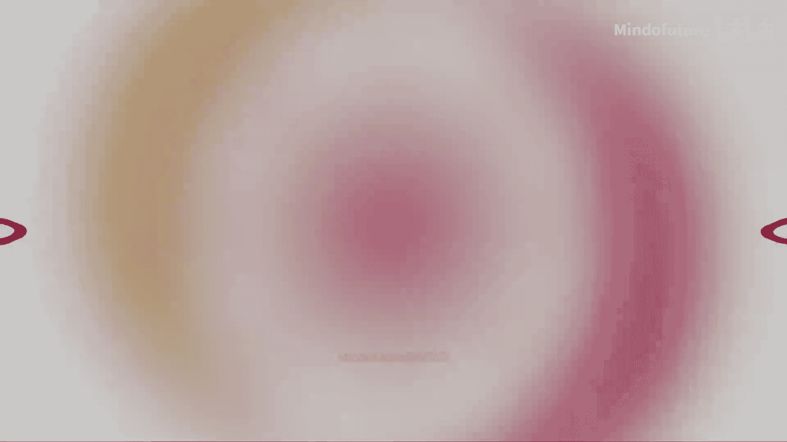
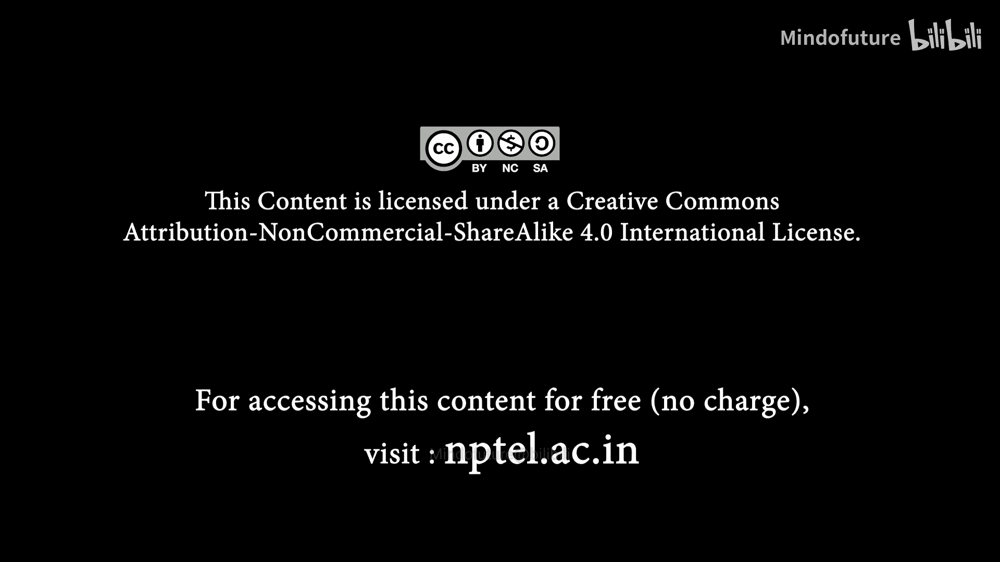
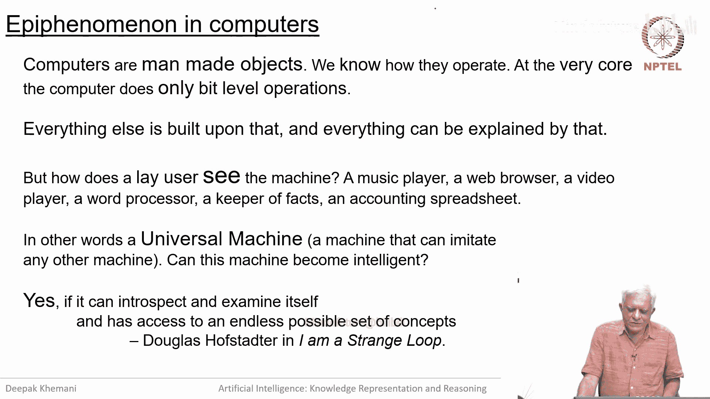

# 【印度理工学院】知识表示与推理 ｜ Knowledge Representation And Reasoning p06 P06_1.6-从粒子到概念 -BV1c4zNBmEyF_p6-

Welcome back。So we have been talking about ideas and minds。

And perception and the world that we live in。And we have been saying。That in our mind。

We have a way of looking at the world that we live in。

And that is what kind of constitutes or influences our thinking or our thoughts essentially。

So let me draw your attention to this nice film。It' is a film called Powerows of Ten0 by Charles Henry Eames。

What they have done is that they have taken pictures and magnified them 10 times so you zoom in then you zoom in and then you zoom in again and then you can see things at different levels of scale essentially。

And it is a fascinating film， you can even see it as a slideshow。

On one of these sites and it was even published as a book essentially so you could you know go through the pages and see that how when you focus on one。

100th of a scene。 So you have a scene。Then you。Sca it down by 10 so 10 this way 10 that so it will become 100 and how the world changes how we see the world changes essentially。

So let's say we start with1 meter。1 me is something typically which is well within our scope of perception we can you know look at things which are1 meter so for example this table here on which my machine is kept is about one and a half meters or something like that so you know I can imagine things like that so a typical door or table。

The height of a child is 1 meter。Then if you look at things。As a scale of 10 meters。

Then you can see that you know， there are things like a roads， a small house or a tree essentially。

Hundred meters。A 10 is2 meters so you can think of a sprint track， a meadow， a pond or a skyscraper。

1 kmeter。10 minutes to3 meters。The longest span of the Golden Gate Bridge。In San Francisco。

10 kilometers。Typically the diameter of a large village or a small town。H00 kilometers。

10 minutes to 5 meters。Around the distance from Mandi to Manalli in Himmael Paris。1enius to 6 meters。

Thous0 kilometers， the distance from Chennai to punne， for example。Here is 1190 kilometers。

10 raise is 7 meters。Roughly the diameter of earth so 10 times the distance from Chennai to pune roughly speaking。

Tens to 8 meters so we use it term megameterters， not very common。In in popular language。

 but you mega means。Then news is2。6， so you know when， when。

When you buy a camera which is 20 megapixel camera， you know that it is 20 million pixels。So。

 the diameter of Jupiter which is about 1 times the more than 10 times the diameter of Earth。

 10 ways to 11 meters distance from Earth to sun， then distance from Saturn to sun。

 then the diameter of the solar system， then the diameter of the Milky Way。

 then a cluster of galaxies。That's call a yota meter， 10 race 24 meters。The visible universe。

 about 10 billion light years across。嗯。So， as we go。😊，As we zoom out。We can see。

More and more of the universe。And so on， essentially。We can also zoom in from 1 m。

 So if you go down to。10 centimeters we can see that you know。

 things like a sunbird or a typical mango or a cell phone。Then。One centimeter or1 millimeter。Yeah。

 I don't have a centimeter there， so one millimeter a mustard seatd。Then as you go zoom in more。

 you can look at Poland。So sometimes you can see poll particles floating in the air。

 I think if there is a beam of sunlight。Then bacterium。

 these are things that we cannot see at this level of scale below smaller than that is the virus than the structure of the DNA。

 then the carbon atoms outer shell， then the electron cloud， then the carbon nucleus， then a proton。

 then quarks and gluons and so on。So you can see。Our concepts， the things we talk about they。

Accur at different levels of scale， essentially。But everything in the end is made up of。

A collection of some fundamental particles。Maybe they are quarks， maybe there are gls。

 maybe they are strings， so there is a string theoryry。Our perceptible universe。

What we can see without having to strain ourselves is in the range of poll dust poll grains。

 which sometimes you can see in sunlight。To about1 kilometer。

 so you can see a distance of a few kilometers on a good day。And our thoughts have evolved。😊。

By thinking of objects at occurring at this。Scale of things or this size of things essentially。

The rest of the things that we have understood is because。Of science。 So science has， you know。

 given us insights into things which are much larger than our perception range of perception and。

Much smaller than our range of perception。So， not only is our range of perception bounded by size。

That we can see it think a few meters to maybe a kilometer across。But also。喂。

What kind of signals we can process so we can see。In only the visible spectrum where we can see the colors and so we cannot see things which are in infrvert or ultraviolet and things like that likewise for sounds we have。

A range of frequencies we can listen to So our experience of the world is kind of bounded by certain things。

Which means that our thoughts must have been influenced by what we can perceive essentially。

But of course， science allows us to。Imagine other things。

Each level of each at each scale at each level of magnification。

There are concepts which have evolved essentially so if you look at these various professions which you know modern day humans work in starting with subatomic particles to chemistry to cellular biology。

 to biology， to psychology， economics， geography， astrophysics， astronomic， cosmology。

Each field of study。Has evolved a vocabulary。To talk about things at that level of scale。

 essentially。So this tells us。That the way that we represent things should is influenced by what we want to do。

 is what is the kind of reasoning we want to do and we always represent things at an appropriate level of skill。

Now， there is a question which is。😊，Bothed many people over the last few centuries is that if the mind is different from the body and if thought thinking and and matter are totally kind of。

Disconnected from each other， how does how do they interact essentially that was a question which。

It was askedav Descarte when he said that the mind is different and the body is different。

How does a thought control our action so if I decide to raise my hand when I am thinking of raising my hand how did my hand which is a physical entity actually get get raised essentially so that is a conundrum which。

People have faced for a long time。Douglas officer in his book I am a St loop。

 which is a book I have been recommending quite a bit。

He says that we operate with the concepts at our perceptible level。

 our thoughts at this level cause the lower level activity that results in the action so there is what he calls a downward causalty。

😊，That from the level that we think at。To generating the。

Nerve signals which will make my hand go up like this。

Is a process which he calls a downward causalty essentially。

So he talks about epi phenomenon in computers， essentially。Computers are manmade objects。

We know how they operate。At the very cold the computer does only bit level operations we know that computers operate with zeros and ones。

And everything else is built upon that essentially everything else is built upon that and everything can be explained by what is happening at that activity。

At the level of zeros and one。 So if you have looked at a computer organization and if you are looked at。

 for example。Assembly level programming and and if you to get machine code。

 you know that everything is happening at the level of zeros in one。But of course。

 we don't like to see things at that level。How does a common user think of the machine？

They don't even of course think about how it operates。

 they think of it as a music player or a web browser or a video player or a word processor。

Or the keeper of facts。Or an accountant。Accounting spreadsheet。 So we tend to see the machines in。

From different perspectives。This has been called a universal machine by quite a few people that the computer is a universal machine。

 it is a machine that can imitate any other machine。It can become a music player。

 it can become a cinema projector， whatever you want， it can become essentially。

The question that we often want to ask is can this machine become intelligent？

So Hofter says that yes。It can become intelligent。If it can introspect and examine itself。

And that is where the title of his book comes from。

 I am a strange loop that you know I create this notion of I。

And this notion of I can look at myself or look at my own。Being。

So it's a self differentialential in this thing。And that has caused problems we will see a little bit later in this course that how if you were to dev logics which allow self reference。

 then they can you know create these kind of conundrums essentially。

We will do that when we look at logics later。Hosler says that if a machine can introspect and examine itself and it has access to an endless possible set of concepts that you can represent different things。

Then。You can make a machine。That is intelligent。Now， that has always been a problem。

 essentially in the sense。Can machines ever think can they be intelligent so that is the issue which has been debated hotly over the years。

呃， even now呃。For example。People have argued that that what computers can do。Is not。

Original thinking they are not intelligent in the sense that they for example they may be able to learn a lot of things from a lot of data and kind of you know throw it back at us。

 but that doesn' not mean that they are thinking machines essentially。No。

There are people who have also argued whether intelligence can occur outside the human brain essentially。

So Roger Penrose， the Nobel Prize winning。Mathematical。Physicist was one of them。

 He said that there's something going on in brain in our brains that。Is necessary for intelligence。

 but he said that we don't know what is that is going on。 so that's kind of a little bit of a。

Conundrum in itself。So people， other people have argued that can intelligence。阿哥。

Outside a context that we are living in this world so we are contextualized by this world and our intelligence is displayed in the manner in which we react to this world。

Can we talk about an intelligence without a context as to can we say that this is an AI？

And then not specify。As to in what domain is it？Active， and what is it doing essentially。

These are questions which are not the primary questions that we are here to investigate。

But we are here to investigate。That can we build machines。Wch will be intelligent enough。

To model the environment that they are operating in。

To reason about what they know about the environment。To make inferences。To make plans。

And to monitor their plans。And in that sense， act in an autonomous way。

Which we may or may not want to call intelligent。See that that is a question of。Definition。

 whether it is intelligent or not。So we are not going to ask to try to investigate that question we are going to try to see our goal at this moment is to in this course is to see how can we represent how can。

An intelligent agent represents the world it is operating in。And reason with that essentially。

We are not even talking about imagining。What will happen if you do certain things。

 whatever the set of actions is available to you？I do teach that in a different course， I think。

So we'll come back and。

Talk about representation。