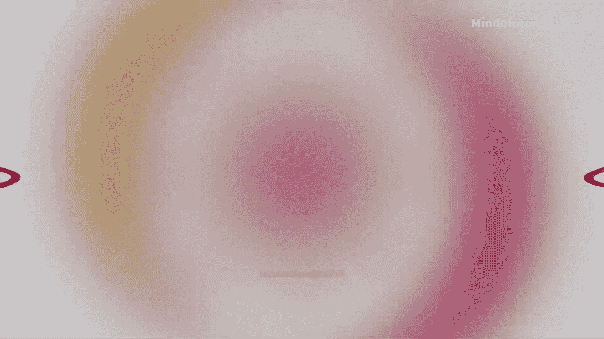
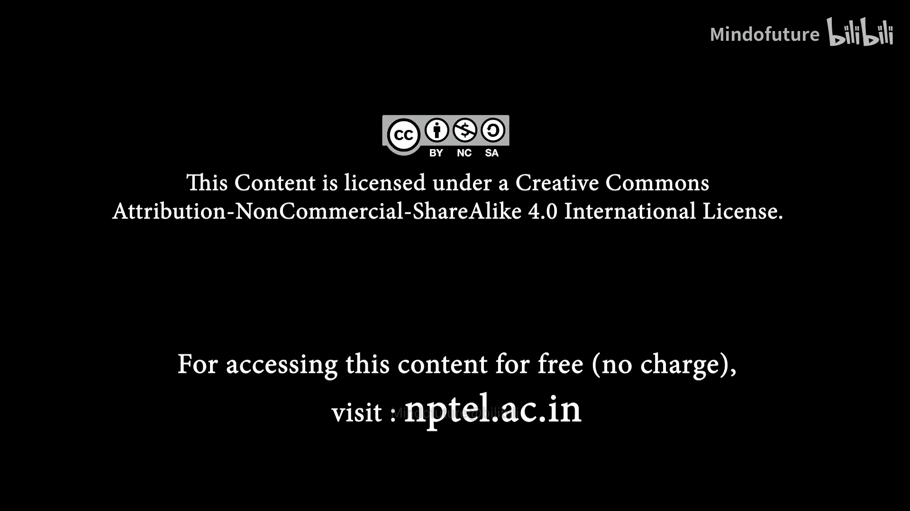
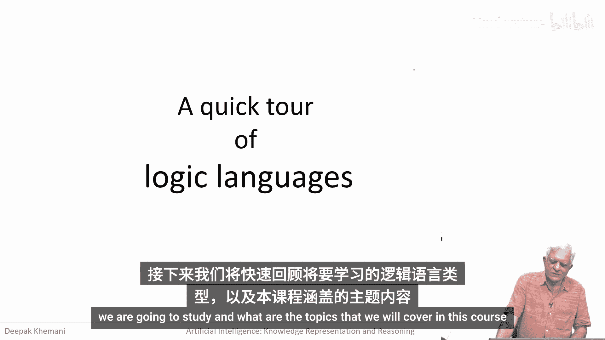

# 【印度理工学院】知识表示与推理 ｜ Knowledge Representation And Reasoning p08 P08_1.8-表示中的层次结构 -BV1c4zNBmEyF_p8-

So welcome back。We have been talking about representation。

And we have been trying to grapple with this problem。

That while the universe is made up of fundamental particles。

 whether we are talking about galaxies or whether we are talking about forests or whether we are talking about human beings or whether we are talking about bacteria or viruses at they all occur at different levels of scale but fundamentally they are made up of some fundamental particles and obviously we don't want to represent them at that level of。

Detailed， let us say。So， we want to represent things at some level which is comprehensible to us and meaningful to us。

And then we also saw that if we talk about。Complex entities。Like human beings， who have a。

Different parts， so you have eyes and you have a nose and you have a mouth。

 you have two ears and you have two arms and two hands and this kind of stuff。

 how do we represent these kind of things？That these are things which are made up of parts essentially。

 so there is this idea。That we will have certain kinds of individuals。And they would be made up of。

Components or constituents or parts as you want to see。So。

 it is the same idea that you know in the world everything is in of some fundamental particles and everything is kind of put together to the say。

😊，But， we will see that。We cannot get away from the fact。

That complex entities will have simpler parts to them and we will need to represent this part of relation at some level essentially。

So， we will need to。Reason about。Aggregation。Of partss into holes。

And coming back to this question that I raised last time that is Soation is an individual and is。

His hand a separate individual。We will see that we when we talk about representation we want to represent abstract entities so a specific individual is in some sense an abstract entity which is there in our minds。

Even though in reality， it is made up of 10 to 27 different atoms and so on。

But we would like to represent that person as a entity， it is an abstract entity；

 it is not an element of the physical domain that we are operating in。

But it will be an element of the。Conceptual domain that we are operating in and in this。

Conceptual domain。We will have to allow。Entities to have parts and relations between them。So。

 that is what we mean by aggregation。The individuals in our cognitive models are not the individual elements in the domain which are elementary particles we have been seeing that over and over again。

Instead， we invent our own concepts in our heads。People， trees， dogs， nations， organizations。

 football teams， governments， rivers， parks， shopping malls， shops， cars， trains， bicycles， cake。

Bread cities， galaxies， protein molecules。We invent this。Things that in our mind。Of course。

 this invention is meaningful because for some reason those collection of attempts do tend to stick together。

But。We create them in the sense that we create them in the way we look at the world essentially。

We also think of concepts like length and color essentially。Now what。What is length。

 what is color I mean are these individuals in some domain。

But we will see that it makes sense for us to。Think of these as abstract individuals。

That we can say that the length of an object is something that is represented in the world。

So that we can compare them。 So you can say that。The mango tree is taller than the。Apple  tree。

 essentially。So， we can make such kind of comparison。

 so it would make sense for us to create abstract individuals for things like length and color。

If I say that the rose is red。What is this rate essentially so we will think of it as an abstracting individual and get away with that。

So， when we say that the row is red， then we mean that an individual rose is red when we say that violets are blue。

 we mean categories that this whole。Bunch of violets or all violets are blue。

We also want to reason about time and events and actions， you know， people doing things。

 events happening， time going by change happening。That will be necessary for representation。

And as I said。We also think of entities like air and water and sky。

But it is not clear whether these are individuals， we can think of them as individuals in the domain。

Or even categories in the domain so what does it sort of mean to say that I have a glass of water in my hand？

So it's not like there is an object in my glass essentially。Because if I take a few sips。

 I would still say I have a glass of poter in my hand recently So those are some of the difficult things that if you want to represent。

We have to contend with。This aggregation。😊，Can be seen。As one form of hierarchy。

In structured knowledge。So。We will see that there are two kinds of hierarchies。

 one kind of hierarchy。Is the aggregation hierarchy which。

In my slidelate is going from the bottom left to the top right。

The other kind of hierarchy is an abstraction hierarchy which in my slides is going from the bottom right to the top left so these are two different kinds of hierarchies。

Aggregation hierarchies。I have key。Wch tell you how different components come together to form a larger abstract entity。

But of course it is not abstract in the sense it has a physical manifestation， essentially。So。

 for example， if you look at these。Elements in my domain。N。They all come together。To form。

A more complex。Enity in my domain。 So think of a car， for example， a car has a steering wheel。

 it has got wheels， it has a bonnet， its got seeds and all kinds of stuff。

So things can come together。To form larger entities。Those things themselves would have been。

Fed by something even smaller。 but of course， we have as as reasoners。

We have to choose as to what level we start with and what is the level where we represent things so we cant go down all the way back。

To the fundamental part particles， we don't。Have the computational capability to do that。

 So well have to cut off things at some level and say we can't。

Break down things any further than that。And listening。So。So， this is an。

Agggregated entity it can again come together with other aggregated entities to form maybe some other particle essentially some other entity so this is the aggregation hierarchy in which things are made up of parts essentially。

The other hierarchy， which is kind of autogonal to this is the abstraction hierarchy。😊。

So in the abstract here key we see。😊，That all these elements they belong to the same category。

 so for example all these are cats or all these are trees or whatever the case may be。

They are all in the category and that category we may want to represent。S。

An individual at some abstract level essentially， So this is cats。And so this could be cats。

 for example。And this other one could be， let's say， dogs。And other things。 And then。They are all。

Kind of mammals。So， there is this abstractstruction hierarchy。

 the abstraction hierarchy is characterized as by。😊，The statement is a so a cat is a mammal。

 A dog is a mammal and so on and so forth。 So we can go So we have this。

Things which we call as taxonomies。The aggregation hierarchy is characterized by is a part of essentially so a steering wheel is a part of a car a horn is a part of a car。

😊，A gear box is a part of a car。So this is the part of our aggregation hierarchy。So。

 the real world of course has aggregation in it and the rest of it is in some sense an imagined world essentially so when we talk about cats。

😊，As an abstract entity or a class or a category， what we are saying is that yes， it is something。

It is a concept or a category to which all these individuals belong to。

And it is not just all these individuals so we can say cats and dogs and mammals so concepts can belong to other concepts also essentially so this is a hi is。

Kind of an imagined world for us， the real world。Is if you want to call it physical in nature。

 but it can be cyber。In the cyber world also， it can be something which we can call as real。

So here's an example from one of my。Favorite domains。Which is a team of bridge players。

And this particular set of six bridge players， they were。Kind of world champions for many years。

In the 1960s and around that time。So Ba Avalli Gerrozo4，batici and Di Alo。They were known as the。

Blue team essentially they won many championships。 So if you know a little bit about bridge。

 which you should。You know that。There are partnerships in bridge so there are three pairs in this team in the blue team so beard donno I released one pair Gaazer Fo is another pair and so on and。

So there is aggregation going on here from individuals。To pairs and from pairs。Two teams。

 essentially。But also there is abstraction going on essentially so for example all these are human rich players and human rich players are sports people and sports people are humans so this is a relation。

😊，Carries forward what they think。And of course。You can have abstract entities which are like a bridge pairs or a bridge team。

 which of which， for example， the blue team is an instance of the bridge team essentially。So。

 knowledge representation is going to operate。诶。This different levels of scale it will need to operate it will need to include aggregation hierarchies as well as abstraction hierarchies。

If you are to do meaningful things with what we know。So， we will have to go beyond。

Predicates remember that un predicates will discuss this in more formally as we go along。

But we said that things like mortal x are categories。呃。We have to go beyond categories and concepts。

A sentence in a logic is something which is true or false in principle。

 even though we may or may not know whether it is actually true or false。So， for example。

 roses are red， violets are blue。A blade of glass contains information of the entire world。

A butterfly flapping its wings in Brazil can cause a storm in Texas。

A tornado is a word that was used。And。These are sentences。

They can be they are either true or they are false。You may or may not know that。

I have given links to these two particular sentences because there are some interesting stories behind these these things and maybe you can go and have a look at those。

But knowledge of the world goes beyond simple sentences as we have been arguing。

Complex organisms can be described only by collecting a large number of sentences and organizing them into meaningful structures and that is what we have been calling us。

Hierarchies， aggregation and abstraction hierarchies。There is。In particular， if you are going to。

We said that you know， intelligent agents or agents in a situation that you know you can demonstrate your intelligence only when you are in a domain in a particular situation。

And one of the ways that we do this kind of abductive reasoning is because we have situational knowledge that what typically happens in a hospital。

 what happens in a railway station， what happens in a restaurant。And things like that。

 So we need that kind of knowledge and。We will see a little bit later that this is kind of called situational knowledge。

So just look at this fact or observation that Anissa walked into the bookstore。So。

 we are going to be talking about inferences and reasoning， right？So what can we？Infer from this。

 We know that she walked into the bookstore。 What else can you infer from this now， obviously。

You can make some reductions。And we can make some abduction so as I said some time ago in the real world most of the time we are doing abductions。

 you know we are doing guesswork that this is what must be happening。

 this is what has caused this to happen and that kind of stuff。嗯。

But the reduction is still a very strong part of。Our repository。A skill repository。So。

 what can you infer when you know that Anisa walked into the bookstore。

 if you know about bookstores then you know that she will probably browse through some books。

Or maybe she is looking for a specific book。Perhaps she will go to the counter if she finds the book she will go to the counter and pay for it if that is the way the bookstore works。

我。It is possible that she may emerge with a book in hand。

 so that is our typical understanding of what people do when they go into bookstores。But if you knew。

That Ana is the sister of the owner。Then of course。

 you may draw different objectiveduct inferences that maybe she was just passing by and wanted to meet her sister。

Maybe she is going to sit in for the owner for a while， you know， and relieve the person and。

For a while。Maybe she is also looking for a specific book， no because。That's what a bookstore has。

But you can make other wild speculation like abductions。

 maybe she had a gun and she wants to rob the stove essentially this would be true， of course。

 if you lived in a country。Where it is common， too。Kigans。So we are talking about aggregation。

 abstraction and。Structured knowledge， essentially。How does one represent knowledge about bookstores。

 all about restaurants， all about dental clinics and things like that？

We have already hinted that this will be done by putting together different kinds of sentences which this will describe those entities。

In some sense， we collect and organize individual bits of facts about the typical knowledge about these entities essentially。

These will be aggregated representations。Roger Shank who was at Yale University who did a lot of work in this area。

 he called such structures as scripts so it is a bit like a movie script you know it is decided。

Especially if you are familiar with Bollywood。Then this is the hero， this is the hero。

 this is the villain and。It's a very。Well beaten script。Marvin Minsky， who was at MIT。

 also explored this idea of structured knowledge together and he called them frames essentially。

We will look at frames and scripts。Though， not in too much detail， but we will look at them。

And this idea of frames。Eventually gave rise to this idea of objectiveiented programming systems。

 So if you have done objectiveient programming， you would know that you talk about classes and you know they can then of course you for example。

 you can。Talk about a car and then the representations middle。The structure from the real world。

 and you can see that that comes from this idea of frames。So。

 there is a story about blind foliage men trying to。Touch an elephant and figure out what it is。

 somebody is touching the tail， somebody is touching the trunk。

 somebody is touching the tusk and so on and so forth。But if they have to make sense of that。

 if they have to come to the conclusion。off。The fact that they are touching an elephant。

If they want to even come to a guess that it is an elephant。To be able to make that guess。

And this is。Throughrue of objectivebductive reasoning。

 you should know about restaurants or bookstores。 if you want to be able to make guesses of what's happening。

 you should know what they are。 So you should know that an elephant is a composite entity it's made up of these parts。

 And then you can say guess okay， maybe Im touching something it looks like a tuk of an elephant。

 So some things may give you better clue。 some things may give you。Weer clue。

But without knowing what an elephant is， you can never guess。What it is。So。

 I mentioned taxonomies on the way， so let's quickly discuss that also。

That you do not want to represent。A large collection of sentences， a large pool of sentences。

 sometimes this is called as a flat structure。That it's just like。

You have all the sentences put together in some container。

An algorithm for making inferences would have to search through the sentences to make the right connections because remember that inference is going to be connections between sentences。

This would。Come at a cost of computational complexity。Instead。

We tend to organize facts into taxonomies。We have already mentioned this in the passing taxonoms facilitate inheritance。

For example。We can state that mammals have two eyes。And this would imply。

That cats have two eyes because we would have represented the fact。That cats are mammals。So。

 they will facilitate this。Property of inheriting。Properties from super classes to subclasss。

A colinrollary of that is that it will facilitate compactness。

We need to only store the property in the superclass。

 we only need to store that mammals have two eyes。And we don't have to store it explicitly for cats and dogs and cheetahs and elephants and so on。

We can inherit that from that， so that will lead to compactness of representation。

And that is also the ideas that came forward in Minskyies。Frames that you can。

Represent things at an at a higher level， and inherit them better。Lower level。

 so inheritance comes with this kind of compactness。Okay， so we will come back。

And do a very quick tour of the kind of logic languages that we are going to study。

And what are the topics that we will cover in this course？

