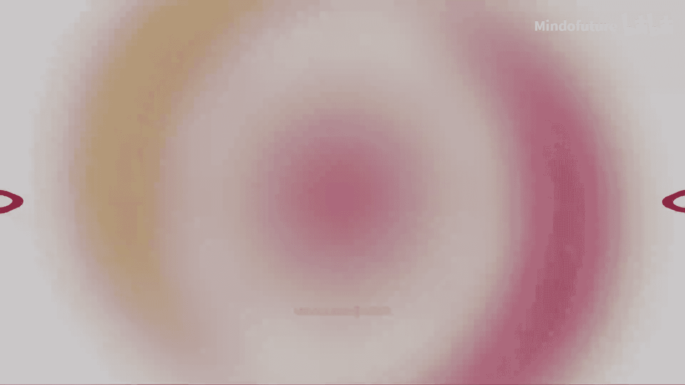
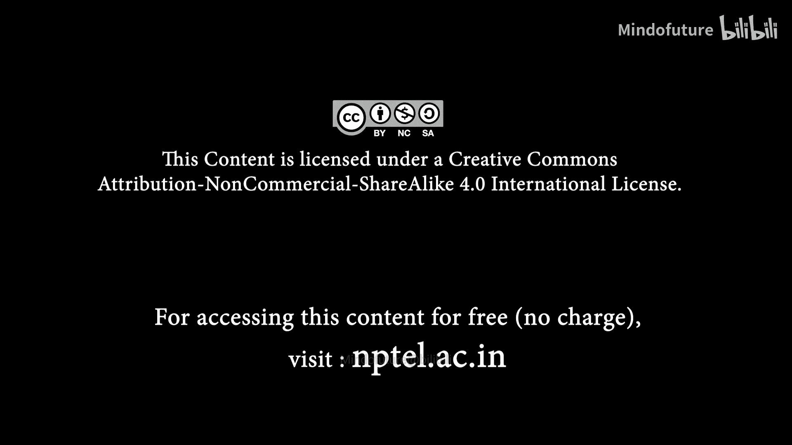
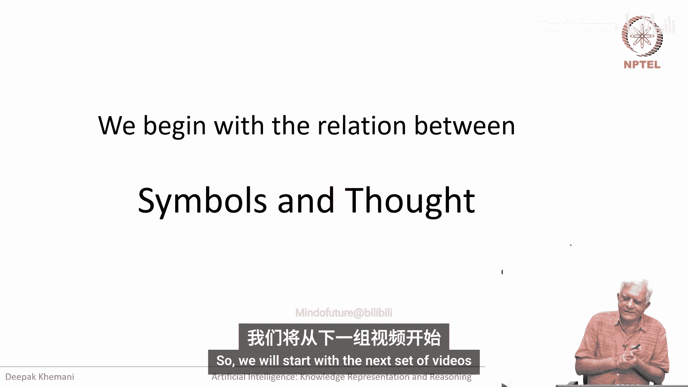

# 【印度理工学院】知识表示与推理 ｜ Knowledge Representation And Reasoning p09 P09_1.9-逻辑与表示快速导览 -BV1c4zNBmEyF_p9-

So we have been talking about knowledge。Representation inferences。Stuctures。Languages。

 logic and so on。Of course， we will study these things in more detail。In this course。So， let us。Doo。

Quick tour of what are the different kind of。Logics that we will look at。Of false。The kind of。

Reasoning that we want to do the main core of our course will be reasoning。

That if you are given some。Yeah。Facts。What can you infer from there。

We will begin with proportional logic， which is the simplest of all languages。

And we would study as to what do we mean by valid arguments？

So in proportional logic also called sential logic。We。Treat sentences as individual entities。

So in these two questions that I have posed here that you should think about。These are the sentences。

The earth is speccle。 If the earth wasphercle， the earth isphercle， we will。

Just treat it as some sentence and give it some symbol。

If it ispherical it casts curved shadows on the moon so there are two sentences here and there is a connection between the first and the second one if the first one is true then the second one will definitely be true。

So， that's one。Pieace of information that is given to you the other one is that the earth is casting curved shadows on the moon。

And then we are drawing the conclusion that it must be spherical。So。

 this is argument if it isphertacle it will cast go outside those on the moon。

It is casting of shadows on the moon。So it must be very good。Is this reasoning sound？

Or valid as we say？Or not， essentially。 So think about that。Here's the second argument。Second。

Problem。He used good bait。😔，And the fish weren't smarter than he， these are two sentences。

If he use good bait and the fish were not smarter than him。

Then he did not go hungry or then he would not go hungry。Then we are saying。He did use good bait。

But he also did go hungry。So can we infer that the fish must be smarter than he was？So。

 logic is concerned with。Trying to decide on the validity of such arguments。The origins of logic。

Both in the West and in India where it was developed to quite an extent。Was。In some sense。

 there is a science of arguments that if people are arguing。

Is there a way of determining who is right and who is wrong， who is correct， whose statement。

 whose conclusion is true？And the goal of logic is to understand valid forms of argument。

 valid patterns of argument。And then see whether given arguments。Follow one of those patterns。

And we will start with professional logic， which is a very simple logic which does not look inside sentences。

And looks at what makes argument valid so we will look at the notion of soundness and completeness。

When we talk about these things。Then we will move on to first alog first alogic introduces the domain so we have been talking about domains now what should be the individuals in the domain and things like that。

When we talk about first a logic， we have to talk about domains。So。

 let's say the domain is a domain of people in the world。And in that。

Snnaario first our logic allows us to make statements like the example giving here。

 all the simplest logic that everyone study starts studying with which said that。All mineral modelal。

So criticism man。Therefore， Socrates is mortal。So， you can see that we are talking about a domain when we say all men。

We are talking about all the individuals in the domain that everybody who is there in the domain Socrates Plato。

Whatever。What are individuals you have？All of them。Our mortal， essentially。So。

 first a logic allows us to talk about domains， about individuals in the domain。

 about relations between individuals and relations between categories so we have seen that essentially。

So in this domain。We are saying that there are four entities we are talking about tinker Taylorer soldiers spy。

You can look at this。 It is one of my favorite novels。No。

Which has a lot of logical reasoning embedded inside there。

So this example is of course not from the novel， but I just use their names。

So this first sentence is saying that one of them is the culprit okay。So。

This is what you can say in first a logic that we are talking about individuals。

And they exist and culprit and the culprit is one of these food individuals。

Then we can say the culprit stole the document。Without knowing who the culprit is we are saying that there is an individual in our domain who stole the document and we have already said that。

One of them， one of these four。People is the。Culprit。These were code names that John Decker。

 the author of the novel， had given to four suspects that he had。

So it's a fascinating story you must go and read it something or watch the film。

Then we also told in this small example that I have created that tinkerance。

Soldier did not steal the document。Obviously， the logical conclusion is then it must be either the soldier or the spy。

But logic allows you to arrive at these conclusions。So Taylor of the pie。

Then we are told that if the tailor or the spy is a culprit。

 we are not told who is a culprit that if one of them is a culprit。

 then the document must be in Paris。All this is given to us。And given these facts。

Can you conclude that the document is in Paris？And first a logic。Allows us to。

Formalize this kind of reasoning and show that here is a proof that the document is in Paris。So。

 we have the notion of variables， variables are some unknown entities in the domain。

 we have the notion of quantifiers so we can say all men， some men one of these， that kind of stuff。

But first order of logic by itself is does not involve time。So。

We we don' not think about this was true at some time this became true at a later time and things like personal logic is changeless。

So， sometimes we say it's mathematical logic essentially because mathematics is changeless essentially so whatever is true in mathematics is true in mathematics。

 it is not that it was true yesterday and it will be true tomorrow。

It's changedless first the logic handles that kind of。Doomains quite easily its a logic of relations。

 you know， predicates capture relations between individuals and so on。Between elements of sets。

 essentially。So that's the next logic that we will look at， which is ver logic。

It turns out that first a logic is computationally very。Expensive。

And very often all its power is not required in the kind of reasoning that you want to do。

And then we will resort to a subset of this logic。A subset of this language。

Which is like a logic of noun phrases that we will only talk about noun phrases so in this small example here。

We are talking about two kinds of companies， a progressive high tech company。And a tech company。

So a tech company is one。All those employees have technical degrees。

 so lets say all techs and the former。Company。A progressive high tech company。

 so that is another description， so description logic allows you to describe such things together。

 describe concepts essentially or categories。So we are definingfin the class of tech companies and the class of progressive tech companies。

The progressive high tech company is one which has at least five women on its board of directors。

And one in which all the employees have technical degrees now which is of course also true of tech companies。

But in the progressive tech company， the minimum salary is 100，000 whatever the units are。

Description logic allows you to very quickly come to conclusions that a progressive high tech company is a tech company。

The kind of things that we talked about earlier that all cats are mammals and so on。

Here we are describing entities。And this logic allows us to。Unearth the relation。

That this is a relation holds between these two entities one is a progressive high tech company and what is a tech company and description logics are very common nowadays because of ontologies which have become very common because of a lot of activity which is going on on the internet。

So we talk about ontologies and things like that。Then I had mentioned。The open world。E。

Assumption in the open world assumption you don't know everything about the world essentially。So。

 a classic example， the standard example of default reasoning is that if somebody tells you that wty is a bird。

Then you can conclude。That treaty can fly。If you don't tell me anything about wty。

Then you can conclude that Twity can apply。And this is called default reasoning that okay。

 I go ahead and make this assumption。😊，If I get to know something else。

 then maybe I will withdraw this assumption。Because， even though。There exist birds， for example。

 penguins and ostriches which cannot fly in general。

 most birds fly and we want to capture this kind of knowledge about birds that。That birds can fly。

 but maybe there are some birds which cannot fly essentially。So it's not universal knowledge。

 it's general knowledge。We want to capture this sort of a thing essentially。So。

 in the real world an intelligent agent has to make inferences even with incomplete information in such scenario one has to make use of what is generally true in a typical situation that if2 tea is a bird。

Then， we can play。Of course， if later on I come and tell you that Twiy is a penguin or that witty is an ostrich or that Twity is dead or that twity is a caged word or。

Pty。Is injured。Whatever there can be a multitude of reasons for which it cannot fly if I give you that more information then you can say okay I take back my conclusion that VT can fly。

And in default reasoning you are allowed to do that。

 you are allowed to make conclusions and then you take them back essentially so I had use the word non monoonic reasoning nonrononic logics。

In this context。That you may add certain conclusions。

 but you may withdraw them little also so it is not necessary。

That your set of conclusions will grow monotonically。

New information may contradict and defeat the conclusion， so we use that the inference is defusible。

Which means it can be defeated。Then we will also talk about event clus because we want to talk about time。

 we want to talk about change， we want to talk about actions。

 the effect of actions on the real world。And things like that which as we say first of the logic is timeless。

 it is you know doesn not allow for change essentially。

When you want to talk about change we are saying something is true at this moment but it may not be true at a later moment。

 or if or if if an agent does certain action it will make certain facts true essentially so all the change and time and action and event should be allowed and that is done in something which we will call as the event calculus so here is an example of that。

Joges made a cup of tea and left it on the table meanwhile Smithha saw the cup of tea and drank it when Joges came back he saw that the cup was empty so you should be able to represent this kind of changing things and you may want to be able to conclude certain things and things like that。

So that' is going to be about event clu。And the last thing that we will study in the course。

I is going to be something called epistemic。Logic。In which agents reason about what other agents know。

So， if we take this joguage story that he made a cup of tea and left andmha came and drank it and he saw that the cup was emptyupping there are these only two peoples。

 two people。In the house at that moment。So you can he can conclude that Mita had polished off his cup of tea。

That comes from event calculus， essentially， in some sense。But。Smeter will know。That Jos knew。

That she drank。The T， this is what epistemic logic。Allows you to do。Sた。

Know something and that knowing something is the fact that Jogeage knows something。

And what the waste knows is the fact thats meta rank the T essentially。So。

 when we look at estimateimate logic， we would represent this as。

A sentence k s which k would be the knowledge operator as we would call it。And。一。D。

That she drank the T， so let us just call that statement as T。

So t stands for the fact that meter rank the t。KJ's T stands for the fact that Joges knows that Smith had drank the tea。

And KS Kj stands for the fact。That's metata nose that Joge nose。That she drank the tea。

This is what we will do towards the end of the course。So， these are the topics that we will look at。

Roughly in the order in which we are going to look at。呃。

You will start by talking about logic and languages and symbols and thought and so on。

We will introduce this notion of soundness and completeness of logics。In which we。

We will say that when is a logic machine useful， essentially it has to be sound。

 which means it has to make only valid arguments。And。

It has been complete that it should be able to make all valid arguments。

Then we will look at a specific logic， which is the proportional logic。

Which I have mentioned a little while ago。And in proportional logic we will look at two proof methods。

Direct proof as to what is the standard way in which everybody learns to prove things。

We will also look at something called the taboo me essentially。

Then we will move on to first a logic which is going to be。The main part of our course， essentially。

We will look at this language， we will look at what we can do in that language。

 what kind of inferences we can do in that language。

We will start by forward chainning which kind of corresponds to direct proof。

We will look at backward training， which is。Also， it like direct proof。

 but we start from the conclusion and then move towards the goal。

Then we will see that those two things are not enough。

And we will look at a method called the resolution Reput method。

And from there we will move to this idea of logic programming， which will say that。

Whatever you can do in any programming language you can do in logic so making inferences subsumes making doing computation。

 whatever computation you can do。You can。Express the whole thing loadly， and we will look at。

To some extent， this language called prologue。Which is a logic programming language it stands for。

Programming in logic， actually the phase comes from French language。

Because one of the inventors of thelogue was from France。

And we will also look at something called the Ra net which is connected to forward chain and doing it efficiently。

Then we will move to representation。And we will talk about reification。

 which we have already talked about a little bit here。

Then we will see at this canonical set of and representations， you know。

 which which is not as diverse and rich as language。But which allows you to do a lot of reasoning。

 We will look at the structured knowledge in the form of frames and scripts。 we look at inheritance。

 We will look at description logic that we mentioned。 We will look at ways of talking about。

Systems which implement。Taxonomies and description logics。

Then we will move on to things which are more powerful than for a logic。

 so default reasoning in particular circumscription is a particular way of doing default reasoning。

And we will look at event carefully that we have just mentioned that， you know。

 which will capture time and change。And even and action， essentially。And as I said。Finally。

 we will discuss epistemic logic， so this is what is going to be in the rest of the course。

And we'll come back。And begin。At a fundamental level。

With the relation between symbols and thought because our fundamental hypothesis。Is going to be。

Is that thinking。Our reasoning， at least is going to be symbolic。That we can do。

Reasoning with representing everything in terms of symbols。

So we will establish this connection and then move on to all the stuff that I spoke about so we will start with the next set of videos。

