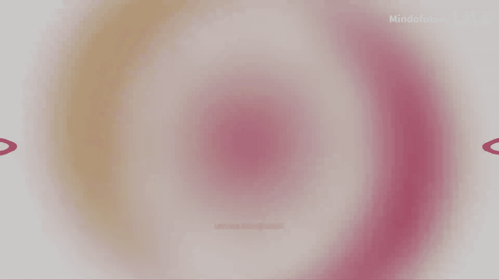
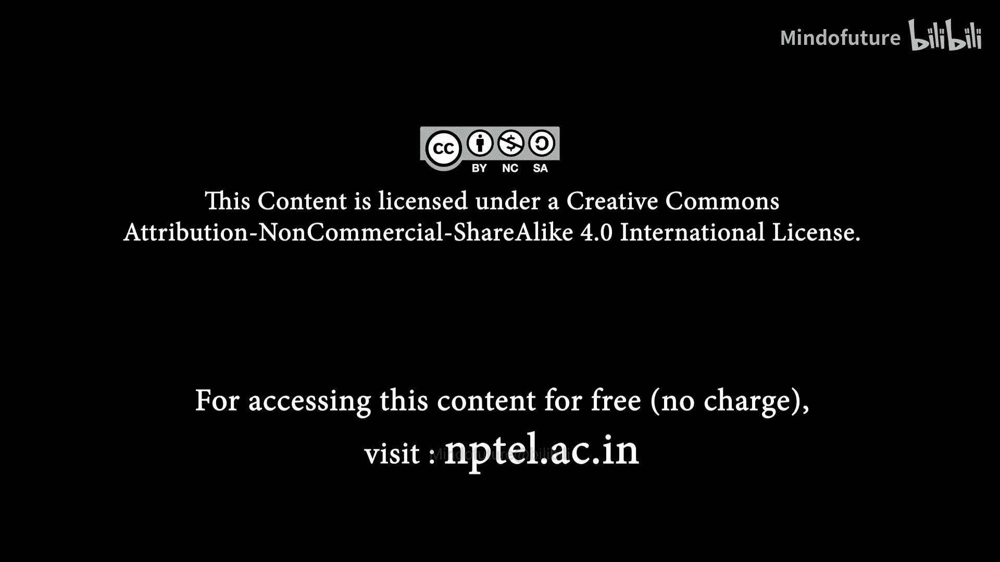
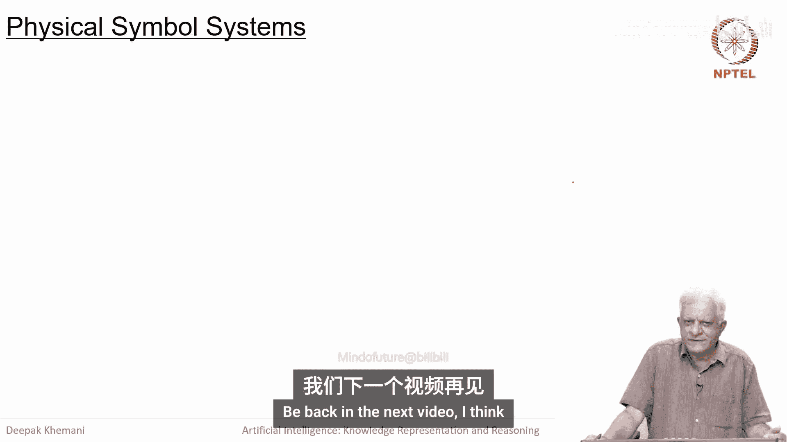

# 【印度理工学院】知识表示与推理 ｜ Knowledge Representation And Reasoning p10 P10_2.1-符号与思维 -BV1c4zNBmEyF_p10-

Okay， so here we are with the main part of the course。

And let's begin with some some very basics as to what is the connection of。😊，Between。

Thinking and symbols， essentially。 Now， that's a question which has been raised。Quite often。

That did thought come first or language come first。Because we often think aloud in words and so on。

So， people have asked whether you know language is necessary for thought or is thought independent of language。

We don't have a clear cut answer obviously yet， I think but there have been for example people like Noam Chomsky who have said that humans are being born with an inherent grammar。

 that we are born with a grammar he called it the universal grammar。

 of course the universal grammar is not for any particular language。Like English or Hindi or Camil。

But it is the basics of a grammar that you know language has a structure and we are born with an inherent capacity to understand structure。

Can you say language， of course。We basically mean symbols and this is what we are going to start with as to how are symbols related to thought？

😊，Now， our first。P。Lectures will be more to do with human mind and human thought because。

This kind of a。Discussion has been going on for a few hundred years much before computers were born。

And then of course we will come to the fact that we want our machines to be thinking machines and what do they need to be thinking machines？

So let's start with that。😊，As discussed in the introduction。

 the main part of this course is to do with knowledge representation and reasoning essentially and we have said。

That this is the core of。Intelligence。Any intelligent agent has to be able to visualize the world or the domain it is operating in。

And it has to be able to imagine。What's happening out there？And not only that。

If you are planning for some activity， you should be able to imagine。

What will happen if you do certain。Things， or if you take a certain course of actions。Okay。

 so of course， if you want to do this kind of imagination and if you want to do this kind of representation。

 then you have to have some way of representing things。😊，In the。Computer。

 and that's what we want to focus on。So， what you want to start with is to say。😊。

That an intelligent agent， what does it know， what does it know about the world。

 its domain and so on。And when we talk about knowledge or saying what what does it know。

 we are concerned with。But we have often call it declarative knowledge。

 knowledge which can be written down in let's say a language like English or something like that。

Not necessarily。😊，With procedural or tacit knowledge。

 because there are other forms of knowledge that we have which are not so easy to capture。

 so you must have heard about classic examples like you know。

How do you know how to ride a bicycle essentially now that is something that is very difficult to express in words essentially or you know how do you swim how do you tie shoelasses all these are examples which have been quoted by many people and so on。

Also， we have。😊，There has been some。嗯。Some thought that you know our knowledge is not necessarily declarative symbolic but we have things like images that we reason think about and reason with and we have you know intuition and the subconscious mind and that sort of stuff that we are not getting into that we are going to focus more on declarative knowledge knowledge which can be written down lets say on a piece of paper。

😊，So， what does an agent know now this is of course true for agents which are not human also。😊，So。

 for example， you know， dogs know things and other animals know things， but what humans。

Are particularly good at。Is。That what do they know？😊，And as a consequence of that。

 what else do they know？So that use you know some things and then you make some inferences and you know some other things also。

 So this kind of reasoning is what we are interested in capturing。In this course， essentially。

 how do you represent what you know？😊，And how do you make use of what you have represented to compute？

Other things which you will know。So we start its representation and。

We are talking about symbolic representations where we have symbols to represent things。And。

 of course， he will realize。That if you are doing anything on a digital computer。

Then you are essentially at the base level representing things at the symbolic level because at the very base the computer is a machine which can distinguish between 0 and 1。

 so there are two symbols one and 0。And everything else is built on top of that。

 including when we are talking about phenomena which are continuous。

 but we always approximate them to be digital and discretized essentially。😊。

When we say that a symbol stands for something else， we should distinguish between。

How things are represented。Inside the neural network， for example， which is very popular nowadays。看看。

So。If you have studied neural networks， you would know。

That neural networks also know things essentially so for example you show them an image and they can label it by saying there is a horse in this image。

 there are clouds in this image， there are trees in this image and things like that so obviously they know that this is there。

😊，But neural networks dont explicitly represent things for that this is a horse and then they don't associate properties with hall and so on and so forth。

 What they represent is。Captured in the weights， which are theirs。In the network， essentially。

 so the network is a large collection of neurons。Wwhichch have interconnections and those connections have weights。

 essentially those weights decide。What information is propagated from one neuron to another。

So somewhere in that is the the neural network knows that， you know。

 this is a horse that this is a man or this is a。3 and so on。

 but it doesn' not explicitly represent that， though there have been claims in recent times that in deep neural networks there will be layers intermediate layers which would represent such things which are part of an image and so on。

 but we are not。Particularly interested in that， we want to work with a system in which you。

Use symbols to represent something。 So a symbol is something。

That stands for something else essentially by itself it may not be meaning。

 but it is the fact that how do we interpret it gives some meaning to that symbol。

And that there is a whole science behind this which is called semiotic or the science of symbols。😊。

And you can see that。We use symbols all the time。For example。The number 7。

And you know that you can write it in different ways essentially so you you may write it for example as number 7 or you may write it in Roman as number7 or you can write it in English。

Which is what I have written in the slide。And there are various other ways you can use any languages so you can represent it in different ways but we are talking about a number called 7。

 what is this number that is a very interesting story that we will come to later because if you think about this mean till we come to that point as to how do you define what our numbers essentially you know what is what is 7 what does it mean essentially？

😊，We will come to that later， but in any case whatever that number7 is the concept of the number we represented in somehow and that is what we mean by symbolic representation。

😊，There are other symbols that we use in our lives so if you are on a road you can see road signs like there is a curve ahead or there is a pedestrian crossing ahead or theres a school ahead or theres a u turn coming up or their are eating places and so on essentially all these are also symbols so the whole study of how symbols are used is the signs of semiotics。

All languages， whether we are talking or whether we are。😊。

Writing our semiotic systems because you know we have symbols and somehow we ascribe meaning to symbols essentially。

How do we ascribe meaning we don't know essentially so I remember for example。

 that when my daughter was four years old she would ask me why is this fan called a fan Why is it not called something else you know it was at that moment beyond our scope of discussion so we let it go but。

The fact is that。We ascribe certain。Names and sounds to certain things and we learn to use so theres a social understanding that this is what we mean when we see a fan essentially。

Now there is also a subfield called biosemiootics in biosemiotics we are talking about biological systems which occur in nature so how complex behavior emerges when simple systems interact with each other through science science essentially。

😊，So at one level you can even say that what is happening in our brains is a biosemitic system because you know one neuron is sending a signal which is a chemical electrical signal to another neuron and somehow you know things thinking emerges out of that。

 but the simpler example is the case of ants that we study very often in AI。😊。

Because there is a well known algorithm called an colony optimization。And。

What we learn there is that an sleep。Little bits of chemical wherever they go， 12 phmon。

And so they leave pheromon trails and ants have a tendency to follow pheromon trails so they if a new if a ant comes out of the nest and it sees some phomemon it will go along that direction usually so that is a form of communication that ants2 and that pheromon becomes kind of a symbol that。

The ant is using other animals also use some markers to mark their territory， for example， and so on。

What is reasoning？😊，By reasoning， we mean the manipulations of symbols in a meaningful manner。

Essentially， of course you have written symbols so that means you can you know write rules to manipulate symbols and so on。

But when you say reasoning， what we mean is that it should be done in a meaningful manner。And maths。

 for example， is rete with algorithms that we use。 So so these are reasoning algorithms。 you can say。

 or these are role for manipulating symbols， as you can say。 So additional multiplication。

 So very early children learn to。😊，Add three digits numbers， for example， you know。

 they learn how to carry over and do all this kind of things。

 So these are the procedures or algorithms that we use and。They are meaningful because， for example。

 if you add 7 to 21， then you will get the。😊，Representation of number 28。

Which is good because if we had seven apples and if we had 21 apples and we put them all in one basket and counted them again。

Then we would have 28 apples and that is what we mean by saying that that mechanism that we have for producing the number 28 from by adding number 7 and number 21 is a meaningful procedure。

😊，Reing is a manipulation of symbols in a meaningful fashion and we are going to be interested in that all throughout this course。

So there are other things we learn in maths， long division， solving systems of linear equations。

 Fourier transforms， the convolution function， and so on。Now， this idea of what symbols is。Quite old。

 and。It can be traced back to the 16th century or even earlier。

In another course that Tatiia start by saying that it was Nicholas Copernicus who kind of drove the wedge between。

Mind and the real world， essentially and。We got the idea that there is something called the mind。

Which sees the world。And。The two are distinct， the external world and the mind is distinct and Copernicus。

Famously told us that。It's not that the sun goes around the earth。

But it said the earth is rotating in our mind we see the sunrise and the sunset and so on。

But what is happening out there is really that。😊，The earth is rotating， essentially。 So Galileo。

 of course， who was one of the famous scientists that we。😊，Have learned a lot from。

He talked about perception。He said that you can taste some some food and you can smell some flowers for example。

 you can see some colors and so on and he say and he says that，I think that tastes， odor。

 colors and so on are no more than mere names so far as the object in which they locate them are concerned so we just say that okay this rose is red。

All this。This cake is sweet， let us say。And so on。But they really reside in our consciousness that it is us we have this sense of it being red or being sweet or being yellow。

😊，These are not con qualities which are associated directly with the。😊。

Objects that we are talking about。They are to do with the way we perceive them okay and the way we represent things and so on and so forth。

 and this is long time ago。In 1623， as you can see， he published this。Fi。He said。

That philosophy are when people said philosophy in those days。😊，They meant everything。

 which includes science and。Maaths and everything， you know， and not to speak of philosophy itself。

 you know。Who am I and。What am I doing on this earth。

 even even more project things like science and math， everything was called philosophers。So。

 he says philosophy is written in this grand book， the universe。😊。

It is written in the language of mathematics。And characters are triangles。

 circles and other geometric figures。He said the geometry could be used to represent。

And reason about motion so we know， of course， you know the laws of motion which learn as school children。

That Galileo invented them。 But you can see that in those days， for example， you might say。嗯呃。

U T plus half 80 squared。Essentially， okay or something like that。

What Galileo was not working with symbols that came later。😊，What he would do is。Theor triangle。And。

One side would be the time。Hello。And the other side would be the velocity， which is a into T。So。

 as time increases velocityloy increases so if it is a system which is accelerating with acceleration a then as as time goes forward the velocityloy keeps increasing and if you look at this area in this triangle then you will see where half 80 squared comes from。

😊，It is basically the area of the triangle。😊，Galileo was reasoning with geometry。

 He did not have algebra to work with that， as I said， came later essentially。

The next person we want to quickly look at is Thomas Hobbs。

Which John Hogel and and this is a book that you can see at the bottom of the slide which I really like。

It was written in 1985 and Hogan said that。What is the idea behind AI。

 what do we want from AI as we discuss in the introduction？

Veryry briefly we said that you know some people say AI is making human thought what what Hogelland said was no it is nothing of the kind we want the original thing a machine which can think essentially。

So， that is a book that I am talking about in that book he is talking about all the history that I I am also talking about here and Thomas Hobbes has often been referred to the grandfather of AI。

And。He said。Their thinking is the manipulation of symbols。That somehow we have symbols in our head。

And we are manipulating those symbols。And that is what thinking is about。So Galileo hadet。😊。

That reality is mathematical in the sense that everything is made up of particles。

 you know a low is made up of particles， of course they do not have this formal notion of the atom at that point。

But they are made up of particles and so on。 and sensing of smell or taste was how we reacted to those particles。

 So， you know， if if if if if the rose is emitting certain。

Molecules and they reach our nose and then we react to those nose and say， oh， what a nice smell。

That's our reaction。 It's not the property of the rose itself。

 The rose is emitted that particle in it is gone。Hobbes extended this notion to say that thought2 was made up of or was expressed in particles which the thinker manipulated。

As you can see， Hobbes was influenced by Galileo。Just as geometry could be represented could represent motion。

 thinking could be done by manipulation of mental symbols as well。 Thats what Hobbes said。

This is a quote from。His book。He says that by reasoning， by reasoning， we mean thinking。

 okay that is how humans think， you know。By reasoning， he says I understand computation。Now。

 one must keep in mind that in those times in the 17th century， a computer was a human being。😊。

Which would sit on a desk with pen and paper。and do calculations mathematical calculations and they were called computers essentially and they did did what is call as computing which was basically mathematics essentially and what Hoes is saying。

😊，Thatby reasoning。I understand computation that means you are doing some kind of mathematics and to compute is to collect the sum of many things added together at the same time or to know the remainder when one thing has been taken from another and so on。

The reason， therefore， is the same as to add the subject。 So Hobbes is trying to say that。

That reasoning is like doing mathematics。 Okay， that is an idea that we will be seeing quite a bit differently。

😊，For those of you。Who are fans of。Comics， you will recognize。The fact that。Hos。In the comics。

 Kvin and Hos。Was named after。Thomas hops。Calvin also was named after a scientist。So。

 the next person we meet is Rene Descartes， we know Descartes very well。

When we say Carisan coordinates， we basically mean something that he invented。

He said that animals are wonderful machines。😊，And then he said that human beings are too。

Except that they possess a mind essentially。Now， subsequently。

 there have been a lot of people who have objected to De classifying animals and machines。 but if。

 but we can kind of， you know。Give him some benefit of the doubt because we can think of any living creature as a machine。

 including human beings。 I mean， just imagine how human beings。Exist， you know？

You are born after the union of two single cells。 and then。

There is some process which leads your DNA and builds your body， you know。

 your arms and your legs and your eyes and the color of your eyes and the hair and the color of your hair everything is written in some。

DNna code and we have this process which， you know， we grow we and， you know， build ourselves in。

 So in some sense， we could say that， you know， we are also machines and by machines。

 we mean not necessarily。The machines that you might see in a workshop。

 mechanical engineering workshop or something like that。

 but by machines we have a more general notion which is that something which operates mechanically of course that is a very circular definition but basically we mean that something that operates based on a fixed set of rules essentially。

😊，And that is what is a machine， so the computer is also a machine。😊。

Its but of course it's a very flexible machine because you know it can play music for us。

 it can show us a video， it can act as an Excel sheet and so on， but that's。

The power of the general purpose computer， but it doesn' not take away the fact that the computer is a machine and Hogland in his book says that maybe behind this idea whether machines can think is the question that are we also machines specifically So what I am trying to say is that。

We must not hold the fact that Decar thought that animals for machine has to to。As a two。

Speaking poorly of animals， essentially。What he was trying to say is that you know we have something called a mind and I said that Copernicus had already said that。

😊，Just like called Galileo said that you can。Represent motion using geometry。

 Descartes said that you can represent geometry using algebra。

 so you know we have an equation for a straight line， for example。

Which is expressed in a liberal form。And Decar took this idea forward， Hobbes has had mentioned it。

 other people had mentioned it that everything is applied maths， essentially even thought。

 even thinking is like applied maths。😊，And he said that thoughts themselves are symbolic representations。

So what Dear did was that he introduced the notion of the mind。More explicitly。

 Copernicus had said that what you see is。Is not what really out there。

 but the car said that minds and bodies are different things， essentially。He said that a symbol。

And what it symbolizes。Are two different things。So a symbol is something which is prone to manipulation that you can manipulate it essentially。

😊，And that would correspond to thinking。Whereas what it symbolizes is the subject of what you are thinking about essentially。

😊，And he said。That thinking happens in the mind。And what you' are talking about or what you're thinking about。

😊，Is out there in the real world， And there are two different things。 Minine is not the same as the。

Wl or the body。Of course， the question arises as to what makes an notion suitable for symbolizing so when I write this。

😊，How does it symbolize number seven？We have to think about those things。

And what makes a notation actually symbolize。 So here I am talking about the return。😊，Number 7， but。

Dear and all those people you are talking about。😊，That if symbols are what we manipulate in our heads。

Then what do this and how do they symbolize essentially and how are they represented in fact。

 of course it' is not like you are writing it on a piece of paper or something。

How can thought and matter interact。That is a big problem， which is called the mind body problem。So。

 there is this paradox of mechanical reasoning。😊，If reasoning is the manipulation of meaningful symbols。

According to national rules。Then who is doing this manipulation， who is manipulating the symbols。

 that is a question which Ree Degad could not answer essentially。And his detractors you know。

 went after him。Making all kinds of mocking statements and making one of it。

So either something can be mechanical or something can be meaningful。 How can it be both。

 That's a question which people are not able to answer。So。

 who is manipulating the symbols is it the faculty of will that something which is not very well defined。

 is it something called a transcendal ego that also is not quite well defined or the human colours。😊。

The little man So there was this notion which had emerged that， you know。

 in in earlier times and people would use to bring make small clay men。

 and the story said that people would， you know。Make them alive。

 and they would do the bidding of the creator and that kind of stuff。

 So that was called human cliffs of the little man。 So people said。

That oh it is a little man sitting in your head who is manipulating the symbols。😊，呃。But of course。

 then the question would arise。As to how is the little man thinking essentially。

 So that's a question that's not so easy to answer。

I will recommend you to some books by one of my favorite authors， Douglas Hotder。😊，His book。

 Godderestsha Bach was written in 1980 or so， and he got a Pulitzer Pri for that and for his thinking on AI and formal systems and music and art。

 everything in one book。Then he and Tenant wrote a book called the Min's Eye as to how does the mind create this notion of the self or eye？

Which he further expanded in his most very recent book called I must Ra loop。

 So I would really recommend that you。Look at that I think。Okay， so。

A little bit of history we stop here can you can take a break and come back and when we come back we will begin with。

😊，Looking at。How we can represent。Knowledge using symbols。Be back in the next video， I think。

