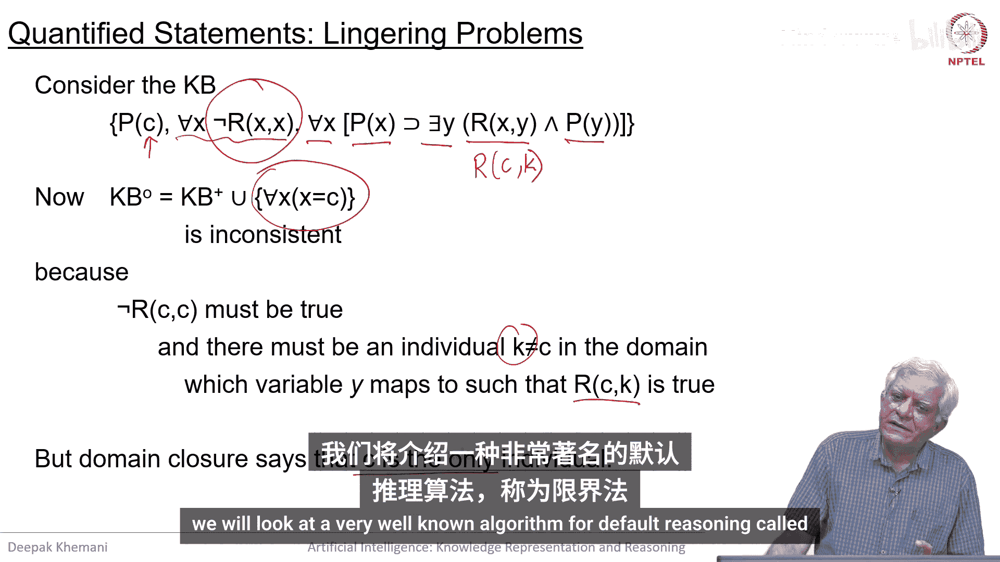

# 【印度理工学院】知识表示与推理 ｜ Knowledge Representation And Reasoning p100 P100_封闭世界假设 -BV1c4zNBmEyF_p100-

So， welcome back， we have started looking at default reasoning。😊，And as we said。

 default reasoning is a mechanism we want to deploy。In a world where。

There is a fair amount of uncertainty that you do not have complete knowledge。

And yet you want to make inferences， essentially。So。

 one of the simplest approaches to that is a closed world approach to reasoning， which says that。😊。

Assume that whatever you know is what is there to know。

This is called a closed word assumption that unless an atomic sentence p is known to be 2。

 it can be assumed to be false essentially。So， this is like negation by failure that we saw when we were looking at prologue。

Except that this applies only to atomic sentences。So。

 what we want to do is to augment our knowledge base。By saying。N。These propositions are not true。So。

 if you are going to be working with a finite set of predicates。

 then we can augment the knowledge base as follows。😊，That in。Construct a new knowledge base Kb plus。

To take the old knowledge base kb and add to that all sentences of the form not p where p is an atomic sentence。

And the knowledge base does not entail P essentially。Having done so。

 then we can employ the standard entailment processes we can treat the knowledge base as if it is just a set of sentences in logic。

And make whatever。Inferences we can， so this is the process of making inferences that we are using so remember that when we say entailment we normally mean a proof process or something similar or model checking as we have seen。

And we will not to distinguish tu between entlement and derivation at this stage。So。

If we can do that， then we say。That the original knowledge base。

Which was a not augmented knowledge base。We can infer alpha in the original knowledge base。

 but with a new form of enttaillement。Which is enttailment under the closed world assumption。Now。

 one consequence of。Doing this。Is that inference is no longer。

Local essentially in proportional logic and in first order logic。

 making inferences is a local process。 What do we mean by that that the consequent depends only upon the incidence and you do if the incident。

Are known to be true then the conequ can be added to them。

Knowledge B So the consequences is known to be true。Of course。

 one has to search for those antecedents， for example。

 if you are doing forward training then you would try all possible antecedents to see whether you are going towards the consequent and backward chain。

You will move backward from the gold searching for its antecedents。

 but that does not affect the correctness of the inference logically speaking。

Once the antecedents are there， the conclusion follows and it follows only from。The antecedents。

In default logic because we have to show that the knowledge base does not entail a proposition P。

For all atomic sentences， this requires to explore all avenues to prove P。

 which means you have to look at the entire knowledge base， so it is no longer a local process。So。

 in a scenario where more sentences are added to the knowledge base。

 this becomes a non local process in the sense that the correctness of the inference requires one to inspect the entire knowledge base。

This is true of other forms of reasoning also so probabilistic reasoning， for example。Also。

 tends to look at。The entire knowledge base， because that's where the numbers come from。So。

 at least we would have to look at the rules that are involved with the fact P。

So how do we do this this thing， an extension or an extent？

Is an explicit anum of a prediiccate instance。So， for example， if your domain has。4our numbers， one。

2，3，4。Then the relations shown here。Our pair is shown here。Is an extension of relation。

And this relation if we had written in the intentional form。

 we would have written that it is a set of all pairs x y so that x is less than y。So。

 when we write the second form， then we are using kind of sentences in first logic exploiting the power of first photo logic。

But if we write the extensions， then we are stating all the facts individually and explicitly。What。

The close what the inference process does is to minimize the extension of all atomic predicates。So。

 when we say minimize this we say that we only keep those things which we know to be true or which can be inferred to be true and we throw away everything else so in some sense。

The extension is as small as possible。Only those instances that are in the Kb or entailed by the Kb are assumed to be true essentially NVFCc in this process that we add all those n of P which are not entailed by the KB。

This can cause some problems in some knowledge base。

 especially if a knowledge base has a disjunctive statement so we have seen that disction is often a problem。

One of the reasons we benefited from using horn clauses。Is that they do not allow thesejunctions。

LisSo an A and B and C and D can imply only。E or something that it cannot imply E or F essentially。

 so distractions can often be a problem。And it is the case here as well so just consider a simple knowledge base which says P or Q for example20 can fly or pe can fly so we know that one of them at least can fly maybe both can fly as well。

But when we use the to world assumption。We augment a knowledge base。

With not p and not because we cannot show that not p is true and not p or Q is true。

 but once having done that we find that our knowledge base has become inconsistent because as we have seen earlier as well。

This set of clauses is unsatisfiable you can derive the nu clause， so which means that。

They are unsatisfiable。So， an approach to get around this problem is called generalized closed world assumption。

And the idea we here is that not to minimize the extension of all atomic。Vicates indiscriminately。

And this in particular will apply to。ど。Atomic predicates are atoms which occur in disjunctions。

An atomic prediiccate in a dysfunction is minimized only if there is evidence that the dysfunction will survive。

😊，In the sense that。The knowledge base will not become inconsistent。So。

 the approach used here is to again augment the knowledge base so we start with the knowledge base and augment it with with something else。

And also we augmented it with all those negations of atomic sentences。

For all such that for all collections of Q1 to Qn， if we have a distinction involving P。Remember。

 that's where we are facing a problem。Then if we have a distinction of the remaining literals without P。

That is also true。 then we can afford to say that not p is true and we will add not p to the。

Knowledge base。So， this is called generalized closewell assumption。So， for example。

 if in our knowledge base we say that twiy or pepi can fly。

And we can also say that we tea or pepe or chrpy can fly。

Then we can add not flies chpy to the knowledge base because we know that one of Twity and pepi can fly so our destruction should not become false that it is the goal behind。

嗯。Generalize closed world assumption and that is what I meant by saying that the dysfunction will survive essentially。

So， as you can see， generalized closed well assumption is less strict than closed well assumption。😊。

It does not add。Everything that it cannot show， every anomic predicate。

 not of P that it cannot show to be true the to the knowledge base。

But it tries to maintain consistency and basically we say that if you have p or Q don not add not p and not q at the same thing。

Another problem with the close one assumption is that it is not so easy to handle quantified statements。

Both in closed world assumptions and in generalized closed world assumptions this is because。

You there may be individuals which are not named in the knowledge base essentially so you don't know whether the perdicates which apply those to the individuals which are not named how to say that they are not true。

 for example。So， if you have a knowledge base which talks about the four numbers，1，2，3。

4 somewhere in the knowledge base。How do we decide that this sentence that for all x x is less than 11 or there exist in x such that x is greater than 11 is true or not。

 because we don not know what are the individuals in the domain essentially。😊。

But if we assume that we know that the only individuals in the domain are the ones that we have stated explicitly and this is the。

嗯。Sppirit of the closed world assumption。That the only individuals in the domain are those explicitly mentioned in the domain。

Then。We can of course make a statement， so this is called knowledge base。Extension。

 so we are extending Kb plus with the。Domain closure axioms all domain closure statement and this statement says。

Therefore for all x， either x equal to not either x equal to 1 or x equal to 2 or x equal to 3 or x equal to 4 is true essentially。

Of course it is turned out to be either or also in this case。

There are still some problems which linger even if we apply domain closure。And to illustrate that。

 lets look at this knowledge base。It has some it has two predicates P is a uninary predicate and R is a binary predicate。

And there is one individual that we are talking about and that is C here。

And we have said that C is a P。We have also said that for every x， not r xx is true。

 so it must be true for C as well。And we have also said that for every eggs。If PX is true。

Then there exists sub y so that rx y is2 and y is also a P essentially。Now， this knowledge base。

With domain closure。That the only individual is c therefore all x x equal to c and that is the only option you have is inconsistent。

Because。Rcc must be false。Because we have a statement that for every x n of r x x is 2。

But there must also be an individual K。Which is not equal to c。Because we want。Ha。See。K to be true。

And K cannot be see because。We know that。R x x is false， so k has to be different from c。

In the domain says that the variable by maps onto maps 2 says that RrcK is 2。

But the domain rule say that C is the only individual。

 so you can see that we have some lingering problems here essentially。So， in the next session。

 we will look at a very well known。

Algorithm for default reason called circumscription。

