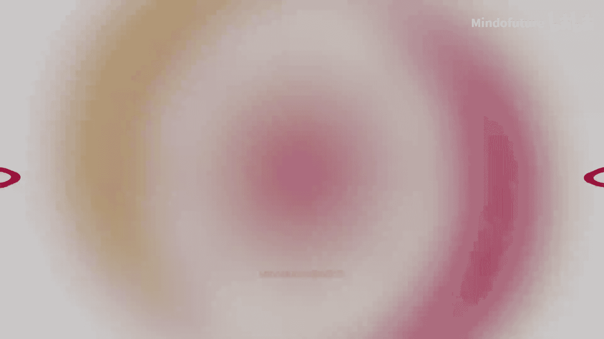
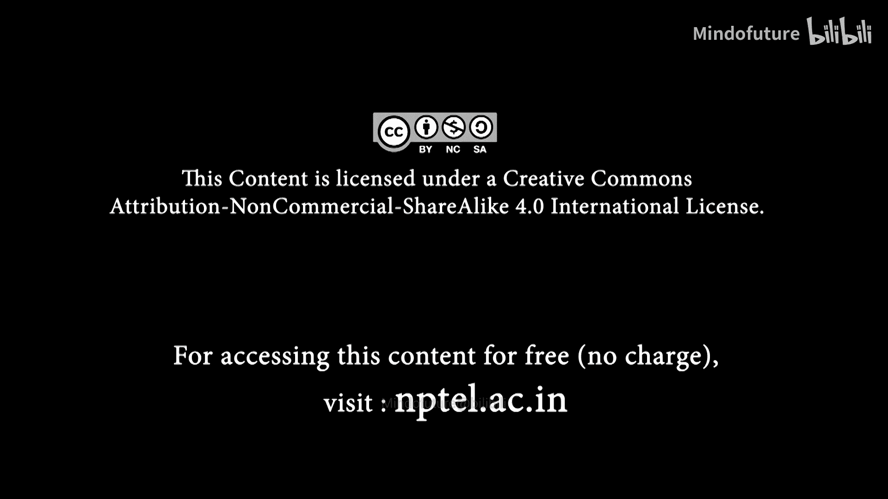
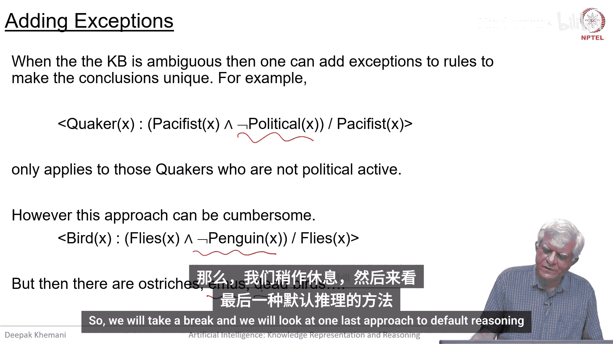

# 【印度理工学院】知识表示与推理 ｜ Knowledge Representation And Reasoning p101 P101_缺省逻辑 -BV1c4zNBmEyF_p101-

So， welcome back。We are looking at our third approach to default reasoning。

And that is called default logic。 It was devised by。R later。Instead of minimizing perdicates。

 which close what assumption and circumscription does。Reters default logic。

Allows us to make some positive assumptions。So， a knowledge base considered to be a default theory。

Is made up of two parts the first are the theory f。And a default set of default rules d essentially。

A default rule is of this。For it has three constituents。One is a prerequisite alpha。

 one is a justification beta。And the third is a conclusion delta also known as assumption。

 so this delta is the assumption that we are allowed to make。

We can believe delta if one believes alpha。And it is consistent that beta What do we mean by consistent that beta is that。

One does not believe。Negation of Vita， This is a general theme that we had spoken of earlier。

 remember。So， this delta is basically the assumption。

 so this positive assumptions that we are saying that under certain conditions you can make these positive assumptions。

So let's talk about treaty。😊，Again。The fact that Twiy can fly or birds can fly is expressed in this as follows that if Ty is a bird and it is consistent that Twiy can fly then Ty can fly。

This is called a normal rule and we often write it directly without writing the justification because the justification is the conclusion itself essentially there if the conclusion is consistent。

 then go ahead and make it。These are not FOL rules。

They apply only to individuals so if you write something like this with a variable。

 it is just a short form we are using for writing all the rules for all the individuals。So。

 what can we believe in default logic？So， given a knowledge base which is made up of the first or theory and the default rules。

We define an extension。As a set of consistent beliefs。And。What are the elements of that。Extension。

All all those sentences pi belong to this extension。If the union of the。First all theory。

And the set of all assumptions， delta。Such that。They are based on a default rules of which delta is the conclusion。

And that should be there in the default theory。Alpha should be there in the extension。

And Nord beta should not be there in the extension。This is as per the definition。So， if you can。

Infer pi from there then you can add pi to the extensionion it belongs to the set of consistent beliefs。

So this whole thing， which is。The set that we are defining we can think of this as a set of default assumptions one can make and then we can abbreavate our definition to say that the first all theory and the assumptions and if you can derive from there then it belongs to the extension。

So observe it。Alpha has to be in epsilon and not in the first so theory this means that if you make a default assumption then you can make another default assumption based on that if there is a default rule in which that is a prerequisite。

So， look at this theory， this is our problem in which chili cannot fly and pti and chili are birds。

Then this will have a unique extension in which wet can play。It is because it is the only individual。

In which birdwi0 belongs to F and notfwiy does not belong to Fil。And Chile is another individual。

 but there the not flies chili belongs to the extension。So this one has a unique extension。

We can have ambiguity in default logic as well as we had seen earlier。

When you are looking at taxonomies， so it is the same example that we can consider then。So。

 the first talks about Republicans and Quakers and the default would say that Quakers are pacifists and Republicans are not pacifists。

Then the knowledge base has two extensions。One in which。X is a pesf。And one in which x is。

Not a pacifist， essentially， or di rather。A skeptical reason reason like we said will believe only something which is common to all extensions。

And a crulous reasoner would believe。A sentence if it is in any extension so that is as we had studied this idea of extensions when we were looking at taxonomies as well。

You can get it on ambiguity by adding exceptions to rules。And we do that as follows。

That we say that if x is a quaker。And it is consistent that x is a pacifist and x is not political then it must be。

X must be a pacifist applies only to those Quakers who are not politically active。

This approach can be cumbersome， we can do the same with birds so we can add the fact that if X is not a penguin the next can fly but then we would have had to add other exceptions and so this whole thing does not very work out very neatly easily。

So， we will take a break and we will look at one last approach to default reasoning。

 which is called autophysmic reasoning。

