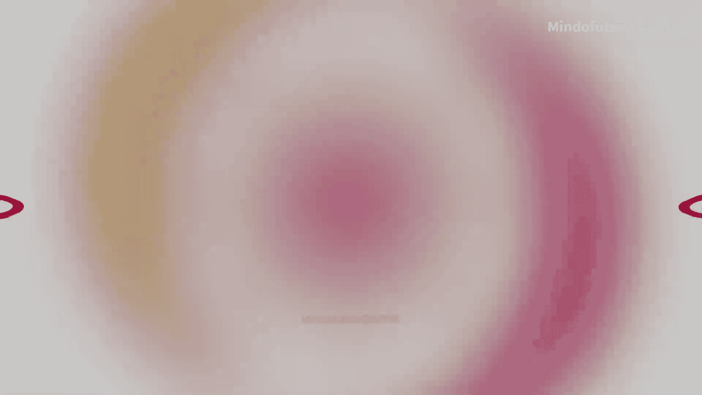
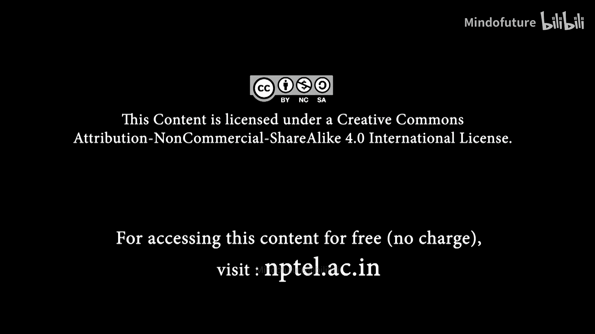
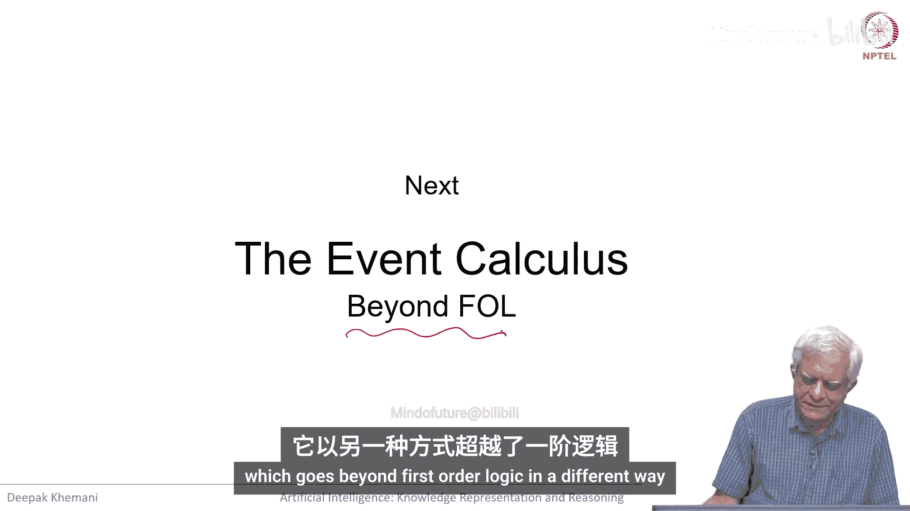

# 【印度理工学院】知识表示与推理 ｜ Knowledge Representation And Reasoning p102 P102_自认知推理 -BV1c4zNBmEyF_p102-

So welcome back， we are looking at default reasoning， we have looked at three approaches。

And we are looking at the last for now， which is the auto epistemic reasoning session。

Now default logic has a set of default rules that determine what assumptions are consistent to make。

But they are outside the language。The conscription has default reasoning built into the language but is not in a position to make consistent assumptions。

Auto epistemic logic combines the features of both in some sense。It introduces a model operator。

 so this is something that we have not studied very much。

 but you can see that model operators are outside the classical logic as we have studied， in fact。

 they are in classical logic， but they are outside of。FOil and population logic that we have studied。

And this motor operator B stands for B essentially。So when we say b alpha。

Alpha is a sentence from whichever language you are looking at it can be professional logic。

 it can be first logic。But when you say b alpha， then that sentences an argument to this model operator b and it says that。

We believe in Alpha。We believe that alpha is true。So。

 in autoostemic reasoning we would say that a bird not believed to be flightless。

 so this is the important part， not believed to be flightless。So this is flightless。

And this part is not believe。 you dont believe that it cannot play。

If you don't believe that it cannot fly， then you can in that it can fly。So， this belief operator。

Has certain properties that we should look at。And these properties will be useful in determining what is the reasonable set of beliefs that one can hold in a knowledge base where there are sentences with the belief operators。

We can say that a set of beliefs epsil in again。Is stable。

But this community calls aps as an expansion。To be stable if it satisfies the following properties one is closure under entment。

 what does that mean？It is that。If epsilon entails alpha。

 then alpha must belong to the entire epsilon then you must add everything。

That can be inferred into the set of beliefs。Positive introspection and negative introspection positive introspection C。

That if alpha is in the epsilon， you must add believe alpha in the epsilon。Now。

 you can see that this will of course lead to an infinite set of sentences。

 but in practice we make some assumptions that we will only go to a certain depth。

Negative as as introspection is if alpha does not belong to the set of beliefs， then add that。

I don't believe in alpha to the set of。Believe out through the expansion。

So when we talk about entailment， we just read。This whole thing has just another pdicate。

If it is true。In the left hand side， then we go to the right hand side else we dont think。

So now we can talk about stable expansions。And the S follows。

That given a knowledge base with statements using the belief operator and the three constraints that we have spoken about closure under entment。

 positive and negative introspection， we define a stable expansion to be the minimum set。

That satisfies the constraints。So pi belongs to the expansion if。The knowledge base is always there。

This is positive introspection， therefore every alpha。

That is in the set of beliefs we add b alpha and for be alpha that is not in the set of beliefs we add not b alpha negative intro if we add all these things。

To the knowledge base and then if you can derive pi or pi is and then you can put it in the set of beliefs essentially。

So this whole thing。Can be seen as delta again， the set of assumptions。

 but the standard assumptions come from the introspection constraints。その。

Procedure to enumerate stable expansions involves guessing and replacing such statements b alpha or not b alpha or just statements of the kind b alpha by either true or false and then verifying whether everything is consistent。

So， we will see an example。So， if you want to come。Compute stable expansions。诶。

We will eventually reduce the knowledge base to what we call as objective sentences。

Objective sentences they don not have belief operators so we would guess so when you say guess。

It typically translates into search， so we will try this option， we will try that option。

 we will try that option and so on。But we are saying here that we will guess it has no so set of a sentences objective if it has no belief operators so we will replace belief sentences belief operators with either true or false。

So， let us say that there are n non objective sentences or n sentences which have。

Belief operators and for the sake of simplicity lets say that the arguments are objective essentially so there is no nesting involved this is just to understand the procedure。

😊，Then you do the following that replace each。Such。Sentence by either true or false。

 so you are guessing whether it is true or false。Then you simplify the knowledge base and call the resulting knowledge base as the objective knowledge base KB。

Then you do the checks。If believe alpha was replaced by true， then verify。

That alpha is entailed by the X knowledge base。If not， then there cannot be a stable expansion。

Likewise if belief alpha is replaced by false， then make sure that alpha is not entailed by the knowledge base。

😊，If both these conditions are satisfied， then what you left would is an objective。Knowledge base。

And the entailments of this objective knowledge base are the objective part of the stable expansion。

So eventually we want to know the objective statements。At least in this logic。

 we are not interested in knowing。If some agent believes something。

So we are not talking about agency we are talking about beliefs in general after this。

 we will move on to。Multti agent systems in which we will talk about one agent。

belelieving what another agent knows or we will not work with belief which is a little bit more complex we will work with a similar modern operator called nose the K operator agent B knows that some alpha。

Our agent B knows that agency knows that Al those kind of statements we will。Do when we look at this。

topic called epistemic logic。So， let us look at the 2y chili expansion。

 we have the procedure now to work with this。So， this is a knowledge base that is given to us。呃。

There are two sentences about witty and Chile， the two rules the the the the。

The auto epistemic rules。And。来。We know that Chili cannot play。So， we try replacing the。

Because we have converted into professional logic， we are not working with variables anymore。

 so there are two belief statements。And we will try the four combinations when we will replace them with true or false essentially。

So， the let us begin with the first one in the first combination， both are true。

We believe that T T cannot fly and we believe that Chiity cannot fly。So。

 we will add this to the knowledge base or we will substitute。These with true。So。

 what happens to our sentences which had those belief statements because。We have replaced。This part。

 believe。Believes that twiy cannot fly with true。So， that part comes here so we have not true。

 so not of true is false so this whole thing becomes false and therefore the whole thing reduce to steward atro and we can throw it away。

Because the knowledge base is a conjunct and adding a true statement to that doesnt change anything or adding true to that doesnt change or top to that doesnt change anything。

Likewise， for the Chile statement。Then we do the checks。Our extended knowledge base。

Nothing has changed。 All those statements have vanished about the the implications。

 and we are left with the。Objective part。Now， in this。We had assumed that they cannot fly。

Now in our knowledge base we know that chili cannot fly so our knowledge base also entails chili cannot fly so what I have written in green is that that test is satisfied or that test is passed essentially。

But there is no way to show that。Ty cannot play is true that is not entailed by the knowledge base so that test fails so this is not a stable expansion。

Let's try another combination。 So we try true and true。 now lets try。True and false。 So for3y。

 we believe that it cannot fly。And for Chile， we do not believe that it cannot play。

So for ty it again reduces to the top or or。Good truth。But for Chile， it reduces to a。

Implication because this part which is not false is true it just vanishes and we are left it saying that if chile is a bird then chili can play。

Then we look at the。Expansion and what do we get here？We have added。It flies chi and。This statement。

 this statement came from here， right and then。Because of motorpons， we added flies chillly。

Of course， you can see that there is already an inconsistency here that is besides the point but。

Aro ismic reasoning fails on both counts so both the assumptions that we made。

Could not be verified here。And this is also not a stable expansion。So， we try true true。

 we try true falses， let us now try false true。So。We do not believe that treaty cannot fly。

 but we do believe that Chili cannot fly。So again， we simplify our knowledge base。

In this case for Chile we get this， but for Ty we get this statement。Then we add。

That statement to the knowledge base and then we infer that pity flies。No， I will。IBelie。

Pass both the test。We said that。We do not believe。That ty cannot fly。And。

We cannot the knowledge base does not entail that wey can apply， so that is fine。

We believe that Chili cannot fly。And the knowledge base also entails that Chili cannot play。

This is a stable expansion and in this expansion tty can fly and Chili cannot not play。

The last expansion is when both are false。So let's look at that quickly。

When both are falses for both birds， we get this added to the knowledge base。

And both for both the world we get thoseing added to the knowledge base。And。For treaty。

 it fine because we said that。We did not believe that it can。

That it cannot fly and the knowledge base also does not entail that it cannot fly， so that is fine。

 but for chile。The knowledge base does entail that it cannot apply because that is in fact given to us in the knowledge base itself actually it is there in the original knowledge base itself。

So this is also not a stable expansion。And。So， we tried all the four combinations and we found that there was one stable expansion and in that stable expansion pretty could fly and Chili could not fly。

So， let me end with some closing remarks about auto epistemic reasoning。

If you look at the knowledge base， very simple knowledge base。

 which has only one sentence which is that。Not of belief in P implies P。

You do not believe that p is true。And if you do not believe that P2 and p2。

 does it have a stable expansion， the answer is no as you can expect。

If BPP so remember that we always experiment with BP so either BPp is true or BP is false。

So when Bp is true。Not B would be false and false implies P would reduce it too。Zhu。When Bp falls。

Then not BPp would be true so true implies P will reduce it to P essentially。So。

 when we assume that Bp is true we are not able to show that p is true but when we assume that BP is false we can show that p is true。

So obviously this is not stable。Let's look at two。Statements one says that if you don't believe in P。

 then  Q is true if you don't believe in  Q。Then p2 now this is exactly two stable expansions。In one。

 BP is true。And BQ is false。And because BPp is true。This one。Reduces T。And this one reduces to P。So。

 P is entailed。But Q is not entailed so which is fine with us because that is what we believed in。

In the other the case is symmetric that the knowledge base entails Q and does not entail P so it has exactly two stable expansions。

Finally。A statement which says that if you believe in p， then p is  true。

If that is the only thing that you have in your knowledge base。

Then you can see that there are two stable expansions。In one Bp is true。And if BPp is true。

Then P is true。 So it。Hs in the other Bp is false， so this reduces thus knowledge base reduces it true。

 so it cannot show that P essentially so。If you believe that be p through then p through is so it is fine that is a stable expansion in the other one P falls。

 so there are two expansions， one in which p through and one in which p falls。

And the only thing you have said that if you believe that BPp is true， then p is true。

If you believe that p is true then p is true， otherwise it is not true so you can see that while both are stable。

Clearly， this one should be more preferable I have written here。

 but you should give it some thought that there is no basis for concluding that p 2 I mean the only basis is that you believe that p is2。

So we leave default reasoning。With this。 And in the next。

Set we will look at this thing called event calculus which goes beyond first sort logic。

In a different way。