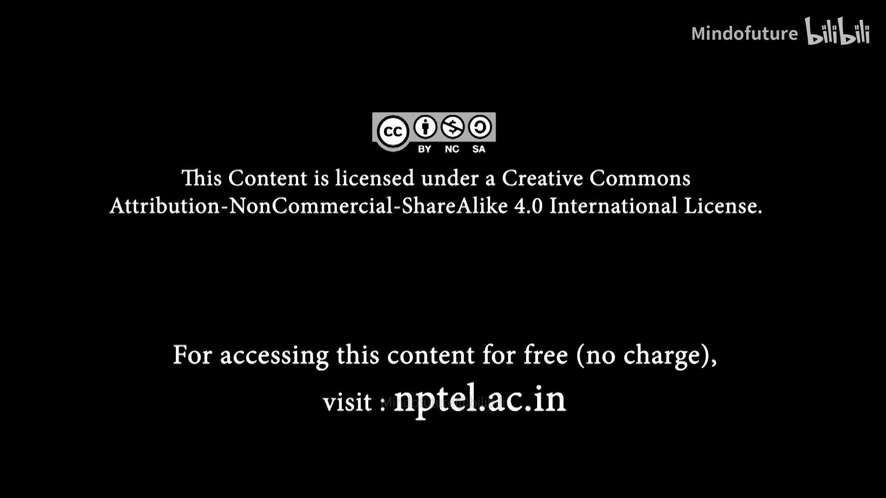
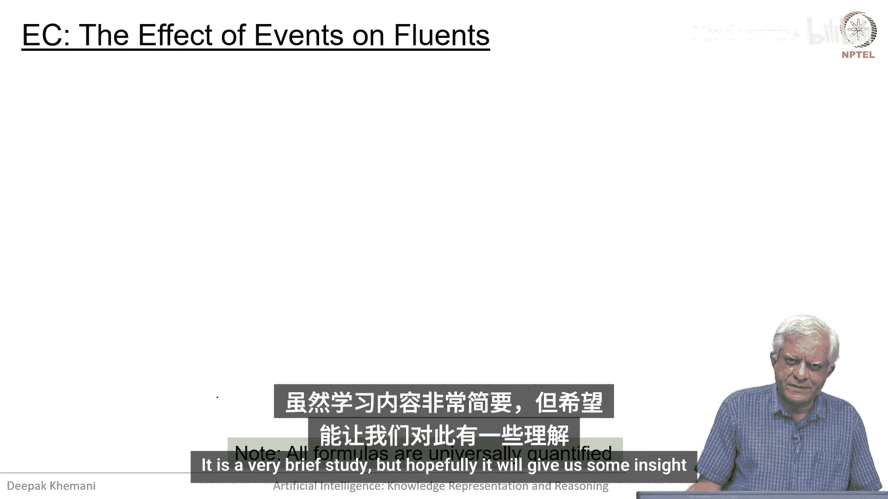

# 【印度理工学院】知识表示与推理 ｜ Knowledge Representation And Reasoning p103 P103_事件演算 -BV1c4zNBmEyF_p103-

So welcome back in the last set we looked at default reasoning。Which is an approach。

 which is close to logic。Which allows us to make。Default inferences。

Or defusible inferences so inferences which can generally be made。But which could later be。

Have to be withdrawn or defeated if moral information comes。

So now let us look at another aspect of how you can go beyond first a logic。

And we want to look at something called event calculus。Which talks about time and change and actions。

And see how we can reason with that。And we will also see some application of default reasoning here。

So， this is what we started first on our logic with。We said。

That the terms of a language of a first order language。Or， essentially。A set。Disting。

So they are either variables or they are constants or you take a function symbol and construct a term and we define a set of terms。

Using that。Then we looked at the set of formulas， which is what we are interested in。

We saw that the inconstituents of formulas were terms。

 so if t1 and t2 are terms then t1 equal to t2 is a formula atomic formula but then atomic formulas and with collectives and all you can get compound formulas。

Or。If T1 and。Up to TnR terms， then we can give them as an argument。To a predicate symbol。

 and we will again get an atomic formula。 So the point I want to make is that the arguments。

To formulas of。First so logic are terms and terms refer to objects in the domain that we have seen。

Then we could， you know， apply the logical connect and we get we could get more formulas。So。

 this is the situation we have the physical domain。😊。

Wwhich is what we are trying to talk about and we have this language for sort logic language in which we have predicates。

And those predicates talk about things in that domain。But F cannot reason about many things。

For example， actions。Or time， I mean， we can reason about time。😊。

By adding time as an explicit parameter and manipulating it explicitly。

Because time is like any other entity， but actions。Ill。Not objects in the domain essentially。

 so we will see this。And knowledge and belief essentially so。

When I say Norgian belief it says that what does one agent know about what does another agent do but that is the last thing we will do in this course and we will do it after we have looked at event categories。

Or uncertainty， essentially there are various approaches to handling uncertainty。

Default reasoning was one of them。So， just a quick introduction to planning because planning is to do with actions so there is a domain and there is an agent。

And the agent has certain objectives and the agent can perceive the domain and the agent can act upon the domain。

 That is the general idea of what an agent can do。But there may be other events happening which are exogeneous or with there other regions also maybe。

But that' is what an agent does essentially。So。A planning agent can perceive the world and produces actions designed to achieve its objective that is what a planning agent is designed to do in a static domain the agent is the only one who acts。

But in a dynamic domain。There may be other agencies。

 so we can model a dynamic domain by including other agencies that can change the world essentially。

So。In the planning。World。We work with predicates which describe the domain， so for example。

 we have on table x on x Y clear x holding x。A E stands for arm and T。

 assuming that we are talking about armed。Robot， this strips was the earliest planning algorithm that was developed。

And it worked in this domain of blocks world and we look look at four kinds of actions in this operators so you can either pick up something or you can put it down or you can stack something on another thing。

Or you can unstack it from there。So those of you who have done the course on search methods for problem solving would be familiar with this recently。

So， in state space planning we move from the given state to the goal state so the given state may be completely describe the goal state may be partially described and we look at algorithms or do that anyway that is not our goal here。

Our goal is to can we reason about logically about what is happening when actions are taking place essentially so here we have three blocks ABc and we looked at this example when we were looking at first order logic。

And that time we were concerned about。Some logical statements now we are seeing。

What will happen if this robot arm actually comes and picks up a block essentially？

So the given state is that a is on B， b is on C， as you can see on the top。

 A is on B and B is on C and some colored information was there we are not so much interested about here。

The question is when？😊，Is this predicate true now， unlike in mathematics。

 once the statement is true it is always true。In the real world things like this can keep changing essentially so how do we handle that is a question so if the world is changing。

Then how do we capture the statements that changes in truth value？So， after an event has happened。

 the event is unst A from B， as you can see the robot has picked up a。What is true， essentially？

So first of all， on AB is no longer true。And things like that essentially， so as I said。In F。

 we don't have this。T about things changing essentially that something is true at some point and not true at a different point of time。

So， they use the example of Pyth hereem it is always true， essentially。

 once you have shown that it is true then it remains true。But that's not the case for us。

Statement like A is on B， because you pick up A from B and it's no longer true。So。

 instead of calling them predicates， we will call them fluence。

 these are predicates which can change in their truth values。😊，In some sense。

 they are fluid a little bit。To reason about effects of actions。So。

 the planning algorithms don not really reason about that， they have their own algorithms。

To move from one state to another state。 So once you pick up。A from B for example。

 if you unst a from B， then the algorithm would delete the predicate on AB from the knowledge base and add holding a to the knowledge base so that is happened in the planning domain but if you want to talk about reasoning and logic how do we handle this。

We need to be able to treat actions。Andflu as arguments to predicate。Now。

 remember in first a logic fluence cannot be our arguments to predicate and we just said that in first a logic only terms can be arguments to predicate in terms refer to objects in the domain。

 whereas fluents are predicates like on aB。Wwhichch have tools value essentially。

 and we cannot add them as argument to predicates in first or logic。Yeah。

 so that is what you said that arguments to predicates can only be terms and terms that are map to elements of the domain；

 we can circumvent this problem by extending the domain to include instances of actions and influence。

We add the symbolic representations of predicates and actions to the domain for the universe of discourse。

And we say that we have refied the actions and predcateates we have looked at this process of reification when we create new kinds of entities。

😊，And add them to the domain。 So now we are saying actions。

And formulas themselves or fluence will be added to the。Do mean。So。

 this is how this world of event calculus looks like。😊，In the physical domain。We saw that， you know。

 you can talk about F predicates， but the F predicates are now themselves arguments too。

Event calculus。So， event calculus is a language。Which allows you to talk about time。

 actions or events。And flu， essentially。So these are relations between these three kinds of things。

Sometime in the beginning of the course we。Would have mentioned this an example of event callus Joges made a cup of tea and left it on the table Meanwhile Miha saw the cup of tea and drank it when Jogege came back he saw that the cup was empty so change is happening the cup of tea was made kept on the table it became empty and things like that so reasoning about time change in action is what we are interested in。

After this， we will move to epistemic reasoning or epistemic logic。

And then we will see that he concluded。That Miha had polish off his cup of tea and more importantly。

 Mita knew that Jos knew that she drank the tea。 This kind of thing is captured in epistemic reasoning。

 and we will have a quick look at that after we are done with。Event c。So what are the。Arguments to。

Event calculus。The variables and consents of even calculus belong to one of the following sorts。

 so when you say sorts we also mean types。An event sort。With variables。We will typically use even E2。

 E3 and so on。So， events include actions。Actions and events we will use intertechangeibly。

But they also include exogenous events like rain， for example。In the domain。

And we have already seen this you can unsstock a block or you can walk from home to office or Rammish can walk from home to office。

Or kbaanin can make up。All。There was a cyclone which was an event whose name was N。

 it happened in 2008。The fluent sort so the fluent type of things that is what we do through separate sets of inputs to the event calculus。

We will typically donate by iPhone F2 f3 and so on。

Now there predicates from the domain like holding block to all location ramish office all week Hubaical。

And then finally the time sort or the time point sort， so we have t 1 t2，33 and so on。

These can be real numbers in the continuous event calculus or they can be integers in discrete vent calculus。

So， what are the predicates of event calculus？Now notice that this predicates take arguments which would have been formulas in person logic。

So the happens predcate says that event E。Happened between time point t1 and time point T2 so even E starts at T1 and n z T2。

Observe that it has a duration essentially。So， for example。

 happens eclipse c21 from starting from time 0 t5 to t7。

We can create instantaneous version of actions by simply saying that the time start point and the endpoint is the same。

Then holds at。Remember that F is a fluent。And now we are saying explicitly that F is true。

When we looked at conceptual dependency theory we had a flavor of this sort of a thing which said that if you do this then you are holding the book or something like that that if you take if x gives y the book then y is holding the book now this is an event calculus we are trying to put this in the logical framework。

So fluent f is true at time point t so for example。Hold that。The form of glacier 17 is solid。

At time 21， so as you all know。Glaciers。All over the world and in particular in Himalayas。

 they are melting。We can also define a predicate called initially a fluent was true initially which means that whenever you start reasoning at at time1 t0 the predicate was true essentially which is holes equal to saying holds at predicate fluent f at time t0。

Then， the effect of。Events on influence。Is captured by two predicates， one of them is initiates。

And what this says is that event E occurs。At time T and results in the fluent F becoming true。

After time tea。So， for example， the event of waking up initiates the fluent of being awake。

So we saw this。A week can wake up。In discrete event calculus so D stands for discrete event calculus it means that the fluent f is through a time t plus 1。

 otherwise it says that time t greater than 2。So terminate in some sense is the opposite of initiates。

That event e occurs at time T and results in the fluent f becoming false after T。

If you' are talking about。Durative actions。Not which begin at a time t1 and end at time t2 we can define the flu to become true or false at either end point essentially so for example。

 if you say that you are walking home。Wing from home to office。Then。This will be terminated。

At the beginning of the action that you are no longer at home。

And the other event that at office will become true or will be initiated at the end of the action。So。

 we have a predicate called released。😊，Keep absorbserving that the arguments to these predicates。

Our arguments to the event calculus predicates are predicates from the first sort logic。

The fluent f is released from the common sense law intia at time t what is the common sense law of intia it says that the fluent truth value will not change。

Unless affected， initiated or terminated by some event essentially。So。

 we are making this state statement that。It is。It is obeying the common sense law in Russia basically which means。

That it's。The fluent will change only if an event happened which changes it。

But if we release it from this law， then we cannot reduceuce what the state it is in essentially。

It's a mechanism to deal with certain kinds of uncertainty， essentially。

We don't have time too much to look into this， but you can imagine that for example。

 if you were talking about。Tossing a coin。Then there is a fluent called heads coin。

And now essentially what you are saying is that。Whatever the state was when you were holding the coin。

 whether it was heads or tails after you have tossed the coin you cannot predict anything about whether it is going to be heads or tails。

For an event。E can release affluent F， essentially if it happens。So that is the predcate release。So。

 here is a connection between two kinds of two events so there are。Cause a relation between two flus。

 for example， on stove。Is initiated by light stove at time T then。

The temperature of the water will be some increasing function of time。Is true after the time TV is。

So， that is talking about initiating and they is saying that this relation has terminated essentially。

😊，So if you put off the stove， then that relation will no longer be true。

Let' us look at some derived predicates。This is a predicate called Cped。

So sometime between time T 1 and time t2， the fluent F。Is made false。

This is equivalent to stating that there exists in event E。That event E happens at some time T。

This t is between t1 and t2 and event E terminates the flu。

 so instead of saying this whole thing we can simply write that fluent was clipped sometime between t1 and t2。

D clippt is the opposite of that； it is made through some。After the disy。Which is， again。

 equivalent to a longer formula。We can also say persist which is like the opposite of clip between time t1 and T2 and the fluent is not released from the common sense law of inertia。

Up to that point and it retains a truth value during this interval。

This is a short form for not released。And this thing。Okay。

 let us take a break and we will come back and continue our study of event ccu it is a very brief study but hopefully it will give us some insight。

😊。

