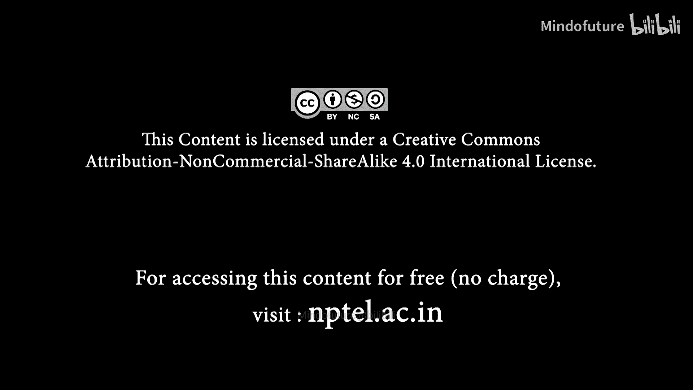
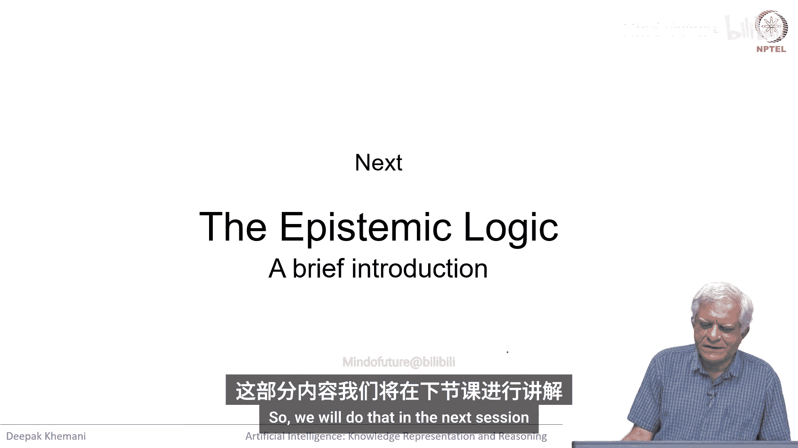

# 【印度理工学院】知识表示与推理 ｜ Knowledge Representation And Reasoning p104 P104_事件的影响 -BV1c4zNBmEyF_p104-

Welcome back。We have been looking at even calculus。

And we have looked at some predicates of the calculus and now let us look at some relations between these predicates so in particular the effect of events on fluence。

So， this is an even calculus axiom it says。That if an event。E happens at time T。

And it is known that event E。Initiates aluent F。Then the fluent f holds at 90 so we can say。

That if the robot has picked up the block， then the robot is holding the block。

But now we have time as a parameter as well。Likewise， if it terminates the fluent。

 then we can see that if an event happens and it terminates the fluent then。

This holds that is talking about the fact what is fluent now this fluent holds to be true at time T although in this case the fluent。

Does not hold to it timely， so hold that is saying that the fluent is true。

Appplain is saying that an event is happening。And initiates is a relation between。Events and there。

Effect on influence。So we have seen that events may release fluent from the Common sense law I。So。

 if the event happens and it releases the fluent， then the fluent is released essentially。

Then we look at the inertia axiom。That fluent remains。

The same if it remains under the common sense law of inertia and is not tipped by some event。

So this is the inertia axiom。If the fluent holds at time even。And T2 is after T1。

And it persists between t1 and T2， and it is not clipped between T1 and T2。Then it holds at time T2。

So， we have to make this explicit logical connection by saying that this was true at time even。

And nothing happened that would change its truth value。

 so it holds at a time t2 which is at a later time。

This is kind of tied up to this frame problem it is a well known problem and there is a link here from Stanford that you can have a look at。

It is a challenge of representing the effects of actions in logic without having to represent explicitly a large number of intuitiveably obvious non effects。

So， we don't want to make。Explicit statements that this is not changing。

 this is not changing this is not changing you just want to be able to state the effects。

And somehow you should be able to make the right inferences。So here's an example。

That if you paint and。Object X with color C， then the color of that object will become C。

 So remember that this is an。Event and this is aff fluent initiates relates an event to aff fluent。

If you move an object to position P， then the position of that object would become P essentially。

And then we are making some statements about what happened。

This is sometimes called as a narrative or the story。That。The color of a was red at time 1。

And the position of a was in the house at time1。Then at time too， somebody painted a blue。

And at time too， somebody moved it to the garden。So what is through at time4？

Did moving the block somehow change its color。That is a kind of question set the frame problem。

Seeks to address。As to what other。Non effects。How do we handle the fact that one thing does not affect another thing？

Painting is independent then moving into block is independent。So。

 this was popularized by the well known Yale shooting problem by high magnoottan Hans。

And it is as follows。There are three kinds of action， so this is the world of proportional logic。

 load， sneeze and shoot。So， somebody is loading a gun。

 somebody is sneezing and somebody is pulling the trigger。

There are three kinds of fluents that you are talking about， one is loaded。

Alive and dead so that is actually a negation of alive you can dispense with that。

This is what describes the domain it says。That if you load。And implicitly it's a gun。

Then the gun would be loaded essentially， so the load action initiates the loaded flu。If you shoot。

 then it will initiate dead essentially。Which is the same thing as saying that if you should。

 then it will terminate。Aive essentially， so alive when dead actually one of them means。

Superfluous yeah。But this effective shoot action holds。Only if。The gun is loaded at the time。

Then we hear the story。That initially somebody was alive， so we have not introduced variables。

 this is just professional logic。Then the load happened at time T T1， sneeze happened at time t2。

And should happened at time T3。So this is a story in some sense。Or as we say， the narrative。

This is a domain description。This describes a domain。

Then we have some information about times because we said T1 t2 t we are saying t1 happens before T1 is before T2 t2 is before T3 and T3 is before t4。

So， let the domain。Yes。Sigma with the conjunction of the first three statements。And that。

Delta is the narrative with the conjunctions of the next four statements。All the next。

 next seven statements。So， what is the jail shootinging problem？So， we have this。

 we just described these two domain and the narrative。And let us work with a simple calculus。

A simple event calculus。We have the following。Axioms in that cculus。Remember。

 this is prologue like style， so the consequences is on the left hand side。

So affluent holds f holds a time t。If it was initially。Zhu。

And it has not clipped from 0 to that time T。Alternatively， a fluent can hold a time T。

If an action happens or an event happens at time T1。And that action initiates the fluent。

And T1 is before T2 and the fluident was not clipped。This is the second。Simple calculus。Axiom。

The third simple calculus axiom is basically talking about clipped and it is a definition that we have。

Given already。That some action happens between time t1 and T2。And it terminates the flu。

 then the flu is clipped between time t1 and T2。So there exists in action。Given this。Set of axioms。

Or rules， if you want to call them。So， given the sigma， the delta and the simple calculus。

 is it entailed？That。One is dead， remember there were three actions， load， sneeze and then shoot。

So did shooting kill someone。I think they were talking about the Turkey at that point they wanted to be。

Kind to humans。So does the following hold。That's what we just stated。That given what we know。

 the domain， the narrative and the rules of inference。Unfortunately the sequence is not a valid。

 so this whole thing is called a sequence， it is not a valid thing we we have not described explicitly the non effects of actions in particular we havent said that the sneeze action does not unload the gun for example。

哦嗯。They may be models。Of this simple calculus。In which。The sneeze terminates the loaded， essentially。

In which case。A lie would be true and holds that would be false essentially。So。

 you cant conclude that。The effect of the。Gunshot。Is that of someone。So。

 in addition to describing the non effects of action we must also describe the non aence of actions。

 how do we know that something else did not happen in the interim period？Also。

 we must include formulaly。To say that sneeze action and the shoot action are not the same action that they are different。

So， that we can do by including something called a unique name assumption。And it is。

That lor sneeze and shoot。Are different。That they are not allliases of each other。

And likewise loaded alive and dead are also different essentially so this UNA stands for unique name assumption。

How do we solve this， we resort to something like circumscription。

 we resort to default reasoning we are saying。And what we have stated is what is true。

And there are no side effects of actions that we have not stated。

 so for example sneeze cannot unload a gun。And there are no actions that have happened that we have not stated it is not as if they were the gun was shot more than twice or something like that。

All that it was out and。Loaded again and then shot or whatever。

So we know that the idea of circumciion is to minimize the extensions of certain named predicates。

And we have。Familiar with this technique by now。So circum of a formula5hi yields a theory in which the predicates have the smallest extension allowable according to that fo。

The circumscription of P minimizing the predicate lu is returnness。Sscribing Phi。

 which is a knowledge base or a formula。With respect to a predicate。So。

 this is equivalent to the following second order formula。

So because we are reasoning about the extent of predicates。And。It becomes。In some sense， bigger than。

First order formula。So， we are saying。That there is no queue。So that Q is less than P。Well。

Q equal to p means。That they are the same predicate for all x qx equal to px。

U less than or equal to p means。That。The extent of Qx is contained in the extent of px。

 so  Qx implies px。And Q strictly lesson p means that this is true and also that they are not equal basically。

And。Sscription with respect to p Q is a formula obtained by replacing all occurrences where we have p in this formula by  essentially and which  Q do we choose whichq choose such that there is no other Q which is smaller than this this thing。

So， remember that the minimal entailment that we talk about。

 we can express it in a different way as well。So how do we solve the yale shooting problem using circumscription？

So given a conjunction of initiates and term formula， that is a domain theory。

A set of narrative initially P happens and temporal ordering formulas。

A conjunction omega of the uniqueness of names， as I so UNA v saw。

We are interested in this circum we want to circum the domain theory by saying the extent of the initiates and the terms formulas are the smallest the effects of actions。

Are only the effects that we have stated， and you cannot。

Have models in which they have some unstated side effects like for example。

 we mentioned earlier that sneezing cannot unload the gun for example。

And we will circumscribe the events or the narrative by happens that whatever we say happens is all that happens。

And of course， a simple calculus。And the unique name assumptions。 So if we use this。

The minimization of initis and termminants corresponds to default assumption that actions have no unexpected effects。

And the miniization of happens corresponds to the default assumption that there are no unexpected event occurrences。

So we have already set this。This is the domain from a jaille shooting problem， and these are the。

Events that happened。We can now conclude。Or it is entailed that under the assumptions。

That whatever we have stated is whatever is known。You can conclude。That after the shoot event。

Someone has died。So we will leave it here。😔，And。Basically。

We wanted to get introduced to this idea that there is something called event calculus which goes beyond first photo logic。

Because first order logic can only take terms which are objects in the domain as arguments。

 event calculus can take those formulas of first order logic as arguments。

Or actions as arguments and relate actions to events talk about change and time。

And it is therefore a much more powerful thing。 we also tie tie it up to default reasoning and said that if you are if you know that a sequence of events have happened and if you want to draw a conclusion。

Conclusively， which。I am also saying that you can deduce or it is entailed。

Then you can only do so if you have made the right assumptions about。What has not happened。

 What has not been stated。So， again we are saying that whatever is stated is what is there and based on that you can conclude that the conclusion that you are drawing is true。

So， we will stop here and。In the next。Session， we will。Look at the last topic in our course。

Which is epistemic logic。Which is talks about agents knowing what other agents know。

So we' will do that in the next set。

