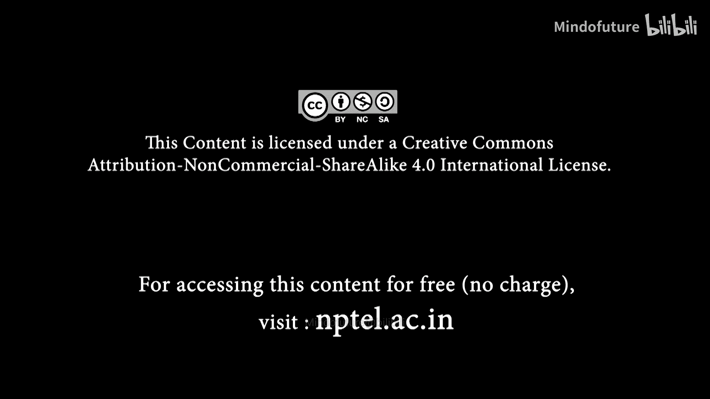
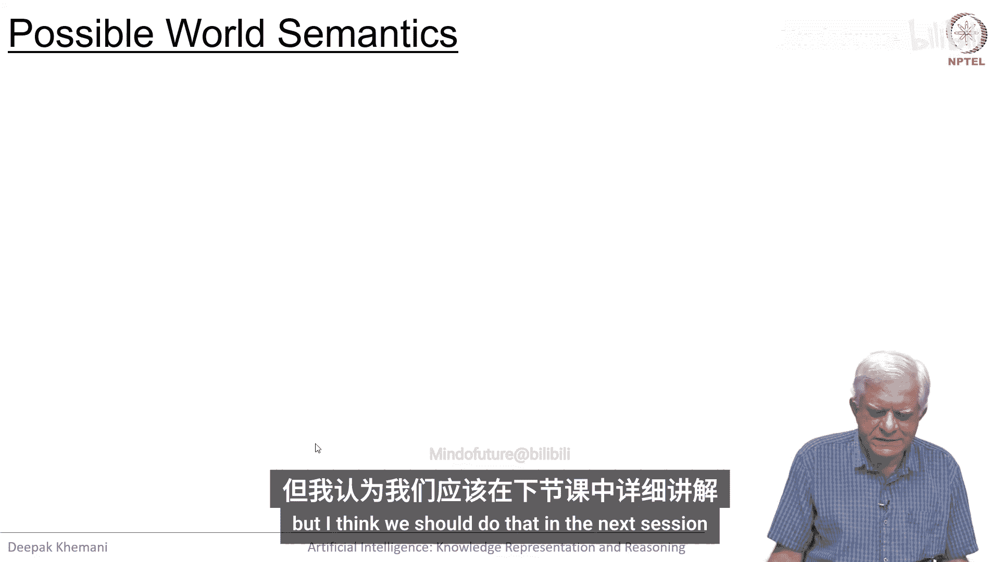

# 【印度理工学院】知识表示与推理 ｜ Knowledge Representation And Reasoning p105 P105_认知逻辑 -BV1c4zNBmEyF_p105-

So welcome to the last leg of our journey。The last topic that we are going to cover is this。

Fail in new and emerging field of epistemic logic， essentially。

So far we have worked with knowledge bases。What they say。What are the truth values？How can you？

Diveve proofs and so on。Then when we moved away from personal logic。We looked at default reasoning。

 which said that how can you make general inferences which are true in most situations？

Then we looked at event calculus which said that how can we talk about events and changing values of predicates？

And time， of course。Now， we want to talk about。Multi agent scenarios in which agents have to。Lien。

About what other agents know。 So that is why in our。Heading here， we say reasoning about knowledge。

That is， of course you have reasoning with knowledge。

 but you are also reasoning about what other agents know。And let's see， because this is a very。

Commonplace situation that very often we reason about what other people know and what other people are doing and why they are doing things and so on。

But we shall have a very quick tour of epistemic logic。So let's begin with a puzzle。

After we have looked at the references so the references the main references is the first one which is this book called reasonaing about Knowled it is about 15 16 17 or 18 years old by now。

But there are other differencess also you can see essentially。

So here is a puzzle that we will start with， essentially。😊，So， this woman called Cheryyl。

She's talking to tube。Persons， Albert and Bernard and says。

I have given you a different natural number。 So the domain of their。

Reasoning is the set of natural numbers starting with0 and then going on。And you have to。

Find out all you have to tell me。Who has the larger number。So that' is the only input she gives。

And in typically this kind of puzzles， you will see that the answers that other agents give also yield information which is used by。

Other agents in the field。 So let's say how。Albert and Bernard。Tackle this。Albert says I don't know。

 Barard says I don't know either。Then Albert says even though you say that I still dont know and then Barernard says aha now I know which of us has a larger number。

Then Albert says， in that case， I know both our numbers。And Bernard says。

And now I also know both the numbers。So the question for you。

A to find out what are the numbers what are the two numbers that were given to Albert and Bard we come back to this mean you could take a break and try and solve this question。

So， where。There are， as I said， it is common place to do epistemic reasoning。And so。

 lets look at some of the scenarios where this happens。 So， for example。

 our own bonds we wait to know。That he is giving a talk tomorrow without making Viwi feel compelled to attend so its about each other's thoughts。

Sa that knows that his mother knows that he has homework to do and he cannot play late in the evening essentially。

So he is talking about what his mother knows。Sushma doesn not expect Sneha to call because she knows that Sneha knows that Sshma is in a meeting at noon essentially。

Ss knows that Amit knows that he is going to bid for the contract。Now， what strategy should？

Surish adopt to outbid a myth。Here is an interesting cousin which you can cousin which you can try out with。

A group of people。The basically， the idea is that you have a group of people and you want to know the average age。

 but you don't want anyone to。Reveal there。Age to anyone else， essentially。So how can we。

Solve this problem how can you compute the average without reviewing the age so you can imagine as a lead to you that you will circulate a piece of paper in which everybody will write something and pass it on。

And then it will come back to the first person who will say， okay， this is what I have bought。

Sta knows that her dad knows that her plane has landed essentially。These kind of things。All comment。

 please。So， let's look at the solution for our。Buzzil。What was a puzzle。

 the puzzle was that Albert and Bernard had got two numbers， let us call them A and B respectively。

And first Albert says I don not know， which means what it means that a is not equal to 0 because otherwise he would know whose number was larger；

 therefore a is either one or more than1 and because Albert has said I don not know Bernard also knows this。

But that says， I don't know either。This implies that b must be greater than or equal to 2 because if b was 0 or 1。

Then Barernard would know that Albert has a larger number。

And now Albert knows this that B number should be 2 or more。

Albert says even though you say this I still don't know。

 so you should think about this and figure out that this means that a should be greater than or equal to 3。

Now， suddenly Perard says aha。Now， I know which of us has a larger number， so the meaning of this。

Is that banana must be holding two or3？And Albert has a larger number essentially。So。

 we already know that b is number is greater than equal to 2 and a' is number is greater than equal to 3。

Albert says in that case I know both the numbers and implies a must be 3 and Albert Albert knows that B is 2 essentially。

And Bard says。And now I also know both the numbers， so Bernard knows that a is 3。So。

 these are the kind of puzzles。Which deal with reasoning about what other people know and making inferences from there and so on。

Let me give you one puzzle as a。Take home mix。And it says follows。

That let's say it is 1968 before most of you were born and you are having tea with two world British champions。

 Bennio Garrazo and Giorgio Belladdona。When。Your friend God Bull walks in and says。

I have three caps from a collection of red and black caps。He holds a lofter box。

From which a lead cap falls down。He hastily puts it back in the box so everybody knows that there is a red box red red cap。

 then he blindfolds all of you。And places a cap on each head， essentially。The blindfold is removed。

And you see two red caps on Galazo and Belladona's head。Now。

 one by one gold Bull is going to ask you， do you know the color of the cap on your head essentially？

So what is the situation？You know that there was at least one red cap， you also know that。

You can see two red caps because both Calazo and beadonna have red caps each and now goodbo is asking the questions one by one first he goes to Gaazo and Benitto says no I dont know the color of my cap。

Then， he goes to。Bella Donna， and he also says that no， I don't know the color of my cap and。Now。

 he is going to come to you。And what is your answer going to be？Anwei。Okay。

 so we have seen a couple of puzzles。And， let's know。

Look into this mechanism of episteemmic logic and reasoning。It' is reasoning about knowledge。

 it is reasoning about what other people know or other agents know。And making inferences from there。

It is primarily used in situations involving groups of agents often used to model distributed systems。

What does a given agent know about the world essentially？And more importantly。

The higher order knowledge as to what does a given agent know about what other agents know essentially so a knows that B knows that Bs number was。

Greatter than equal to 2 and this kind of。Sentences， no we want to be able to reason with。

So let us quickly look at the language and then we will look at the details as we go。😊，So。

 like any language， it is a set of sentences。And the sentences in this epistemic language。

 the simple epistemic language is atomic proposition， so P as you see on the left hand side。

Then for any formula from the language。You can take the negation of the formula。

 which is the second thing here。For any two formulas。

 you can take the conjunction of the two formulas。Now you would recall that if you have taken negation in conjunction these two logical connectors are enough to model everything else so even if you want to model things like implication and disjunction and so on。

 you can always translate them into this essentially。

What is new in epistemic logic is this model operator。Call K E。So。

 k is the model operator which stands for knowledge and a is the name of the agent it stands for an agent。

 it says that agent a knows some formula， the formula can itself be a formula for epistemic logic。So。

 the unary epistemic operator K is similar to the belief operator we saw belief in auto epistemic reason though that we did not talk about agents at that time。

The main difference between the belief operator and the and the knowledge operator is that the。

Knowledge operator K is applicable only to true statements。

 so that is the difference between the two。While the belief operator does not require。

The believed statement to be necessarily true。So， this。Property。

Of the knowledge operator is captured in this axiom T as it is called。Which stands for truth。

 essentially。And it says that if an agent a knows a formula  phi。

Then that I better be true in the world。Whereas with belief operators， that is not the。

Necessaries condition， you can believe anything and。There is nothing wrong in that essentially。So。

 let's look at。The axioms that this logic works with and there is like many logics this is also a family of logics and we look at this common nomenature due to lemon and later by bull and Seerberg。

嗯。So， here are these set of axioms each has a letter name to it。So the first axiom is the K axiom。

And what does it say it says。That if an agency。KNotowes that a implies a plane this allow stands for employees here。

Then。If agency knows a。Lin。Agency knows a plane what does this mean it means。That。

The agent C can do modponence； it knows a， it knows a implies a prime and therefore it knows a prime。

This d is the double negation here， so if agency C knows a。It means that。

It is not the case that agency knows not e essentially。

Then the through axiom that we saw a little while ago that if agent C knows a。Then a should be true。

 truth are ver X。Then we have the positive and the negative introspecction that we saw in auto epistemic logic as well。

That if agent C believes in a or agent C knows a， then agency knows that agency knows a essentially so it knows this。

Likewise， if the agency does not know a。It knows that it does not know essentially。

And then there are a couple of more axioms that you can look at it and the commonly。

Use set of axioms are known with system names， so system K uses only the knowledge aom。

System T uses both the toolaxom and the knowledge axiom。System S， which is the most common。

 also uses a positive and negative introspection。Axioms。And then we have systems like S point system。

5。2，5。3 and 5。4。So， this this will take a little bit of time to digest。

 so I suggest that you look at that。Let' us look at the last one， it says that if a is true。It means。

That。What does this say that it is not the case that agent C knows a？

And then this second negation says that it is not the case。

 that it is not the case that agency knows a。W basically means that agency knows a essentially。Okay。

 so you can think about the other two。This sinks， as well。The way to。

Model auto to may the way to talk about semantics of episteemmic logics。

Is the possible world semantics？But the。I think we should do that in the。Next。Session。

