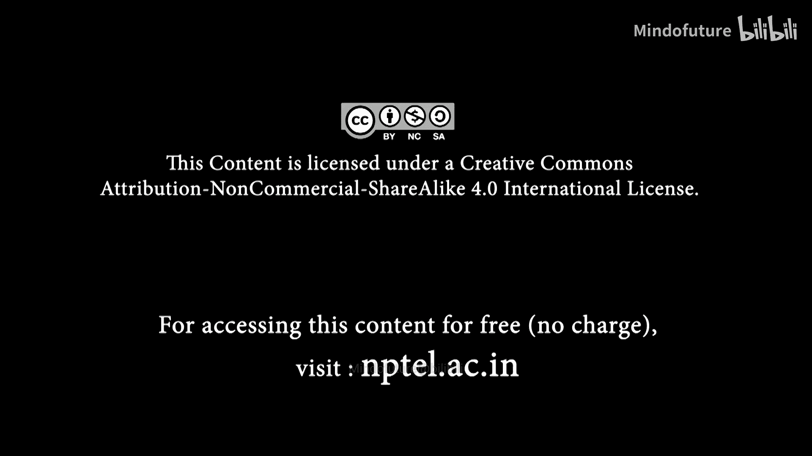
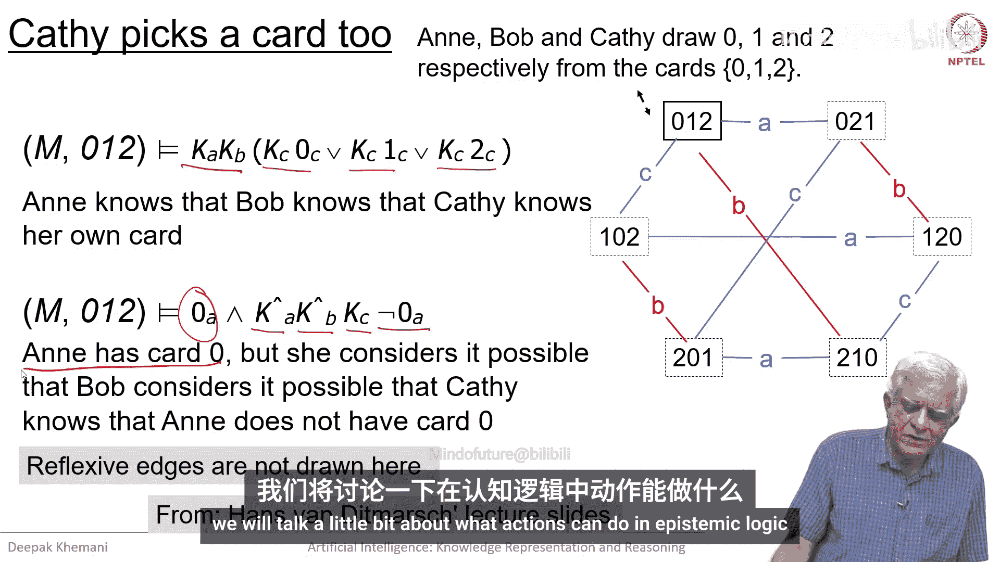

# 【印度理工学院】知识表示与推理 ｜ Knowledge Representation And Reasoning p106 P106_克里普克结构可能世界语义 -BV1c4zNBmEyF_p106-

So welcome back。We have been looking at epistemic logic。

And we have seen a very simple case of epistemic logic which has a proportional logic plus this model operator called k essentially and we have seen what the language is like and we are also seen what are the set of axioms that can go along in the proof system that what what is it that you assume to be true about knowledge。

When agents know about knowledge， essentially。So let's talk about this semantics snow。

This is alls cryp K。Almost 200 years ago， 80 years ago define define the semantics of episteemmic logics。

In which different agents operate with incomplete knowledge and as a consequence are unable to know the real state of affairs。

So， in typical world situations you know some things and you dont know some things and other agents know some things and other agents also dont know something。

 how does one reason with this kind of partial knowledge essentially？

Remember that it is still knowledge we are not talking about belief we are not saying。

That you can know something which is false， you can know only something which is true。

But your knowledge is incomplete， you may know some things， but you may not know other things。So。

 Cpke introduce this notion of possible world， so it is imagine that there are many possible worlds。

And each agent can access only some of them。All all of them also as the case might be。

 but in general only some of them。Such models are known as scriptcase structures in which different possible worlds have different sets of propositions that are true essentially so if there are three propositions lets say in the world P Q and R。

 you can imagine。That there are eight possible worlds know for each combination of PQR being true or false essentially。

And different agents may know about different。Possible words， of course， when。In a real situation。

 one of those possible world will be the real world essentially。But even in the real world。

 there may be some incompleteness in the knowledge about those agents essentially as we will see。So。

 agents do not know enough。To be able to distinguish between some possible worlds and others。

 even though the ground truth。Hs in exactly one。Of the possible words。

In such a scenario and we will see examples that will make it clear we will see。嗯。

What is this notion of。This possible world。So， these things are called crypcase structures。So。

 let SB set up states or of possible words essentially。

What is a possible world a possible world is one in which some statements are going to be true and some statements are not going to be true。

That5 be a set of atomic propositions。Let pi be a mapping or choose assignment to those atomic。

Sentences， so it maps the set file under true or pulse。

It is an interpretation like we said when you are looking at proportional logic function that assigns a truth value。

For each。Proposition in Phi。And it does so for each state belonging to the set of possible states a set of possible worlds。

So， this is a truth assignment or an interpretation。Let A be the set of agents。Then for each agent a。

We define a binary relation labeled by a R of a。Be a binary relation on s cross s。

 so it is basically an edge between between different states in the possible world structure。

This relation is an equivalence relation。And is often used to models。

That the agent cannot distinguish。Then a crypcase structure M。For n agents。

Is a tu where there is a set of states。An interpretation function。And a set of。

Binary relations for each agent。Each of the agents， I think。So。

 let us talk about enttaillement and we will assume that we are always talking with respect to one of those possible world and let us call that world s。

So， given the crypcase structure and given one state s in that structure。

We say that a sentence P is entailed。If。Interpretation function for that statement in that state。

Gives you a value of true So it is simply saying that the interpretation tells you that it is true in that particular state and this truth value of P is only。

In that state， essentially。So， this is talking about facts essentially what we call as objective statements when we were talking about autoepsteemmi logic。

And then of course， there are the logical connectives。

 a formula like phi and phi prime is true if phi is true and is phi prime is true。A negation is true。

 if。It's。Negigation is not true。Most importantly。We say。That an agent I。Knows that phi is true。

 so this is a formula in our language and this formula K I Phi。

 which stands for the fact that agent I knows Phi。This formula will be true。If first of all。

It should be true of course in y should be true in the state s， but not only that。But in every。

State tea。Set S。Belongs to the relation array for the agent I。This formula must be true。

 So what is this saying， this is saying that。Let's say there is a state s。And in this P is true。

And there is another state。Oh。And which also P is true。And there's a third state。Let's say， Q。

And also， this P is true。Then because in all the states that are， as we say reachable from s。

P is through。10 agent i， so this this should be labeled by the agent number。

 so let's say if the agent is I。Then these edges are labeled with agent I if every state reachable via this。

嗯。Name of the agent I this is true， then we say that P is true。But if we added at another state。

Let's call it T。In which not p is true。Then we cannot say that agent A knows P。

Agent I knows P because there is a possible world in which P is not true。

 So agent I knows the formula。W。Only if it is true in all possible worlds that the agent cannot distinguish between。

So here's an example and that hopefully should make things clear。So we have this gripcase structure。

We have three states STN U。Then we have two agents。1 and 2。

We have only one formula in our these things。And we have two relations R and R2。

For each of the two agents as to which which world they cannot distinguish between essentially。

And we have the truth assignment that there is only one formula P。

 so in state S it is true in state u， it is true and in state。T， it is not true。

We can depict this graphically。As follows that we have this three states T SN。

 which are the labels in the nodes。Then we have this edges。Between states。 So first of all。

 notice that every。State has a reflexive edge for each agent。 that means that the。

It is not the case that the agent cannot distinguish between that state and itself。So。

 we have two edges here， one is labeled1。This means。That agent 1。Cannot distinguish between。

The possible world T and the possible world s。And there is another edge， which is label 2。

Which says that agents2 cannot distinguish between。The possible world S and the possible world。

U now you can see that in t as we said。P is not true， but in the other two states p is true。

So what can we say here？We know that。And we are going to be talking with respect to this state S all the time。

So in this state is。Given the script case structure。It is not true。That agent fund knows P。

And why is that？That is because in state s， of course， p is  true， as you can see。

But there is a world that each and 1 cannot distinguish from， which is the world of。

which is is the word label T so agent1 cannot distinguish between S and T。Now， in S， it is true。

 p is true。In T， it is not true。So clearly agent1 does not know that P is2 precisely。

But agent 2 knows that p is true and why is that？Because the possible world for agent 2 is S and U。

And in both S and U。In the statement， P is true。So。

 as far as agent 2 is concerned in whatever world it can imagine。Be true。No。Again。

 remember that we are always talking with respect to the。State is。Now， agent1 knows。That agent， too。

 knows。B。Our agent2 knows not P。Which means。Agent2 knows the truth value of p so this statement is saying。

That agent1 knows that agent 2 knows the truth value of p。See agent one himself。

Cannot believe that P is true because， as we have said。He cannot say that P is true。So， he of course。

 he also doesn not know whether p is false or whatever the case p is not false in this example。嗯。

Except if we were talking about the world T， then agent 2 would think that p is false。So， in s。

 that is our reference state that we are talking about agent2 knows the value of p。

 which is represented by the fact this。That agent 2 knows the p or agent 2 knows not p。

 so it knows what is the value of p。Now， this is true。😊，Because。In the state S itself。

 which is what our reference state is。Agent 2 knows that P is true， we have already observed that。

So the this will be true naturally。Lakewise。Instead state tea。

State T is the world which agent1 cannot distinguish between。So。

 what agent 1 is seeing is that in state S agent。2 knows that P is true。And in state T。Agent， too。

 knows that。😔，P is not true。 This is in state T because in that state。

P is not true and from that state agent 2 cannot access any other state essentially so it knows that p is not true so again it knows that p is not true so the distinction becomes true again because it knows one of the components and since both are the case then agent2 knows。

Whether p is2。Whether the agent 2 is in state S or state t。

 which are the two states that Age 1 can see。And。う。Hence， this formula is true。So。

 we will leave this as a small exercise for you。You can think of it as saying。That agent。

2 considers it possible that agent 1 knows the value of P。But you should。Convince yourself that。

It is indeed the case， so you have to go through the argument in a little bit more detail。

Let's take another example with a small pack of cards。Let say there are three players。

 and Bob and Kitty。Represented by A B and C。And we have a small pack of cards of three cards in pack。

Whose names are one， two， and3？Let the atomic proposition。

That a player is holding a card we represented by card super Subscript player。

So that 2 b for example， says。The card2 is held by player B， which is Bob。So。

 the following are sentences in this world。In this domain。The first one says agent a knows that。

B is holding two Bob is holding two。 This is the intended meaning of the。Sentence。

This one says that agent a knows that a is holding 0 or a is holding 1 or is holding 2。

 so this is the the the or is across agent A knows that a is holding1 or agent A knows that a is holding 1。

Or agent a knows that a is holding2 so for each of the three cases01 and 2 agent a knows what agent a is holding essentially so Annie knows her card thats all。

Agent Annie does not know Annie knows that Bob does not hold two essentially that would be the case if anyone is holding one then also if anyone is holding two then any would know that Bob is not holding two。

But this is how you would say that Annie knows that Bob does not hold to。

To be means Bob is holding to be and not to be is that Bob is not holding to。

Bob knows that Annie does not know that Bob holds too。This part says that。

Anin does not know that Bob holds too， and Bob knows this。

And he does not know that Bob does not hold to。So， the second part is does not hold2。

 Bob does not hold2 and the first part says。Annie does not know this。So。

 the last statement is also considered。Equent to saying that Annie considers it possible that Bob holds2。

Because she does not know that Bob does not hold to。

 so it could be possible that he is holding to and we sometimes write it in the short form by putting k hat instead of k and saying that any considers it possible then Bob holds2。

So， let's say。And Bob picked two cards。And it gets0 and Bob gets 1。And from this pack，0，1，2。So。

 this is the。As shown here in this。Rectangle the situation。The first card is for Annie。

 the second card is for Bob and the third card in this case is on the table。So， Annie got gets 1，0。

 Bob gets 1 and car two is on the table。This is how the world would look like。As you can see here。

N is holding 0。That's a real world shown in。The dark rectangle。

But Annie he does not know whether Bob is holding two or Bob is holding one and therefore there is an edge。

Between these two states labeled with any。That she cannot distinguish between the fact。

That whether Bob is holding one or whether Bob is holding two and the other card is on the。Table。

Likewise， Bobb cannot distinguish between the fact whether n is holding 0 or whether n is holding 2。

And in so on。You can see that from each of these states， there is the distinguishuability relation。

So， in this state which we have labeled as 012。What can we say？Bob does not consider it possible。

That Annie has guard one。Remember that this part says。This hat is not very clear here。

 but you can imagine the hat is there， just watch that carefully。

The part I circle says that Bob considers it possible that an holds one and when you put a negation it means Bob does not consider it possible。

You can imagine that's true。Because Bob is holding one。Any considers it possible。

That Bob considers it possible。That Annie holds one。See， n is holding 0。

She doesn't know whether Bob is holding one or。Du。If Bob were to be holding two。

Then Bob would consider it possible that Annie was holding one。

And this is what the statement is saying that Annie considers it possible that Bob considers it possible that she has the card one because Annie doesn not know that Bob is actually the one who is holding one。

Then any knows。That Bob considers it possible that any holds zero essentially。So。

 she is actually holding it holding0， so it must clearly be possible for Bob to consider it possible that she is holding it0。

So， let us say Kay also picks a card which is the third card。

 so now we have this world in which everybody is holding a card。And then again， there is。

The indistinguishability relation between。The different agents。Again。

012 is a real world and is holding  zero， Bob is got one and Kahy is got two。In this world。

What does this say K C， OC， K C 1 C， Kc 2 C means？Ky knows。Wch is holding 0。

All Catthhy knows that she is holding one， or Kathhy knows that she is holding two。

 which means that she knows what she is holding and both Anne and Bob knows this so Anne knows that Bob knows that Kathhy knows her own card。

Fan knows that Bob knows that Caty knows her own card。Now n is holding0。

 so that' is a true statement because you can check that in this given state that is true。

And and consider is possible that Bob considers it possible。That。

Kathy knows that Bob is not holding zero。N is not holding 0。So N considers it possible。

That Bob considers it possible so and doesn know what Bob is holding so Bob bo could be holding2 or bo could be holding0 bo could be holding one。

そう。In either case。It is possible that。Kathy would think。That you are not holding。

He and is not holding。0ero。And has card 0， thats the first part。

But she considered it possible that Bob considers it possible。

That Kathy knows that an does not have card 0。Which is not the case because she is holding the card zero。

But there are two consider that possible in the row so you should think about that。Okay。

 so let us take a break and then we will talk a little bit about what actions can do in epistemic logic。

