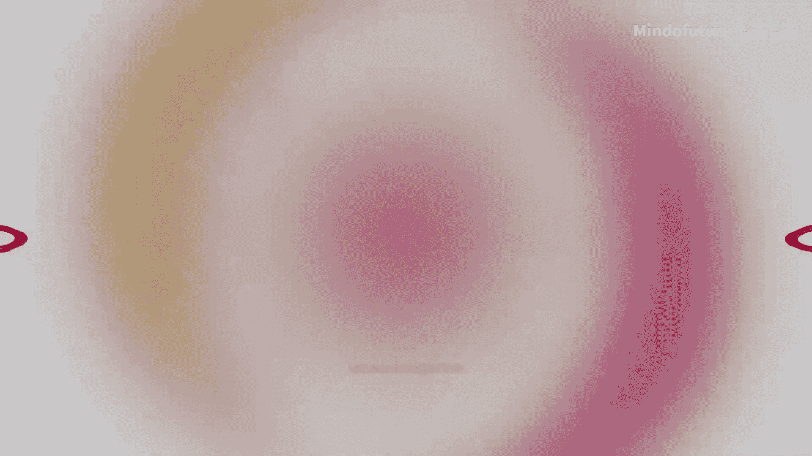
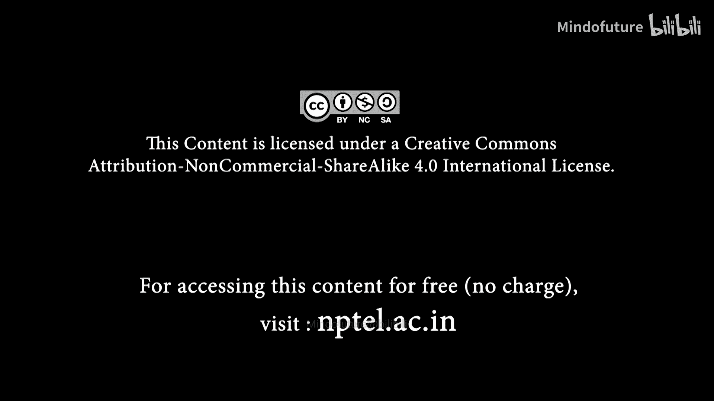
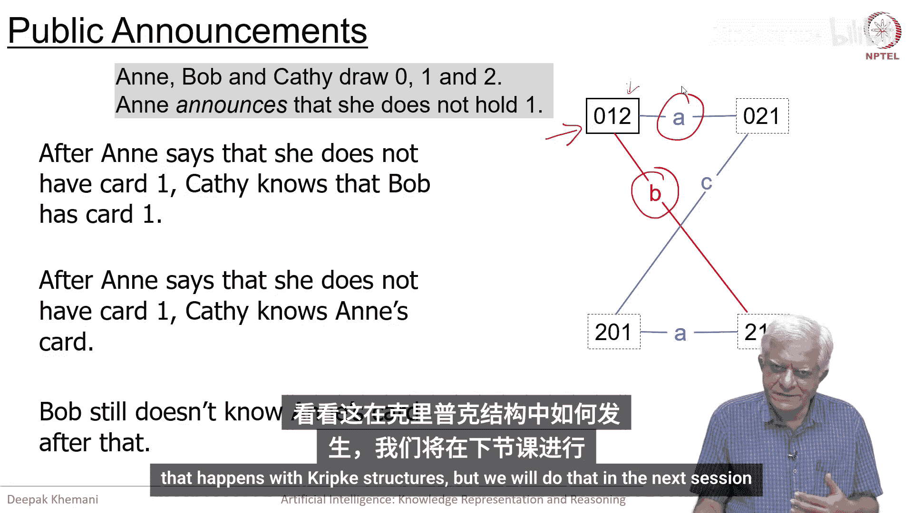

# 【印度理工学院】知识表示与推理 ｜ Knowledge Representation And Reasoning p107 P107_泥孩谜题 -BV1c4zNBmEyF_p107-

So， welcome back， we have looked at the epistemic logic， we have looked at the language。

 we have looked at the kind of sentences that you can express in that language。

And we have seen that how the semantics can be modeled using crypcase structures or the possible world semantics in which there are many possible worlds as shown in the diagram that you were just looking at last when there are three cards and three people who are picked up with three cards。

And we have edges between possible worlds。Saying that。For example。

Agent B cannot distinguish between the world 0 to 1 and 120 now of course agent B which is Bob is holding the card2 but he doesn not know which which of the other two is holding 0 and。

Wwhichhich of the other two is holding1 so it cannot distinguish between these two walls in which one n is holding 0 and in which n is holding 1 essentially。

And we saw that。There is always the real world that we often。Use for reason。

So often the task is to find out what is really true in the world。When you have incomplete knowledge。

 so you can make some inferences so like in the puzzles that we saw。Earlier。

So let' us talk about actions， How do you get？To know more information。So。

 actions can be of two kinds one is called on actions these are actions that change some propositions。

In the set of propositions so for example， a robotic agent may pick up a block thereby deleting the proposition that the block is on the table and adding the proposition that it is holding the block。

So， these are real actions in the world but we can also have episteemmic actions。

 actions that reveal information so that can happen either privately so agent a can tell agent B something。

😊，All by broadcasting it to everyone essentially so there are two kinds of such announcements that you can make one is private and the other is public so an agent may announce that some proposition is true or false and the agents receiving the information can then eliminate the remaining possible world and this is what we will see。

no。This kind of eing requires models which deal with actions。Action models， which is covered in this。

Aa called dynamic epistemic logic， but which is beyond the scope of this course here。

So we will just get a rough idea of whats happening。We'll also look at this。

Fairly well known puzzle called Mamadi children。Brazil。And it occurs with variations in many places。

And the puzzle is like this。That there are N children who are playing outside， lets say。And。

Some k of them and this k could be0 or it could be n。

 they get their444 heads dirty0 so that is why they are called muddy children。

A child can see everybody else's forehead but cannot observe directly whether it he or she himself or herself has mud on their forehead。

And for some reason no child reveals what she sees to anyone so if I see you and you have murder on your head I am not going to you know tell you that you have mud on your head。

So， this is a scenario and these kids are playing。And some of them， let's say。

 have mud on their heads。Then comes one of their parents。

The father of one of the children comes and announces， which means he tells everyone。

That at least one of you has but on your forehead。After the having made this announcement。😊，No。

We want to find out。Whether children can find out whether they have mud on their forehead essentially。

Now， remember that they cannot see the entrance， but they can benefit from what they see。

Amongst others。And。😔，From whatever information is revealed through announcements or through actions essentially。

We will assume that the kids are perfectly rational。And。Honest， whenever。

They know something and if the question is asked， they will answer that question truthfully。

So what is the question？That one will ask now， so of course first you go and make the announcement that somebody has mud on their forehead。

Then。He asks， does any one of you know whether you have mud on your forehead essentially？

And what will happen in this scenario so we dont know how many kids have mud on the forehead。

 we want to do a general analysis。The assumptions are that the children are perceptive， intelligent。

 truthful and answered simultaneously so if if。You were to ask how many of you have met on their foreheads and if they were three of them。

 all three would raise their hands at the same time or step forward at the same time or whatever。So。

 that is the assumption and that they are perceptive and intelligent that they can make all the inferences that we expect an intelligent agent to be able to make so remember the puzzles that we had seen you had to make some inferences there。

So， what will the children see so what is the scenario？

The father came and said someone has mud on their forehead。Then then he says， does anyone know。

Any one of you knows。That you have mud on your forehead。

Let us say we have there are K children who have muddy foreheads。

It turns out that in the first k minus1 times he asked。

The question the answer will be no for everyone or in other words they will not say yes。

But the case time he asked the question。All the children with muddy health foreheads will simultaneously answer yes。

So， let's see。How that happens。So we start with a simple case when there is only one muddy forehead。

Since the father truthfully announces that at least one child has a muddy forehead。

We and every child， do。That case is greater than 0。Now， supposing K was actually1。

Then there is exactly one child with the muddy forehead， right because k is 1。

And that child can see that no other child has somebody forehead so this announcement that the father made was news to him or to her as the case may。

And。😊，Once the announcement is made。He will know that he has mud on his forehead because nobody else has mud on their forehead and when the father asks does anyone you know then he would immediately raise his hand and say yes。

 I know。So the case when only one child has mud on the forehead。😊，Is simple。

But now the cases become a little bit more involved so when we set two children then each of the child can see one child who has mad on their forehead so this is a case of two muddy foreheads。

What happens？So， let。A and B have mud on their forehead so when the father asks the question for the first time they both see mud on the other persons forehead。

And they say no， but they also expect the other person to say yes。Now。

 A knows that of all the forests except his only bees。Muddy so a would expect B to say yes。So。

 if a's forehead was not muddy， B would have seen only clean foreheads that would have been the case that we considered earlier。

And would have known that his forehead was Mo and B would have answered yes。

But since B does not answer yes。After the first question。After the first question。😊。

A already knows that he has mud on his forehead I was in a similar fashion， B also would know。So。

 B said no， and this means that a is 48 is also money。

And itssymmetric reason B also realizes that is forward his money so the next time the father asked the question that is a second time。

Both these children would say yes。And then this kind of argument continues。

For every k so you should go through this in more detail yourself。

 so for k is equal to 3 each muddy child sees two muddy foreheads。

For the first round everyone says no for the second round everyone says no。But。M。

Each of those three children would be expecting two of those others that。She can see。

To have said yes when they say don't say yes， then she figures out。

That it is not that k is equal to 2， but that k is equal to 3 and that she is a third person。

And so the third time the question is asked， she will say yes。

The same argument applies to4 the first three times。All nobody says yes。

But if you are looking at three muddy forehead heads you expected those three kids to say yes and since they did not。

 you know that you are the fourth and then next time you would say yes。

So it will go on up to any key。So， what is the use of the father's announcement so lets take the case when there is more than one child who is muddy here each child already knew what the father said the father said someone has mud on their forehead and each child would see at least one other person who has mud on their forehead。

So does that announcement really help？Without the announcement if the father had said。

 do you know if anyone has put on their foreheads？Then will they be able to answer？

Was this announcement useful is a question？And in fact。

 it was because without the announcement and the subsequent questions the children would never be able to conclude that their foreheads were muddy。

So just take the case of the one case here essentially if the father had not made the announcement and there was only one child with Mudy forehead。

 the child would never know that he has mad on his forehead when the father announces if there are two children who have muddy foreheads and the father had not announced that you have mad on their foreheads。

 then there is no reason for anyone to say that I have murder on their foreheads。

So let's see the impact of public announcements here。

So we we saw the situation that Kay was holding card zero， Bob was holding card one and。

Sorry Annie was holding card zero， Bob was holding card 1 and Kahy was holding card2 essentially and this was a crypcase structure that we saw and now suddenly Annie announces that she does not hold one which is a true statement obviously。

In the logics of knowledge you can only make two statements。And she says that she does not hold one。

 which is the case because she is actually holding zero。

So what happens as a result of this announcement？That these two。Possible world vanish。

Because in these worlds she is holding one。And she has said that she is not holding one。

 so these world are not possible anymore， so out of the six world， two worlds will vanish。

And we would be left with。The remaining four world and what can be said in these four world。

After any say that she does not hold cardd one， Kathhy knows that Bob has card one。So。

 this is a real world。Right and in that real world。Kathy has no connections to any other world。

 so Kay knows everything。Kathy is herself fold2。Anne has said that she is not holding one。

 so Kay knows that Anne is holding zero。And therefore， Bob is holding one， so Kahy knows everything。

In fact， Casey also knows that what what an is holding as we just discussed essentially。But。

Bob still doesn not know anything。 Bob has got not got any new information Bob was holding one。

And then and came in said that I am not holding one so that Bob already already already knew。

 so Bob does not get any new information from the announcement and this you can see in the fact that。

Wf cannot distinguish between the world in which an is holding0 or an is holding 2 essentially and the other card being with Kahi essentially。

And can also still not distinguish。Between the world where Bob is holding one or Bob is holding two essentially that is shown by this arrow for and from the real world it is only Kahy who has benefited from the announcement。

And that is because。Caathy did not know anything about one。

 so now she knows that Anne is not holding the card one so she knows everything else。So。

 this is a kind of reasoning that we are planning to do。

In the sense that we are looking at a set of possible world。And we want to。Get more information。

And eliminate some possible worlds。So， we will look at another example。

 the example of muddi children that we just saw。😊，And see how that happens with crK structures。

 but we will do that in the next session。

