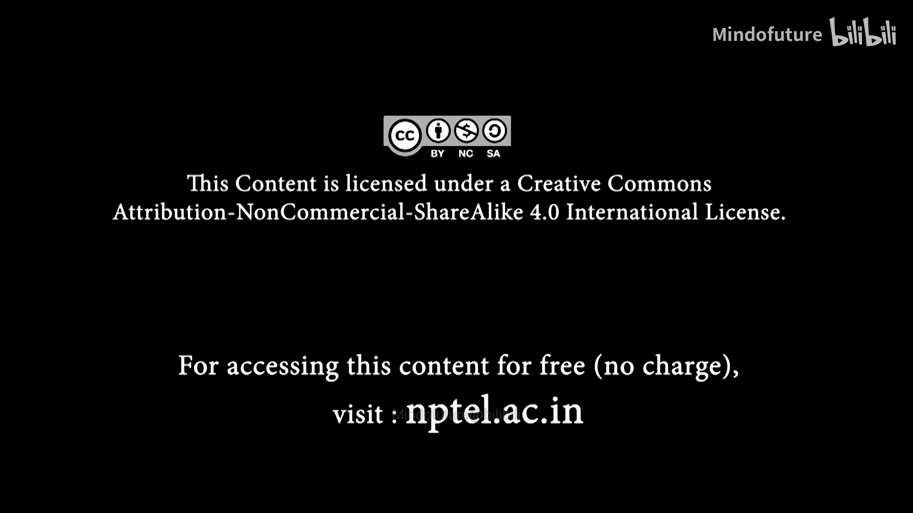
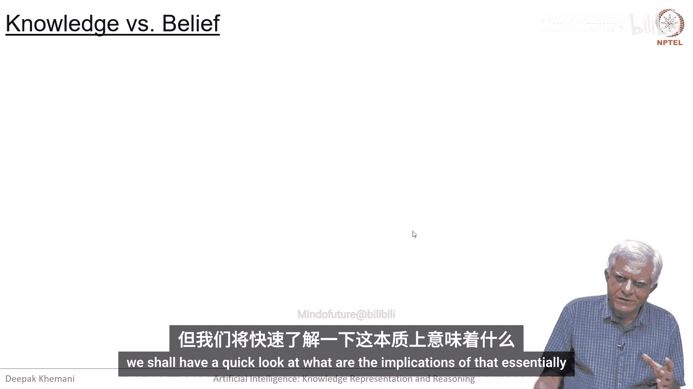

# 【印度理工学院】知识表示与推理 ｜ Knowledge Representation And Reasoning p108 P108_认知行为的影响 -BV1c4zNBmEyF_p108-

So welcome back。We have been looking at。How K K structures。Can be pruned。

When you get more information， this information can either come through public announcements。

As we saw， or it could come through individual actions as well。So。

 actions like raising an hand is equivalent to saying yes， which is also like a public announcement。

 so we are talking about public announcements here。So。

 let us look at the case of muddy children and let us say they are three muddy children and lets say they are the same three and Bob and Kaie were playing cards before this now they are playing outside。

😊，And this is a real world has shown him in which Anne and Bob have got muddy for it and Kahy does not have a muddy for it。

 so that is a real world but。Because。There are three variables each can take two values。

0 or1 there are。3 is two is to 3， which is eight possible world as shown here。

And the distinguishable relation between all these worlds essentially。So， in the given world。😊。

And cannot distinguish between the given world and 0，10 because。And does not know。

Whether Anne's forehead is muddy。All not， essentially。

But it knows that Bob's forehead is muddy and she knows that Kay's forehead is not money muddy likewise。

 Kay cannot distinguish between the fact。Where she doesn't know whether she has a muddy forehead or not。

It could be in either case and likewise for Bob， so Bob also doesnt know whether he has a muddy forwarder or not essentially。

So， this is a situation when we start with the extreme cases 000 when no4 are money。😊。

And the other end is 1，11， where are all for it somebody。So， let's see how。The process goes on。When。

The father comes and makes an announcement that at least one of you has mud on his or her forehead。

There was a state hill。Mes 0，0，0。Which vanished essentially so that state has gone。And now。We are。

Into。These states where either one or two or three children can have money。Now。

 notice that once this state has gone。Each of the kids。Would have。Some conclusion。About。

Their foreheads。So， in the possible world in which Bob was the only one with a muddy head。

 Bob would know that this is a state because from here there are no bob edges。So。

 if Bob was the only one， so that is what the possible world there is showing with the muddy head。

 then Bob would know at this stage likewise for。Kathy。

 if she was the only one to have a moneydy for it she would know at this stage because there are no khy edges going from that edge essentially so these are the edges which also which got deleted alongside。

The announcement after the announcement and likewise for an essentially so if only one of them was having a forehead then at this time if that was the real world then they would know essentially。

So， when the father ask。Does anyone know。And nobody steps forward。Then， all those。

Three states that I had circled here。All of them will vanish because if any one of them was a real state then they would have known and they would have stepped forward and all said yes and they would so all those states vanished so we are only left with these states essentially。

Now， you can look at this state， the real state here。In this real state。

 there is only ambiguity for Kahy。Getty。ItDoes not know。Get he can see。

That Anne and Bob's forehead head are。But she cannot see her own forehead。

 so there is ambiguity about that， so she doesnt know whether her forehead is muddy or it is not essentially but for the other two people there are no there is no ambiguity they know exactly that。

Because。At least two kids have to be having。Muddy for it because the second question is about to come。

They must be one of them because they can only see one other listing。

So next time when the father asked a question。Everybody knows and Anne and Bob will say that yes。

 I know that I have。But on my forehead。Now， in the epistemologic community there is something called common knowledge that we often talk about。

And it goes like this。That a proposition P is common knowledge。For a group of agents。

 if every agent knows P to start with。Then every agent knows that every agent knows P。So， this is。

K I P。Then， this is K I。계 J비。And so him。You can keep adding these knowledge operators and the statement would be true so every agent knows that every agent knows that every so everybody knows what is going on essentially。

Up to any depth。Despite the seemingly difficult definition。

 common knowledge is very common and is easy to attain。

The simplest way to do is to just make a public announcement， like others。

Coming and saying that somebody has forehead。somebodybody has mud on their forehead， essentially。

Of course， you can imagine situations where common knowledge is harder to achieve。

And there is a standard example of two generals。Who are on different sides of a valley and both say that。

Only when we decide to attack together。that we will launch the attack and they will live in a world without any social media and without any telephones and things like that so this they have some mechanism of communication but it takes a little bit of time so General A tells General B sends a message saying that lets attack tomorrow morning。

So should they attack next morning。Not unless they have consensus。So。

 general A should know that general B has received his message essentially how will you know that？

He has to get a message back from general B when general B gets a message。Then。

General B will send an acknowledgement saying yes， I received your message and therefore general A knows that general B has received the message so can they attack。

But General B is still not sure whether his acknowledgement has been received by General A so General B will wait for the fact。

That a should tell him that he has received the acknowledgecment。

You can see that this process can go on indefinitely and common knowledge is very difficult too。

Obtain in such scenarios essentially and you can imagine that such scenarios are there on the internet where messages are going back and forth and you know servers have to send a message to somebody and other other machines have to send acknowledgements and so the TCP IP protocol and things like that。

There are applications of epistemic logic there。also something called mutual knowledge。

And it is a weaker notion the common knowledge it says that。Everybody knows P。

But everybody doesn't know that everyone knows me。As long as everybody knows P。

 we say we have mutual knowledge essentially。In the Mu children case if the father had whispered to every child individually。

That at least one of you has muddy head。Then we would know that we know。

That this is mutual knowledge。 The children don't know。

The children know that something was whispered in somebody else's head。

 but they dont know what was whispered so it is not common knowledge but it is mutual knowledge provided that the father whispers the same message to everyone。

So。Let me denote the fact that father announces to the children that at least one child has somebody forehead it。

If everyone knows P say the far and this is mutual knowledge whisper in everyones A。

 but everyone does not know that everyone knows P。Then if case is equal to1 the child with the muddy forehead will realize that he has muddy forehead。

 but for k is equal to 2 or larger this would not be possible and you should just think over this and see that mutual knowledge would not be inof。

This is the case because when k is equal it 2， the second time a does not know if b knows b essentially because a does not know what the father told B essentially。

And therefore， a will not know why B is not stepping forward。So， in general。

Wchual knowledge will not help you。The children will never be able to conclude their forwards are muddy essentially。

But common knowledge said that up to any arbitrary level of nesting。In general， it can be shown that。

If。The depth is K。That。The depth of this。Shared knowledge K1 KI knows that KB knows and so on。

If the depth of this length of this。Expression is k at least。Then if there are only K children。

 then that not mutual knowledge is enough enough essentially。So。

 you should think about that a little bit。The next topic we want to look at is belief and see where beliefs。

How it contrasts with knowledge？It is an emerging area。

 but we shall have a quick look at what are the implications of that。

So we' will do that in the next session。