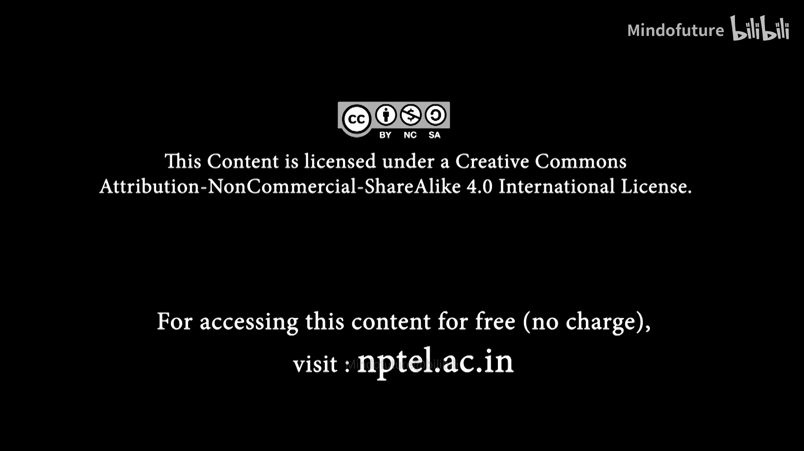
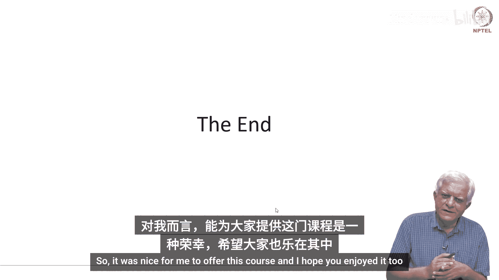

# 【印度理工学院】知识表示与推理 ｜ Knowledge Representation And Reasoning p109 P109_信念推理 -BV1c4zNBmEyF_p109-

So welcome back。We have looked at episteemmic logic。Which is reasoning about knowledge。

But we have also said that。Knowledge is characterized by the fact that you can only know true things。

And that is because we have the truth axiom in episteemmic logic that says that an agent can only know something which is true。

 so if agent A knows a sentence phi then the phi has to be true in the domain essentially。

We saw that this。Logic was useful， so we saw the muddy children puzzle that when you have incomplete knowledge。

You have in complete information， then as you get more information。

 then you can do some reasoning and figure out what's happening So it's a useful device to have。

Without this through taxom。Agents can believe sentences that are not necessarily true， so。

 for example， Age A can believe that the earth is flat essentially。

It doesn not imp that the earth is split agent they believes that， So we know， of course。

 that lots of people believe lots of things and they are odds at。With each other on such matters。

The world is full of such。Contrasting beliefs， recently。

That is one of the reasons why logics involved that you know。

 when people have different opinions or different beliefs。

Then they could sit down and work with this formal system to arrive at。

What is really true essentially？But， let's look at the。

What can happen if we don't have the toolaxum and such logics are called do logics which are kind of logics of belief then we have to think about things like belief revision and so on。

We don't have too much time。hi。The fact that agents can hold false beliefs open up all kinds of possibilities。

In particular， one now has the possibility of inducing false beliefs in others essentially。

As you know， it's not a very uncommon thing essentially， so we have heard about fake news。

We have heard about disinformation。 So， for example， even as I。

Write these slides and as I present these slides we know that there is a lot of dis information about Ukraine that you know both the east and the West are saying that the other is meddling in Ukraine and it is not clear as to what is really happening。

And then， of course， you know， election time。They can offer you the moon。

Reasoning with beliefs is a much harder task。 and this whole area of research is still in its decency。

 So we don't have anything to talk about。 but what I would like to talk about is some。

Possibilities of what one can work with if one is interested in this area。

Inducing false beliefs is the basis of deception deception has existed since time immemorial。

 even in World War I the Allied forces had you know tried to deceive the Germans into saying that they were going to land in。

One place whereas when they had landed in a different place。

 so deception is a common and powerful tool in all adversarial situations。

But how do root deception is still difficult for us to do that and we will look at a couple of examples。

 but I should underline the fact。😊，Now this is future work and somebody who is interested in。In this。

Has a meaty problem to work on essentially。So， I will discuss two problems that we are looking at here。

嗯。Without。Discussing how we are trying to solve it。One is this story called the Guffelo。

So let me read that。I mean， not the story itself， it is a very delightful book to read if you can get your hand on it you should。

😊，Really read it is a children's story by Julia Julia Donnelson that tells the story of a clever mouse。

And this mouse is confronted with the prospect of becoming a meal。

For three animals in succession first it meets a fox。

 then it makes an owl and then it makes a snake and each of them is keen to eat the mouse。

The mouse invents an imaginary character called Guffelo。

And convinces his potential predator that instead of the mouse getting eaten they are the ones who are going to get eaten because the grauffelo likes to eat a f and the grauffelo likes to eat an owl and the guffeller likes to eat a snake and so on。

And those creatures。Believe him and they run away essentially and the mouse leaves to tell the tale。

The story gets really complicated when as the mouse is going along it is going in a forest looking for nuts or something like that。

And it actually runs into this grafeello which it thought did not exist and it had imagined and it really shows up in front of him and the grafeello says I am going to eat you essentially。

The mouse deceives him also by saying that the it is he the mouse。

That is a dangerous predator he says， don't mess with me。Otherwise。

 Ill make a meal of you or something like that。And as evidence。He leads the Cafeello and say。

 he says， come and show how people are scared of me or how animals are scared of me。

And he takes them towards the fox and the owl in the snake。 And all three of them。

 they see this pair approaching， and obviously they run away in。

Right the point is they are running away from the Gufffeello but the grauffelello doesn not know this and the Guffelello thinks that the mouse has told him that they are running away from him and so the Gufffeello believes this story。

😊，And it runs away in turn， essentially。So as you can see this is to do with deception。

 this is to do beliefs and inducing false beliefs in others and so on。

 but it's also to do with other aspects of。Being in a domain of problem solving， you know。

 fighting for your survival and things like that and what。We want to see is how。

Can a mouse invent such a lie？How would you implement supposeupping you were implementing this whole thing。

 how would you implement a mouse which could do this sort of thing essentially？

What different kinds of representation and reasoning will one need to combine essentially？So。

 look at the different kinds of listing that the mouse has to do to be able to do that。So。

 given that escape is unlikely the mouse has the goal of scaling its predator。

 so we presume that the mouse is not in a position to run away。

 so it has to do something clever essentially。And it decides that。

The best thing is that the predator should run away essentially。

Now this is because the mice mouse can imagine the fox， for example。

 the first animal it meets is is scared。That if the fox is scared。

Then it is a fox that will run away so his goal is to now scare the fox。

So he invents a monstrous creature called the Gufffeello and describes him in vivid detail and how he likes to make a meal of foxes。

How would an agent come up with such a plan to tell a lie to create a false belief in the adversary？

That's Sir。Difficult question to answer。The mouse has to imagine。

How the fox will react to in such a belief essentially。

And the mouse has to decide to tell her lies that I have a friend called the Gufffeo he is about to come and eat you seriously。

And， of course， hope。That the f will be deceived essentially。So。

 if you do get your hands on this story， do read it and if you get time think about。

How you can handle this kind of reasoning that' is happening there。

The other example is from my favorite domain of contract bridge。

 which sometimes I say is the secret goal of AI。Because we have had。

Game playing programs which have mastered all the board games。The ches and go and so on。

 but our game programs are still not good enough to beat the best humans essentially。So， this is a。😊。

Example I am giving from the game of bridge， you don't have to know the game。

I will try to describe it irrespective of the game。I want to show。

That this involves reasoning with possible worlds and that is the。Point that we are trying to meet。

So， without going into the details of the game we are talking about one particular suit I hope you know what is a suit so we are talking about diamonds and this is the actual distribution of the diamond cards and we are talking about this player south and this player。

Wst。So， the goal that South has is to， as we say in bridge set up the diamond suit this thing。

The assumption that South has to make so he has to make assumptions that this must be true and the assumption is that the diamond is has to be with west。

 which means。This condition， which happens to be true in this real world， essentially。

And then the plan that South makes is to。P a small diamond towards the king essentially so again there is some plan of playing the diamonds in a particular way and south has made this plan now West。

There is also alert and West knows that South is going to play on diamonds and West is also active。

But let' us look at the situation from South's perspective。These are the possible worlds。

That exists for because see south can only see。So钱。

And north hand that's how the the the game is played this thing south cannot see。These hands。

So the remaining cards of the two。Players。Can be divided in different ways。

And those are the different possible world that South has to contend with essentially。So。

 these are the possible worlds that we can talk about。Oh。So let me unwb that thing here。So。

 you can see that。We have decided that a has to be there so in all these hands as you can see a is with v essentially but any of the other cards can be with west so those are the possible hands we have tried to cut down on this set of possible hands by introducing something called x so this x stands for a small card so which is why in the actual case where we have a' queen and 4 we have written as a queen and x and the other x is there and we have put count of two to say that these are actually two different possible words but as far as planning is concerned they are the same。

So we have this one， two， three。And seven possible worlds in which。This plan。

 whatever the plan is will succeed and there is only one possible world in which little Fa that is shown in pink hair essentially so it is a reasonably good plan It is a very good chance of success and。

That plan is to play a small diamond towards the king。So， we have said this。

 this is a situation and this is the real world here。😊，Whihich as you can see， is the same as here。

A screen and small and one small there。And now South has a plan。And West can。Anticipate。

That south has a plan。 This waste was， in fact， an army。Cat Army in sergeant， I think， called。

Moice gray， and this happened during world for one time。So it's a real life situation。

It's the real life example。So。As you can see。😊，All these green things are in which the plan would have worked。

And the one which is in dark this thing outline here。Is the one in which。Which is a real world。

 So which means that。The South's plan would have worked in this real world。But if。

The real world was this one， as shown here by this arrow。Then waste was Molly gray。Could do。

A brilliant play。Wwhichch is to throw away the diamond days before west South got a chance to play diamonds essentially okay so that much is important for you。

So， once he throws with the diamond A， this situation gets transformeded into one in which the diamond A is gone from play essentially and then it turns out that that is not a situation where the south plan will work。

But this is only。If。This was the real situation。In the given situation。

 whatever waste does will not work essentially。In if the situation was the one as shown in the alo hill。

Then this play would have been brilliant。But you know。

 we are working in this world of incomplete information South doesn not know what west holds。

 west does not know what South holds。So what happens， What is the effect of。

Having thrown the diamond in the real world。We has thrown the diamond。

 so you can see that there is no。No a here， essentially。

That would not have affected the plan and the plan would have succeeded essentially。

But this is what Moice great did He actually threw away the diamond a。And as a consequence。

He convinced。The declare。That that was not the real world， that the real world was this one。Here。

And he has converted the real world into this one。Which means that South's plan will fail essentially。

 so he had only pretended that is what deception is about， right？And。As a consequence of this。

 decer believed that this is the actual hand， the one below and not the one on the top。Because。

This throwing away of the diamond a would have been meaningful in this。Possible world。

And so because he has thrown the diamond a， it must be this word and declareer actually abandoned his line of play。

And tried something else。And was defeated in the contract， essentially。So， deception。😊。

Is still very much。A very nascent field we dont have programs which can do this of course we have programs which can produce deep fakeakes and things like that。

 but it is not that autonomous agents are doing something there is deception going on。

 but the deception is being done by people。How can program through deception is still very much an open field？

And we'll end with that。So this is just to illustrate what' is happening here。

 These are the possible world， the possible world。On the left hand side， which includes the world。

Which is the real world， so this is the real world。

But from the south perspective there are many possible world。From e from the waste perspective。

 all these other worlds are the possible world essentially。

But what weed was that it played as if this was the real world and therefore。Was able to。

Deceive the declareer， essentially。So with that， we come to an end。Of our study of epistemic logic。

 and， in fact。With the end of our course。I hope you enjoyed doing this course and I hope you。

Benefited from it。And I hope that it will help you do some useful thing in whatever you are doing。

So it was nice for me to offer this course and I hope you enjoyed it too。

