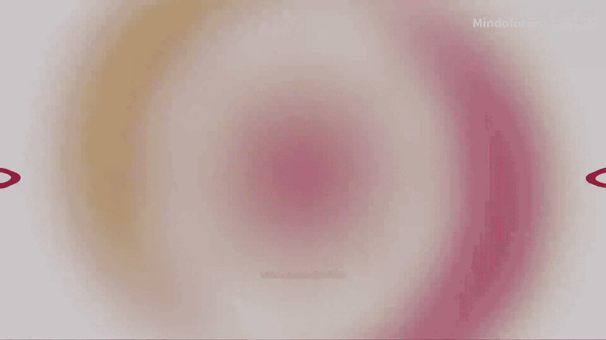
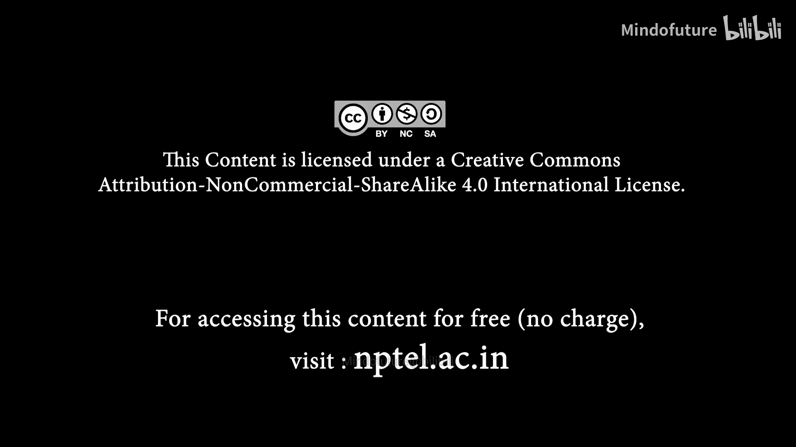
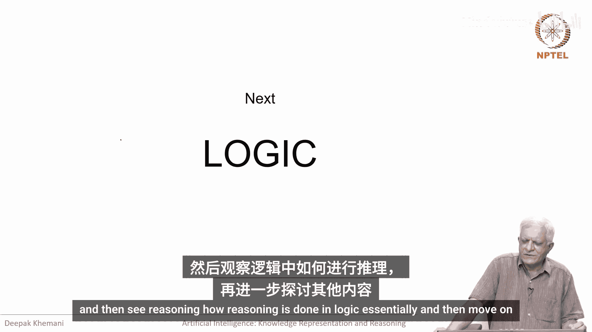

# 【印度理工学院】知识表示与推理 ｜ Knowledge Representation And Reasoning p11 P11_2.2-从齿轮到符号 -BV1c4zNBmEyF_p11-

In the last video， we looked at。😊，The relation between symbols and thought or symbols and thinking。

 and we saw that even in the 16th and 17th century， the philosophers were theizing。

The fact or hypothesizing the fact that thinking is basically the manipulation of symbols in our head essentially。

 So we'll go forward with that idea。😊，And try to define what do we mean by？呃。

Something called physical symbol systems， which was。Described by。Two scientists in the last century。

ho。Simon and Newell。Okay， so we already said that a symbol is something we stand for something else。

😊，So， now we are kind of clarifying that you are saying that a symbol is a perceptible something that you can sense。

Because it's a basic unit for communication that you。

You create a symbol and somebody else perceives it essentially。So。

 a symbol is something that stands for something else where we have seen alphabet symbols， nuals。

 road science， musical notation， and so on。A symbol system is a collection of symbol systems。

 it is a pattern of of those symbol elements essentially。So。

 words and arrays and lists or even a musical tune can be thought of as a single system。

And when we say a physical symbol system， what we mean that just like。

The physical world awaits some loss。The symbol systems will also obey some laws of manipulation。

 essentially So for example， how to do addition。OrAs we will see more this thing。

 how to make logical inferences。So， there is this hypothesis called the physical S system Hyth。

 it is credited to Ellen Newell and Herbert Simon who were pioneering AI researchers at CMU。

At the time when CMu itself was being created。呃。And they wrote a very influential book called Human problemble solvinglving in which they tried to study how humans solve problems。

 Simon was the economist by training。 In fact， he got a nobel prize for that。

 Neel was his student and they did a lot of work together。At the Mu。What they said。😊。

Was that a physical symbol system has a necessary and sufficient means for general intelligent action？

😊，That if you can represent things using symbols and if you can manipulate them using some algorithms。

😊，Then， that is enough to create。As we would say nowadays， AI。

To to to to create machines which can have intelligent action。

 essentially both necessary and sufficient。 you don't need anything else。

 but it is also necessary according to Newel and Simon， you cannot create intelligence without。

Representing。Things in a symbolic manner， and we had talked about that when we were talking about the introduction essentially。

And that's what this course is all about。呃。So， the ability to manipulate symbols is called symbolic AI or classical A。

😊，And Hoglands call it good old fashioned AI， GFI。Which is in contrast to modern a。

 which people think is only machine learning。So， let's look at symbols。As I said。

 symbols are used for communication。And communication is commonplace amongst living creatures。

 not just human beings。Birds have wide variety of songs， obviously。

Or at least one can hypothesize that they are singing it for other birds。

Walees communicate across long distances， which is known to be a fact。

Dogs wag their tails and bark at their strangers。No。Some people might say。

That this is their inherent behavior that dogs you know behave in a certain way just like a weaver bird has it genetically learned how to weave its nest。

 which is an exite exquisite structure。😊，All these animals。Behave in some intrinsic manner。And so on。

 but nevertheless。They are using。These sounds to communicate。

And we can even go ahead and say that there is intentionality behind their communication that when a dog sees its owner and wags it tails。

 it is really happy and is trying to convey in some sense the fact that it is happy or at least it is very happy essentially。

😊，Or if it sees a stranger travelingwling around near your gate and then it starts barking。Oh。

Its probably there is some intenseity behind there anyway we don't want to get into that。

Humankind is the only species that consciously uses symbols to represent information。😊。

And sleeve symbols emon trails， but they don't do it consciously is it is their behavior it is their nature essentially。

But， we do。It consciously， essentially。嗯。It's possible that other other animals。

 more likely primates also do it， but we are not arguing about humans versus the rest of the。Oh。

Animal kingdom here what we are talking about。😊，Is that humans have shown signs of being intelligent。

 though， of course many people would question that given the state of the world。But。

We want to investigate how that intelligence can be created。So， talking about symbols。

 the earliest humans known to engrave symbols， So we are talking moving towards written the written word。

 of course language。Emerged out of a。Of more basic sounds。嗯。But the return word。Its something。

Which has made civilization possible essentially。 once you write down stuff。

Somebody 20 years later can read it also。So， the earliest humans known to engrave symbols on clay were the Sumerians。

In ancient Mesopotamia， which many people consider to be。The cradial of。

Civilization in what is modern day Iraq。The first engravings were picgraphs and they were found in many found in many parts of the world。

😊，But soon involved into more abstract entities。Like symbols from an alphabet decision。

One of the earliest。Scrips or languages。OrMore like scripts that was developed in the ancient world。

Was。Called Ciform。And you can read about that in this。Article on the web。

Call the world's oldest writing。First， developed around 3，200 BC。

W Sumerianscribes in the ancient city state of Uuk。

Wwhich is in Fandde Iraq as a means of recording transactions。

 uniform writing was created by using a read stylus to make we shaped initions in clay tables。

Cllelay tablets。Now even as I was preparing my slides for this recording。

There was this news that the U has recently returned one of the earliest slate tablets which was stolen from Iraq during the Iraq invasion。

this is a clay tablet which is called the Gilgamesh。😊。

Tablet Gilamsh was an ancient king and this tablet apparently narrates the exploits or。

Exlos of bravery or whatever about Kigamesh。 And this has been recently in 2021 returned back to Iraq。

Now， uniformiform as a robust writing tradition endured 3000 years。

The script see uniform is not a script it is not a language。

 it is a script which is used to symbolize something else which is language which is that sounds have certain meanings essentially。

That an， an apple is a sound， which。Means the fruit apple， but。

It can be written in different scripts essentially okay I mean we normally we would use the Roman alphabet。

 but you could have written it in for example， in Hindi newspapers。

People do use the thenaary script to write English words， I think so that can be done。uniform你form。

It was not a language， it was a script and it was used by different languages。

 multiple cultures over time to write a number of languages other than Suil most notably the Acaddian a Semitic language that was the linguaranca of the Assyrian and the Babylonian。

Empires。Alphabetic weigh。Where are the markings that you make？😊，A from a well defined alphabet。

 so we have the English alphabet， we have the Hindi alphabet and so on and so forth。

So the imag alphabet and the Roman alphabet， that came a little bit later towards the  first century AD。

So。We are heading towards language。The breakthrough came when symbols were not only employed as images of representing objects and events like a hunt。

 I mean， that' is one of the most famous kind of cave paintings one talks about， you know some。

Humans with spears， you know， chasing something which looks like a oxen or a bull or something like that。

But the breakthrough came when symbols stood for abstract entities like sounds。So， you know， A，B。

C D or whatever。 These are sounds， which are used to。Put together to form words。

And words are put together to form sentences。So， ability to write alphabet gave a great impetus， too。

😊，Language and then， of course， literature and science and everything。The spoken word had become。

The written word is essentially。Different languages evolved in many different regions of the world。

And the common theme was writing exactly that came with the written word exactly。

Our interest is in computing machines， so I mean our goal in AI is to make machines think to make them intelligent essentially。

And this quest has been there for a while， you know， for for humans to create machines which。

You can do useful computation for them。 Initially， we started with mathematical calculations。

 which was the idea of computing in those days。 But more grandly。

 we want to create machines which can think， you know。😊，So， the earliest machines which。Buildu for。

Let us say calculation or computation， as they said in that time。

Were non symbolic machines in the sense that they do not represent。😊，Symbols， explicitly。有去。

But somehow， you know， a little bit like how of course this was conscious activity。

 but somehow how the ant subconsciously leaves a ph trail which is interpreted by other ants。😊。

To be the past to where the food is。So， the earliest machines also did not use symbols explicitly。

They would use things like gears， essentially of course gears have built in digital elements to them because you know they have their wheel the teeth and if you can think of one th as counting one number。

😊，Then the number of teeth that you have would kind of in some way represent numbers， essentially。

But not explicitly。Charles Webbbage， who is credit to be。The father of computers。

If not the father of computing。He was a mechanical engineer in the sense that all his experiments were done。

😊，In machines of iron and steel。And one of his famous。Machine called a difference engine。Did use。

Symbols。In the sense that it used punched cards。 now punched cards。Were not invented by Babbage。

 They were used in France， for example。In weaving， so they were a mechanism which could give input to the loom。

As to what is the pattern that you want to weave in。Cth， essentially。So， the origin of。

This stored program concept。Or the origin of a flexible computing machine。Or the universal machine。

 as people have called it。Was that you could。Load different sets of instructions into the same machine and it could do different things for you essentially that。

We get the idea of a general purpose machine。And Bas did use punchcard。 So in some sense。

 there were some elements of symbolic。Communication there。And of course。

 in modern day times electronics， the machines have become more and more digital。

 they have become more and more simple manipulating。We take it for granted。

That the digital computer operates。On zeros and ones。Our goal is to。

Rise out of that c of zeros and once if you have looked at code binary code。

It is quite undecifiable for us。And we would be much happier。

If the machines operated at our level of representations rather than。

Their level of representation which is you know strings of zeros and ones。

And that' is our goal in computer science in general， you know。

 inventing different programming languages。And of course AI essentially。

 ideally we would be able to tell a machine something in natural spoken language and it would do what we wanted it to do essentially。

Language and logic preceded computers。 Okay， we will start with that study。And our quest of course。

 is to impart both these capabilities， the ability to de with language。😊，嗯。And by language。

 we mean natural language， you know， kind of language that we use for communication between ourselves。

And logic， logic is something because we will see。That because of its preciseness is something that。

Hes very attractive with。So， we begin with。Some more history。呃。Mechanical arithmetic。

How can you make machines do？The sums that。Human beings， all human computers as they were called。

Would sit on a table and do。So Pascal who is of course a well known scientist。

 we have Pascal's law and we have a language named after Pascals。Yeah。

Invented the mechanical calculator using lantern gears。And this was in 1642。He did， of course。

 lot of experiments all。Inventors have to go through a lot of experimenters。

 what we finally see is the final product。And he presented his first machine to the public in 1645。

 he called it。The arithmetic machine， a parcal calculator。Or later， it was called the pascalline。

And this calculated machine could add and subtract two numbers directly。😊。

And multiply and divide by rep， essentially。 So theres a image of。The pscalline here for you。

He received。The royal privilege。Which gave him the exclusive rights to make and sell the cultalculating machines in France。

But it was an expensive proposition in by 690s by 1654 Pasates sold about 20 machines。

But it was not something we would sustain， essentially。And he kind of stopped making them。

The person who take forward mechanical computing。Was liveness， liveibness。

Is another great scientist that we have。We've got so much from。

He started work on his own machine after Pascalll's death。And。

He invented what is called the Leibness wheel of the stepped drum。In 1673。

Which was used for over three centuries until the advent of electronic calculators。

 you can see how far reaching that invention was。And you can see this invention in this small animation on the left。

You can see that there is a spindle like thing with a gear on it。😊，And then there is a drum。

 which has got。Steps of different size， different lens。The drum rotates。And depending on where that。

Gear is located。The gear will rotate an appropriate number of turns or times， if you want to say。

 So if you look carefully at this。In this you will see that this gear rotates three times1。Do。

3 and then the fourth step misses it so in some sense this gear at this setting has counted up to three essentially so you can see where we are heading we can not think of you know machines which can handle numbers essentially。

😊，Now， obviously， if you were to move this bear back and forth。

 then it would count different numbers the the more to the right you go。

The larger would be the number it would count because the number of times then that step would hit it would increase essentially so that was a invention that。

Called the lightness wheel of the stepdom， which was used in calcivulating machines for a very long time。

It's。His machine called the stepped reckonconer was a digital mechanical calculator invented by Leibness around 1672。

😊，And completed in 1694。It could perform multiplication by repeated addition and division by repeated subtraction。

 and it could work with a digit numbers。 Okay the earliest digital computers also。我。

Small word length， they worked with8 bit numbers who this is we are talking about eight digit numbers so。

And here's an image of his steplener， and it was used。

Up to the early part of the last century before the electronic calculating machines were invented。

Of course， if we are talking about mechanical computing。😊。

We cannot but talk about Charles Dage and his inventions。

 we already have mentioned the difference engine what we are talking about here。

Is the analytic engine and you can see how intricate the mechanical system is on the picture on the left and this is a machine which is displayed。

😊，At the science museum in London， if you have to go there。You should definitely go and take a look。

But thankfully in modern times you don't have to go there you can just go to the internet and you will find。

Notally images of the analytic machine and the difference engine。

The alytic engine and the reference engine but also working models with videos showing how they used to operate and it is quite quite fascinating。

Even though it's very cumbersome to use those devices。The thing about the anatic engine。

 which is the precursor of our general purpose computer。😊，Was it。

It was a mechanical general purpose computer。 What do we mean by general purpose by general purpose we mean that。

😊，The computer of the machine remains the same。😊，But you can make it do different things。

Unlike many machines that we have， for example， if you have a ceiling fan， it can only rotate and。😊。

You know， move the air around for you。 It can't do anything else， essentially。

However sophisticated the machine might be。I had a friend who was once admiring。

A music is in my head。And then， you know， as a kind of a joke， he said that， can it cook。But。

 of course。That stage has not yet come。So， this is。The analytic engine by Charles Rabbage。

 which was described in 1837。 so you know quite some time ago almost 200 years ago， not quite but。

As a successor of his difference engine the analytic engine had all the features that a modern digital computer can have。

 it had something like an arithmetic and logic unit which does the computation。

 it had control flow as to you know how to flow the computation as to whether to do this sequence of actions whether to do that sequence of actions。

😊，It had conditional branching， it had loops。It had an integrated memory。

Making it the first design for a general purpose computer that could be described in modern terms as during complete。

So when you say tuuring complete。We mean。Everything that a tuuring machine can done。

Can do essentially。 So if you have studied a little bit of computer science。

 you would know that the tuuring machine is a model of a general purpose computer that anything that can be computed。

Where any machine。It can be compute by a tuuring machine。So。We have looked at symbols。😊。

And their relation to thought。 And we have looked at how symbols can be。

Manipulated or how philosophers thought that symbols are manipulated in our heads essentially and then house philosophers or scientists if you want to call them now。

People like liveibness。Try to implement。This kind of processing。Caapbilities。Computation。Capbilities。

 you know， mechanical computing。Into the only machines that we knew of that time。

 which was mechanical machines。 So everything that happened in medieval Europe was essentially。

Mechanical in the sense that it was built by metal essentially。And。

This idea of the digital computer came only in the last century， as we know。So， what we will do now。

Is2。Look at the origins of logic， so we have we have seen that there is a connection between symbols。

😊，And thinking hopefully there is a connection at least in human beings。

 but what when we come to machines like the digital computer。😊，We have no。

Other possibility but to represent symbols。In some fashion， essentially。

How we represent things in our head is still not clear in our human heads。😊，Of course。

 it's there in some very complex network of neurons in our heads in the form of some。

Large network of neurons。And many people have said that the human brain is the most complex piece of matters on on in the universe。

 So we don't really know how we represent symbols in our head。

 So if you look at Hoter's book that I mentioned earlier， you might get some。

Insight into what possibly could be there。But when it comes to digital computers we have no option but to represent things using zeros and ones and eventually you know interpret them in some more esooteric fashion。

So well now move next to logic。And。Study。Logic and then see reasoning how reasoning is done in logic essentially and then move on to other things。

