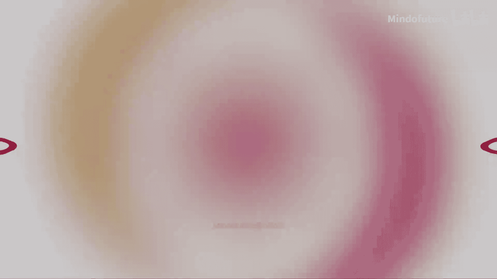
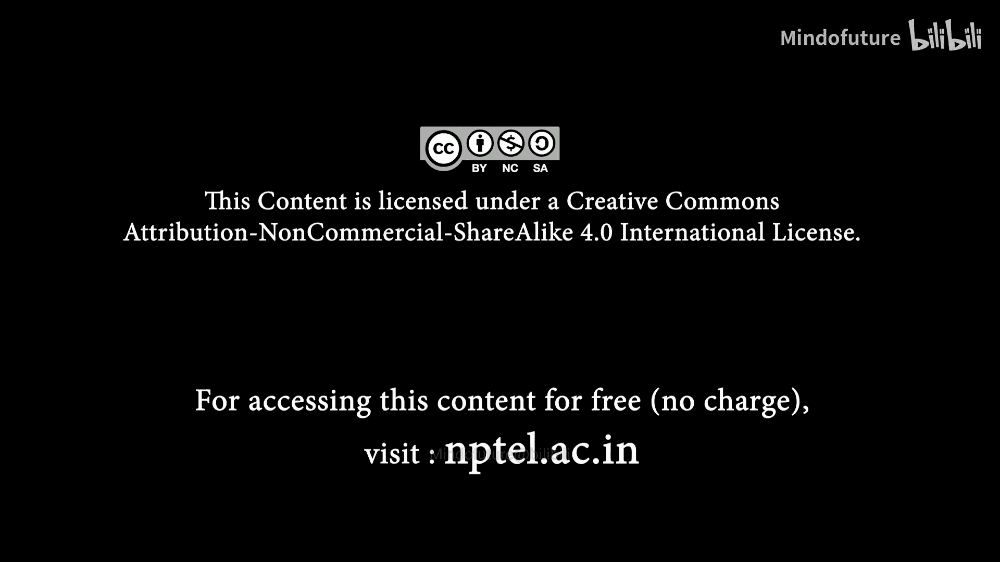
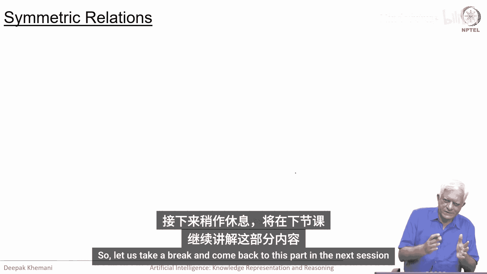

# 【印度理工学院】知识表示与推理 ｜ Knowledge Representation And Reasoning p111 P111_同义词、反义词、下义词、部分词 -BV1c4zNBmEyF_p111-

Okay， so we have been looking at how we can use quantifiers and logical connectives to represent。

Kowledge about the world， about our domain。Let's look at the existential quantifier。

If you want to say that some children are tall and we have said this earlier。

We should represent this as saying。There exists in x。Sas that x is a child。An exist do。

This is in contrast to saying that。If I had to say all children at all， I would say for all eggs。

 child eggs implies。Doll eggs。Now in one case we use implication in one case we use and essentially so we use implication for the universal case and we use and for the existential case。

 so is that correct？One way to verify your representations。Is to check。That。

The negation of what you are saying is。Obtained by negating your representation。Okay。

 so one way to establish the correctness is to check that it negates correctly so if you want to negate that some children are tall then what you should expect is that all children are not tall because。

If something is at all， and that's not true。That means no child is tall。

 so either we want to say no child is tall or we want to say all children are not told。

 which is the same thing as we mean。That not tallll is opposite of tall。Now。

 if you have chosen the implication。Like we did in the universal case。

Then if we negated the implication， then this is what we would get we would start by saying。

That this is our presentation there exists in x child X implies tallx and we would negate it。

And we would expect to see that no child is tall， but what we get to see is that once you push the the negation inside and then you push this negation again inside you get child X and not tall eggs。

 what does that read for all eggs。X is a child， and x is not all。

This is clearly not the negation of some children at all， because not only is this saying that。

All children at all or something like that， all children are at all it is saying that everyone is a child。

And everyone is not tall。 there is no connection between it being a child and all。

The correct representation when we negate we get what we expect to see and you can see that what we get is after pushing that knot inside。

We get this statement， which is。Can be there is？For all legs， child eggs implies not all legs。

 which is all children are not tall。So， this is a。Point where。Students， often。

Get confused as to why are we using an and here。 And this hopefully should。Clear the air。So。

 when you talk about。Tall， we。Also， think of short。

And basically we have antonyms in the world language。And we define that。

Perdicates in terms of other predicates， this is usually because we wish to translate natural language sentences into logic and the text may use any one of them；

 somebody may say the boy short somebody may say the boy is not tall but we should understand them to be the same thing and we can do that by adding extra sentences to our knowledge base。

Which define how such predicates are related to each other。

 so antonyms are when one is the opposite of the other。So。

 we can say that for all let shortx is equivalent to saying not all lake。Wwhichhich we could expand。

 so if you remember that an equience is also a by implication from left hand side to right hand side and from right hand side to left hand side。

 we could write it as two implications。Then there are hypernyms and hypernyms。

When we say that a cat is a mammal， we are relating two categories， One is a cat and one is a mammal。

 so which is different from。All manner model， where we。Approximateated a property with a category。

 but here there are two categories， cats and mammals and the sentence form is the same which is not surprising because we are treating properties as categories。

And we are saying that all cats are mammals by saying forlics catex implies mammallics。

When we look at taxonomies。In description logics， we will see that。

We can express this using the is a relation。And we would express it by saying a cat is related to mammal by the ease relation。

 so their cat is treated as a representation。Not so basically we represent categories。

 we don't represent variables staff。So the catat is a hypernym of mammal and mammal is a hypernym of cat essentially。

This is a。One way implication only if x is a catd then x is a mammal。

 the other way around is not necessarily true。Which is different from equals， essentially。

Then there are words which can be called as melonyms。And this is a definition dictionary definition。

 a term that specifies a part of something， but that refers to the whole essentially of the thing。

 for example， when we say。Needing more hands to finish the project so when you say needing more hands what you really mean is people and you know hand is just a part of the people but。

In mes， when you use this phrase， we。A referring to them as the whole that it is a part of essentially。

Or when we say。Wheels set of wheels in driving a new set of wheels like saying driving a new car or something like that or auto or whatever is your favorite vehicle。

When we talk about knowledge representation， we would be interested in this part whole relationship because in many places it would be important it。

Area of representation， which has received less attention。 And I'm sure in， in time to come。

 it will receive more attention。 The other relation， which is that of a。

Hypo name or a hyper namem has really has received a lot of attention because we have constructed taxonomies of things cats are mammals。

 mammals or animals and that kind of stuff， but part of fruitation has received less attention except in some sub fieldss。

So， just as we have an abstract hierarchy made up of is relation。

 we would like to have an aggregation hierarchy using is part of relation。Then there are synonyms。

 I think， which is one of the most common。Things that we use a word having the same or nearly the same meaning according to the dictionary。

As another in the language， such as happy， joyful， elated， and so on。

A dictionary of synonyms and antonyms are opposites such as ciis called a thesaurus。

A word or an expression accepted as another name for something， for example。

 as Arcadia for pastoral simplicity or Wall Street for US financial markets。So， these are called。

Zonyms and mettonyms。In biology， there may be one or more scientific names which talk about the same thing。

Now in classical logic。W which means you a logic in which there are only true and false it means this nearly the same is kind of difficult to define unless you define a predicate called nearly which would not capture the semantics of what you are trying to see essentially。

When we say。That when I say all men are mortal I mean all humans are mortal。

 it is just a manner of speaking， it is not that they are synonyms because human and men。

 man and human are not synonyms， man is in fact a hypoponnym of humans。Now。

 there is a tool which has come to。U。😔，Whi has come to be available to all of us from Princeton called Wordnet。

Wwhichch is something which one can use if you are moving between language and logic essentially because it tries to capture all those similarities in language which you want to distill down to something similar or common。

In logic essentially， so it is a large lexical database of English nouns。

Worbs adjectives and adverbs are ground grouped into sets of cognitive synonyms。

 so these are called syn sets， so they put all the words which are cognitively the same meaning。

Because there can be words， which。Have two different meanings。

 but only if two words have cognitive with the same meaning。Nin。It will be into a sunset。

So since is short form synonym set。Each expressing a distinct concept。

 so you know word senseus can be different， for example， when you say a bank。

 it could be a river bank or it could be a financial bank， but they would be in different senses。

So sinces are inter by means of conceptual semantic and lexical relations so basically how they relate to each other the resulting network of meaningfully related words and concepts can be navigated through a browser there is a link here and of this whole thing I have got from the Princeton website Wordnet is also freely and publiclyably available available to download essentially。

It makes it a useful tool for computational linguistics and natural language processing。

It superficially resembles the thesal， but there are some differences as pointed out on their website。

Wordnet interlinks not just word forms， strings or letters but specific senses of words so that is why we have a syns as a result words that are found in close proximity to one another in the network are semantically disambiguated。

Bnet labels the semantic relations among the birds whereas groupings of birds in a thesolrus。

Do not follow any explicit pattern except for that their meaning is similar。So by semantic relations。

 they mean things like synonym， hypoyms and other things as we will see。

The majority of the word net relations， the connections between syns。A from。

Elements which are from the same part of speech so P S in linguistics or natural language processing stands for part of speech so noun is a part of speech verb is a part of speech ver phrases kind of a verb and so on。

So， in some sense it is really four different nets， one for nouns， one for verbs。

 one for adjectives and one for adverbs。With a few cross part of speech pointers， cross。

 cross different。Part of speech。So， cross part of C relation include morph semantic links that hold among semantically similar words sharing a stem with the same meaning。

 so， for example。Obbserve observant observation observatory。

 these are kind of have the same root word and wordnet also captures the fact that they are related to each other because of the common root。

In many of the noun verb page that is cross part of speech connections。

 the semantic role of the noun with respect to the verb has been specified in this。Knowledge base。

 if you want to call it that。For example， sleeper or sleeping car is a location for the act of sleeping。

Painter is the agent for the act of painting。While painting or picture is the result of the act of painting。

 so these kind of relations which are more conceptual in nature are also captured。So if you want to。

Rightrite systems we shall read from natural language and convert it into logical and logic and do reasoning with them。

Then Vernet definitely is going to be a good。Tool to work with。

So remember this example of who was the surgeon， we did an example when we were talking about consistency。

And so on。You can you want to read a story in English and translate it into。Logic。

So under such situations。Since it is not feasible to use every word from rational language as a predicating logic as we have said repeatedly because we would need associated rules for every such representation mistake it would make sense to choose a vocabulary of a restricted set of predicates in the logic language that you are defining and use the tool like wordnet to express the facts using the chosen vocabulary so your vocabulary will have in some sense。

A conceptual core of words whereas language is rich and diverse。

 and you should learn to able to map from linguistic utterances into those core utterances。

 essentially thats a。Gold we will come back to later as well， essentially。

Now we are talking about binary relations。Which we said are relations。

Between two elements in the domain essentially as opposed to categories and properties which are just one elements。

 so categories and properties of course are related logically to each other using connectives。

 but now we are talking about binary predicates or binary relations in which。

There are two arguments to the predicate， so lets。Take a break and come back to this part。

In the next session。