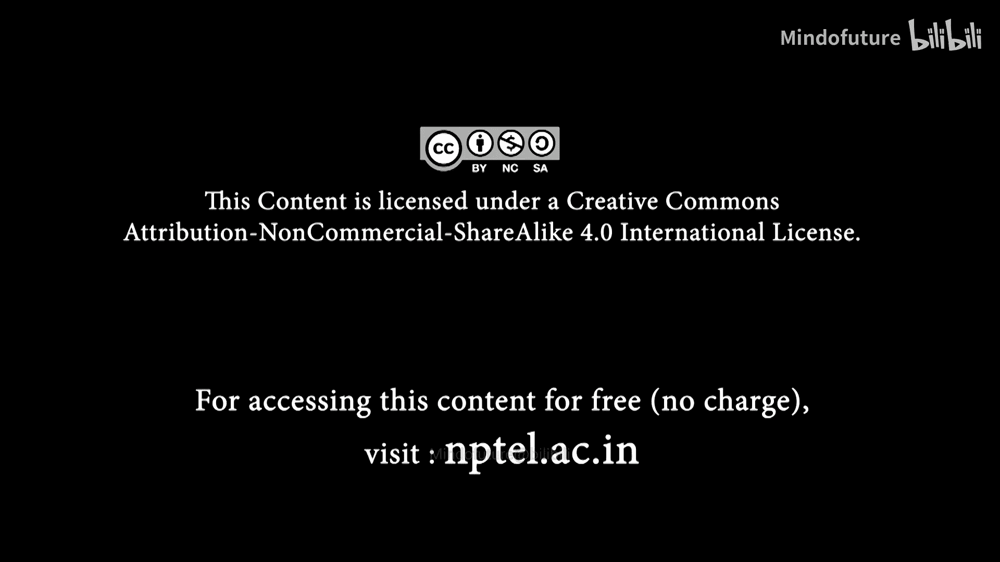
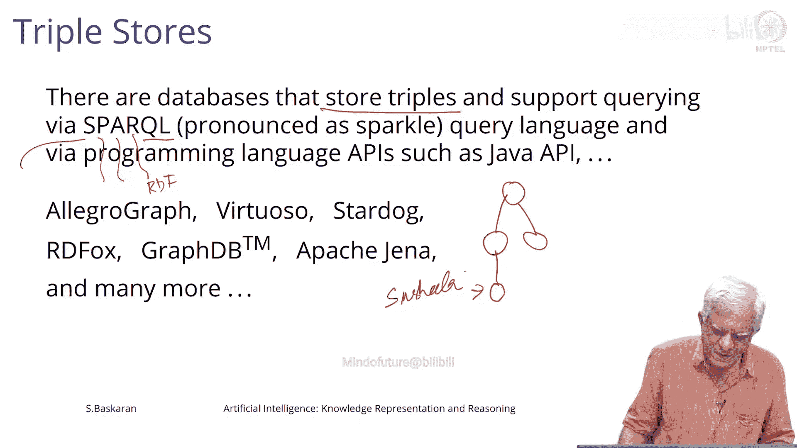

# 【印度理工学院】知识表示与推理 ｜ Knowledge Representation And Reasoning p112 P112_RDF资源描述框架 -BV1c4zNBmEyF_p112-

So welcome back。In our journey。In this study of knowledge and representation and reasoning。

We started by saying。That our representations have to be symbolic。

And then we built upon that and started looking at logics as a mechanism not only for representation。

 but also for reasoning essentially。So， when we were looking at reasoning。😊，We were。

Not concerned about meaning at all。Logic does not。Look at meaning。

 logic does not look at truth value it is just a symbol processing machinery。

And that works with its advantage because then we can say that our machinery has these properties and so on。

And essentially， if you give us a knowledge base or a set of axioms or a set of premises。

 which are true。Our machinery will automatically produce other true statements。

Even though it does not it is not aware that the statements are true or not exactly just aware that the statements exist so a logical machinery works only with a collection of statements and we have shown that for a complete and sound system those statements would be true statements and only true statements。

Then when we move towards representation， we started looking at。

The choice of predicates and how to represent sentences。We move towards。

This idea of having a standardized representation in which we use binary predicates for everything and we came up with this idea of triples。

So we take up action from there。Now， and we want to see。As to with the advent of the worldwide web。

When people want to exchange information across the web。And we want our。Web to be more meaningful。So。

 we use the term the semantic web。As you。No semantic refers to meaning。 So now we are saying that we。

Are coming back towards meaning。 we want our web to be meaningful I， when the web started evolving。

 we had steam。Pages or we had this HTML marker language to create pages which other people could see we and it did not know anything about what was being represented。

😊，From there we want to come to a stage where。The web is meaningful in the sense that。

Anyone who looks at it should be able to say what we are talking about essentially obviously meaning is。

We have said this earlier。It lies in the mind of the beholder。But what we want now is shared meaning。

It's like language that you know。Language is。Mechanism which works because the speakers of that language or the user of that language。

Have a common notion of what the words and sentences in the language mean。And in that sense it。

Is meaningful essentially。We want the same to happen to the semantic web we are now moving towards representation or we have moved towards representation and in representation meaning is obviously important because when we represent something it is eventually for the consumption of some users who would be concerned with meaning essentially。

😊，So， we started this。This phase of this thing we are looking at how one can meaningfully represent information。

😊，On the web essentially the information can be consumed by users or by programs written by users which may do meaningful things with the information。

😊，All useful things with the information if you prefer that。So， we will start about。😊。

This phase with looking at this thing called Rdf resource description framework。

 which is a data modeling technique which allows us to。Have a standardized way of representing。

Data on the Web basically。These slides， as you can see。

 I have taken from S Baskeran who is an expert programmer。

And who has been working in the area of semantic web and ontologies quite recently？

And these are the areas that we are going to look at now。So。

 resource description framework or RDf is a language for representing information about resources in the worldwide web essentially。

RDF documents can be stored in various formats， we are not going to be too much concerned with that。

 our idea is not to learn RDF here or as we will see RDFS our idea is to get a feel of what is RDF and what is RDFS and later on what is O and what does it allow us to do。

😊，So， RDF is basically talking about resources essentially and it uses various conventions as you can see here。

 URLL， U， U and IRA essentially lets look at them。😊。

Resource identifiers denote resources in the worldwide web resources identifiers have a global scope。

 which means。You can access them from anywhere。And they would in some sense mean the same thing the same resource identify in different RDf documents RDf graphs and query result sets on different machines identify the same resource on the worldwide web what is the resource we will see in a moment。

A resource may have many resource identifiers just like a human being may have aliases and multiple names。

😊，But resource identifier should represent only one resource which is what we try to do when you are talking about humans by putting suffixes like Soace 29 or Gita 73 and so on。

 but now we are moving to a more standardized approach which RDF gives us。

So what are users identifierifies， So the first one is your uniform resource resource locator points to a location resource on a computer。

 So for example， the IATM address website， w w w dot IATTM dot A dot in。

A URLN or a uniform resource name is a persistent location independent identifier。

And the simplest example of that is the IPN numbers that books have you can identify a book by its ISPN numbers。

Then we have a uniform resource identified is either a URL or a URL。

Re source locatedcator names are resource identifiers。

Then we also have the internationalized resource identifier which allows multilingual representation so as you can see in this example here we have three Wikipedia pages。

 one is in Sanskrit。One is in Hindi and one is in Tamil， essentially。So， all this。Conventions。

Follow different specifications and different character sets in practice IRIs are encode as Uized and therefore whether URI is intended and IR can be supplied essentially。

Now critical to the use of RDf is the notion of name species because we want a name to mean something specific we put names。

Of resources。Into a name space and the name space in some sense sense the contact it defines the context context in which the names are being used essentially。

So a name case typically has a name。Which is， for example， here。This is a namespace for RDF schema。

 so this RDF schema。RDF schema is an extension of RDF。Which has a set of names， which can be used。

To describe or relate resources and some of those words are names in the namespace of RDF schema。

Our sub propertyty of we will see this what this mean sub class of。

Or a class essentially a class will basically be a category a property will basically be a relation between two elements。

😊，We can use short names so instead of using this entire name we can simply say。

That we just want to say RDFS colon and that is the way to refer to that particular name space so as you can see here all these references have been shortened into simply saying that RDFs followed by the name that you are talking about。

You can go even further by saying that this is going to be my default namespace that if I don't specify a location then this is what I mean and in this example what it means is that we have some tutorials for the knowledge representation and reasoning course and the names used in the tutorial are the names that would be referred to if we just give a colon and nothing else so as you can see here there are three names rangg India and poet and we are saying that。

These are names from the name space that we use in the tutorial essentially。

Now there are many names faces we have RDF to start with RDFS which is RDF schema which is an extension of RDF which allows us to talk about more things。

 all is an even more expressive extension of the same class of languages。So， we have these schemas。

 RD of syntax， RD of schema， all， then we have Xm schema。Which evolved after Sml。

Was used then people started using XmL， which was more expressive and。

More flexible in terms of what you could say then we have the database。

 the Wikipedia on of databases then and we have this Yago yet another。Great ontology。So。

 whenever we talk about the semantic web， we inevitably talk about ontologies and we will see what we mean by that。

Sometimes we know that。A resource exists but we do not know where it is in from way which namespace does it come essentially so we can use just an underscore like here to say that this is a local name essentially blank nodes are local to the RDF graphs and query results essentially and if different programs were to access it then it might give you different results。

Now， there are various kinds of data models that people talk about and RDf is just one of them essentially so here we have listed a few of them。

 the entity relationship model， ER model， the relational model， the XML model。😊。

The property graph model and now we are talking about RDf essentially and RDf as you will see is made up of resources。

 properties and statements。So， this is our domain of interest， so to speak。

The domain is modeled using。Three elements。Our domain of interest is RDF and the domain of RDf is modeled using 3。

Elements， these are resources and properties and statements。

And we have graphs and documents are used for organizing statements。

 collecting them together and putting them in one place。Now。

Resources everything is a resource as far as Rf is concerned we are talking about things。

And everything that we talk about is going to be a resource， and it will have a。Unique identifier。

And everything， therefore isnt。In of RD resource。ADF is resource。So。

 they can be physical or the real objects or individual elements， so， for example。

Something called run， which we will see or which we have seen earlier。嗯。And YouTube， India and Amir。

 you might remember the example that we did towards the end of knowledge presentation。

This thing we can have abstract concepts like Sufi on genre。We have can have categories。

Our classes like song artist studio， and we can have properties， as I said。

 properties are relations between。2 resources。 So we， we can say poet。

That the poet of this poem is this person。 and you know， like my single in did。So， as we said。

 properties are binary relations between resources。And optionally， if you are working with RFs。

We can define what is the domain of the relation and what is the range so the domain is a starting point and range is the ending point if you can think of it as anarrow in a graph。

So， domain is an RFS word and range is also an RDFS word whereas property is an RDF type。

As you can see here。So， for example， when we talk about poet as I just said。

The domain of poet is a song。The range of poet is。From a class called poet。

 remember that this is an RDFS class。And poet is a relation， so poet kind of sits here。Essentially。

Likewise。Single is a property which connects an event to a singer。

And date is a property which can convince an connects an event to a date so notice that this poet and these singles are classes essentially it says that。

The a song which comes from the category song。A specific song which comes from the category song is related to a specific。

Element which comes from the category poet so poets will have a class of its own likewise Sings will have its class so on and these are defined in RDFs。

So， our statement is a triple that is how we arrived here。😊。

That we want everything to be expressed in a standardized compact format。And the triple， for example。

 that rung。Has a poet。Who is air 것으로？As far as the encoding goes， it is simply3 Us。Rung is a UI。

 poet is a UI， and Amir Kolo is a UI。As far as the lexical view goes。😊。

There are three resources that we are talking about。Remember that the property is also a source。

Classes are also resources。And elements are also resources。Our individuals are also resources。

 Everything is a resource。 We said that already。The data view is that we are talking about a resource which has a property which has a value essentially。

The logical view is that we are talking about a subject。😊。

And there is a predicate which relates the subject to the object and the logical view would look like this where you say predicate that is our standard way of logical representation predicate subject object so。

 for example。Poet。Is predicate and the two arguments are the song or the poem and the poet。

As we have already said that a statement is a triple。And it can be an edge in a semantic graph。

 So we saw this when we were talking about run and it is associated。Data。Yeah。So。

Here we are specifying a little bit more about that。So first， we are saying that the poet。

The type of poet which is an RDF keyword。Is。An RDF is class that this poet with a capital P is an RDF class。

And it is a subclass of another class， which is called persons。

And single is a RdfS sub propertyperty of。Artists so artist is a property and it can include other kinds of artists so。

 for example。A painter or whatever。And single is is。

A sub property so both of them are single and artist they connect。An artwork to the artist。

And single basically connects。Songs to singles。So， we have already seen this long poet is Air Klo long genre is Sufi。

Performance。Title was wrong， and so on。嗯。So， the RF data model is a set of statements form graph so we put together different statements and because they have shared resources or shared nodes。

😊，One end of the statement will。Connect to one end of another statement， essentially it could be。

That we are talking about performance 101 and then many things are linked to that or it could be even a chain of things。

So， basically graphs and documents are used to organize triples graphs are stored in RF documents and one。

Unnamed graph per audio document。And we may have additional name glass which we can import from inwi。

So this is how。Data on the web looks like it is called it linked open data。

And if you just search for。L OD cloud。On the web you will be taken to this site which kind of points to this LD cloud linked to open data cloud and then you can see。

How many collections of such documents are existing on the net and how。

They are related to each other， essentially。So， basically the linked open data is made up of R documents which can be graphs which can have subject precate object relationships which are talking about IIS and the Is point to real things in the domain so some element in the domain for example ail Coro。

And so what you see at the bottom in the shaded part is the real world that we are talking about and what you see on the top is this whole vast network out cloud of documents that is talking about them。

Databases are stored in whatcols triple stores， so they store this。Tris， remember。

 triple is a binary。Pdicate sentence。Subject predicate， object and so on。

And they support us query language called Sple。Which is an interesting one so here S。

Stands for Sple itself。P stands for protocol。A stands for and。Asked stand for RDf。

And Ql stands for query language。So R stands for earlier。

And S stands for the whole word sparkle itself in and protocol and so on。

 so it it is basically a query language just like SQl SQL is used to query relational databases sparkle is used to query graph databases or triple stores as they are called and essentially you can specify graphical patterns that for example you can say look for a pattern like this。

In the Gv database。So， four nodes which are connected by this specific pattern and and and retrieve them essentially now you would recognize this that if you were talking about the family database that we did earlier。

Then this represents a uncle or an aunt relation， so there is an individual here。😊。

And then the parent of the individual， then the parent of the parent and then a child of。

The parent and the child is different from。The first individuals pale essentially so we can retrieve such such patterns。

 And if you specify here， for example， if you say。That。Who are all the aunts and uncles of suila。

 then we can just query using this pattern and Sparle will give us all this data essentially。

Now there are various triple stores listed here a logo graph is a well known one。

 but there are others foro star dog and so on essentially。Okay。

 so let us take a break here and we will come and look at some more examples and then see how we can move on to something which is more expressive。

😊。

