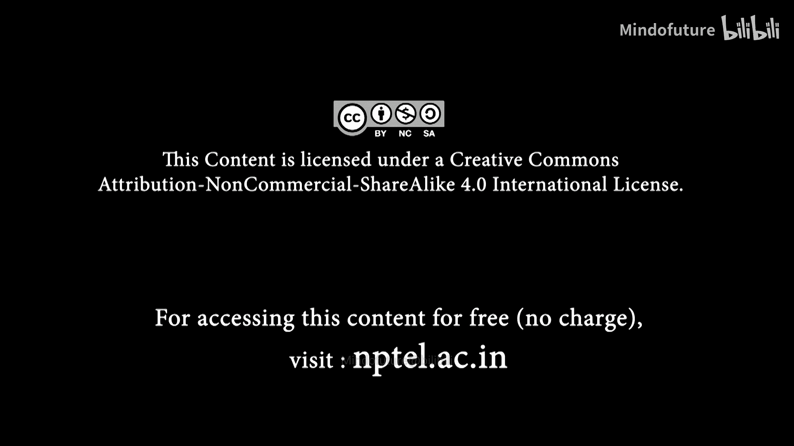
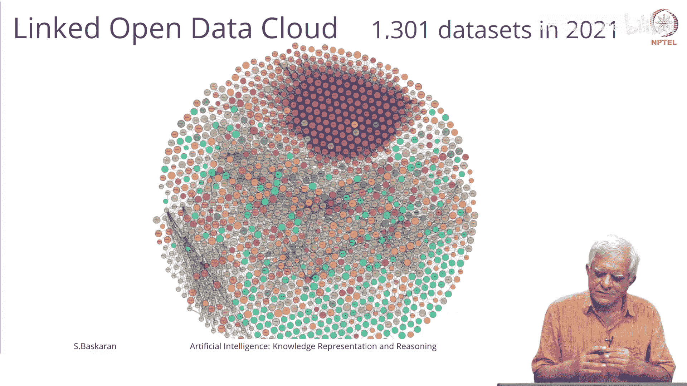

# 【印度理工学院】知识表示与推理 ｜ Knowledge Representation And Reasoning p113 P113_RDF RDFS OWL与LOD云 -BV1c4zNBmEyF_p113-

We have started looking at RDf and RDF is。And。As we said。😊，The goal。Of using。These techniques。

All this representation scheme is to have a shared common vocabulary which can be used around the web。

So， we had this notion of name spaces that we saw and then we saw that the statements also are of standardized formats that they are they have three components。

 the subject， the predicate and the object。And。That is how we are going to represent things in the net so let us look at a few examples and our goal is not to as I said earlier our goal is not to learn RDF here or RDF or all because these are languages and they are best learned by just going to the。

😊，嗯。Websites and looking at them if you go to the W 3 websites。

 you will find descriptions of what is RDf， What is RDf schema， what is， what is the syntax。

 what is all everything you can。Find there， but what our goal here is to get a feel of what RF and RFF and Owl is like。

So， we have already spoken this， we can use different kinds of refxes to talk about sentences and sentences are tripled which are made up of three things。

As shown here。Some of the some of them we have already seen earlier。 So for example， poet is a。

Subclass of person and subclass itself is comes the RDFS vocabulary and likewise。

Country is a class and studio is a class， and a person is a class and so on。

This representation that we are showing is called tu format essentially so if you were to use tu format to talk about RdF sentences then this is what you would do you would first。

State the first element with the colon， for example。All。With the RDF namespace。

And then three things properly followed by。F stop， essentially。So， the journal is。Type of property。

The domain of genre。His song， the range of genre is the class called Jon。So likewise， we have poet。

Whose domain is a song and whose range is a poet and singer also a domain is an event we are talking about。

Instances of。Singing performances。So in that event。

 the singer was somebody who comes from the category of single。

We can use a compact format where we don't have to write。

Then repeatedly we can just use the subject ones， then put semicolonons。

And end the whole thing with a colon with a full stop。So that kind of makes it more compact。

Likewise for the other things that we have。Bookken here。

So here is something that we are familiar with。 we have been talking about this for a while that。

The poet of Lung。Was a miraclelo， the Journal of youngest Sufi。 So that's one。

Think we are saying something about lung so in a in a graph you would see lung with cuusso connected one and the genre connected at other the site。

And。We can talk about the specific performance that we described when we were talking when we had started introducing Tris that this performance was in 2012 it was done for Coque Studio the producer was Rohail the host was YouTube the singer was Haddiika and the title was run and then of course this will get connected to this essentially so you can see we drove this network but now RF allows you to do that as well essentially。

So， the vocabulary of RDF and RDFS allows us to create new classes， new data types。

 new properties and new litals so it is up to us to define what we mean so if you want to talk about poets and singers and songs we can do that if you want to talk about books and authors and publishers we can do that as well or anything else for that matter。

These languages are generally enough to allow us to define subclass relations。

 sub propertyperty relations and。Doomain range constraints， as we will see as we go along。

We can talk about bags and lists and rerite statements as well。

This is a vocabulary of RDf RDFs you can go through this at leisure I will just talk about something things that we have spoken about。

 so RDfs has a。Word called subclass of。So one class is a subclassus of another。This thing。

 likewise we have sub property of and we know that。

We have domain and ranges of properties essentially。Then as I said， we can talk about list。

So we can talk about the first element of a race list the rest of the list or an empty list and so on essentially。

So， we have RDF statement which is a triple RDF subject predicate object。As we said， our own。😊。

Allows us to do much more than RDF and RDF can do。It allows us to create new classes。

Of different kinds anumated classes or unions or intersections of classes or complements of classes。

 we will see examples of that。We can talk about relations between classes。

 so a class is also a resource in。Our DF is also and in owl also essentially and in owl we can say that two classes are equivalent one is a subplus of the other and these kind of relations。

We can put property restrictions and say that。These classes have these property restrictions basically which means and we will see examples。

That the range has to be from a certain class， for example。So， for example。

 the child must be female and then we can say， okay。

 we are defining a class of people who have daughters and so on。

We will see that there would be other kinds of restrictions， value restriction。

 existential restriction。Number restrictions， how many elements we can be related to and we will see as we go along。

 But this is all part of the all this thing。 and these are the。

This is a vocabulary of all which talk about allows us to do that。So for example。

 we can say restriction。On property。Lets some values from。That。As I just said。If you child。

 want to talk about people who have daughters。明。The child property with a restriction that the range must come from the class female essentially。

So， we will again look at this as we go along， some values form or all values from that they have only daughters。

 for example。Then cardinality， how many they have and that kind of stuff。We will see these things。

 So there is cardin T， there is qualified cardin T as to。How many elements of a certain class？

You are allowed to have。Our build on。The RDFS vocabular as we have said。

Allows named individuals and allows us to express sameness and dishness between individuals that they are same or different。

You can create object properties， data type properties。And an notation properties。

 an notation properties are properties which are meant only for the reader of the document。

We can define inverse properties， for example， child and parent。Property chains， for example。

 brothers。Syistister law。An equi relation between properties and so on。

We can have already we said that inverse functional properties and so on functional properties are properties which map only to one person they are like functions。

 mathematical functions。And this is the vocabulary that Owl uses for doing that。

 so we can say inverse of or we can see a property chain this thing or equivalent property and so on this actually so you can look at them。

In leisure， in fact， I would。S stronglyly recommend that you go to the Owl website for W3 and you can see that what are the different things that owl allows you to say。

But as long as you get a feel of it， we should be happy here。So， as we said that。😊。

RDF is basically meant to store data on the web essentially and we spoke about the linked open data cloud cloud or the LD cloud I will show you some pictures from there but you should best go to this website and look at them yourself to get a feel of what is happening then we said DPia Wikipedia Wordnet also has RDF datas and there is something called data hub essentially。

There are various。😊，Resources available for studying ontologies and AlDFM。LDFs。

 an nice book is by Antonio and。How million。嗯。But there are plenty of resources on the web。

 as you can see these are primers all on W3 websites。Essentially。

You go there and anything that you want to read about concepts， abstracts， abstracts synaxs。

 total documents。All the language primer， for example， is a nice one there。

Quick reference guide for all and so on。So， once you know what RDF and RFs and all are about。

You should go to these sites to get more information and that will equip you to start using them。

What I will do now is to show you some。Images from this。

LD cloud website so that you get a feel of how this data has been expanding over the。

Over the last couple of decades。So， this is how。The all cloud or the link to open data cloud used to look in 2007 it had about 28 data sets some of which have been shown here。

As you can see， this Db P。Is kind of central and connected to many other things essentially。

 but there are other things as well so for example， there is DbLP。

By use for by people in the research community。It's a collection of all the papers written by different authors。

 So you can search on author， you can search on papers and so on and。

You can get a lot of information about publications here。Friend of a friend， FOAF essentially is a。

Data set which kind of allows you to connect different people to each other essentially so there is a theory that if you take any two people in the world。

And essentially we are talking about the social network like situation here where they are connected on the social network。

😊，Then you can reach from any person to any other person in six hops and that's a theory。

 And this friend of a friend is basically a。Daatabase， which allows us to look at that。

There are other things like US census data。And project Gutenberg， which。

Is a collection of free available books that anyone can read。By 2009， as you can see this。

Cloud had grown considerably DP is still very central to this whole thing。

 but there are other things which are getting more important essentially as you can see the density of connections here is larger and so on。

But 2010 this process has increased further so that cluster that we saw there and this one。

And this one。By 2017， it had。Kin of。Developed subregions of interest。

 which are shown here in different colors。And each of those circle like things is a database of is a is a document RDF document。

I should draw your attention to the fact that this。

Very dark colored background that you see in this part of the in this part of the。Then。

I essentially edges and there are so many of them that it looks as if the background itself is。Dark。

This is in 2021。Which is last year when I am recording this。

And you can see that it grows and it grows essentially 1300。Documents on the Web when。

You have to really zoom into。Look at for something luckily of course you can search for what you are looking for。

 you can search for a domain so there is something called a medical ontology that you can find and things like that essentially。

So， this allows us to give you a feel of what is happening in the world of RDF and storing documents on the web。

Next， we will make a connection to。Logic。And we will start looking at something called description logic。

Which is a subset of first a logic。Which is decidable。But which can do only certain class。

Cllos of influences。嗯。With the language allows。

Well do that in the next。