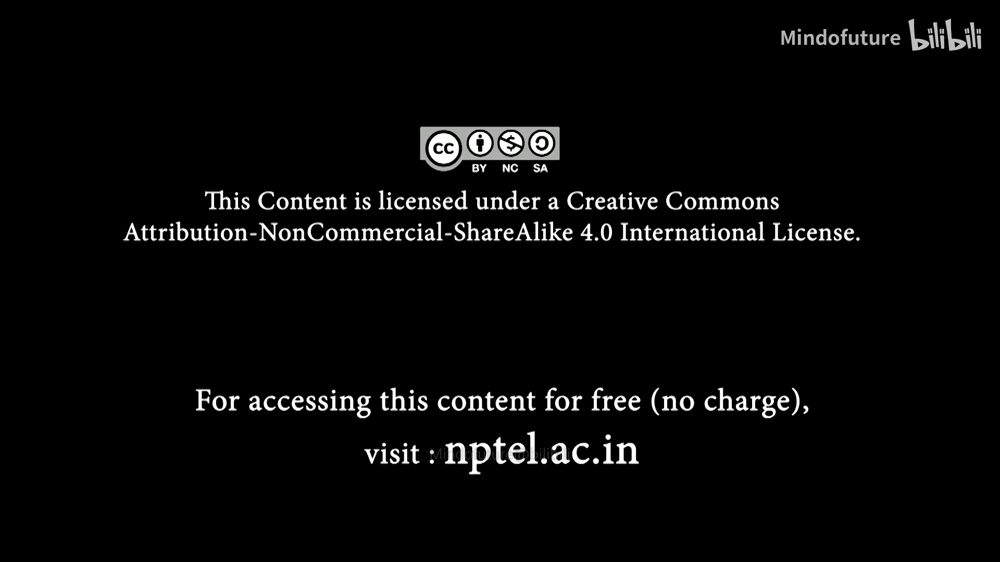
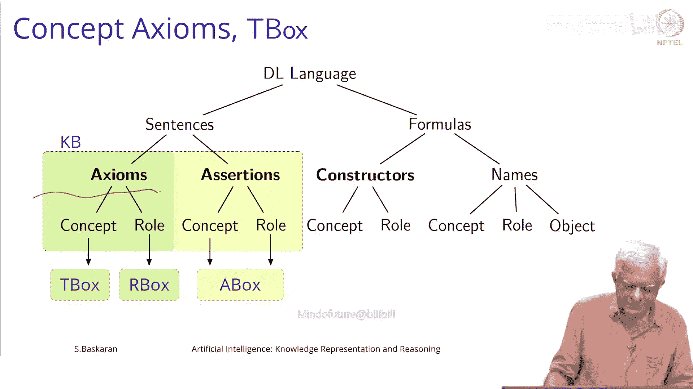

# 【印度理工学院】知识表示与推理 ｜ Knowledge Representation And Reasoning p114 P114_定义新概念与角色 -BV1c4zNBmEyF_p114-

So， welcome back。We have started looking at this family of logics called description logics。

And we are saying that basically we are allowed to talk about concepts and relation between concepts。

And relations between relations and relations between individuals and concepts。So。

The key feature of description logic is that you are allowed to create new concepts。

Using concept constructors， so let's look at some of them。So。

 concept constructors allow you to create new concepts from existing concepts。

 so you can start off with a set of basic concepts。 We did that when we were defining the。

Family database， we say that we will talk about two relation two only two kinds of relations one is。

A parent child relationship and the other is a gender relationship so using only these kind of facts what is a gender of a person and how are two persons related we will construct the rest of the knowledge base so we will define aunts and uncles and grandfathers and ancestors and so on。

Lets see how we do that in。Description logics。And we will see the various ways in which this can be done。

So what are concepts， concepts。We will use the term symbols C and D to stand for concepts。

And there can be any one of these that is listed on the。Right inside of the arrow Italy。

We will look at them one by one。So the first one in that list。Is the top concept？

It' is also called thing in O。And everything in the domain is members of the top concept。

 so it basically defines the whole domain。Yes。不是。Everything。Is included in the top。On sip。

All elements。The second one is called the bottom concept。

It is also called the in all it stands for the empty concept or the empty set。Essentially。

There is nothing； there is no element which belongs to this concept。

 the empty concept is the bottom concept。Then we have named concepts where a a name a comes from the set of names that we allowed we have defined for concepts essentially。

And the name concept is essentially the interpretation of that is that it is a subset of the top concept。

 So yes so if this is a top concept， this thing， then we have a concept a。

And so all the elements which are in this here。It defines a subset of the elements。My。

That was a named concept， essentially。So name concepts are like primitives essentially。Right。

 for example， we might say male， female or something like that。Then。The complement or negation。

So in the description logic。😊，The symbol for negation basically stands for complement。

And the interpretation of complement， as you can imagine。😊，Is that if you have some concept。

Let's call it C。Then everything that is not in C is in the comp。Compliment of sea。He always。

Drowwing over when diagrams。With。The top concept is a。Doomain， essentially。Then， intersection。

Members of concept C are also members of concept D essentially。So if you have concept C here。

 if you have a concept D here。And this is your。Top concept， this is C。 This is D。Min。

All this is elementary set theory； it just that we are using a language to define and name those sets。

So if you give us two sets。This thing which stands for two concepts。For example。嗯。Uncleles。

Set of ankles， the set of。Gentlemen。You can define a set of。Uncles who are gentlemen。

There was a nice novel I read from Pg Bus， which saidAs aren't gentlemen。So clearly。

 that would be a true statement， but uncles can be。This other symbol。Stands for Union。

So if you have C， if you have D。😔，Then everything which is in either of them。

Is in the union of the two sets。Notice that the two sets can still have an overlap。

Then we have this restrictions on role， so R stands for a role。And see is a concept。So。

This for all for all C says。That all the objects。Whose role is filled with members only from the concept C essentially。

So， first。We have something called concept C。And now we are trying to define this new concept。

AllWho all role fillers come from the class C？Which basically mean that if I have this element here。

And it's related to。Another element here。And it is related to another element here。😔，Then。

I can put it in this class。F on。See。See this class we have not given it a name。

 but we have given a description of the class。嗯。This class that I am trying to define。

Using this shaded thing。We are just describing it we are not we are not given it a name。

 we can give it a name as we will see later。So， this。

Individual here since it it is related to two elements and both of them are from the class C。

 it belongs to the。Description for all。RRC， but if there was another individual here who was related to this one but who was also related to this another one。

 then he would not fall in the class for all C essentially for all R C essentially。

An interesting point to note which you should carry forward from first so logic is that if there is an individual。

Who is not related to anyone？Then that individual also belongs to this classy。

 so as we said in logic it is vacously true。The other kind of relation we can talk about is existential restriction。

Did there exist。And there is a word that we use at least one member from the concept C。

So if you look at the same class that I was trying to define earlier。

The same set of individuals that I was trying to define earlier。 so this was C。

 there was one individual let me see。One individual here，1 individual here。

And the third individual here。This one had two elements。Connect to here。This one had。

One element connected to the one here and one outside。This class C。No。This concept is。

We are trying to define another concept is that。Whose role is filled with at least one member from the concept C so as you can see of the three individuals that we were talking about only these two will form the concept will fall in the concept that we are defining now。

That they not only do they have to have a roll filler from C。

 they have to have a role filler to start with essentially so they must be at least one person they are related to。

By this role filler， essentially。So， for example， people who have。A daughter。

There must be at least one child who is a daughter。This next concept。

Tals about a self loop it basically the set of all those individuals。

In which the arrow points back to themselves， whatever the relation is， so for example。

 you can see the set of all those people who love themselves。

Which hopefully will be as large as possible。Because it's a healthy thing to do。

But we could define such sets here， essentially。So， formally speaking。There is a pair A A。

 It belongs to the image of the rule。 So we had。kindind of omitted talking about this for the existential relation we are saying that it is a set of all those people from the domain such that there exists a B such that A B belongs to R and B belongs to the class C。

For the other relation for all role fillers C again it is a set of people from the domain such that for all those elements B where AB belongs to R B must come from the set so logically this is how you would express them。

Then， mean cardin T。At least n load fillers from class C， that is what we are seeing here。So。

 the same example， if I take that I drew some time ago， this person was related to this。

This person was related to one element here。😔，And one element outside。😔。

And there was a third person who was not related to anyone。Now， if we were to say。That。

Greateater than equal to2 or c。 that means you should be related to at least two people。

Who come from class C？Then this is the only one which would fall in that concept。

The other two would not fall in this concept。If I were to change。Itと。

Max cardinal T that at most n roll fillers then for the same diagram。This is C， this is this element。

 this is this element。So what are we saying here？Let's say it is2。eri。

Le than equal to2 orrc there are at most two role fillers。Which come from class C。 Then again。

 you will see that this is the。Same as what we earlier said was there exists at least one rule fill in this case there are two logically speaking it is a collection of all those elements。

😊，From the domain。Such that the cardinality of this set what is this set this set is a set of all bes。

Sa that AB is related。A is related to B。That means they come from the rule R。And B belongs to C。

Is atmost n the currentality of that set is utmost n。

 so both these elements that we saw fall into that。

The definition for min cardality was similar the same set。

But here the cardinality was at at least in the set of name objects， so we have some objects even。

Up to ak。And then we simply say that these objects belong form a concept， so， for example。

 days of a week essentially so you can say Sunday， Tuesday， Wednesday Thursday， Friday， Saturday。

Fnder。Day of a week， essentially。So that's the last of the。Ways that we can define concepts。

What we will do next is to see how to。Define。New roles。And。

There are essentially a few ways of doing that。So， we are interested in defining new roles from existing roles via either role inverse or role composition。

So， if you have a role P which comes from the set of name rules。

Then we can talk about three kinds of。Rules， one is。The universal node， we will see this。

The role itself。Or the inverse of a rule essentially。So let's look at them one by one。

You denotes the universal rule， so it is basically。

Every element connected to every other element this thing。It's like a cross product of the。Lummin。

P is a role name。Name rule。And it's a subset of the domain。P inverse is the inverse of p。Which is。

It is a set of all those Bs such that AB belongs to P。

Or it is simpler to say parent child relationship essentially for every parent who is related to a child。

 there is a child relation to parent。So， all constructors。All of two kinds as we saw。

 the simpler kind simply takes two roles。And connects。So。If you have an A hill。

And it's related by a role to B。😔，Let us say， aunt。And。😔，C B is related to。Xi。Let us see。Gzen。

Then we are defining a new role。Which is like this。

 we can think of seeing as your aren cousinling essentially。So it is a set of well。I should really。

Use consistent notation here。So， this is B。Because we are defining trying to define this new role a to B。

And what we are saying。Is that there exists in x。Says that x is a roll fill for the first role。

 so this must be x。And x is the。In the domain of the second rule。

So Ax belongs to role 1 and Xp belongs to role 2。You can extend this idea。2。

A whole chain of roles and I think we in India are very familiar with this。That my sisters。

Byath in lawss。Brothers。Nce。So you can have a whole whole chain of relatives， essentially。

And that can be done by saying。That you are。A chain of rules， essentially。

 the idea is still the same。That you are trying to define the role a to B， so a is here。Be here。

And there exists all these x1 up to x k minus1。That is that a is related to x1。

And x1 is related to x2。And so on eventually till B essentially。

 so xk minus1 is related to B so we can have a roll chain。So。

 essentially this is a description of a complex role in some sense。

We have not given it a name but we can always give it a name。So， well come to。Concept axioms in the。

Next session。

