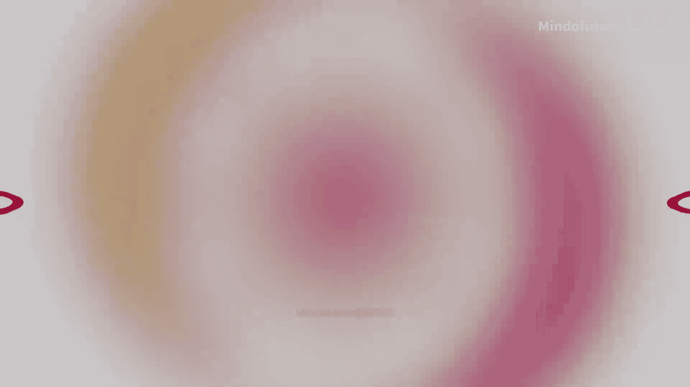
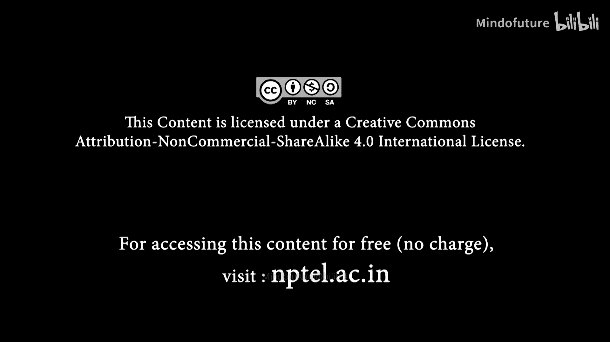
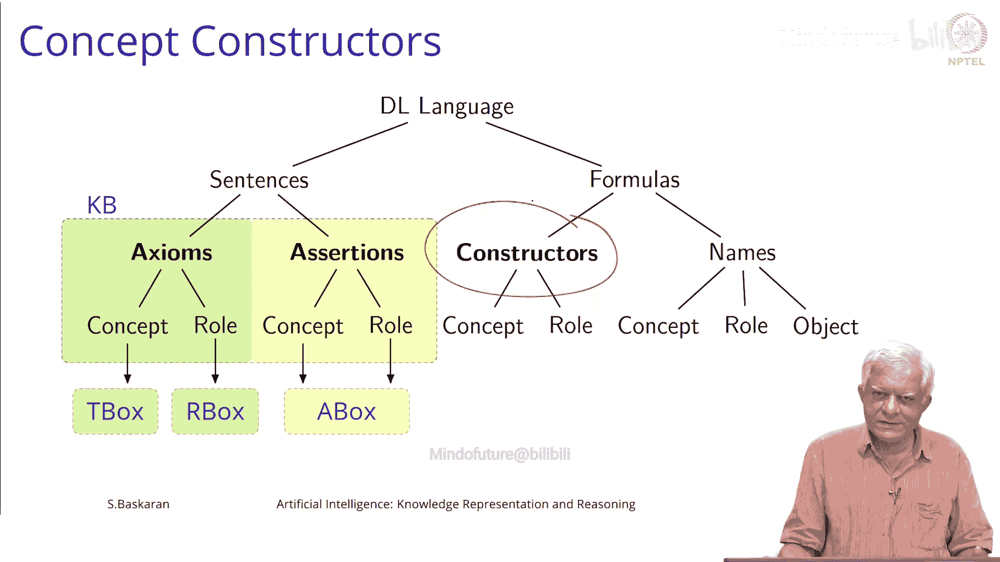

# 【印度理工学院】知识表示与推理 ｜ Knowledge Representation And Reasoning p115 P115_DL描述逻辑 -BV1c4zNBmEyF_p115-

Welcome back we have just looked at。RDf。Which is a way of representing data on the Web。

And it is extension RdFS and we spoke briefly about something called all。The web ontology language。

Which is an extension of RDF。So we are talking about ontologies and ontologies are basically。

Representations which relate different kinds of classes together and talk about which elements belong to which which class and things like that。

Now RF documents were triples， subject， predicate， object。

 and each of them was told as resources and RF and RFS gave us some metadata about what each thing was essentially whether you know which class it came from and things like that。

Before we。Talk about reasoning in。For ontologies。Let us discuss a subset of a logic which is useful for talking about ontologies and that is。

Description logics。So， description logics are also called as logics of noun phrases。

The no phases are basically categories， know things like goat lion and whatever and。

Description logic allows us to define such categories。

And define relations between such categories and relations between individuals which belong to certain categories。

So， let us look at description logic as I did for RDF we have taken these slides from S Pascallin who is an expert programmer working in ontologies。

😊，So， we had said earlier that。Personal logic is semi decidecidable。That if there exist approve。Fer。

😔，대。Then we can devise strategies to find that proof。But if there doesn not exist proof。

 then the program can go into。An infinite loop， essentially。So here in this diagram， we see this。

That。Four theorems。We will find be able to find proofs unsatisfiable formulas are basically nes of theorem。

So， if a formula is unsatisfiable， then its negation would be。😊，A valid formula。

But there are formulas which are neither unsatisfiable nor theems and they are these are called contingent formulas。

Who's。Truolth value depends upon the interpretation that you are looking at essentially and it turns out that in that there is a small subset which will not terminate。

If you want to prove those statements。So， what we are looking at now is a subset called description logic formulas here。

Which is。Going to be decable， which basically means。That。You can query for those formulas。

And you will get a yes， no answer。Within a finite amount of time。

The kind of things that we can reason about as we will see。😊，Is consistency， membership testing。

 substion testing， classification， and so on。We will see that description logics are a family of logics and there is a trade offs。

Of expressivity versus computational。Complexity。Here are some webs resources for talking about description logics。

You can see that the word ontology comes in frequently， so there are all implementations。

I will remember is web on strategy language。Then there are automatic reasonsers which are available which you can use directly for doingne car during the kind of reasoning that we are going to talk about。

And there are repositories of ontologies so there are many specialized ontologies that people have developed which can be used in those specific domains。

For example， there is this pub system which stores a。

Publications from the medical domain and they have an associated ontology along with that。

So here is what we are going to study in description logic we will see that。

We will talk about sentences。And there will be two kinds of sentences， one， which will be。

Kind of quantified。Formulas。And the others would be about individuals， which are called assertions。

Then we will see how to construct。New concepts。And we'll talk about names of concepts and rules and objects。

 Some of the symbols that will be used。All given here below。

Just like we defined a vocabulary for personal logic。

 we have a vocabulary for description logics as well。We will see this as we go along。So。

It is a family of languages， it is not just one language just like logic is a family of languages。

 description logics are also family of languages and basically there is as as they become more expressive。

😊，Then the computational complexity of these languages increases essentially these logics are named by are known by names like the ones given below A ALC。

 ALC and showing， Sic and so on， and let us see what these。Stand for。So。

 the most basic of languages is Ya。Or ative language in which you。Are talking about what。Binary。

Attributes， exactly。Then we add this notion of concepts。Which uses the complement。

So remember there a concept。Is interpreted as a subset of the domain。

 essentially when you talk about doctors or surgeons or mothers。Or whatever or carnivos， hebe words。

 whatever these are basically subsets of the universe of discourse or the subsets of the domain essentially。

😊，How do we describe these concepts as what we are going to be talking about now and given a concept C if you can talk about its complement。

 then such a language will have a C in it。😊，So， for example， ALC。

Attributive language plus complement。If you can talk about things like role transivity。

 we will add the letter s to that language。If you talk about complex role inclusion axioms as you will see examples of this。

 then you have the letter R。If you talk about low hierarchies。Then。We can talk add edge to that so。

 for example， role is a type of another so father is a type of parent， for example。

 if you talk about the rule。Remember， roles are binary。嗯。Perdiates， if you can include names。

 then we will add the name O to the language， so for example。The music group above for example。

 there are four people there you just list the four names。Their names again with A， B， B A。

And that is a set that is a group called Aba。We will talk about inverse rules when we add i to that if we talk about number restrictions and we will see this we add n to that。

And if we had qualified number restrictions， then we add Q to that。So。

 the various languages that we mentioned in the last slide so showing for example Sloic you can now see what what is what does each of this language allow you to say essentially。

Let's look at what these。Represent， essentially。So， as I said。

 description logics allow only unary and binary predicates to model a domain unary perdicates are shown as rectangles here。

So for example， there is person， there is happy， happy， there is Apple。There's teen。And so on。

Byary predicates are shown as arrows， so there is owns。And his brother。

 both of them are what is called as rules。So a role relates an individual to another。Resource。

 which is a pillar。Individuals are drawn as circles here， essentially。So as we said。

 concepts can be teen， apple happy rules can be own as brother has sibling individuals can be named individuals。

We already know about interpretations in when you talked about logic。

 the same concept applies to description logics because description logics are after all subsets of first order logics。

So， concepts。The interpretationpolation of a concept renoted by concept superscript I where I is kind of overloaded a little bit here。

Is basically a set of objects， which means its a subset of。The top concept which is denoted by this。

Delta。Roll is a subset of the domain cross the domain。

And we have seen that as brother wounds and so on。  individualss are mapped onto。

That specific individuals who we will represent by saying that the name Lucy refers to this individual。

 which we have said Lucy's superscript eye。With that particular Lucy。

Here are some sentences from description logics。The first one。

 the sentences are written on the top here， the description logic representations are。

Given to the top left and the equivalent for representations are given in the bottom essentially so。

You can always whatever you are saying in description logic， you can always say in for logic。

But not everything you can say in person logic can be sent in description logics because the language is more restrictive essentially。

So。We will see this。Construct forming this concept forming operators soon。

 but this stands for intersection so。You take the。Category of teens。

And you take this category which stands for the fact that those things who have at least one Apple device。

And then you have a full category here。And then we are saying that this category belongs is a subset of this category of happy people。

Happy， whatever， not necessarily people。So， you will notice that。This symbol。

Which stands for is subsumed by。Maps onto this symbol which stands for Implication in logic。So。

 in logic， you would say if x is a teen and there exists a y such that x owns y and y is of category apple。

Then， X is happy。So， that。Is correspond to this symbol here exactly。And of course。

 corresponds to n and so on。So likewise， you can you are saying that brothers are siblings。

 So for all x y， x is a brother of y， then x is a sibling of y or x has。Posibly。Then， of course。

 individuals。Lucy is happy。Jack， Lucy has brother Jack。So。

 let us not talk about the knowledge base here in this language。

We will see that there are three kinds of three components of the knowledge base。

 one is called the T box， one is called the R box and one is called the。E box， essentially。So。

 thats it here T box， al box and e box T box is a set of concept as axioms。

 al box is a set of role axioms。And。A box are assertions which talk about individuals。

So the knowledge base is made up of these three things and the three sentences that we saw。No。

 recently。Are part of three different components of the knowledge base。

This al box because it is only talking about Ha brother is a role and you are saying that it is a sub role of Ha sibling。

Concepts。Ascesessionions。Express class memberships。Roold session 6。

Express object to object relationships。Axioms express subclass equience and destroyjoness amongst concepts。

 role axioms express sub propertyperty equience and so on。

They also express things like reflexivity symmetry。And so on。

 remember that rules are binary regulationss。So， we have these three finite set of signature symbols。

 NCRC and NI set of concept names set of role names。

 set of object names we have seen examples already here。

So the statements in the knowledge base are written using these symbols。

So let's talk about constructors， no。So， since we want to look at quite a few of them。

 lets take a break and we will come back and。Look at this。

