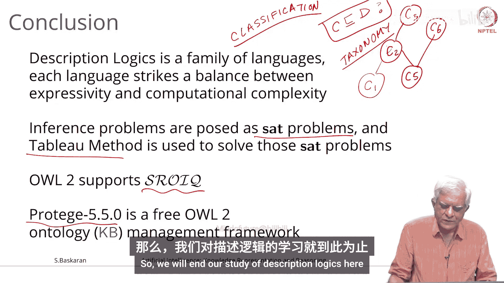

# 【印度理工学院】知识表示与推理 ｜ Knowledge Representation And Reasoning p116 P116_ALC表示例 -BV1c4zNBmEyF_p116-

So， welcome back。We have just looked at the tableau method。And so now let。Look at them in action。

And let's look at some examples。So we starts with a simple example is that is this。Concept。

 satisfiable。So to say that。This concept is sisable。 What is the concept that there。

Exist a roll filler from the class C。Which means that there is some a So say some a new a that it is like a column concern that we had talked about earlier that there is some a which。

Satisfies this C。So， that goes into the a box and there is nothing else in the t box because now we have added this scum constant or this new variable to a。

Yeah， so。The tea box is empty， so the only rule we can apply is this rule。So。

 we start by saying that a belongs to this class C。

 so what what else do we know about a that it must have a role filler x？Which belongs to the class C。

That is a existence rule。So from a， we have gone to x。Both belong to the class C in this case。

And no more rule supply so we can say that this is satisfiable。でで。

There can be an individual a which will belong to the class C which is。Or related to the。

Individual a， so you can always create an individual A and relate it to another individual with a class C。

Is there a model for all role？Pillas come from the class D。So again。

 we check for the satfiability of this formula with a new variable a。Add it to the a box。

The tea box is empty。And so what is the starting point of our tableau we have this node a and it belongs to this class for all the essentially now if you remember this rule。

For allD says that for every roll filler check that it comes from a classD but it does not have any roll filler so no rule supply and so we have a model for this statement as well。

So the next example says。That is it。Possible。There there is a concept which is made up of the intersection of two concepts。

The first one of that is that there is a roll fill of class C。

And the second component of the intersection is that。All road fillers come from class D。

So is there such an element a？So， we add a in onto our tableau and we basically add this formula。

2 our。Label set for a， essentially。Then we add， so this stands for adding。More to the set。

 so we already have this。건양천。Concept in the label set to that we add these two constituents that exists a road fill of class C and for all road fillers we have a class C。

So， we first apply the exist rule。And we say that OK， create a node x， as you can see here。

And say that it belongs to the class C。And。This is a relation R essentially。

 so we have a role filler。Call x， And we say that is x belongs to the class C， essentially。Lin。

To the label set of x。Ne a play。We add the class D because remember that what does the universal rule say that for every branch。

Check whether D belongs to the class whether whether whether the roll fill belongs to the class D or not if not。

 add it to the listing， so we basically add D to this here。And therefore， we have a model for that。

 and it is satisfiable。Is it satisifiable that there exists a role filler of class C and there exists a role filler of class D and is there such an element which has these two role fillers then if you go through this process you will see that you will start with this sentence add the two components then apply that there exists rule twice and。

We will create。Variables here。 So first we will create a variable x。

 then we will create a variable y to x， we will put it in class C Y we will put it in class D。

 So x belongs to class C y belongs to class D and lo we have a model， so that is satisfiable。So。

 here is an example that we had mentioned earlier。Given that Lucy likes。Apple。

 we know this Lucy likes Apple and we don't know anything else about Lucy。Can we conclude。

Can we conclude that Lucy likes fruits？Of course， we should。

Know that Apple comes from the class roots。So given that apple is a fruit and given that。

Lucy likes Apple。Can we conclude？That they exist。A fruit that Lucy likes。So， this is given to us。

That a is related to B。And that B comes from class C。

Can we entail that a belongs to the class of those things where there is a role fill of class C essentially？

So we will add the negation of this。Here。And show that it is unsatisfiable。So， when we take the。

Negation of that。Then what we get is this。Because the sign of the quantifier changes。

And now what do we have have。E here。Which has this property。Which we got from the negativeed goal。

That all role fillers do not come from class C or all role fillers are not in sea。We also know that。

A likes B。Well， lets say R stands for lakes and B。Actually， comes from the class C， essentially。

So when we apply this。Lule。Then for every branch。 So we have a。Which is Lucy， and we have B。

Which comes from class C。All the universal rule says that for every branch。You add。Whatever is here。

 So we add this here， not see we add， so this becomes our set， which is shown here。And this。

 of course， is closed， why， because you cannot belong to the classy and not belong to the classy。

So this slide sums up this whole process。Therefore from the given information， we can conclude。

Ned Lucy likes fruit。Can we conclude。From the same example。That Lucy likes only fruits。

And that will translate into that everything that she likes is a fruit。So。

 the universal statement that everything that likes the food and Lucy belongs to that class of people。

Or individuals。Who only like fruits， so this this stands for only in some sense。Only fruit。

And that's a query that we have。 So does our knowledge base Entail this essentially So as before we will take its negation and add it to that and then try to show that it is unsatisfiable。

If it is unsatiable， then the entment holds remember that。So。

 we have added that negation of that and that will translate into this。

So now we have the label set for a contains this this has come from the ned goal。

And we also know that there is。An element B。Which already exists。And it comes from the class C。

That is stated in the knowledge base itself。And that a is related to B by the fill role R essentially。

No。We have got this。Rule in the label of a so we expand that rule what does the rule say that there exists something which is of not classy。

What does what happens there then we create a new variable x and we say that this is not in class C that is the existential rule。

And at this point， there is nothing else we can do， so we terminate and we have a model。So。

 it means that the original sentence that she likes only fruit。Is。Not。A conclusion we can make。

 so we cannot conclude that Lucy likes only food。 so this slide sums up this whole process。So。

 here's another example。C is subsumed by D。And there is an element in the domain at least that is expected by the fact。

That there is an element which belongs somewhere。In the domain。Does it entail the fact？

There there is an element。Who has a role figure from the class C？And that also。Is a。

It also comes from the set of elements who have a role fill of class D essentially。

We already know that C is subsent by D essentially。

So everything that comes from the class C must also belong to the class D essentially。

 so intuitively you should。Recognize that this statement should be true。So。

 that is the knowledge base that is given to us， that is the conclusion that we want to draw。And。

We negate the conclusion as before。And then try to show that it is unsatisfiable。And。When we ne it。

 as we can see here， we will push this negation inside。And。

We will remove this and replace it by this， but once the negation gets pushed inside then this will translate into the exist C and for all R node D。

So that's in our tea box now。This comes from the fact that C is subsumed by D remember that this is how we translate it。

And this is the。Neegigation of the goal that we wanted to prove。

And the a box has only it says that there is some element called a。

 so we start with a in the tableau and it only says that okay there is。Top there。

Then we apply the T box rule， which basically means we first bring this one and add it to this set here。

Remember that there is still another。Sentencing T box， still remaining。We will add that later。

So having added this， then we apply the。嗯。Connection you rule and add the individual elements here。

Then we have an existential statement and a universal statement。

 So first we apply this existential statement， so we create this x。

And we say that x is from class C essentially and x is related to a by the rule R essentially。Then。

 we apply the。Universal rule。The universal rule says that for every edge that you can find going from。

Any element in the domain？Addd。Not d to the roll filler， so to this we add not d。

So that is what we know about x at this moment。Why see， because。

We said that there is a role filler with classy and why naughty because we say that all road fillers are from naughty。

So that is what we had we had this in the label set of eggs。

Now we bring the other T box statement here by applying the T box rule here。And。

We will create two branches now。One going this way and the other going that way。In one branch。

 we will add not C。And as you can see， this not see。Will clash with。C。

 which is already there in the label set of C remember that this stands you are adding to the label set so C was already there now you added not C so that branch is closed。

This blocks， which has C and not see is closed。In the other branch， we added D here。

But there was already a noty in。In the root of those two branches。So。

 this branch is closed because we have not D andD， so both the branches are closed。

And there's nothing else we can do。So， therefore this is entailed， this is what we set out to do。

Here' is another example with the same。Starting point that there is one element in the domain。

 at least。Does it entail the fact？That if every role filler。Comes from class C。For every element。

Which is has this rule R？Then there exist。At least one roll filler which comes from class C so if you remember。

This is。A universal statement it can be vacly true。

Which means that this enttailment should not really hold listen， so but let us see how that happens。

Because this says that there exists at least one essentially。So greater than equal to one road fill。

Whereas this can be0。So， obviously it will not entail that， but but does the logic。Work out。

 That's the question。So this is what we want to show。And therefore， we show that。

We add the negation of that。What we wanted to show to the this thing our a box as as before only contains the fact that there is an element in the domain。

 our T box contains this thing here。Which when we push the negation sign inside and replace this。嗯。

With a。Concept forming operator， we get this thing as before。So。

 that's what we have we started with the。The empty concept Act in a sense that all the top concepts rather。

And then we apply the tea box rule add this to here thats an。Intersection。

 so we add the two individual elements here。And what is this thing， this is saying。That。

Every role filler must come from class C and we are talking about the element a here every role filler must come from the class C。

 the other statement is saying every role filler must come from a not class not C essentially。

But there is no role fillers here， so it is not that we are asserting the existence of a roll filler we the rule says if there is a role filler it must come from class but since there is no role filler no more rule supply。

And as you can imagine。We have a model for the negation。

So this is what is happening here that we cannot entail。This statement。So here is a little bit of a。

😊，Situational sentence。We have landlords own houses。

Which we have expressed as saying landlords come from the set of houseers。

Those who own taxable items， whatever they are are taxpayers essentially。So if you own taxable items。

 then you must be in the set of taxpayers。Houses are taxable。

 jack is a landlord houses come from the set of taxable things。

And this is an a box statement that jacks is a landlor。Does it entail that Jack is a taxpayer？Again。

It looks like it should be the case。But let's see。What the tableau method tells us。So。

 this is just a restatement of the problem， this is the query。

And we have removed those big words and replaced them with small words here。

 so L stands for landlord O stands for home H stands for house。

B stands for tax taxable because we can't put T there T stands for the top concept remember。嗯。

P stands for taxpayer recently。And we have said that Jack with A stands for Jack Jack is a taxpayer and does it show Jack is a landlord and does it show that Jack is a taxpayer。

So， again。We add the negation of that to our knowledge base。

 so that is what we have we have added a negation to that and we want to show that it is unsatisfiable。

What does the a box is a box says that a jack is a landlord or a is an L。

 lets just use that phrase now。And a is not a P or Jack is not a taxpayer this came from the negative goal。

And this is from the knowledge base。So the box has two things， which is what we start with here。

That the label set of a contains L and not b。And the tea box has everything else that we know about。

The knowledge base that。Landlords are house owners and if you own something just taxable。

 you have to pay tax。嗯。And houses are taxable。That's the third。Statement in that。

So we will add them one by one to the to the。Tableau so the t box rule。 so first we have added this。

One here。This is a。AUnion statement， so we will create two branches L1 and L2。

In L we will add L not L or complement of L and in。L2， we will add that。嗯。

They exist in OH essentially so this stands for landlord and this stands for house owners if you remember。

So after the first branch L1 has L and not L L。L， not L we added here。 L was originally in the。

Kowledge base。 So that branch is closed， So we are left only with the second branch。

So we are in the second branch now with E。And we have this。L and not P there。And there exists。

That that we have house owners， essentially。So this exists。Thinking we apply the。Existence rule。

And we see。That will create a new branch， new node x， so this is a remember that a stands for jack。

And this is X。N axis。A house。ますし。And O stands for owner ref， so the relation is O and x is a house。

Then we apply the tea box rule。We have got the。Second element from the tea box， which is here。

That's a。Union statement。So again， we split this L2 into3 branches L3 and L4。In one。

 we add P and in the other。We add the remaining part， which is。Not all。For all O， not B， essentially。

So this P and not P in branchs 3。They cancel each other， they clash。And therefore。

That branch is also closed。And we are left with only one branch。Whi is helpful。

So we are now in this L4 branch。1。We have this statement that exists a house owner。The and。

All owners。I not taxpayers。So anyway， you can keep track of the meaning of those things。

So we apply this rule first。This rule says that you add to whatever labels you had the label of not B essentially。

So what do we have now， the label we had h here and we have not be here essentially。

Because we added it this not be because of the universal rule， essentially。Then again。

 we apply apply the T box rule and we are left with that last statement there。Not H or B。

So we add that here。Remember this standford addition， so we have not returned the full thing。

 but whatever was there plus this essentially。We create because this is a union rule。

 we create two branches l5 and L6。In L5， we add not h and in L6 we add B essentially。Now。

 you can see。That。Not H is clashes with H， which is in the parent of that。

And B also clashes with not B essentially。So both the branches， L5 and L6 are closed essentially。

So branch 5 is closed， branch 6 is closed。And therefore there is nothing else we can do。So yes。

 this is true。So we can conclude that Jack is a taxpayer。So。

 description logic is a family of languages， each language strikes a balance between expressivity and computational complexity。

Interest problems are posed as satisifiable problems and the tabau method is used to solve these problems。

All two supports this particular language sic that we had discussed earlier。

And you can use a freely available tool called Pro for using our。Now。

 there's one thing I want to say before。We close。Which is that。We now have a procedure。

 which is a tab limit。4。Determining。왜듭。C is subsumed by D or not， so we can answer this question。

That is it true that C subsumes D？No。Which。Given this procedure。And given a set of concepts。We can。

Arrange them in the taxonomy。So if there is a concept C1。And this see when is subsumed way。

Let's call it C2。And this C2 is subsumed by C3。And so on。 and maybe C2 has another child C5。And。

C5 also is a child of some C6。So， such arrangement of concepts。Its called a taxonomy。

All you need to arrange the concepts that you have in a taxonomy is a procedure which will answer this question。

That is a concept subsumed by another concept。 and once we have this procedure。

We can construct a taxonomy。 This process is called classification。

Or there is a process called classification which tells you that given a taxonomy and you have given a new concept。

 where do you place it in the taxonomy？We will defer that when we look at taxonomies in more detail a little bit later。

And then we will look at this algorithm for classification as well。So。

 we will end our study of description logics here。

