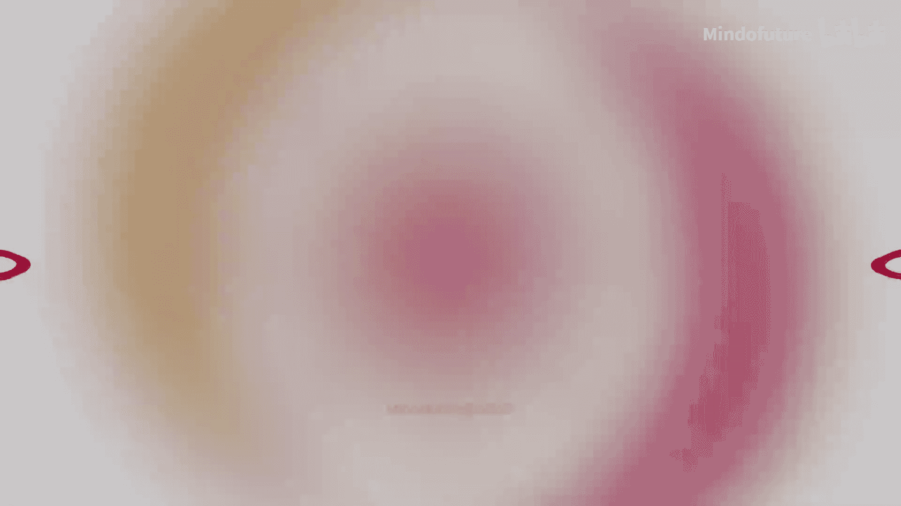
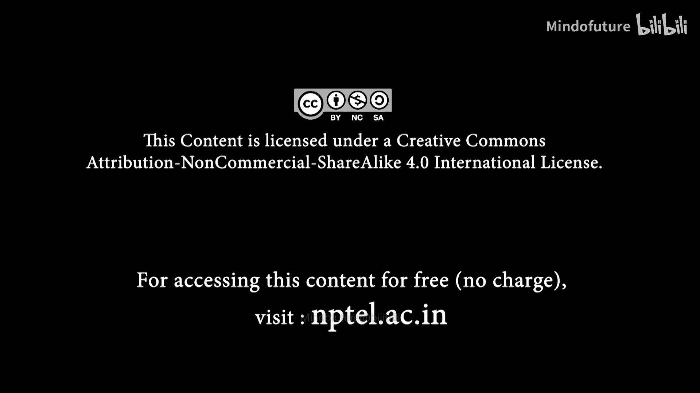
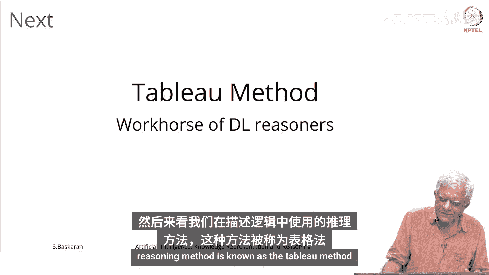

# 【印度理工学院】知识表示与推理 ｜ Knowledge Representation And Reasoning p117 P117_DL示例 -BV1c4zNBmEyF_p117-

So， welcome back。We have been looking at description logic。All description logics。

 And let us look at some。Statements we can make。And。

Description logics so remember that description logics are logics of noun phrases。

 so basically they allow us to describe noun phrases essentially。And of course。

 relations between concepts。When we move on to sentences， essentially。

But when you are talking about concepts， we can say for example。

 that eager students is the intersection of those who are eager and those who are student recently。

Basically it is an intersection this is a union buses or cards we can say by saying if we know the concept we have the concept of bus。

 if we have the concept of cards， then we can define a concept of buses or car。

If you have things which are electric， we can say not electric， essentially。So this is。

Semantic in the sense。That we are defining primitive concepts and。

We are defining new concepts from primitive concepts。Simply saying in personal logic that。We have a。

Peddicate call。Eger student X doesn't mean anything in first or logic。A predicate name is。

Meaningless， essentially in that in the sense that。The interpretation depends upon you。

 what do you mean by that。Predicate what particular subset of the domain you are talking about。

But in description logics， we define some primitive。

Concepts and then define new concepts in terms of those concepts。

And we assume that the primitive concepts are defined in some name space if so it should be clear to anyone who is reading。

That。Document as to what what is it we are talking about。So， the meaning of a。

Pereddicate or a concept。Still comes。Fong。The user essentially， in some sense。

 except that the idea is in。Using RF is to have a shared vocabulary and that is a key essentially that everyone knows that what is it that we are talking about。

So， if you wanted to say the set of people， let us say people are the ones who own cars or the set of individuals who owns only trick cars then we can use them for all owns and this is the class from which the whatever they own comes from essentially。

If you want to say a person who owns electric cars。

 that means at least one electric car the personnel first of all。It must be a person。

And there must be at least one electric car that a person owns。

Someone who owns something that has a battery。So own something。

So thats something corresponds to this concept here。

And that something is something that has a battery， so it has a part which is a battery。So， we can。

We had said that if you use the statement。That。I am defining a concept car as a subset of this concept this concept is says。

That it has。At most， four wheels。And。Sorry， at at least four wheels and at most。 so this is at most。

So at most four wheels and at least four wheels， then we can define it， but we can't really use it。

But we cannot say that something is a car we can say that。

I am defining this concept card which has exactly four wheels。But on the other hand， if we say。

Equvalence。Then we are saying that cars have four wheels and also。

That things with four wheels are car so we are defining a two way relationship here and in that sense now we have defined what is a car you show me some description and I can say that yes this is a set car and that is what we do when we do in this process of kind of classification essentially you define a concept using other concepts and then you know where it sits in the taxonomy。

So if you understand students attend lectures。So the right hand side here says。

The set of individuals。Who at least attend who attend at least one lecture。And students are。

 basically。Those people who at。Atttenend at least one lecture。

Lecturees are those things which are attended by students， so it is the inverse of the attendance。

Rural， essentially。And that lectures and students are destroyedjo can be said using this。Relation。

So we can talk about the domain of this attend role。We can say that by specifying。

 if there is something that。Is a role filler for attendance。From the whole domain。

It must be a subset of students。Which is basically saying that the that。

Only students attend something， the domain of。너 롤。Attends remember that attend is a role which goes from students to lectures students attend lectures。

 so the domain of attendance is students。And the range of attends， which can be seen because of the。

Inverse role here。Is a lecture so anything that is attended。Is a lecture。

If you don't want to use the inverse tool， we can also say that。In the entire domain。

 which is the top concept。If anyone attends anything。Then that must be a lecture。

 So for all attends it must be a lecture。 That is another way of saying that the range of attend。

Roll is a lecture。And we have already seen that you know we can have inverse roles and things like that so attends and attend inverse and we can define role has parent as an inverse of role has child。

 so has child says that somebody who has a child the inverse of that is somebody who has a parent。

We have also spoken about grandchild。So， hair child。Composed with hairch。Eer。Grant。

 so you can think of this as is in some sense。Because you are saying for all eggs， something。

 something， something implies something else。Those with grandchildren who are all doctors。

We can say it either by saying。All those individuals who have a child。Who have a child。

 who is a doctor essentially。Or we can say all those individuals who have a grandchild。

 who is a doctor essentially。Remember that。They don' not have to have children essentially。

 but if they had a children。Then all the children would have a children。

But they don't have to have and if they had then it would be a doctor so you just need to you know。

Sort out what I just said。But essentially what I was saying was that it can be vacly true either at this level or at this level essentially。

😊，But if the child exists， then the child better be a doctor。This simply says that。At most。

 two clled。Brothers are siblings。Sisters are siblings。

It is a subro that we have already spoken about。We can say that the sibling rule is symmetric by saying that。

The inverse rule。Is also the same role， essentially。

All it is transitive is that you you compose the sibling role。

 then you will have another has sibling rule。But you can also be careful and say。That。

It is an irreversible， irrelexive rule， essentially that you can't be your own sibling essentially。

So， lets just make a mention of the fact that when you talk about logic in general we are talking about the open world assumption。

And。Which is also true for description logics， essentially。So。

 supposing we make the statement that Lucy likes apples and oranges and there is no other information about her likes and dislikes。

Can we conclude。That she likes only fruit， so we know that she likes apples。

 we know that she likes oranges。But does that mean that she likes only fruits？

It really depends upon the answer to this really depends upon whether you are working with an open world assumption or whether you are working with a closed world assumption。

So if the information is stored in the database。Then the query。List those who like only fruits。

Will return， Lucy。That' is because of the close one assumption which says that we know everything that we。

Could know about Lucy， essentially。So， remember， it's。

The language prologue that we studied essentially that also uses a crude cook close world assumption and we had this notion of negation by failure there essentially。

So the similar thing applies to this here。But if we say in logic。

That Lucy likes only fruit or description logics this will not return true and we will see this when we look at the reasoning algorithm for。

Dscription logic later。So， our data database works with a snapshot of the data and assumes that a snapshot is complete so we know everything that is needs to be known。

Whereas FOL DL looks at all possible world that there can be things that we are not mentioned there。

And。It could be possible that she likes， for example mobile phones essentially we have not mentioned it here。

 but it is possible essentially。So a statement like Lucy likes only fruits would be false in such a case。

We will also look at something called default。Reasoning as we go along。

Where you can draw conclusions even in an open world scenario。

But the conclusions can be revised later， and such conclusions are called defusible。Conclusions。So。

 we'll stop here。And then look at the reasoning method that we use in description logic。

And that that reasoning method is known as a tab method。

Well do that in the next session。