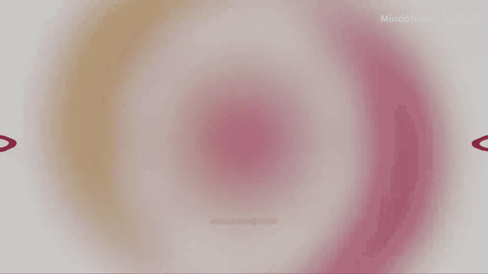
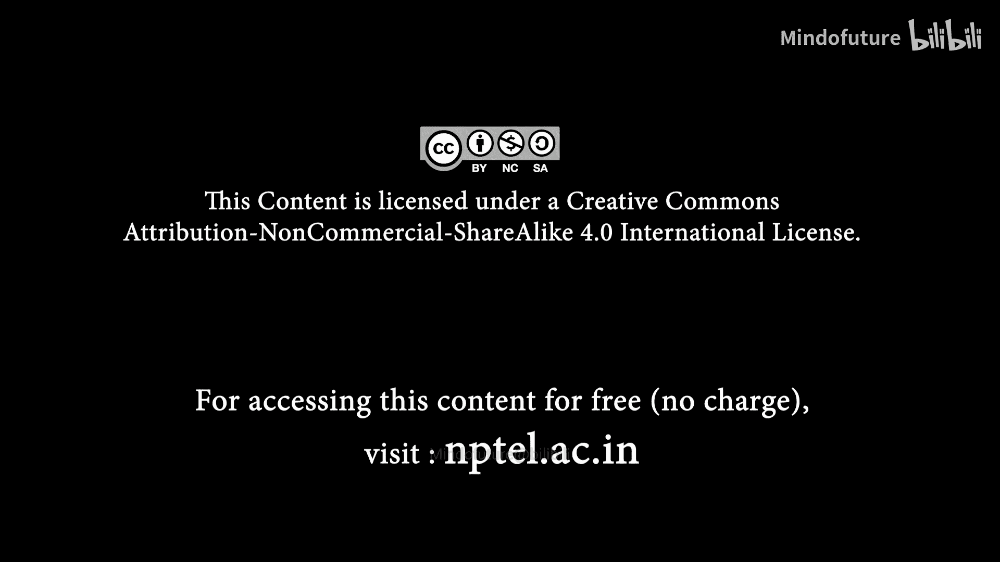
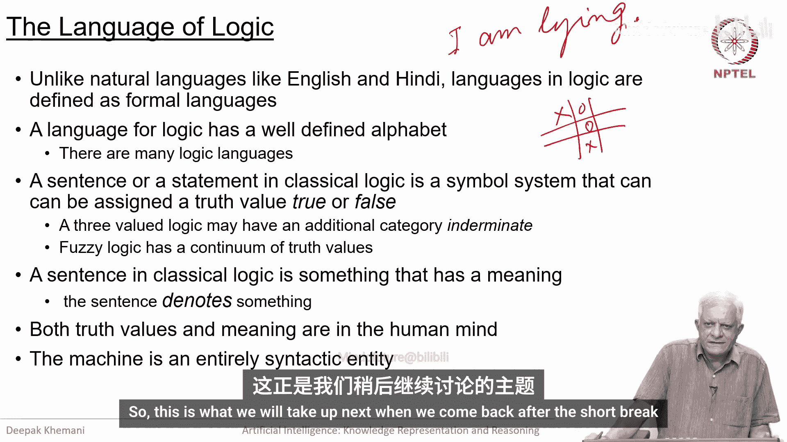

# 【印度理工学院】知识表示与推理 ｜ Knowledge Representation And Reasoning p12 P12_2.3-真值、逻辑与可证性 -BV1c4zNBmEyF_p12-

So we just finished talking about symbols and thought。

Try to see the connection between thinking thinking and symbolic representation。😊。

People started about discussing whether thinking and language are related。

 whether they are necessary for each other or not。But we are more interested in the fact。

Like Simon and Newell said。Is that。Can intelligent machines be built using symbol manipulation？

Or symbolic we see and that is a physical symbol system hypothesis we show。Recently。No。

We are focusing our attention on logic。And logic has been studied。For a few thousand years。嗯。And。

It has been concerned。Withhich the validity of arguments。嗯。Is that。If you know some things。

And then you do some inferluencing or some reason and you come。

 you know other things and that that's what we said that that's what an agent needs to look。

How do you make sure that。The conclusion that you arrive at are。Validt decision。So。

Logic is really concerned with valid forms of reasoning。Of course， when we talk about logic。

 we talk about full values， so we will begin with that。😊，That if something is true。

 then what else is true？And essentially we are interested in。Everything that is true。So。

 we will look at the general principles behind logic now。😊，And。Gradually refine our。

Study into more specific details as we go along session。So we are concerned with。True statements。

And we can see。That our logic has been proposed as a mechanism。For arriving at。New truth statements。

 given some。Existing flow statement。嗯。That's a process。That will top of as binding proofs。

All as provability。So what logic？😊，Focuses on is deductive reason。Which means。Reasing。

 which is going to。Give us valid arguments。As we said。

 logicians were focused on reasoning much before the advent of computers。Wt。

With digital computers and our interest in AI。The focus shifted to representation because， you know。

 we want to represent everything all the knowledge that our machine needs to know or an agent needs to know。

呃。So presentation is important。We will come to representation， of course， that's the mean。

First in this course， but we will begin with logic。And。We will see what are the kind of。Mechanism。

 what is the kind of machinery that we can build？😊，For doing deductive reasoning。

 we will define what is deductive reasoning and we will look at some reasoning。

 which is not necessarily deductive jumping to conclusions， for example。Is non deive。Oh。嗯。

It's called inductive reason and that's what the machine learning is all about。

So let's look at logic。We are back to Golden timess。Libness was interested in。Calculating machines。

But he was also interested in。Using those same machines。都。Do logic。Reし。So。

 he believed that much of human reasoning could be reduced to calculations of a sort。

And that such calculations could resolve many differences of opinion。

One of the reasons that logic was。Developed or evolved。Where if people are arguing。

 then how do you decide who's right and who's not right this issue， not a very easy task， but。

That was the motivation behind logic。What are the inescapable conclusions that you can draw from what you know？

So， what Liveness says is that the only way to rectify our reasonings is to make them as tangible as those of mathematicians because mathematics was always considered to be a。

😊，Essoote。Art or science。And he says that so that we can find our error at a glance it is very easy to see where you have made a mistake in when you are doing sums。

 for example。😊，And。We should be able to spot our mistakes and arguments also you know。

With similar ease， and that was the goal that he was interested in。And he says that。

When there are disputes among persons， we can simply say let us calculate。😊，Without further ado。

To see who's right。It would be nice if everybody would。😊，Resort to this way of。Solving arguments。So。

 his goal was to find a foolproof mechanism which could be used to unambiguously decide who was right when people were arguing essentially。

😊，Now， if you study Indian logic and we will not have time to study Indian logic in this course very much。

But you can see that a lot of。Intel logic was also based on this formalism of argument so。

Pinncciles of arguments known as Trk Shaftra was developed independently in the 17th century by Annaabberta in his treat called。

第成略。So， there is a lot of work in Indian logic but we will not have time。So go into that very much。

So let's look at what Leibness is saying。He works with these two following principles which he applies。

Not only for logic， but also for his whole philosophy of thinking。

He says that all our ideas are compounded from very small number of simple ideas。😊。

Which form the alphabet of human thought， he said。It's interesting that when。George Bull introduce。

Bullion algebra to us。His book was also called laws of thought basically。

 but people were concerned as to what is thinking， how are these how are we humans， you know。

 thinking and that kind of stuff。He says that complex ideas proceed from these very simple ideas by a uniform and symmetrical combination analogobs to。

😊，Arithmetic multiplication。So， he had this very esoteric idea of saying that we can represent concepts using prime numbers。

 so every prime number would stand for。😊，A particular concept。So， for example。

 if I say three stand for red。And if I say。7even。Stands for flower。Then。I could say。That 21。

 which is a product of three and 7， stands for the red flower。

So so if you could have prime numbers to。Represent the。

Properties or characteristics in the real world。Then you could describe an element using。😊。

Just a number and you have to only factorize the number to find out what the properties are so if I say 21 then you know that I am talking about a red flow because this 21 is a product of 3 and 7 that was likeibness' idea of composing everything from a very small number of simple ideas and he wanted to invent something called those universal cs but this idea of prime numbers is interesting。

😊，But difficult to implement。And冇。How would we know what three stands for。

 how seven stands for and so on， so that's another thing that one would have to worry about。

So let's look at formal logics。That's what we are interested in。That's what we are going to。

Begin with we are going to use logic as a language for representation。And of course。

 then logical will also give us a machinery for reasoning。So。

 logics are formal languages with well defined rules for manipulation of representations。

We will use the term knowledge base。To stand for a set of sentences in a given logic language at this moment we are not concerned with what is the language we are using。

 what is the formal language we are definingening we will do so as we go along。

But the knowledge base is basically a set of。😊，Sentences that are expressed in some given logic language。

Family of logics or the family of languages used in logics。Our point of view。

 we will see a glimpse of what kind of things are， what kind of languages it with。

And they vary with expressivity， how much can we express using this particular language？

As you might expect。Expresssivity comes at a cost。The rich， the language。

The more is the power you need。To compute with that language。

 The more is the complete computational complexity of。

Handling that language doing reasoning with that language。Thanks坐。

So let's look at the language of logic decision。Now。

 unlike natural languages like English and Hdi languages in logic。😊，Defined as formal languages。So。

 for those of you who have studied formal languages。

 you would know that basically a formal language is a way of enumating the set of sentences that are there in the。

😊，Logic and there are different mechanisms for doing that。

 but these are very well defined sets of sentences。We start with a very well defined alphabet。😊。

And construct the set of sentences that can be expressed using the logic。嗯。Uing using。

Very strict rules unlike unlike our natural languages where the rules are not so strict that you can。

 you know bend them a little bit here and there in formal languages， the rules are very。

Stick as to you know what is a sentence and what is not a sentence。

And it has a very well defined alphabet。😊，So the main thing about a sentence and logic。

Or a statement。Or proposition in logic。Is that it's something？

Which we can say is either true or which is false。It can be assigned a truth value and we will work with two truth values。

And when you are working with tools values， we say that the logic is a classical logic。😊，So。

 anything， any sentence， it can be in any language。

 it can be in English or it can be in the normal language。😊。

Wch can be assigned a value to or false is a logic sentence in logic essentially。In principle。

 so I might say。For example。That is raining in Delhi。It's raining in Delhi。That's a sentence。

 right because。It can be either true or it can be false。

 of course I don't know what's happening in Delhi， but that doesnt stop it from being a sentence。😊。

So if in principle， you can assign a tool value。Then we will call that as a sentence。

Then my favorite example is that of ch。嗯。If I make a statement that white always wins in chess。

It's a sentence。But we do not know whether it true or false。 And when we say that。Wite always。

Win in chess， what we mean is that if both the players are playing perfectly。

 then white will always win。😊，And the sentence has to be either true or false。

 but we don't know whether it' is true or false。For simpler games like cross and knots， for example。

 that's something you must have played as a child。Where you start off by putting a clause or the not。

我 close我 don't know。And so on。We know。That if both the players are playing perfectly。

 the game will always be a draw。But we do not know about this。

But still the sentence that white always wins in chess is a sentence。Because in principle。

 it can be assigned through value。There are certain sentences。😊。

And Russell showed this so there is the barberous paradox and so on that you must have heard about。

 just look at barberous paradox on the neck。But a simple sentence like I am lying recently。

 so supposing I just say。😊，Can this sentence be true or false in principle？The answer is no。

 because if it's true。That means I am telling the truth， but it says that I am lying。

just think about this and that is a sentence which even in principle cannot be assigned with truth value so that is not a sentence then there are other things like question marks can you tell me your name that is not a。

😊，That's a command or a question mark。 It's not something we can be true of course。

 So sentences are those。Whi can in principle be assigned values which are true or false and we are dealing with classical logic。

嗯。In this course。Mostly。And in classical logic， there are only true whose values。

 one is true or one is false。But there are other logics that people have worked with。

 so for example there are three valued logics in which the additional category indeterminate or maybe maybe its true maybe its false and things that but those are different kind of things。

😊，Then there is fuzzy logic， which is a name you must have surely heard there。

The truth value is in a continuum of values between0 and 1 in classical logics it is either false which is0 or true which is1 in fu logic it can be anything in between so if I say Mary stall。

Is a sentence too？Well， obviously， it depends on Mary's height， but。

It also dependss on what you mean by all。So can we fix the height。

 can we say six feet is tall then what about five feet and 11 and a half inches。😊。

Then is that person tall or not is difficult to see the phiologics deal with those kind of statements where the notion of toance is not crisp。

😊，But as your height increase then your degree of tallness increases so when you say somebody is tall you will assign a tools value which is between 0 and1。

 it could be between 0 and。😊，A sentence in。Logic or classical logic or any other logic also has a meaning。

😊，It denotes something essentially。So， when I say that。The clouds are dark。

It's a sentence in English language， but it has a certain meaning essentially。Likewise。

 sentences and logic also have a certain meaning。But both truth。

 values and meaning are in the human mind。When I say。

There the clouds are dark and of course it is meaningful for me and I may believe that that's true。嗯。

And when I say what does it mean to say that the clouds are dark and I also have a certain denotation for that essentially。

😊，That's also in my head essentially。So if I may say， if I say Su is a friend of。😊，Let me。

What does this mean？The meaning， of course， is in my hair decision。As we will see。

The machinery of logic。His。Neither concerned with meaning。Nor with two values。

It is a machinery which works with patterns。嗯。We will。Come back to this。After a shot。Make。

The machine。Is an entirely syntactic entity， it does not deal with meaning。

 it does not deal with truth value。数。This is what we will。

Take up next and we come back up to the short break。

