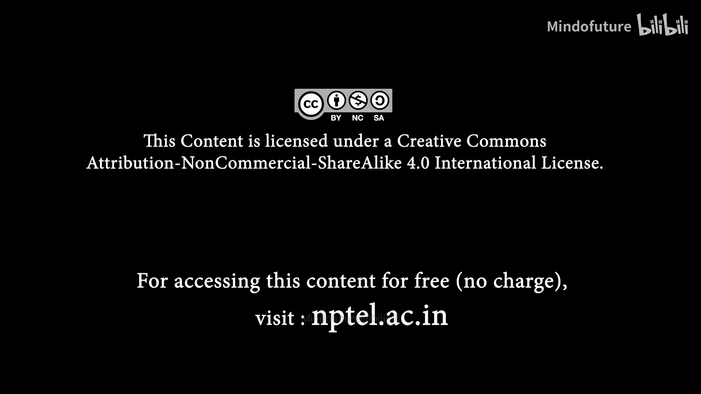
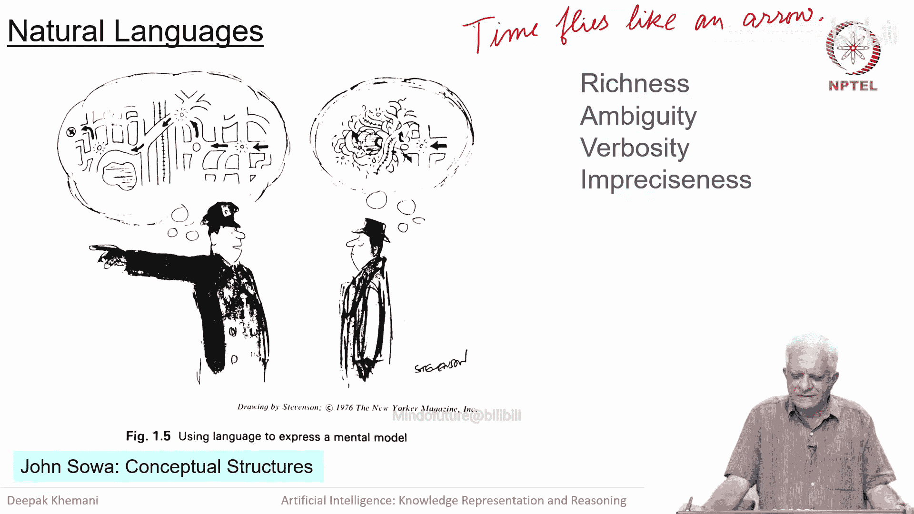

# 【印度理工学院】知识表示与推理 ｜ Knowledge Representation And Reasoning p13 P13_2.4-句法机器 -BV1c4zNBmEyF_p13-

So when you come back。We are。Discussing the machinery of logic。And we said。That。刘啲。

Essentially deals with sentences。Classical logic deals with sentences that are either true or false。

Sentences have meaning sentences have truth values but。The logical machinery doesn't。

Deal with any of these essentially， it is something which operates。V our patterns， it's as synractic。

嗯 b啲。In fact， the digital computer itself is inter。😊。

So let's look at this notion of a syntactic machine。It is only concerned with form。And not content。

When I say form， basically。We said that logic is to do with arguments with reasoning， essentially。

And it is concerned with arguments which are valid。We will see that the validity of an argument。😊。

Is dependent upon the form of the argument。And not on what the content is specifically So form is important and that is why。

Logic is called formal logic。It is form。When we look at a more expressive logic called first or logic we will see that we can define meaning also formally as to what does the sentence mean。

 for example， I give you an example su is a kind of lamish。😊。

But we will see that the meaning also will be defined in terms of some kind of a formal structure it。

So here's an open and interesting question。😊，Can a computer understand？

What it is processing because understanding something that we associate with intelligence and if you say that machines are intelligent machines machines can think or machines have minds of their own。

Then obviously we will have to answer yes to this question that if it is doing something meaningfully even though it is using rules can it understand what it is doing。

We still don't know the answer essentially。嗯。Because it really depends on what you mean by understanding。

 how can you show that you are understanding something simply。Even in the case of humans。

We do some kind of， you know。Test so so when you are teaching in schools and colleges。

 we test them to see whether they understanding something or not。

And based on the results of those tests， we say， okay， yes。

 this person can understand something which is， of course， what Tring said。In the T test。

 he said that if you want to decide whether machines are intelligent or not。

He proposed this imitation game which we now call a tu test and he said that if a machine can react to you in those days it was over written text over a teletype machine。

 now you can think of it as a chat box。That if a machine can react to you。And you cannot。

Tell the difference whether it' is a machine reacting to you or a human reacting to you then it must be intelligent。

 so that is the essence of the turing test。Whether a machine understands。😊，Is difficult。So。

 of course， Denette came up with this Chinese roomoom argument that you should look up on the net again the Chinese zoom argument says。

😊，That imagine。That you are writing a question or a query in Chinese。

And split and kind of slipping the slip of paper below the door。And something is happening inside。

 you know， there is some person sitting or something like that。And what Denette says。😊。

Is that if that person is not a Chinese speaking person and let's say it's a English speaking person。

😊，But the person has access to a large number of。😊。

Patterns which says that if this is a pattern that comes in。

Then this is a pattern that you must dish showed。Then to the outside person。

 it may seem that you are asking a question in Chinese and you are getting an answer in Chinese。

But having conjured of this Chinese room experiment， it is a thought experiment in principle。

People have argued that it's not possible to construct such a。呃。

Room because the number of slips of paper that patterns that the inside。That should be there is。

Simply beyond。嗯嗯。The realms of possibility。But if we look at it from outside。

 we are sending in a slip with a piece of。😊，We are sending a piece of paper with a question written in Chinese and you are getting an answer back in Chinese so does the person inside and understand Chinese what we have said that the way we have constructed this thought experiment is that the person does not understand Chinese if you know the person using some syntactic procedure he does pattern matching he looks at the listing and you know somehow matches the right slip which is the right slip of paper on which the answer is written and gives it back to you。

😊，So， you know， these questions we will leave aside for the moment。😊。

Even given the fact that we want to build machines which have minds of their own。

 as far as logic is concerned， we have more modest goals。😊。

And the goal is that can we build machines that do something meaningful for us。

 something that' is meaningful for us can we automate this process of reasoning and argumentation。😊。

And。Let the machine do it for us and it comes up with the answers even when it is syntactically or mechanically applying rules。

So we are not going to address the issue of can the machine understand？We are going to address the。

Question of， can it do something useful for us？And logics are meant to capture valid forms of reasoning。

The most famous example。Is the Greek syllogism？Which embodies one particular form of reasoning。

 which is。Consider to be valid。And the classic example for that is。😊，The Sotic argument。

It says that all men are mortal。Socrs is a man。And therefore， Socrates is mortal。

 So what the idea of the slogism is that。This Socratic argument is a valid argument。

 not because it is talking about men and mortality and Socrates。

 which of course in the real world we know that all people are。😊，Okay。

But it's a pattern which is important。And the pattern， as you can see。

 is repeated in the other two examples on this slide。😊，The first one said all manner model。

 the second one says all cities are congested， the third one says all politicians are honest。

Then we give an example， Socrates is a man's， Chennai is a city， Zeth is a politician。

And then we come to the conclusion， Socrates is mortal because all men are mortal。😊，Chinese。

 sorry Chennai is congested because all cities are congested。

 some is honest because all politicians are honest。So in a valid form of the argument。😊。

If the premises are true， if what is given to us is true。

Then in a valid form of the argument the conclusions must necessarily be true and that is the idea of a valid form of argument and logic is concerned with valid forms of arguments；

 syllogism is one of them which the Greeks invented。😊。

We will look at more modern logics but the basic idea is this。That。

The validity of an argument depends on the formal structure。

 not upon whether you are talking about men and mortality or cities and congestion or pollution as the case is nowadays。

😊，Our politicians。And so on， essentially， as long as you accept。That all politicians are honest。

Then if somebody is a politician， you must conclude that somebody is honest。

Property of a valid form of reasoning basically and we are interested in these kind of valid arguments。

That's why， as we said。😊，We call our logic as formal logic。

So it is a formal system the way by a formal system we mean in the computer science sense of the word。

Formal languages， for example。Something which is expressed explicitly and is well defined。

Logical reasoning is concerned only with the form of the argument and not with the content。

 it doesn not matter what you are talking about as long as the argument has a valid form。😊。

We will accept it。If the form is valid and if the antecedents are true， what is given to us is true。

 then the conclusion must necessarily be true。Conclusion holds。If the anteceence cell。猪。

Logic does not concern itself with truth of the antecedents。Inf logic doesn't even concern with。

Truth at all， as you will see， if you give us the first two sentences in the syllogism。

 we will give you back with。😊，Conclusion， it's like the Chinese room essentially you give give me two pieces of paper。

 I'll send you one piece of paper back and that's a conclusion。

There's no talk about truth or meaning there。Why do we need logic Okay。

 so that's a question that we can talk a lot about but。The simple answer is。😊，That。Our languages。

What we call is natural languages like English and Hindi and Spanish。French。

They are rich essentially， and this richness。😊，Comes with expressivity and expressivity。

 as we have kind of mentioned in the passing。😊，Comes with difficulty of understanding。So。

 not only are。Meural language is rich。They can be abiiguous。For example。亦飞。What to say。

He shot the girl with the camera。What do I mean？Is it the girl with the camera？

Or did he use the camera？So there is ambiquity and and natural language is full of interesting sentences。

 essentially one of the most famous sentence which was introduced in the world of computing when people try to build parss to。

😊，嗯。Passe natural language。Was。This sentence。Call time。P。你。And hell。

Of it's a sentence with English speaker。Have no difficulty in understanding。In fact。

 they can't even possibly imagine。😊，Why should be there difficulty in understanding such sentence because is such a commonly used sentence time flies like anarrow？

What we really mean is the time is going by at such a rapid phase essentially。But for a machine。

And we are talking about the 1960s here。Which was not equipped with the background knowledge that we humans are equipped with。

We not equipped with the intricacies of language that we are equipped。😊，嗯。

Would find it difficult to pass that sentence。So if you look up this urban net。

 you will find interesting this thing， but some of the variations that。嗯。

The machine came up with different parts treess。I that it one thing is that it said time is an adjective flies is a noun。

So time place。Is。What kind of phrase？So there is a quote which is also attributed to Gauucho Marx。

 who was one of those Marx brothers famous in cinema。系啊。

Gauo marks apparently said time flies like anarrow fruit flies like a banana so you can see the structure is same time flies are a kind of flies and they like for some reason inarrow。

And fruit flies， of course， we know our kind of flies and they like bananas。

 I think so you can see that this sentence could very well mean。😊。

That there is certain kind of flies called time flies。And they like an error。啊那个。

Past that the machine came of it。Was that time is a verb。Okay。It's like， you know。

 if you were a coach for。Set of athletes and you're training them。

Then they are you know practicing their sprint， let's say the 100 meters。

Then you are timing them essentially。嗯。😊，So what this sentence is that for some reason you to time flies。

 maybe you are coaching flies to do something。And how do you time flies you time flies like you would time in L essentially。

😊，Whatever the mechanism is for timing and error， which I don't know。

But that's what the sentence could mean。So the point is that natural language is is rich。 of course。

 that's why we。😊，Enjoy the works of William Shakespeare and James Joyce。And Kaids and Premchann。But。

The businessiness comes at a course， essentially it's not easy to process anything。So。

 that is one of the reasons why we do not use language that it is too rich， it is ambiguous。

 it is ver so if you want to say some simple things in natural language，😊。

Then you won end up being very ver and no one。No that better than a bunch of lawyers。

 essentially so if you have written any legal document， so if you are。

Most of the time when you are signing up for an app or something， you accept the conditions。

But if you open that set of conditions。Verocity is the first thing that hits you。

 I think it's kind of pages of。Text that you know， you cannot make sense of essentially and。

Vbosity is another problem with natural language essentially that if you want to be precise。

 you have to be very verose and the legal fraernity knows that better than anybody else。😊。

And of course， otherwise you will be impreci so either you will be precise or you will be ver。So。

 for many of these reasons。😊，Much as we would like machines to interact with us in natural language。

呃。We are not able to do that because of these properties of language。So， we will take a break and。😊。

We will come back to formal languages， formal logic。You know， next video。

