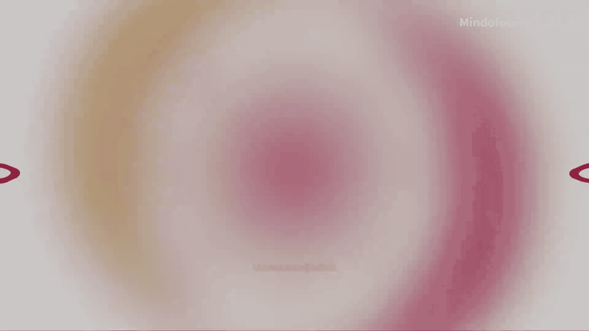
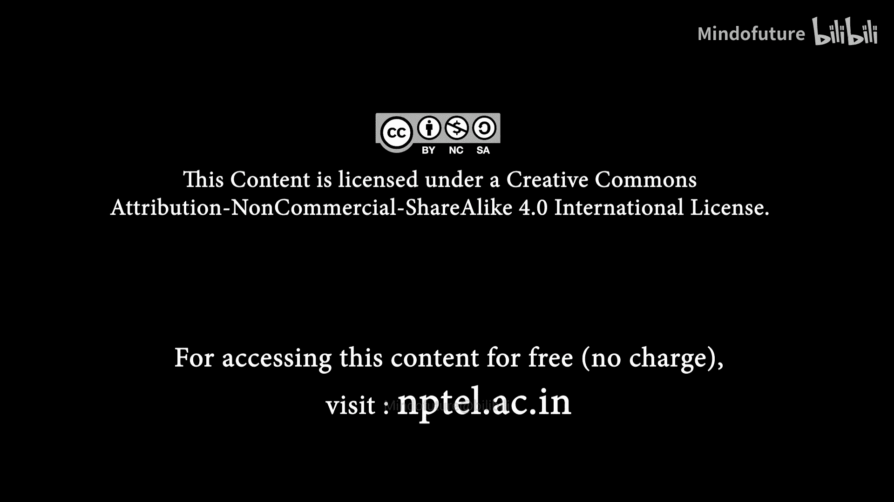
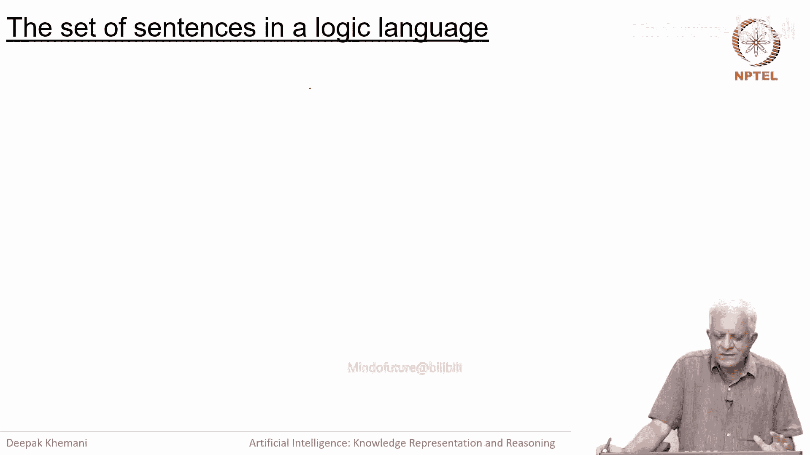

# 【印度理工学院】知识表示与推理 ｜ Knowledge Representation And Reasoning p14 P14_2.5-蕴含与证明 -BV1c4zNBmEyF_p14-

So welcome back。So in our last meeting， we。We discussing why do we need。Pmal logic。 Why do we need。

A mathematics like language for reasoning。When we could have。

Use something like natural language and we saw that there were various arguments against natural language。

Mainly business。Ambiquity， verversity， impreciseness， you can either be precise or you can be ver。

And this nice cartoon from。The book， conceptual structurestures by John Silver， indicates that。

Quitnessly。So， that logic is。In fact， a branch of mathematics。

The earliest logicians for mathematicians。As far as。The formal system is concerned。

When we talk about logic and reasoning and arguments， we say this is true， this is not true。

 this is false， this is not false。Mathematically， those values are just members of a set of variety of two that is for classical logics。

😊，In which sentences are mapped so every sentence is mapped either to the first element of this set or the second element of the set so for example the first element could be true the second element could be false or you could write it as capital T and capital A。

Or we could write it as1 and0 all of them are。😊，As far as we。

Are concerned the same it is a set of two elements and we want to basically partition our sentences in the logic。

Into these two sets whether it is true or whether it is false。We said。That what we want。

From knowledge of presentation reasoning is what does an agent know？

And what else does the agent know as a consequence of what it knows so once we map。The given。

Knowledge or given set of statements are true or the knowledge base as we said。

 then we are interested in knowing what else is true。For us， of course as humans， it comes。

We say that okay， I can see it with my own eyes so it must be true。

 so of course nowadays with all those fake videos it's not so easy。

But for us validation comes from the domain， we are seeing it with our own eyes is the standard phrase that we use。

We also mentioned that different logic languages have different levels of expressivity。

And we have said that this comes as a trade we will see some of this as we go along in this course。

We have also said that logic is concerned with valid arguments we are interested in what forms of arguments。

 what forms of reasoning， what patterns of arguments are valid and which patterns are。Not valid。

The language comes as a second。嗯，点。So here's a whole family of logics that you know people talk about。

😊，In the center， in the rectangle are these classical two values logics。

Proational logic is the simplest， then per order logic。Then second。

We will spend a large part of the course on first of logic because first of logic is something that is sufficient to。

Describe almost all mathematics。And everything that a computer program does is essentially we will see is something which can be directly related to first neurolog so the thrust of our course will be on first neurolog essentially though we will begin with professional logic because its a simpler language。

 we will make a passing mention of second neuro logic which is too expressive for us。😊，嗯。

Even for a our logic we will find computationally it is difficult to handle。😊，So， we will look at。嘟。

Subsets of personal logic， one is called horn close logic， one is called description logics。

 and we will see that this is simply to。Fight this monster of computational complexity。

That we will work with restrictive languages， but we will also look at the more expressive languages like event calculus。

😊，嗯。And def logics。You know， which go beyond what first aology allows you to see essentially。

We will spend a little bit of time on epistemic logics。😊，Which is concerned with。What。

One agent knows about what another agent knows essentially。

And epistemic logics are basically a kind of model logics。

 but we will not look into the intricacies there。😊，Temple logics are concerned with time， isn。

 you know， what something is true at this time and something is true at earlier think。

 then how do we。Deal with that。Moal logics and logic which， for example。

 talk about the possibility and necessity， for example。嗯。That Samung tens are。Necessarily true。

Some sentences are possible true so there is a language for talking about that。

But we don't have too much time to worry about that。

There are other things which I mentioned in shaded boxes which we will not look at at all。😊。

Puzzy logic is one example。 rough sets is another example。

 Love sets are kind of tied up to model logics because the set of true sentences。

 the set of necessarily true sentences， a set of partially true sentences So these are kind of rough sets。

 essentially an element。Belongs to us said。Or may belong to us it。Or does not belong to us。

Whereas in classical logics， either you belong to the set of flu segments or you don't belong to the set of flu segments。

So， this whole business about valid argument is formalized by this notion of entailment。

We start with a knowledge base， as we said。A set of premises or axioms are initially given to be true。

Rems are something that you assume to be true。 Xoms are something that we are。

Convinced that they are true so there is not much difference as far as logic is concerned between the two。

 but Xms are known to be true statements。And we will set the we will refer to the set though。

Set of sentences S all to knowledge base Kb he said。The exams are known to be true。

 premises are given and assumed to be true。And knowledge base is true。

If all the sentences in the knowledge base are true， if and only if。

The notion of enttailment is this there。😊，Given the knowledge base。Which is a set of true statements。

All the sentences in the languages have those values that are determined or entailed by the knowledge base once you say that the knowledge base is true。

Then， in principle。We can say you give me any other sentence in that language。

And I would be able to tell you whether it is entail or whether it is not entail so by set of entail statements we meet。

The set of sentences， which are also true。So， if the knowledge base is true。

 what other sentences in the language are true is the notion of enttailment。😊，So。

 we will use the term entailed sometimes， but we more often than not we will use the term true so we say given this knowledge base is this sentence alpha true that means is it entailed by the knowledge base or not。

So， formally I set a sentence alpha。We will use alpha beta gamma to stand for sentences beyond that we don't know what is the language we are talking about。

 but these are sentences sentences in the sense。😊，Something which can in principle be given a truth value。

 either it is true or it is false in principle。So， a sentence alpha is set to be entailed by a set of sentences which we will call as the S or the knowledge base Kb。

😊，If the sentence is necessarily true。Whenever the knowledge base is true。And we will use this。

Formal notation to capture the meaning of to capture the notion of enment So the knowledge base entails alpha is equal。

Pmly like this。As I said。We will not always use the term ened we will also use the term true we will also say that alpha is true。

Of course， implicit is the fact。😊，That。Given the knowledge base。So we can imagine this。

We have a language which is a formal language， which is a set of sentences。We have a knowledge base。

 which is shown in the center here with shaded circle。And we accept the knowledge base and say， okay。

 yes， whatever you have given us is true。And then there is a set of sentences which is entailed by the law of course I run them as small sets here。

 but in principle the set of entailed sentences is going to be infinite。😊。

We also have the notion of proability。Entailment talks about truth。Prorovability talks about。Roof。

Or devivability。So， the logic machine has a set of rules of inference。

A rule of inference is a role which says。That。😊，Whether under the sentence can be added to the knowledge base。

We have already seen the syllogism earlier。The slogm says。If you give me a sentence。

All men are mortal and if you give me another sentence。

So criticism is a man we are not talking about truth values now， okay。

 we are simply saying that this sentence exists in the knowledge base All manner mortal is represented in the knowledge base。

So criticismtic says a man is requied knowledge base。

What the rule of inference which is the syllogism， which is a valid form of reasoning says。😊。

That you can add the sentence。Socr is model also to the knowledge base。

And that' is what a rule of inference does， it looks at patterns。And decides。

What else can be added to the？Set of sentences。A logic machine has algorithms for deriving new sentences from old ones so just like we saw we can derive the sentence。

Soates is mortal。From the old sentences which were all men are mor and soates is a man。😊。

And we can keep repeatedly applying these rules of inferences。😊。

P addinging more and more sentences and。Eventually， what we have is a proof。So。

 given a knowledge base， a new sentence alpha is added to the Kb by repeated application of。

Rules of inference So let's say we stop when we have we interested in one particular sentence alpha。

And once we can add it to the knowledge base。Then we can stop the proof and what we say is that alpha is prove well given the nout base。

So， we use a slightly different symbol if you will notice here。

 which is different from the notion of entailment which had two horizontal lines。

 this is one horizontal line and this is set to stand for the fact that alpha is derivable from the knowledge base or alpha is provable。

The goal of the logic machinery that we want to build。

Is to mechanically produce by this process of derivation no match a pattern。And add new things。

The goal is to。😊，Produce all and only through sentences。That are enied if you can do that。

 if you can build a machine。That will produce all the entail statements or all the true statements。

And if it can。Produce only true statements and nothing else。

 so all and only true statements all and only entail statements。

 then we are happy we don't have to worry about truth values and enttailment and stuff like that and we will see how that happens。

We can simply rely on the logic machine to see whether it can。

Produce the sentence that you are interested in if it can， then you will accept it to be true。

 We talk on this notion。A little bit more。So this is the notion of the proof。😊，That so， for example。

This is an application of a rule of inference， it says that if this is there in knowledge base and this is there in the knowledge base。

 then you can add this into knowledge base。😊，Makeway。

We have these other rules of inference and we keep adding new things so we added this and we add this then we add this and we add this and we add this and then we can add this and maybe that's sentence we are interested in and if we have。

Added this， then this whole sequence of derivations is called the prove。😊，And that is arrived thatby。

Application of rules of inference。So we have two notions now， one is called this notion of soundness。

And the other is called the notion of completeness。

 we will talk about this in a little bit more fashion。So you see that given this knowledge base。

We have two sets。 One is the set of。Proable statements。

Which have been shown by these colored circles here。The other is a set of entail stiffness。

 which has been shown by these squares here， these are two different sets。And what we are saying。I。

That if you would like to build a machine in which these two sets are identical。

 exactly whatever is in one set should be in the other set and vice versa。

 and that is the notion of soundness and completeness。so。

Given a knowledge base and the reasoning algorithm。

 some algorithm we have for adding new sentences of generating the proof。

Entailment says which other sentences in the language are necessarily true？

2 says which other sentences in the language can really one can produce by reasoning algorithm。

And we say。That our reasoning algorithm is sound。If it produces only true statements。

That if it produces something。We can accept it to be true。Completeness is。😊。

That if a statement is true。Then our logic machine will prove it。

 so if you can produce or prove or derive all through statements。

 then we say that our machine is complete logic machine is complete。

If it can derive only through segments， then we say that。系。Logic machine is sound。

 so we are basically interested in producing。A logic machine which is both sound and complete which means that if you if you are given a knowledge base and we want to find out some other sentence alpha is true or not。

 we simply give it to this machine and if it produces it，Then we say yes。

 it's true if it doesn't produce it， then we say no it's not true So that is a benefit of a sound and a。

Complete logical system。So， let's take another short break。And。We will come back and look at。Oh。

The set of sentences in a formal language is considered。So。

 how do we define this formal language of logic， which has a set of sentences？So see you。

In the next。Video。