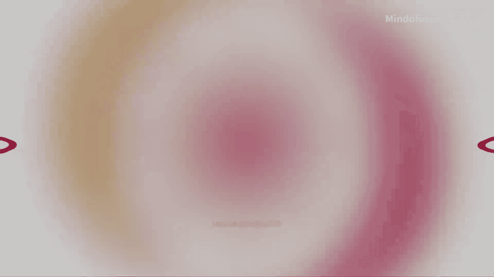
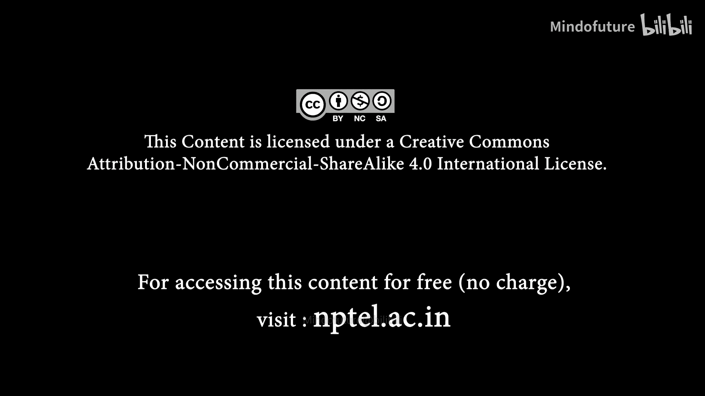
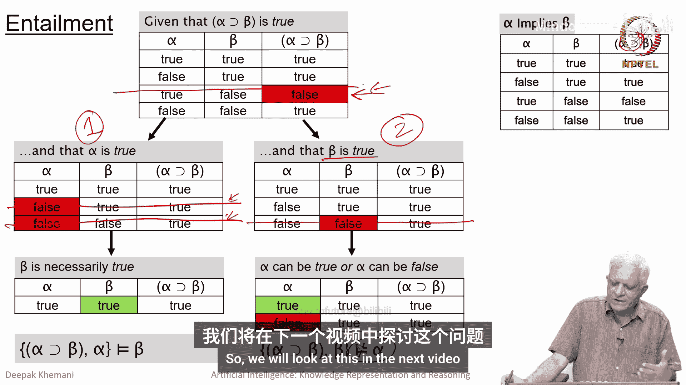

# 【印度理工学院】知识表示与推理 ｜ Knowledge Representation And Reasoning p15 P15_2.6-逻辑的语言 -BV1c4zNBmEyF_p15-

So you're back。Now we want to define。How do we construct this formal language we how do we。

No which sentences are in the language and which are not in the language。So， we can start the。

Set of sentences as follows。That we start by saying that these are the set of atomic sentences which are there in the language essentially。

 and we will see that different languages have a different。Set of different ways of defining the。

Set of atomic app primitive sentences。And then we use this notion of a logical connective。

 which is central to logic。To construct compound sentences。How do you combine two sentences？

All in the language of。Formal languages， what are the well form formulas so well form formulas will be the sentences of our language。

We will see。That given any set of primitive sentences and given a set of logical connectives。

The set of。Sentences in the language language is infinite， it's unbounded。

 You can keep adding a new sentence， essentially。What do you mean by a compound sentence？Basically。

 a sentence which， you know， connects two sentences in some way， essentially， so we can say。

The earth is round and the moon is beautiful， so there are two sentences， one sentences。

 the earth is round the sentences， the moon is beautiful and this is a compound sentence because we use an and and that's a basic idea behind logical connectives so they are different kinds of connect and is just。

关屋定。So， what are the kind of connectives that we can use to produce new sentences， so remember？

We start off with a set of atomic sentences and then we use a set of logical connectives to construct new sentences。

In this way， we define the formal language， which is a。Language that we are talking about。So。

 a logical connective takes one or most sentences as input。😊，And construct a new sentence。

All logic languages have some common set of connectives。

 so all classical logics have these connectives that we are going to talk about in a moment。

 I' am sure most of you are familiar with this。More express languages may have more connectives。So。

 one is a unary connective， there are two unary connective， one is identity。

 but we are not so much interested in the identity。😊，嗯。The more interesting one is the。This saying。

This symbol。hich sometimes people use this， sometimes people use this， but we will use this symbol。

And it says that if。You give me any sentence as input if alpha is a sentence。Then so is。This not。

So we use read this as not alpha if alpha is a sentence。P always not helppa。

We often use brackets to enclose sentences just to make sure as to what what does a connective apply to。

 but we can also leave it out when it is clear from the context that this is what we are talking about。

So we will use this symbol。For notaught， and。We will often leave the brackets。

Then there is a set of binary connectives， connectors which take two sentences。As input。For example。

 alpha and Vita。And it constructs a new sentence。Which we write as this。So。

 what is a connective the connective is this inverted v like symbol， which is called and in the。

In the language of logic。So and is a connective。And you give me two sentences and we will construct a new sentence by saying alpha and beta likewise。

 r is another connective。The symbol that we use is。Like a capital B。

And if you give alpha and beta as input， it constructs a new sentence。Called alpha Alta。

Another interesting connective is the employees or the implication。Essentially。

There are different symbols that different textbooks would use for this。But we would stick to。

This oneのね。If alpha and beta are sentences， then so is alpha implies beta。There are in fact。

16 binary connectors we have just written three here。

I will encourage you to explore the other connectives。

Do we need connectives of higher degree or higher or this thing which will take three sentences and give us a new sentence。

 four sentences and give us a new sentence。Luckily， we don't need that because it has been shown。

 for example， that if you use terminally connectives or higher connectives。

 then whatever you can express with them， you can express by。Using binary connectives。

 So supposing I defined a  ternary and okay， which says that。In some sense。

If it were to say something like。Let's call it。D and。Okay， I am just inventing this。You。

So tanned it stands for T and with meansterernary and。And what it does。

Is that it takes three sentences。As input。And gives us a new sentence。

 So lets say this is a representation of the new sentence also that it is eternalary and of alpha beta and gamma but as you can see。

We can very easily replace this by。Alpha and Vita。So I've got one sentence。

And then I apply and again to that。I good干。So， this。This， I can construct this end of three things。

The moon is round， the moon is beautiful， the earth is round and the sun is shining。

 I can say all these three things and put together using the binary connective。

 So basically we don't need higher order connective， so which is a bit of a relief。

And we can have logics with work work only with binaryary and binary cons。Of course。

 when we talked about correctives here， we in our discussion we were already talking about the semantics。

😊，And means this all means did this and so on and so forth in the formal language。

 its just a connective。 It is just a symbol which is used to construct a compound symbol。

When we say that we are talking about semantics of logical connectors。

Then we are saying how does the meaning of the tools value。Of the compound sentence be determined。

 and that is determined。By the definition of the logical connective that we are talking about。So。

 the semantics of compound sentences is derived from the definition of the logical connectives。

Most of you would have studied this， so we will try and go through this somewhat quickly。

The logical connectors are defined at watercols through tables we will see a couple of examples。

And because we are talking about truth values， we are。Talking about truth functional semantic shift。

Which is as opposed to。The meaning part which is sometimes called denotational semantics。

 what does it denote。So， the root table on the left that we are seeing here。Is for the logical note。

So， not surprisingly。Not alpha is true when alpha is false and not alpha is false when alpha is  true。

So you can see。The connection between the left hand side and the right hand side。When alpha is true。

Not alpha is false。When alpha is false。Not Al is true。 So this is a through table。

It tells us that you tell me the social value of alpha。

And I'll tell you the truth value of not alpha。I'm sure most of you are familiar with this。

The right hand side is the tool table for the logical and。And as expected。

 it says that both the statements have to be true then I will say that the compound statement alpha and beta is true。

So you can see that here。Native alpha is true。IfBta is 2， then I will say alpha and beta is 2。

But in all the other three cases。😊，I am saying that alpha and beta is false。And that is our。

Common sense。Meaning of the word and we are just capturing it， capturing it as a formal system here。

So here are some common connectives in some La model。Being gone here。Alpha implies beta。

Is something that logic uses a lot。And I am sure you are familiar with the fruit tables for that。

 Alpha implies Vita is true。For most cases， except for one case where alpha is true n beta is false。

 then alpha implies beta is falses。An interesting。Connective is。The XR connective。And。

XR is what actually。What will in common sense language。Mean， by all。

So if it say that I go for a movie or I go for a。嗯。Theater。All the music performance。

 then it basically the exhaust sense， essentially。嗯。When we in language say all we often mean X or。

 which means either。Alp is true， all be is true， but not both easily。

And the table for Excel shows that。That。Look at the cases when alpha。Okay， so they then error here。

This should be ex。The symbol for xO is。I。So， Xr is true。When only one of the。Constituency is true。

 So when beta is true or when Al is true， and when the other thing is false。

 essentially when both are true。Then it is false。 as you can see， when both are false。

 Also it is false。 So X R is a standard sense that we often use in in natural language when talk about logic。

 the logical all。Is a little bit different from X that these two middle cases are true like in Excel。

But this case is also true， which means alpha is true or beta is true。

And that is the logical or logical or says that as long as one of them is true。

 this alpha and beta is true Xr is what we mean by saying that either one is true or the other is true。

This north there a hill。We will come back to this symbol。Later。So it's an arrow symbol that we use。

 I will just check in what is the correct one and then I'll correct it here。

Another interesting connective is the equience。😊，Relation。

 which is this three lines is a standard symbol that we use。

And you can see that it's exactly the opposite of X of。The equience is true。In these two cases。Okay。

 here's an error again。This should be true。They should be false。So the equience is true。

Only when either both are true or both are false， in some sense， both are equivalent essentially。

So whenever the X is false， equience is true。And。In some sense， it's a negation of XO。ok。

So given this set of connect， So I said that there are 16。

Loical binary connectives and one urary connective。How do we construct。

The meaning the semantics of compound synthesis， the semantics of compound synthesis derived from the definition of the logical connectives that we have seen。

 and we have seen that logical connectives are defined using through stables。

We can carry forward this idea of food table。To determine the。Semantics of compound synthesis。

So this is also given by a through table。The number of rows in the two table will depend upon the number of input sentences。

 so we saw that for the negation there were only two rows。

For for and all and all the binary connected， there were four rows because there are four possibilities。

 So two ways to end。The number of rows in the fruit table。So， here is a sentence。In logic。

The first of all you must convince yourself that this is a sentence in logic。

 so alpha and beta are sentences and therefore alpha implies beta is a sentence。And also。

 not alpha or beta is a sentence。And therefore， this whole thing is also a sentence。

How is this sentence related to the those values of alpha and beta？

We see that first in the first column we have alpha and beta。

 which is the kind of things given to us。And then the rest of them are derived from。The truth tables。

 So this is the definition of alpha definition of implication。

 and it tells us that these are tools values for alpha implies beta。

This is a definition of not alpha， so you can see that whenever alpha is true， not alpha is false。

And whenever alpha is false， not alpha is true。嗯。你有。嗯。

So it's true here and here and false here and here。And then， likewise， once we are given。Not alpha。

 And once we are given beta， we can compute the。True value of this by looking at these two columns。

 And finally。The sentence that we are interested in。

We look at the this column and we can look at this column and compute the value of this。

 And and we can see in this example。That this sentence is true。Irrespective of。Whether。

Alpha is 2 or beta is 2 or alpha is for also be in all cases， all four cases。

Of those values of alpha and beta， the sentence is true。

 So this is one of those interesting sentences， which is always true。

So the number of rows is of course as as set to raised to end so here I have constructed just another table with three variables so they are alpha beta and gamma and therefore we have a rows as you can see for all combinations of these true false values。

And we can in a similar fashion construct。 So we， we first construct the。Epha implies beta。

 and then we construct not delta and then the all of these two things here。So。

 we can consider the thing and we can see that this falls in one case and it is true in the other case so in that way。

😊，You construct any arbitrary logic sentence and we can use the through table to。Deffinine the。

Truth value of the compound sentence。So。Now， let's talk about this notion of enttaillement here。

We are given。The root table of alpha implies beta。Which is a symbol that we have been using here。And。

 let's say。If we are given this as a sentence， alpha implies beta as a input in our knowledge base。

 we say that somebody told us that alpha implies beta is true。😊，Which means。That's。

If alpha implies beta given to us。连。We are only interested we we are saying up front that this is true。

 which means it is not false so what is shown in the red square that that is not allowed so we can actually delete this row。

From。Our through table we are not interested in that because somebody has told us that alpha implies beta is2。

 so those are the only other three rows in which。It is true。So we will get this through table。嗯。

In which this third row from the first table has been deleted， and we have only left with three。 Now。

 somebody tells us that alpha is also true。Which means it cannot be false。

 which means the last two rows of this。呃。Not required。So we can delete this row。

And we can delete this row from there。And we have left at only one row。So。

This is a process that we did。 we started with the meaning of alpha implies beta then when somebody said that alpha implies beta is true。

 then we deleted this。Roll from here。And then when somebody said that alpha is also true。

 then we deleted these two rows from here。And we are left with a root table， which has only one row。

 and you can see。That in that suit。Which is the final fruit table at the bottom。Beta is true。

It is no other option， but to be true。So， it is necessarily true。And that， as you remember。

 is the notion of enttailment。But supposing instead of telling us that alpha is true。

 somebody said alpha implies beta is true。😊，And then somebody says that beta is true。

 that's another list thing。So。When somebody said Al implies which as true as before we deleted this。

😊，Third row from that column。Then when somebody said beta is true， we have to delete this。

Last row from the column because that's where betas falls。So we are left with now。A food table with。

2 roads。And you can see。That。Epha can be true or alpha can be false in in one the first row alpha is true and in the second row alpha is false。

Which means Al is not necessarily true。So which is what we would say。

In the language that we are developing。That， in the first case。

Alpha implies beta and alpha entail beta。But in the second case。Epha implies beta。And beta。

 it does not entail Al。So this is a notion of enttailment。Which allows us to compute。왜的。A sentence。

Is entailed from a knowledge base。So， we saw two cases here in one case in both the cases alpha implies Vita is given as part of the knowledge base。

In the first case， we saw。That。Alpha is。Given to us。And then， we saw。

That beta is entailed because beta has no option but to be true in the resulting。

Truit table in the second case。Miso。That beta is given to be true。And then。

We were left with the possibility of both alpha still being true or it being false。 So alpha。Is。

Not entailed by alpha implies beta and。Beta， whereas beta is entailed from alpha implies beta and alpha。

So， you can see。The interestingness of this implication statement and an implication statement is the most。

 most often form of。Inference that we will see， but you can see that if。

 if somebody is given you alpha implies beta and if they give you alpha， then you can conclude beta。

 But if they say alpha implies beta and。They give you a be You cannot conclude that。So alpha is。

 as you can see here。Not entailed essentially so we use this enttaillement symbol with a slash sign to say not entailed。

Okay， so we'll take another break。And we'll come back。And look at this。As a pattern of。Lasing。

We are interested in。Those sentences which are entailed。

But we also want to look at how we can do that using the syntactic process of finding a proof。

 So we'll look at this。

In that next video。不是有数。