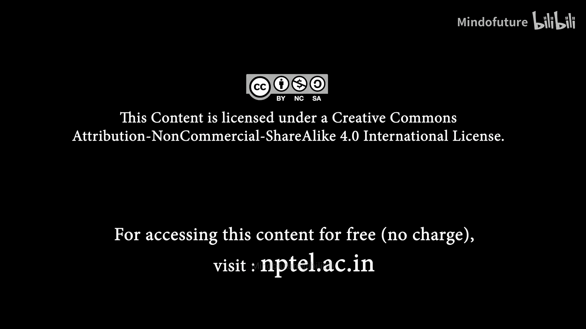
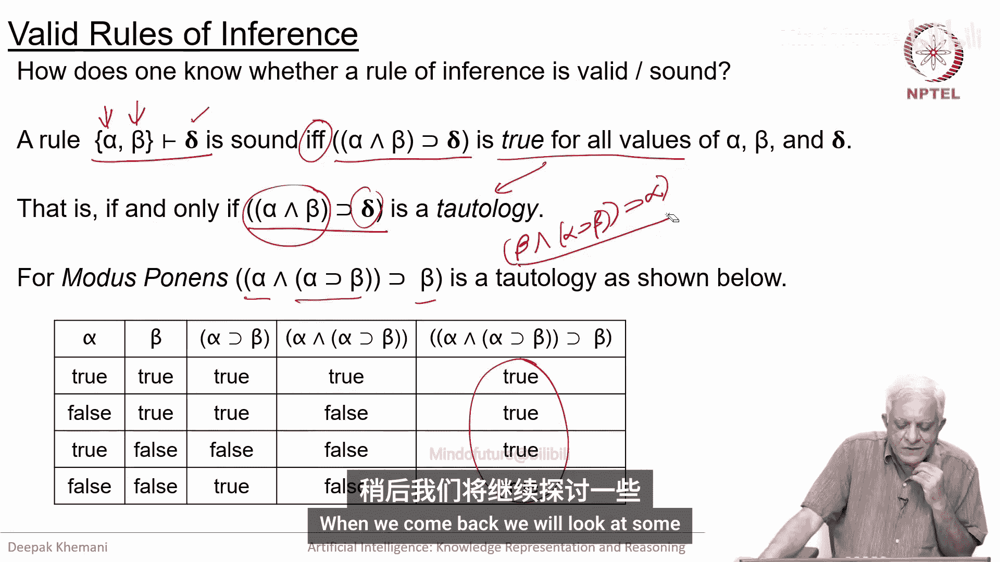

# 【印度理工学院】知识表示与推理 ｜ Knowledge Representation And Reasoning p16 P16_2.7-论证模式 -BV1c4zNBmEyF_p16-

Okay， so we are looking at logic。😊，We have looked at。The notion of a logic is a formal language。

We have looked at the notion of。Semantics of logical connectives。

And then we have looked at the semantics of compound sentences。

And we made a passing weapons to the fact。That the number of。

Compound sentences is infinite because you can always take any two input sentences。

 take any connective and produce a new sentence。 So that is a。And less process。

And then we had this notion of our entailment which says that you give us some statements which are true。

😊，And then we want to decide which other statements are true or not。

 and that is the process of entitment。And we saw in the last example。

That with the implication statement alpha implies beta。If you give us alpha， also， then beta is ened。

But if you give alpha implies between if you use beta， then alpha is not entail。

 So lets look at this。Process and let's look at the mechanism for doing this。Using the。

Ruleles of inference and proofs。So we are interested in。😊，Atns of arguments。

 we saw these two arguments。Which are given below。These are enttailments it says that alpha implies beta and alpha entails beta。

And alpha implies beta and beta does not entail alpha。So。

 how do we capture this in the form of patterns of arguments just like syllogism was a pattern？

It said that if all X's are wise。And A is and x。Then a must P y。 Okay。

 so x could be man or city or politician， whatever。 it doesn't matter。There was a pattern。

 the syllogism was a pattern。So we want to find patterns now in this more modern language that we are working with physicallyly。

So this is what we have seen。That you give us alpha implies Vita and you give us alpha。And we can。

Infer beta， That's a pattern。That we will use。Now note that alpha beta kind of variables in some sense。

 in the sense that you can plug in any sentence for that essentially it can be a compound sentence。

 it can be a primitive sentence， it doesn' not matter。And the pattern that we extract from this。

Entailment that we have seen。Is this。So， from。Alpha implies beta。And alpha。

 So we So this is a given for us okay。So this is given。

Or the premises of the aM or whatever the case may be but。

The pattern is that if you give us alpha implies beta and if you give us alpha then we can infer beta and we normally write it by drawing a line it is like a sum that we are doing so in the way we learn addition and multiplication is very similar in nature that there is a pattern that we can do that if there is anything which is alpha implies beta matches and alpha matches something then we can add beta to the set essentially。

It is very similar to saying that if you have 21 and then you want to add 7 to it。

 then you do something and then you write 28 below essentially。

We have seen that this is a valid pattern。Or as we say that it's a solid sound rule of inference。

Because a beta is en tilted。At the same time， if you give us alpha implies beta and you give us beta and we infer alpha。

 that is also a pattern。But。It's not a sound。R love inference。It's not a valid argument。

So you can see that the pattern is， is。On the surface look similar you are given two sentences or two well form formulas。

And then you are inferring a third one decision。So in one case。

 when from alpha implies beta and alpha u in beta， it is valid and we saw that because of the process of。

Cutting down on the root table that we saw in the last slide last video。

And the second one is not sound。Because you can use it as a pattern。But don't。

Expect that alpha will always be true。So when we use valid rules of inference。

For sound rules of inference， we say that we are doing deduction。We can deduce something。

And most students who study logic。In some part of their education。

Begin with this rule called modest opponents。 We will use the。Shortform MP for that。

And the pattern is as given。On the top right。That you give a alpha implies beta and you give a alpha and you can add beta to the missing。

And we have said that it is a sound rule of inference。

 we will talk about how do you determine whether the rule of inference is sound we saw we made our observation based on the entailment process that we said that if alpha implies beta is true and if alpha is true。

 then beta is true， always necessarily true。We arrived at the conclusion because it is always the case of beta so that it is entailed essentially。

But the pattern rule of inference， all this pattern directed inference system as some people call it is simply syntactic essentially which says that if I can match。

😊，Alpha implies beta in my knowledge base。 and if I can match alpha in the knowledge base。

 then I can add beta to the knowledge base。 It does not refer to truth values at all essentially。

 And that is why it is。Something which can be automated without， you know。

 having to worry about this thing。So the question you might ask is if you can establish a valid conclusion。

Or enttaillement by constructing a through table， why should we bother with derivation and proof at all essentially？

The answer to that。His。There are many reasons one is。😊。

Because the number of rows in the true table will grow exponentially with the number of variables if so this in this case there are two variables so that we will have four rows。

 if we had three variables we would have eight rows， eight rows。

 if we had four variables we would have 16 rows and you can see that you know the number of variables increase and the number of rows keep increasing。

The number of columns。Is determined by the。Number of connectives that are used in the formula。But。

 most importantly。And we will see this as we go along later。

The through table method does not apply to more expressive logics in particular to first router logic。

So， something which is closer to semantics， we will see。But not this notion of。Using food tables。So。

 reduction is sound because it is based on a valid entlement or based on entment。

And the pattern is that is such that we saw that。Given alpha implies beta and alpha beta was necessarily true。

 abduction is the other rule that we saw， which is that。It's called abduction。嗯。That we are given。

 alpha implies beta。And if you are given beta， then you can infer Al。

 but we saw that this rule of influence is not sound。Because we thought， after， you know。

Reaing with the truth table or after， you know。Playing around with the two table。

 we saw that alpha was not necessarily true。That means。That if you use this particular rule。

Then the conclusion is not necessarily true。 You may give us alpha implies beta and you may give me beta  I infer alpha。

Then it doesn't mean that I have inferred something which is true exactly。So， here's this argument。

 which is。Found in literature quite often。呃。Is that。Let's say Alpha stands for you water the garden。

 Beta stands for the fact that the lawn is wet。So it's obviously true。That if you water the garden。

 then the lawn will become red。Wt， so that's true。Supposing somebody tells you that the lawn is wet。

 which means be and if you make an inference that you water the garden， then clearly this is not a。

Valid。Influence。Because。It could have simply been the fact that it was raining essentially。

It was raining and the lawn becomes wet。 So that doesn't mean that you can infer that the。

Lan is wet because that if the lawn is wet， then you。Have watered the garden essentially。

 even though it is true that if you water the garden， then the lawn will become red。

 So alpha implies beta is true。But that doesn' not mean that if alpha implies be 2 and beta is  true。

 then alpha is necessarily true as this example shows。So， having said that。

We find that abduction is something that we do all the time as human beings in this world。

And it's a very useful rule to have， essentially。嗯，你好。Not least in medical diagnosis。

 so in these current times。嗯。You might。Make this accept this first two statement。

 which says that if you have COVId。Then you have cough and fever。Which is a true statement。

let's assume it's a true statement， So there are people who are asymptomatic。

 but that doesn't matter。 Let's assume that that's a true statement。That if you have COVID。

 then you have cough and fever。And then。You meet somebody who has coughin fever and you conclude that the person has COVID。

So， as we have said， as we have seen in this pattern of reasoning。This is not a valid。

For of reasoning。But it is a very useful form of reasoning because entire field of medical diagnosis works on this principle that in medical diagnosis what happens。

😊，嗯。The disease， let's call it a disease。Employs the symptoms。So there is a causal connection。😊。

Which makes this implication true that if you have this particular disease。

 then you will get those symptoms essentially。If you have some disease， let's say X that。

 then you will get fever。So， if you know that you have that disease。

 then you can conclude or you can deduce that you have you will get fever。But you can't do， you can。

You can you can go in this direction which is allowed that you can go from disease to symptoms if somebody gives you alpha。

 so disease is alpha。And symptoms is beta。 if somebody gives you alpha， you can conclude beta。

 but you cannot go in the opposite direction。Because， for example， if you have fever。

Then it could have been due to various diseases disease one may cause fever disease two may cause fewer fever disease C may cause fever。

 all of them could cause fever so you can move from the left hand side of an implication to the right hand side which is along the line direction of causalty because the disease causes the symptoms。

Just as botling the go。Garden causes the lawn to become wet。

 so the implication says that if the left hand side is true then the right hand side is true。

 but you can go from the right hand side to the left hand side。So you can see the symptoms。

 but it you can， you cannot logically conclude that you have the disease。 Of course。

 you may can conclude it statistically that， you know。

 everybody is getting covid or everybody is getting a common cold or everybody's getting dengue as it's happening in many parts of the。

In Delhi right now。Well， it was somethingable。You can make your conclusions but those conclusions are not valid。

 they are not sound， but they are useful recently because when you see somebody with a fever you know that okay you have to check for this disease or this disease or this disease。

So that's what happens。 You see the symptoms。Then typically a doctor might advise you some kind of a confirmatory test which say go and do this test and。

Find out whether you have that particular disease or not。 So abduction is very useful in real life。

 we use it all the time。 we see we see something。And we infer what might have caused it， essentially。

But it's not sound essentially。And we are going to focus more on on deluction， which is sound。

Forms of reasoning。A valid forms of these。So， let's quickly talk about。

How do you talk about validd rules of inference。How do you know that our rule of inference is valid。

One simple wave。Is to go back to through tables。글쎄。Thattter rule。

 So we often write a rule in this fashion。So， this is one antecedent， this is another antecedent。

 we often write it without the brackets also so we can write it with brackets， it doesnt matter。So。

 alpha and beta。If you can see alpha and if you can see beta。

 then you can add delta as a rule of inference。That if alpha occurs in your missing and beta occurs。

 then delta is to be added。 So these are some kind of compound synthesis， obviously。

We say that this rule is sound。If and only if。This sentence。

Which says alpha and beta implies delta is true for all values of alpha beta n delta。

Such as sentence。Which is true for all values is called totalology。So。

 the if the rule of inference is based on a totological implication。

 so this is basically an implication statement right it says something implies something else。

 so it is an implication and its a toology， then you can go ahead and rule the user rule of inference。

So for modest components it means。That this taological that that this implication which says that with alpha and alpha implies beta you can infer beta is a totology because you can just construct through table to see that it is in either totology and you can。

Look at that， essentially。And then Xs。I will ask you。To construct the through table。For abduction。

So for abduction。What will be the formula that you want to check for？That。Beeter。And。😔，Epha ins beta。

The whole thing。In place alpha。Take this formula constructed through table。And you will see。

That it's not a trytlogy。Right， because。In one， at least one of the。Rose。

 you will see that the formula evaluates to false。We have seen that earlier。

 but we can go through the process by constructing this compound table for this entire formula。ok。

So we will stop here and next we will。Look at some other rules of influence。

 So we have seen one valid rule of influence， which is mod opponentents。

 It says that if you are given alpha。And if you are given alpha implies beta。Den。You can infer it。

When we come back。We will look at some more rules of。

Influence。