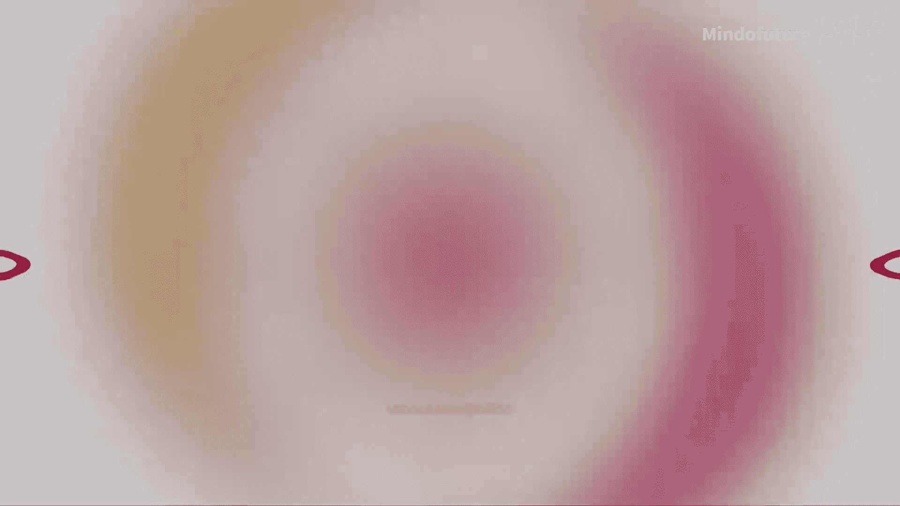
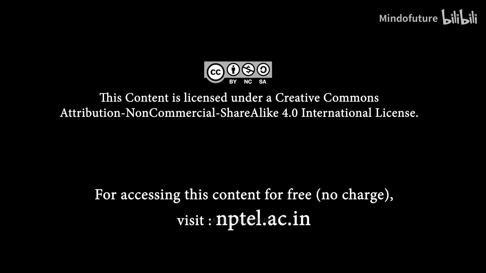
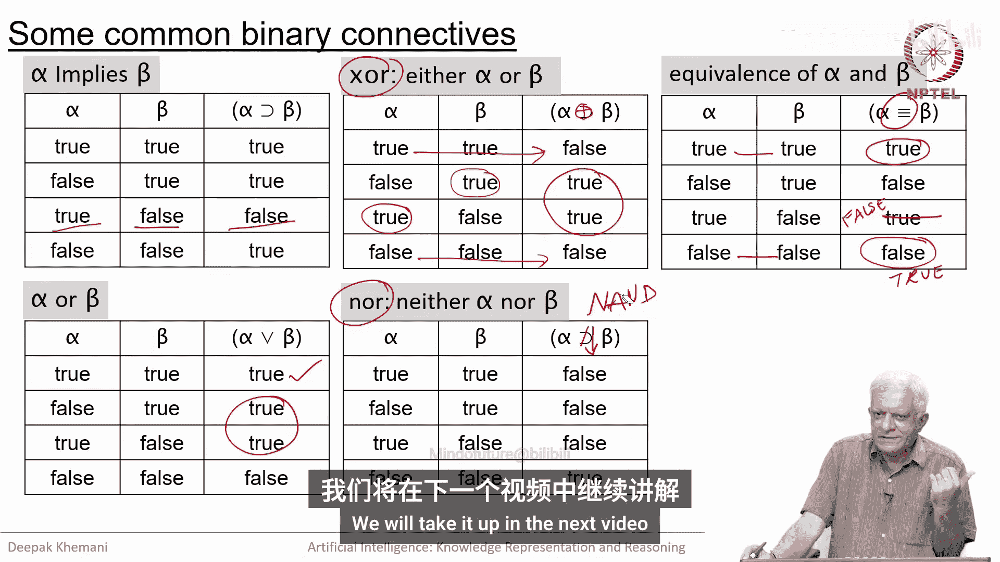

# 【印度理工学院】知识表示与推理 ｜ Knowledge Representation And Reasoning p17 P17_2.8-推理规则 -BV1c4zNBmEyF_p17-

So welcome back。We have been looking at patterns of reasoning。

 patterns of valid forms of inference sound rules of inference。And we have seen two rules so far。

 One is。Moponence， which is we showed that it is sound because we could show that it is sound by constructing an。

The two table for the implication and found that it was a trotology。And we also saw。Another rule。

 which was abduction， and we can show that it is not sound。So。

 there are many rules of inference which logics have used， so lets quickly look at some of them。

We have already seen modest opponents alpha implies beta and alpha gives you beta。

The converse in some sense is called modest toens。It says alpha implies beta and if you give us not beta。

Then not alpha is。A valued rule of influence。Again。

 I would encourage you to construct the tool table for this and see that。It will be a toology。

Then conjunction is a simple rule。Which says。Yet if alpha is 2 and beta is  true。

 then alpha and beta must be 2。嗯。Something called addition。嗯。Which says that。If。

Alpha is true then alpha all beta is true。 remember that our definition。

 logical definition of alpha all beta。Not of definition of or is that。

At least one of them must be true。So， if Alp is 2。And definitely alpha orbitta will be true because that is true。

 so it is kind of trivial in that sense， but it is a useful rule to use in many places。

The opposite is simplification， if somebody has。The opposite of conjunctionction is simplification。

And if somebody says alpha in beta true， then you can conclude alpha。

There are some more rules of influence， constructive dilemma。Destructive dilemma。Djunctive syllogism。

Hpotheticals。Cyillogism。I would encourage you to study these rules。And。

Construct the two tables for them。To show。That these are all valid rules of inference。

Which basically means that。You could use any of them to derive a new sentences。

They are also called rules of substitution。And a rule of substitution allows one to replace one sentence with another。

This is the rule of implication rule of inference say that if you are given alpha and if you are given beta。

 then you can add delta essentially。A rule of substitution says that if you see certain formula。

You can replace it by another formula。And in this example。Because they are logically equivalent。

In this example， if you see alpha implies beta somewhere。

 you can replace it by not alpha or beta or if you see not alpha or beta somewhere you can replace it by alpha implies beta because they are logically equivalent which means。

That whenever one is true， the other will be true。 and whenever one is false， other will be false。

 That's the definition of。Equalence， if you remember the root table。

Why is this a sound rule of substitution why when are rules of substitution sound？Again。

 we can construct a root table and show。That it is a totological equience the for rules of inference。

 it had to be a totological implication。The movement was only from left to right。In the case of。

Substitution。It's an equience， which means you can replace one with the other。So。

 there are many rules of inference which are rules of substitution which can be used。

Why do we need these rules， We need these rules because we want to construct a machinery。

 We should only look at a pattern and。Do something with it。

 so you can either replace it with something or you can infer something and add a new formula and so on。

And everything is done based on patterns。 if you match this。

 then you can replace it with that and so on and so forth。So you must be familiar with some of them。

Some simple patterns are。For example。Communicivity of。Or。It sounds a little trivial。

 but if you are doing things formally， then you have to be。Foral about it， and。

Make sure that pattern matching is exact isn。So， community of our。As shown here says。

 alpha or beta is equivalent to beta or alpha， of course， it sounds。Tion。

But it's something that you can use in your programs。Likewise， committed to your and。Or simple rules。

 like alpha is equal to。Is equivalent to alpha and alpha。 Al is equivalent to alpha or alpha。

Then we have rules of associivity。嗯。This thing， then we can we have rules of distribution。Now。

 if you have alpha and beta or gamma， so notice that。The connectives are like that。

Then it's equivalent to saying alpha and beta all alpha or the and gamma。

Some very popular rules you might remember are the D organ laws。

We say that if you have a compound formula preceded by a negation， you can push the negation inside。

But when you do that。The connector will flip。So if it all formula had all。

And you push the negation inside。Then。The new connector will be， and。And you can。

Construct the root table and verify that these are true， essentially。 So there are many rules of。

Substitution that one can use， and these are basically used for manipulating formulas。

You want to eventually derive something and you can use a rule of substitution。Here is the last rule。

 which is。An interesting rule， it says。That if alpha implies be ties true。

And if alpha in pi is not be tie is true。Then alpha can never be true。 With means， alpha is force。

 essentially。And then there are some other simple rules of inferences shown here。That if alpha。

Is true and true is there。 Tru is a constant， which is always true。

Then you might as well simply write true， essentially。But if alpha is there and。False is there。

Then this formula can never be true because you know both have to be true and false is anyway false then this formula is equivalent to writing false essentially。

And things like that。So if you are going to be constructing proofs by hand， then you should。

You need to be familiar with。Various rules of inference and various rules of substitution to make your task。

Simler。We will。Talk a little bit about what is called completeness do we need all these connectives。

 16 binary connectives we talked about。The answer is no。

So remember that a binary connective defines the semantics of a sentence。

Wwhich is constructed by taking two sentences as input and we say that there are 16 this thing。

And I have asked you to look at these 16 connectives。And think about them。

Do we need all 16 connectives to。Express compound。Sentence。Luckily for us， the answer is no。So。

 we have already spoken about this right， we said that if you see alpha implies beta anywhere。

You can replace it by。Not alpha or beta you could have done it the other way around also。

 but we are talking about replacing implications with we are talking about eliminating in im sentences。

So wherever we have alpha implies plus beta and a compound sentence， we can substitute it with。

Not alpha beta。In which case we have eliminated this。Implication sentence。So。

 then we will have a language in which implication sentence is not there at all essentially。嗯。So。

Clearly， we don't need all 16。 How many do we need， that is a notion of complete necessity。

What is the minimum set？That you can work with。And this can be done as an exercise。

They it can be shown。There is following sets of connectives。Are complete。So， for example， this set。

Which uses only two connectors， one binary connective and one unary connective。Is complete。

 which means anything you can say with。Any other。Set of connectives can also be equivalently set to。

Express in and and not， what does it mean that you can you give us any arbitrary formula Al。

You can construct a formula beta。And beta uses only an and a negation connective。

And they will be logically equivalent。So anything that can be said using other connectives can be said using just and。

And not， likewise。For or and not。Likewise， for implication and not。In fact， one of the earliest。😊。

Logical。Systems which is called an aximatic system， we will study that a little bit later。

Developed by Flge uses this。This set of connectives， which is implication and negation。

Imp practiceus， as you will see。😊，We prefer to use a set of three connectives。

 even though one of them is redundant， we can either throw away the and or we can throw away the or。

 but it helps us to express things in。Using these key connect， and we will look at a。

A lot of this essentially， as we go along。Interestingly。

 there are two single concepts that are complete。1 is。The land。Which is also called not and。

So you can see。That whenever and is true。Which is in this case。Not end is false。

And whenever and would have been false， which is in this case not n is true so in that sense this is not of and。

So if I were to write it like this， it would be like。Not。Elpha。And met。

We have already said that you know， you can replace one connector with another and so on so。

Andand is something which is just。Another way of saying n of alpha and beta。

And the connective symbol that we use is thisarrow pointing upward。

 and it's also known as sheer stroke， which was。Invented by。 the logic shapeper。

Another connective which we have seen a little bit earlier。Is the nu。Connective。

Which is a short form for not all。And as you can see。

This is false whenever all would have been through。And this is。

True when all were the wind Paul So it is a negation of all so just as we wrote not and we could have written not all also by writing not。

Alpha or Vita。Which is equivalent to this， but we use this symbol， which is also called Pices arrow。

 which is the。Symbol that I was looking for。When we were。Looking at logical connected。 Okay here。

So instead of this， it should have been the arrow pointing down。Yeah， there are some errors in this。

In this particular slide。And。When we upload those slides。

 I think these errors will be collected and hopefully they are collected here as well。So。

What we did was。We said we are talking about expressivity。We said that there are many connectors。

Employs or nor x or equience。You know， and。So this is five of them， so there are 11 more connectors。

How many do we need to express whatever we want to express？And we saw。There， there is a set of。

completelete set of connectives。So of course， negation is something very useful that you cant do without negation。

But along with negation， you could have used just implies or just or or just and。But。

 what is more interesting is。😊，That there is there are two connectives， one is this。No。

And the other one。Was land。They are complete by dentals。

 They just stand alone and anything you want to say。

Using any other connectives can be said using only the。Nor connective， all the N connect。So。

 you must have heard if you are working with circuits that there is something called a N gate that is used。

 so N gate is a physical implementation of the N connective and then you can build logic circuits and you know reason with them and so on and so forth。

So， we talked about the notion of completeness of connectives。When we meet next。

We'll talk about the notion of。Completeness。Of rules of influence， we saw various rules of influence。

Modestpons， deive celllogism， hypothetical slogism， conjunction， addition。Moisttos and so on。

How many roles do we need？So that our logic machine is complete。Remember。

The notion of completeness is。That。If a formula is entailed。

Then the machine should be able to prove it or derive it he。

How many rules of inference do we need that we can derive all true formulas so that is a notion of completeness。

And answers can be quite interesting， we'll take it up。

In the next video。