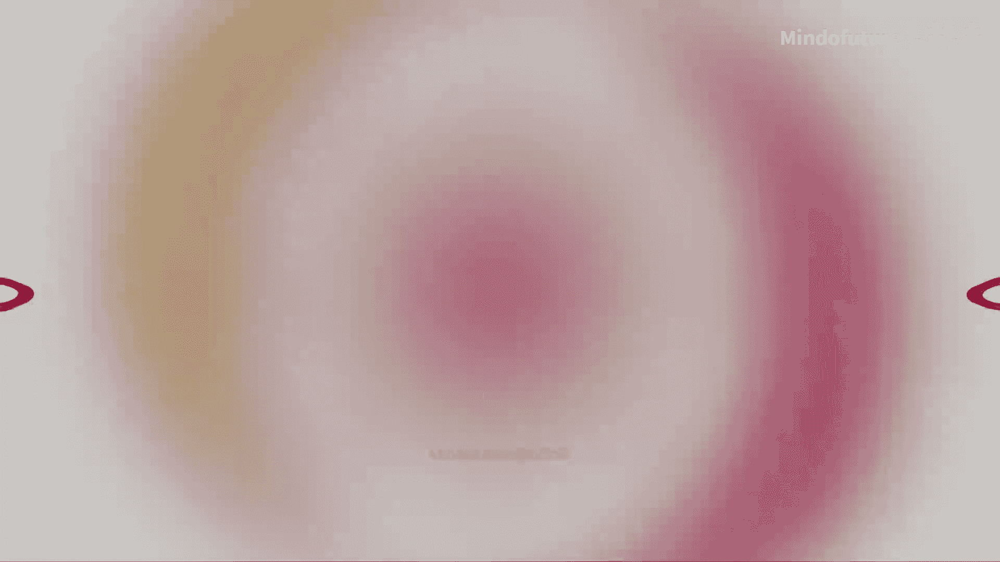
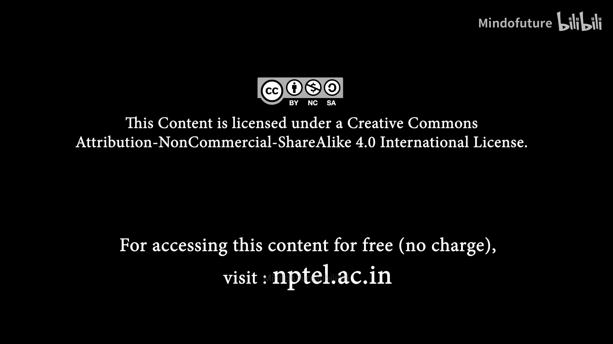
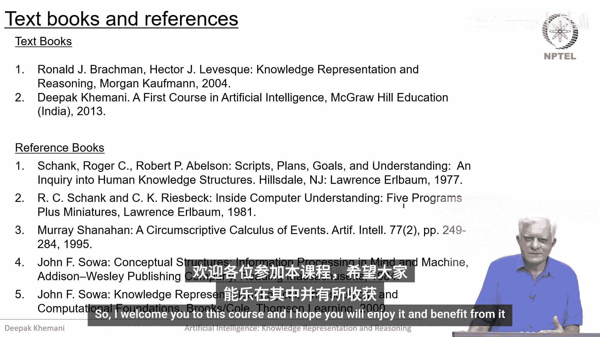

# 【印度理工学院】知识表示与推理 ｜ Knowledge Representation And Reasoning p18 P18_人工智能知识表示与推理-介绍 -BV1c4zNBmEyF_p18-

Hello。😊，My name is Deeppa Kemani and I am here to introduce my course artificialificial intelligencetellig。

 knowledgeledge representation and reasoning to you。😊，Now。

 this course has actually been running for the last five odd years。

 but we have done a new recording and hopefully it is a improved course。Now。

 this course is as the title suggests。😊，Focuses on one of the key aspects of artificial intelligence。

Which is， how do agents know？Their environment， the domain。And as they acquire more knowledge。

As they get more information， how do they reason with what they know so our course is going to be focused on that。

So think of an intelligent agent on a football field。😊，That player has to represent the situation。

That she is in。And has to reason with that situation so for example if this is the player that we are talking about the player is running towards the goal but the opposing players are moving towards here the opposing team is the right team。

😊，But her partner is also moving forward， so what should she do？

She has to be aware of the situation and。😊，Reason about what's happening and of course。

 make her plans。Reasoning when we say reasoning， we say making influence， you know something。😊。

What else can you know essentially what are the inferences that you can make？

And our course is going to be focused。On both these things， how do you know something。

 How do you represent something。And as a consequence， what else。Do you infer。Now。

 if you look at the human cognitive architecture we can think of it as a three layered architecture。

 the outermost layer shown in gray hair does signal processing so we see with our eyes we hear from with our ears and so on。

😊，And it processes signals。 Then there is the next layer。

 which is the neuro fsil layer which converts。😊，Signals into symbols and in our course we are interested in symbols and not only in symbols but in reasoning with symbols essentially。

So， we will cover topics like logic， knowledge representation ontology， semantics。

 a little bit of natural language understanding， but not too much more and the other topics I cover in some other courses。

Such as search methods and so on。Now， perception。The atmost layer is a perception layer。

 it senses information signals。And converts them into signals the fuzzy system converts it into a signal。

 but reasoning itself is symbolic and our focus。Is going to be on reasoning essentially we investigate the algorithms for reasoning on symbolic representations。

We are going to focus a lot on logic。And one of the oldest things that。

We know of logic as a Greek syllogism which embodies the essence of logic and the essence of logic is that reasoning is formal that reasoning is valid or arguments are valid if they conform to a valid form they are not so much concerned with content so this is a standard example that we talk about very often all manner modelt Socrates is a man。

And therefore， Socrates is not。Let's call a Sotic argument。

But you can see that it is a form that is important， you can say all cities are congested。

 Chennai is a city and Chennai is congested， all politicians are honest， some is a politician。

 some is honest。As long as。The argument。Has a valid form。Then if the premises are true。

 then the conclusions will necessary be true that is a。K idea behind logical deduction。

The syllabus that we will cover in this course will start with introducing logic and the fact that we represent things symbolically。

We'll talk about soundness and completeness。We will start with the simplest of all logics。

 which is Proal logic。😊，And study some proof methods。

 the direct proof in the tableoo method before we move on to the main part of our course。

 which is going to be on per a。で？We will look at algorithms like forward chaining， backward chaining。

 the resolution method。We look at their connection to the idea of logic programming。

 declarative programming。An example will be proloed and will will also look at forward chainning as a declarative language using the writtennet。

Then we will move on to representation。In which we will look at the idea of reification。

 which is the idea of creating concepts in your head。😊，We look at some。

Theory called the CDd theory which is a choice of predicates we look at how predicates can be organized into frames and scripts and taxonomies and description logics and owl。

Then we will move on to reasoning with incomplete information with default reasoning that you make some conclusions。

 but you may have to withdraw them later。We will look at circumscription。

 which is a well known example， and we will also look at。Something called event calculus。

 which talks about time and change because when you know， there are actions happening in the world。😊。

Things are true at one point and they become false at another point。

 so we would want to reason about such things。The last thing we will cover will be epistemic logic。

Which is logic about how agents can reason about what what other agents know essentially。

There are two textbooks that I will use throughout the book。

One is a book we have Black Man and Lek Knowled representation and reasoning it has the same title written in 2004 a little bit later I wrote another book。

😊，Whi was a larger book on AI， but it contains the material we are interested in it is called a first course in AI。

And then there is a host of references and will also give you references as and when we go along。So。

 I welcome you to this course and I hope you will enjoy it and benefit from it。

So see you。