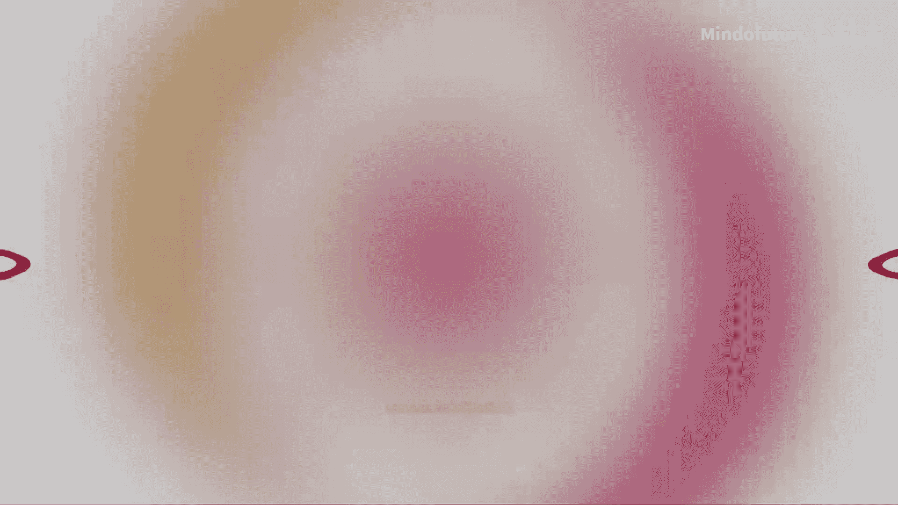
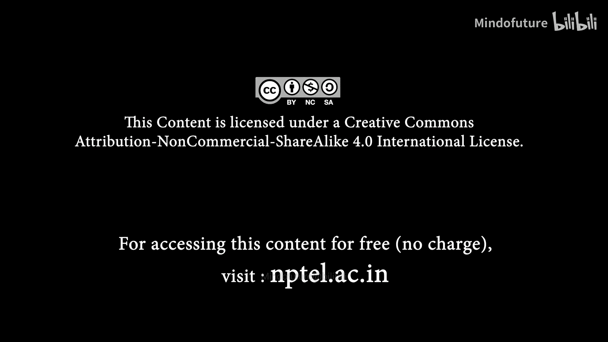
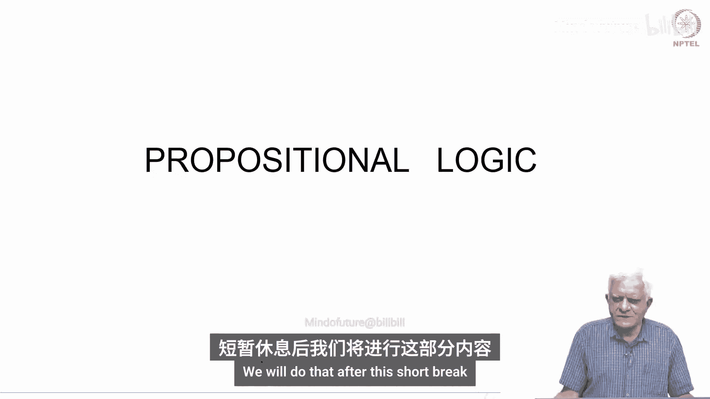

# 【印度理工学院】知识表示与推理 ｜ Knowledge Representation And Reasoning p19 P19_命题逻辑 -BV1c4zNBmEyF_p19-

Okay， so we have been looking at。Logic in general。We have not yet defined the language。嗯。

We have assumed that we have some language in which there are sentences， alpha beta gamma， and so on。

And we have looked at the fact。That you can create more sentences or compound sentences。

Using the logical connectives。So， we saw a set of connectives。嗯。

One unary connective which is the negation and we saw a few binary connectives which take two sentences and produce a new compound sentence。

And then we did a little bit of analysis to see that of all the 16 possible binary connectives how many do we really need essentially and we saw and maybe we will begin with that today that a small set is necessary。

😊，So lets look at that essentially。😊，What do we mean by a complete set of connectors？😊，Basically。

 whatever can be expressed in whatever language we are defining。

And today we will define our first language， which is the proportional logic。😊，呃。

That whatever can be expressed that in that language using all connectives。😊。

What is the minimum set that you can use or what is a sufficient set？

That is enough to express everything that can be expressed。

So that way we don't have to work with all the connectives。😊。

And we saw towards the end of the last video that these sets are complete and by this we mean that whatever we can say using the entire set of 16 connectives。

Can be said。Using any one of these so for example， this set is complete。

 this set is complete and this set is complete essentially。

And today we will also look at this logic given by Fge about3400 years ago。

 which use only this set of。😊，Implication。And。N。And he showed that it is something which is complete。

When we move on to a more expressive logic， which is first tunnel logic。😊。

We will see that the most popular set of connectors that people use are these three connectors even though there is redundancy there。

 but it makes。😊，Representation。Moreul。Standard or， you know。

 easier or compact because one thing that happens is that if you convert。

If you eliminate certain symbols so we saw in the last。Session， how we can eliminate for for example。

 the implication sign we saw that we could if we have alpha implies beta。😊，Then we can replace it by。

Not alpha or beta。So if we if we have a knowledge base in which we have。😊，The implication sign。

 we can eliminate the implication sign by simply replacing wherever we see alpha implies beta we replace it but not alpha implies or beta。

😊，The problem is that。😊，When we try to expand when we try to remove other connectives。😊。

Then the length of the formula becomes longer and longer and since we are talking about。😊。

Writing programs to process formulas。The length of the formula can also play a role as we will see as we go along。

So， these are the。Connectives that are。Complete in the sense that we can represent everything we can represent in this that particular language using only these connectives and we don' not need the other connectives。

😊，The expressions that we use may be longer in this case the length is the same more or less in the sense that we have。

😊，One connective is replaced by two connectives， but one of them is a unary connective。

 but for other cases it may be。😊，helello。Different， so far as an exercise， maybe you should try to。

Express this。Using。Only。Let's say， all。And not。And see how that can be done essentially。So。

 you will see that the size of the expression increases essentially。😊。

We also mentioned in passing that there are some。😊。

Singleton sets which are complete and one of them is the Nant。Which is same as not and。

And we had seen that you could also write it as。Not of and。 an and would be。In this case。

 alpha and meter。But instead of calling it not end。We are calling it N which。

And we are using one symbol to do that essentially and the symbol is at arrow pointing upwards。

 which is also called sheer stroke。😊，And you can see that the truth values are opposite of that of n so if I write the truth values of n。

😊，U。Here。Try to squeeze it in so and will be true only when。

These two are true and in the other cases it will be false。Yes。

And you can see there the relation between。😊，True and false。

I the same that it is that at every low it is a negation of the other so it so so nand is nothing else but not and but the interesting thing about nand is that。

😊，Anything you want to say in。That language you can say using only this Nant connective。

It has implications in。😊，Building circuits because logic circuits are essentially hardware implementations and then if you can use only that one one one gate N gate as it is called to implement the circuit then you know life。

😊，Has certain。Plus points there basically。Another connector which is also complete by itself。😊。

Is the null gate or null。Lo connective also known as joint denial。Also known as Ps Alo。

 So these are the logicians who。You know， vote about these connectives。

By joint denial we mean what we mean that this sentence will be true only when both alpha and beta are denied essentially that alpha cannot be true or and beta also cannot be true so both must be false essentially。

😊，And only then this is true essentially and you can work it out that this is the same as。😊。

Not alpha or beta。So， by now you should have got the hang of the language you can see that this expression which is not alpha or beta and the brackets are around alpha or beta is not the same as this other expression。

😊，Where it is not alpha all beta and they are entirely different essentially。So。

 that is one of the differences between。Formal languages are formal logics and natural languages so in English of course we can go on rambling so on。

 but in logic you have to be very precise。Okay， so let's talk about this fagegueus proportional calculus。

😊，The other issue that we want to look at very briefly is that of doing logical inference so if you remember the way that logical inference works is that you have a set of rules of implication we saw a few few of them modest componentsence。

 motor tos disive syllogism hypothetical syllogism conjunction addition and all of these essentially what they allow you to do is to add new formulas to the knowledge base so that is a。

😊，The proof process is an entirely syntactic process that you look at a pattern and you can add something new to that essentially。

😊，What fgueage should？Was。😊，That just one rule of inference is enough for completeness。

Okay so this is a different notion of completeness when we talked about completeness of the connectives we said we were talking about the completeness in terms of expressivity that everything that you can express in that language can be expressed using only that small set of complete connectives。

😊，But the question that。That we are looking at now is that given a set of axiom and premises that is given to you。

😊，Withhi set of rules？😊，Suffices。To derive all enttailments remember the notion of completeness in logic。

A logic is complete if everything that is entailed。😊。

Can also be proved essentially so how many rules do we need to be able to do that is the question that people have been asking since logics were device。

And what Gula fgue showed。Was that just one rule of mod opponentents so if you remember mod opponentents it says if you are given alpha and if you are given alpha implies beta。

😊，Then you can infer beta。So you can put a therefore sign here。

This is a Moponin rules of inference that if you if you can match alpha with something in the knowledge base and if you can match alpha implies beta with something in the knowledge base then you can add beta so you don't have to worry about truth values and stuff like that essentially and what he showed was that this one rule。

😊，Of mod componentsents and with this small set of logical connectives is complete。😊。

Provided you accept the axiom set。He has is specifying we will look at this axioms in a moment。

What do we mean by complete here？In the case of。Fres proportional calculus， we will see。😊，I that。

You can derive all through statements。And when we say truth statements。

 we mean the statements that are entailed。So， his logic is called an axiometric system。😊，Because。

We start the knowledge base is a set of axioms。AxiMs are basically statements that mathematicians。

So not specify and say that you accept this and everything else will follow essentially so this is these are the axioms of leg for personal calculus。

😊，Mathematicians， for example， have。😊，Given a set of axioms to define number theory。

I dont know we if you get time we will probably look at how numbers are defined。

 so we have we have said this before that we know that what is the notion of a number but we are not quite。

😊，Sure as to how to describe a number of course we know how to represent it using some symbol so for example the number 7 we discussed but what is a number we will try to see sometime later and that there is a set of axioms called piano axioms。

So， we。A A and4 if you get time， we will look at them and they basically define。😊。

Number systems and on top of it all number theory has been built essentially。So。

 anyway we are talking here about logic here， proportional logic and Frege proposes a set of six axioms and the first of them is that alpha implies beta implies alpha well note the brackets the brackets are of course very important as I said a short while ago。

😊，What does it mean to say that this is an axiom it means that this statement is going to be true whatever you plug in for alpha。

 whatever you plug in for beta， whatever you plug in for alpha and beta there are only two things here。

😊，This statement will turn out to be true and I encourage you to。😊。

Daw the through tables for all the six axioms that we have。

Writing make and convince yourself that these are indeed axioms which are true safely。So。

 this is called then 1 alpha implies beta implies alpha and we can plug in anything for alpha we can plug in anything for beta the only constrain of course is that whatever you plug in for the first instance of alpha you must also plug in in the second instance of alpha which is the normal notion of a variable。

😊，Avaable。Stands for something else。This is then 2 so the antecedent is this alpha implies beta implies etcso。

And it says that if this is true， then this the second half is true also。The differences。

There is a third variable here， which is not there in the first one。

 so alpha implies beta implies gamma。If that is true。

 then you can write alpha implies beta the whole thing in place alpha implies gamma actually。

The third axiom called then3 is as follows so it says that alpha implies beta implies gamma is same as not same as you you can add beta implies alpha implies gamma essentially and。

😊，It has been shown subsequently by other logicians that this is really a reundant axiom in the sense you dont really need it for completeness even without this third axiom the system would be complete。

😊，Then there are three aoms which have been called as fRG 123， so fG 123 is that alpha implies beta。

😊，Employees， not beta implies， not alpha。Again， you should construct the truth table to verify that this is the case。

If you look at the if you remember the rule called mod tolerancells。

 the mod tolerance rules are as follows that if you are given not beta and if you are given alpha implies beta。

Then you can infer not alpha。So you can see。That。The right hand kind of corresponds to the mod stolen rule that instead of alpha implies beta you are working with not beta if you were working with not beta implies not alpha then this would become mod spence essentially because node beta would come here and so this would become not beta。

😊，And not Vita implies， not alpha。And then， not effort。😔，So that would be like mod stolen。

 so you can see that modest mod tos which is this one empty is just modest componentss in in another。

😊，Form essentially this is modest components， right？😊。

The antecedent implies the consequ and given the antecedent you assume the constant。

In what assurance you would assume the negation of the consent and you infer the negation of the antecedent so it is nice to play around with logical systems and see。

😊，That you know。Sometimes there are shorter proofs if you have more rules of influence。And that is。

A question which any designer of。I an improving system or a program which thus proves will have to contend with this issue。

The last two are pretty obvious as you can see it says that the negation of negation is positive so of not alpha is alpha and if you remember the through tables then you can see that that is obvious。

😊，That。That， for example， if you start with alpha and then you put a n then if alpha was true then it will become false you put another not and that false will again become true essentially so they are equivalent essentially why do we need these things which are sometimes obvious because。

😊，The proof system is a formal system。It。Only looks for a pattern and you are allowed to add a new pattern or replace it if you are using a rule of substitution but basically there should be existing pattern which matches some rule either a rule of influence or a rule of substitution and only then you can proceed essentially。

😊，So， completeness。He had approved。Frege had proved that his proportional calculus is complete。

 unfortunately， we are not so much。😊，Kind of involved with logic to be able to go into rules of completeness the proofs of completeness and so on。

 so we will accept it we willll take it by faith that the system is complete essentially completeness proofs are more difficult than soundness proof soundness is easy to show you you just have to show that the rule of inference is sound and that the logic is sound but completeness is a little bit more involved。

Now we also said that it is an axiomatic system which means that the knowledge base is a set of axioms and axioms are statements which are accepted to be true essentially so we know that axioms are true essentially so。

😊，When we say that something is entailed from those axioms。

 essentially we are saying that that something is going to be true essentially so verify that all the six axioms are。

😊，Aologies aology is a statement which is always true。In a sentence， it can be a compound sentence。

It cant be a simple sentence because unless you use a particular。

Symbol which we will see when we look at the first logic that we are looking at。嗯。

So essentially what this says。😊，Is that。You are started off with a set of statements which are known to be true。

And。Then， you can。It is complete so you can derive all entail statements so all entail statements also must be true so in other words we can derive all toologies essentially。

😊，And by toology again we mean statements which are true。😊，Now。

 if you remember we had talked about the deduction theorem。It it。That。If in this example。

 E is entailed from A， B， C and D。Then。This is equivalent to saying that。

If you construct a formula which is which has all the antecedents joined together by and so A and B and C and D。

And then you put this employees。い？😊，These two are logically equivalent the deduction theorem says that if given ABC D。

You can show E。It's equivalent to saying。That you can show that A and B and C and D implies E essentially。

We will revisit this and we will revisit the use of this also。

But if the thing which I have underlined is true， which means。😊，So。

 what is why is this a tatology because this is the ems this is empty there is nothing there you don't need anything to be able to show that A and B and c and D the whole thing implies e you can show that it is true essentially you know that it is true it is entailed by nothing essentially so it is true it stands by itself。

😊，Now， go since fage system is complete， we know that。😊，If this is the torology。

Or which which can be derived from nothing， then you should be able to derive。😊。

This is as well as we should able to derive so if it is entailed then it can be derived that is what completeness means right？

😊，So， if you can derive this。Out of nothing。That means if you were given ABCD。

 then you could have derived E essentially。😊，So， if you now connect this first thing in the last thing。

 the first thing was what？😊，ABC D， E。Entails E。Now we have shown that given this AcDE。

 we can derive E so remember the difference between television and entlement essentially。😊，So。

 this means。😊，That。😊，Not only is Fage's system。We often enough to derive all torologies。😊。

The fact that you can derive all totalologies。Means that if you are given some premises， for example。

 A， B C D， somebody has told you that these are true and then if E is entailed from those premises，😊。

Then you can also derive it so in that sense。The logic is complete。Okay。

 so now it is time to look at our first language。😊，We shall do that。嗯。After a short break。

 think about the notion of completeness。Of set of expressive set of connects and also the notion of completeness in terms of。

Being able to derive all true statements and then we will now move to a specific logic language we have not defined the language so far。

 we have said that alpha beta gamma are some sentences in some language but now you are going to define a language and that language is the simplest of all language is called proportional logic we will do that after this short break。

