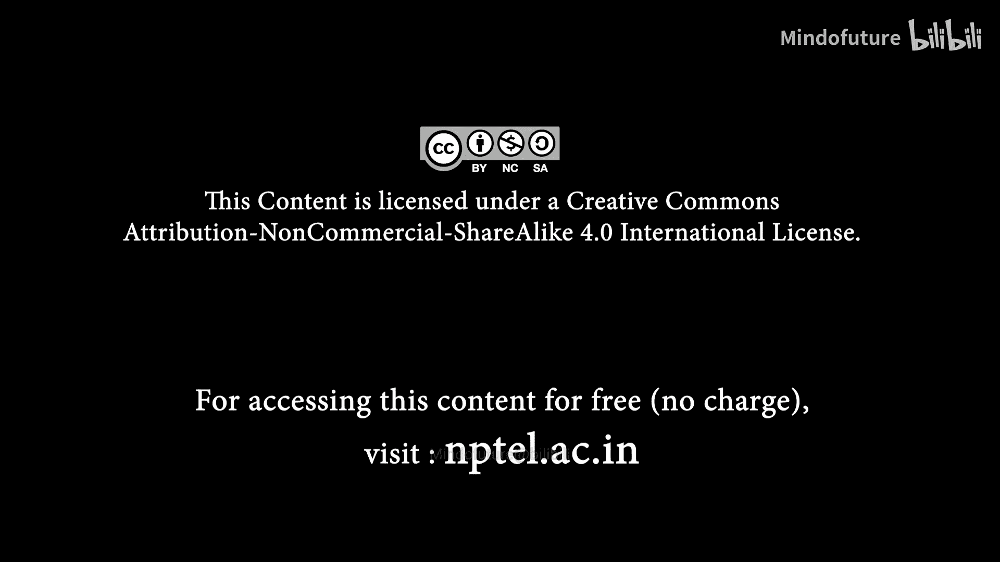
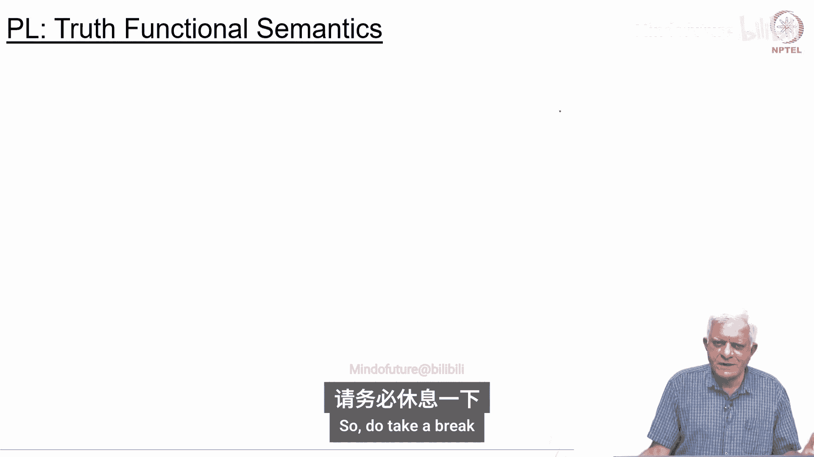

# 【印度理工学院】知识表示与推理 ｜ Knowledge Representation And Reasoning p20 P20_命题逻辑语法 -BV1c4zNBmEyF_p20-

Okay so heavier。On the verge of defining our first logic language called Proal logic。

And this will give us some insights into the algorithms that we use for。

Computing proofs or computing derivations。So。Pportessional logic， often we will use the。

Acroronnym P to stand for the proportional logic。All it is also called professional calculus is the simplest of logic languages。

😊，The atomic sentence， the the smallest sentence remember that an atomic sentence is a sentence without any connectives so the other sentences are the sentences for example alpha implies beta or alpha or not beta so they have logical connectives essentially an atomic sentence is a sentence。

😊，In which they are no connective。And the atomic sentence in Pro logic is a symbol， just anything。

 for example， the symbol P and we say tea is a sentence。

 what does it mean that p is a sentence that in principle。😊，If you were to give truth values。

 then p could be given a close value of true or false essentially。

And it stands for some sentence we have not we when you are talking about logic， we don't need to。

spececify what it stands for but as we see examples when you are talking of a specific domain then you may have certain certain domain in mind and then of course then symbols will stand for specific things that we will see as we get along。

😊，So， a symbol can stand for any sentence。So， here are some examples that I have written all men are mor we saw that that was part of the syllogism。

But as far as pro logic is concerned it is just a sentence we could call it P or Q or R a anything it doesn' not matter essentially。

😊，Then any of the other sentences that have written here， the moon is made of wine cheese。😊。

You may not believe it， but it is a sentence which means。😊，It can be either true or it can be false。

 so most of us of us will believe that it is false because。

By now we know that it' is not made of lych cheese。

 you know we have got astronauts landing on the moon。Stuff like that。

Then also there are the following two or sentences， the earth is round， the earth is flat。😊。

Of course。Only one of them will be true and we know it is the first one。

But both are sentences essentially and we could have used a symbol to stand for that。Then， of course。

 we have two interesting sentences with。😊，Which is that tomato is a vegetable。

 and the tomato is a fruit。😊，Are they true， are they false， I will leave you to think about them it。

😊，Depends on。How you perceive the world essentially okay？

You may think of the tomato as a vegetable because you put it in let's say making。😊。

Samber or something like that。But you can also think of it as a fruit because， you know。

 nobody stops you from just stopping it and eating it isn。😊，So， it is up to you。

 but these are sentences essentially and the truth value of course will have to be defined in some listing。

😊，The sentence is atomic or indivisible。We don' not look inside the sentence we have said。

If you take the first example， our favorite sentence。😊， all men are mortal。😊。

And we are saying this is a proposition or this is a sentence。😊，Between you and me。😊。

We know what we are talking about because we understand English。

And we have an understanding of what is a man and what is mortalityty and so on。

But in propositional logic， we do not。😊，Per inside it essentially we do not say that oh it is talking about men and that it is talking about all men and then it is talking about some property that all men have which is a they mortal we don't break it down in further we simply say this is a sentence P and you tell me whether it is true or not and then。

I will do something with it whatever logical reasoning one can do one will do with that essentially。

Now， obviously， you will think that。😊，This is very restrictive。😊。

I that if you don't even know what you are talking about and how can you， for example。

 infer from this？That if Soates is man， then Soates must be mortal。

And the fact is that in proportional logic， you cannot essentially。😊。

We need a more expressive logic which is called first a logic which is what we will do after we have done this professional logic and will so that we need something more expressive then proportional logic or logic of sentences to be able to talk about things in the domain so elements in the domain so man is a set of is from the set of humans for example and so on。

But in proportion logic。The sentences are atomic we do not look inside it essentially we just treat it as a unit which cannot be broken down any further。

Logic itself， as we have been trying to say， is not concerned with meaning。What does it stand for。

 we don't care。You just tell us some relations between things。And we will tell you that yes。

 so I mean we have seen this example right modest spence is our favorite。😊，That if you say P。

And if you say P implies Q。Then we can invert you。What does P stand for， what does Q stand for？

Logic is not bothered about that essentially it is not concerned with meaning。

 it is concerned with valid patterns of reasoning and this is a valid pattern essentially。😊。

Meaning lies in the mind of the beholder， I mean if I am going to say that P stands for that the earth is on and it is in my head recently as far as logic is concerned p is just a sentence。

😊，Lakeways。As sentence is or the proportion is in principle true or false we have been saying that。😊。

And again， this root value is externally supplied essentially I mean。

 there is nothing in logic which will tell you whether this sentence is true or not。

 somebody has to tell you that this sentence is true or not。😊，Again。

 that is the reason why valid forms of reasoning say that if。😊，P is true。And。

P implies place key Q is true。If you if you tell me that p is true and if you tell me that p impliesq is through。

😊，Then。Because my system is sound， I can tell you。ThenThat queue is true。

But logic itself is not even concerned with truth values what it says is that if you give me these two formulas。

😊，P and P implies  Q of these two sentences， then I can add this to your knowledge base。

The fact that the knowledge basis is a set of true statements and that the conclusion must be true and all is the notion that we have been talked about。

I think to a fair extent now the notion of soundness and completeness and stuff like that。

But the basic unit of a professional logic is set。Of basically a proposition。

Wwhich is an atomic which is a sentence， which is atomic in nature in the sense that you don not look inside what the sentence is saying。

😊，So， we had said that。A formal language is a language in the sense that it is a set of sentences。

ListenSo you would have you would have studied， for example， if you have a。Then， of course， on。

On formal languages that you know there are regular languages。

 there are context free languages and so on and so forth。

 but basically all there are a set of sentences which are defined using some simple rules they dont even have to be defined using some rules you can actually explicitly say that this is a set of sentences that I am dealing with but basically。

In a formal language。It is there is a set of sentences that we are talking about so let us see what are the set of sentences that we can talk about in proportion logic and that is what we are talking about the syntax。

😊，How can we construct sentences， how can we construct more sentences given simple atomic sentences like PQ and so on？

So， every time you build the logic。😊，You will have a constant or a logical part which is to do with the logical connectives and the logical reasoning logical reasoning is based on the meaning of logical connective right so when you say the logical part of the vocabulary that means what are the connectives that we are using。

😊，Here。If you are writing programs to do listening。

or influences or de then of course you would have certain domain in mind and then you would choose that okay I need so many variables I need PqR and I need something we will see an example as you go along。

So， the constant of the logical part which is there in practically all languages that have been devised are the symbols that we have already seen。

😊，which is the in this the symbol by now we have got so used to calling them by their names that we might as well do with here and all all negation or implication。

😊，But as well as the syntax is concerned。😊，There is no。Association。

With the through table that we associate with and essentially as long as long as as far as syntax is concerned this is just a connective and we know that of course that this is a urinary connective。

😊，And the others are binary connectives， which means。AUnity connective takes one。😊。

Sentence and gives you a new sentence binary connective takes take two sentences and give you a new sentence and these are just connectives that are going to be useful for us and with you know advanced knowledge or hindsight since we have been talking about two tables we will use the same names that we will call this first one and the second one or the third one not and the post one implication。

But that is because we have already kind of figured out that that is what we would want to mean by these connectives or thats how we would like to define the semantics of those connectives。

😊，In。In reality， there is no connection between the through table and these connectives。

 It is just that when we define the semantics of。😊。

Pro logic we will see that of course I will we will define it based on the connective so it is a very subtle difference but you must keep it in mind that this the connect the connective symbol that you use which is this inverted v or the v all these symbols。

😊，They are independent of the meaning of those tool table set we are going to associate them of course we are going to associate them with that but they stand by themselves we could have just used a different set of symbols the in the tables and a different set here and then establish the association but you know it makes it simpler for us to think of them as the same thing。

😊，But that distinction is subtle and you must always keep it in mind essentially。😊，Then， of course。

 there are these symbols that we use for brackets and。We are familiar with this sort of stuff by now。

And the constant symbols。In two valued logic， there are two constant symbols。

The first one is called the bottom。And the second one。

Whi looks like a T is called the top essentially。These are sentences that when we define the semantics of the language。

😊，What is what do we mean by we define the semantics is that when you will define as to。😊。

You tell me any， you give me any compound sentence， you know what compound sentences are by now。

And we will。Decide what their truth value is。So， for constant symbols and that is why they are called constant symbols。

😊，The2 value is。Phs。And true respectively。It is like when you do algebra with numbers。

 which is also what you are doing with logic is that you know if you have a constant symbol like0。😊。

Then you know that it stands for the number0， essentially。Again。

 there is a distinction between the number 0 and the symbol 0 essentially。

But if you have a symbol call x which is a variable then it could stand for any number essentially so likewise the sentences in a logic can stand for any can have any truth value except the constant symbols which。

😊，Will always have the same truth value and bottom will also bottom will have false and top will have true essentially。

😊，And it is only in our heads that when when we say that it is false。

 this is what we mean which means it is false in the real world， but otherwise they are just。😊。

A pair of this is a small set to which we will map all sentences。

 so some sentences will map to false some sentences will map to true and。

The interpretation is in our head， essentially。😊，So。

 that was a constant of the logical part of the local Valley， which is there。😊。

In all languages even in in the more expressive languages that we see we will have see these things and there is a variable of the domain specific part that if you are solving a particular problem if you are encoding it in logic and trying to derive a proof then of course we will have to choose certain set of symbols and these are the set of symbols which we will use this。

😊，B。in a different phone to stand for this set of propositions and it is a accountable set of propositions basically you can choose any number and there is no limit on how many you can choose but you can you should be able to enumerate them that this is the first symbol this is the second symbol this is the third symbol and so on。

😊，So， for example， p1 p2 p3 or more often than not we use different symbols because you know we have certain things in mind so Pqr and so on and so forth。

 So this is a。The the simple the alphabet of Proal logic。I should have written this somewhere。

 so this is the alphabet。So。Of this language。Now we are talking about sentences。

 remember that logic is concerned with sentences and sentences are what sentences are something which are either true or which are false。

😊，In terms of formal languages， we say that these are formulas or well formed formulas which means that they are formed using。

😊，The set of rules that we are going to describe just now that is how you can form more sentences you start with a set of atomic sentences。

呃。Which are from this sector。B that we have set。That every proposition symbol is a formula。

 so we will use the term formula and sentence。Interchangeably。When we move to。

The next logic which is for ser logic we will see that there is there is again a small subtle difference between a formula and a sentence whenever we say formulas we mean well form formula so know formula is just a short form for saying well form formula。

😊，And。In proportion logic and in all logics in fact。

 we have atomic formulas and in case of proportional logic， the atomic formulas are。😊。

The set P that is。You start with by choosing a set of propositions。And so。

 this kind of rule say that if alpha belongs to this set of symbols that we have chosen then we can say that alpha is a formula or it belongs to this set of formulas so atomic formulas are also formulas but there are other formulas which are not atomic and we already have an idea of what is happening there。

😊，You can use a unly connective to construct a formula if alpha is a formula which is a way of saying that alpha belongs to this set f。

Then。Not alpha is also a formula so we are defining this language we are defining what is the set of sentences that we are talking about so first we chose a set of proportion symbols。

😊，And then we are now adding logical connectives to say that， okay。

 these are the other sentences that you can construct。We have seen binary connectives also。

 so if if this is some binary connective。It can stand for its like a variable connective it can stand for and or or。

All the。Ones that we have seen Sheur S。Pierce helllo and so on。Soly not thisす。

That's a unity connective。So if that's a binary connective。😊。

And if you give me one formula to two formulas which。

2 some things which are formulas or alpha is a formula and beta is a formula then。

We take the connective， you put two brackets around it and we say okay。

 this is a new formula and that is how we can construct more and more formula。😊，And。As we do。

When we give definition of sets mathematically， so the set of formulas f。

Is a smaller set satisfying this above what do you mean by a smaller set satisfying above is that you can only construct formulas using this。

Set of rules and there is nothing else that you can do essentially so for example， you cannot say。

That。Epha。You cannot say this。This is not true。Alpha negation sign beta is not a formula。

 so formula are only the those that。Can be constructed using these these rules so for example。

 alpha and or beta。Does not belong to the set of life。

That is not a formula you cant put two logical connectives in between two missingings so only what you can do is what we have done here and that is what we mean by saying that it is a smaller set satisfying the above。

So， a not on phgues proportional cs。When we say that his calculus is proportional。😊。

We are not saying that the axioms are made of atomic formulas。We are not saying。That an axiom。

 for example， then2。Ha contu alpha beta gamma， we are not saying that they are atomic formulas。

those axioms simply say that these are variables you plug in anything for alpha and you plug in anything for beta and for example。

 you can say that alpha。😊，Is equal to。P implies  Q。

That's perfectly valid it allowed then if be ties is something else。You know。

 so you plug in those things and it will still be a torology essentially so for example。

 you can say beta。😊，In 걸도。Not you。All are。And say， gama。Nqual to。P or Q， okay。

 I have just written some random statements here。These alpha beta and gamma are variables we said you can plug in anything you can plug in these three values for this and you will find that this this is still a termology so when you say it this his language is the the pre calculus is propositional we are not saying that alpha beta and gamma are atomic propositions rather we are saying。

😊，That。The atomic sentences in the logic。Are those that we are not going to peer into that is what we said right that when you say P stands for all men are moral then that is it essentially you cant say it is talking about men。

 it is talking about mortality， it is talking about all men， we cant do all that essentially。So。

The atomic sentences come from this set P that is what we are saying when you see that this is proportional calculus。

But。The rules don not apply only to atomic sentences， as we can see in this example here。You can。

Plug in any alpha can be any sentence in this language。

 beta can be any sentence in this language and gamma can be any sentence in this language and it will still work。

So， as I was saying alpha beta and gamma could well have been compound synthesis that what we did here from some more expressive language it doesn not even have to be professionalal language；

 it could have been first order logic or any other logic。😊，And this。Axioms would still be axioms。

 they would still be。조。So， that is what we meant by saying that this is propositional in nature so we have defined。

😊，The language of Proal cs we have defined the syntax and what we have seen is that。嗯。

How to form a set of wellform sentences， essentially。And。Next。

We will talk about semantics essentially so we will come back。After a break to talk about this。😊，Yes。

Go over the definition of the syntax syntax。I essentially what you write down on paper and what are the symbols you use and what combination of symbols is called a sentence or a well form formula and we have defined that set of well form formula now we will talk about semantics essentially but we will do that after。

Break in the next video， essentially so do take a break。

