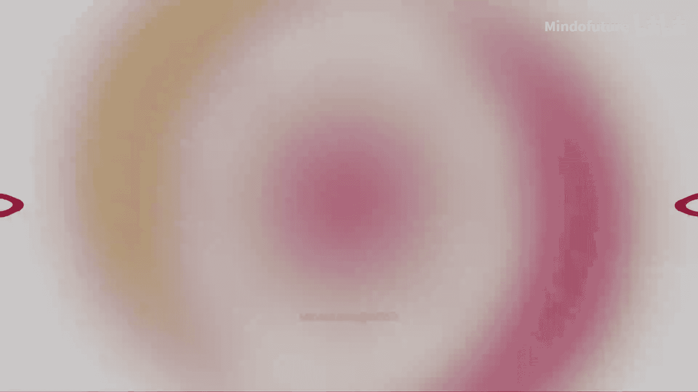
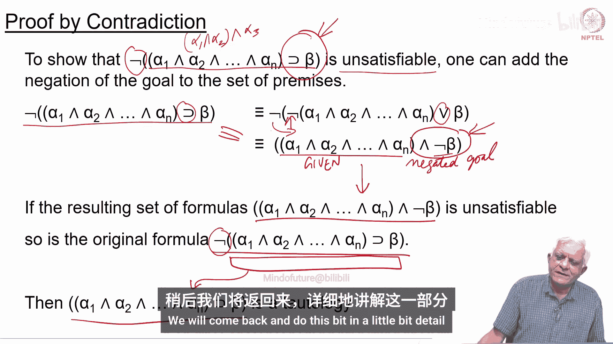

# 【印度理工学院】知识表示与推理 ｜ Knowledge Representation And Reasoning p21 P21_模型 -BV1c4zNBmEyF_p21-

Okay， so welcome back， we are just finished looking at some approaches to direct proofs。

And now we want to move towards。Indirectect proof。So by indirect pose， we we mean。

That it not in direct close， we started with the facts。

And use rules of inference and move towards the goal indirect proof。

More roundabout ways of doing things。Now if you remember。😊。

The sad problem we have spoken about it it says that find a satisfying valuation for。😊，Pula。

Any valuation。For a formula what is a valuation basically the atomic sentences are given values P true Q is false r is true and so on；

 any valuation is called an interpretation。As in that interpretation P is Q true Q is false and R is true and so on。

An interpretation。😊，That makes the formula true。I is called a model for the formula。So。

 the notion of a model is an interpretation。😊，Under which the formula will become true or it will become satisfied essentially。

嗯。And this process of looking for such an interpretation is also called model checking。

Now if you look at this。Facts if。Negation of alpha has a model。

Which means that there is some valuation which makes negation of alpha true。

Then it is is possible that alpha also may have a model。And an example of alpha is P implies q。

So negation of P impliesq is。So， negation of。比。Employs Q。What is a model for this？

That means p impliesq must be false， that means p must be true。And Q must be false。

If p is2 andq is false， then negation of p implies q is。P implies q is false and。

Negation of P in plus Q is true essentially。On the other hand。What was alpha alpha was？P in Q。

Does this have a model？Yes， this also has a model one simple model is when p falls。

When P is fails this whole formula becomes true then whatever is the value of Q。

 then this is a model essentially。So， we have a model for p implies q。

 we also have a model for not p implies not q so if not alpha has a model then alpha may or may not have a model。

But。If not alpha does not have a model。Which means it is unsatisfiable， remember。That。

Un s and these are disjoined sets essentially if alpha doesn not have a。

Model that means there is no model that means there is no satisfying valuation and therefore it is unsatisfiable。

And if if not alpha is unsatisfiable， we had said that there is a 121 correspondence between unsatisfiable formulas and totalologies。

 so if not alpha is unsatisfiable then alpha must be a totalology。😊，So。

 here is one another way of trying to show that alpha is a toology。😊，And of ways。

Look for a model for not alpha。If you cannot find a model。

 then you should you can conclude that alpha is a totalology and that is the approach that we will investigate now。

So to establish that alpha is a total G， look for a model for not alpha。So here are some examples。

That if you want to look for a model， if you want to show that model componentss。

Or implication on which model modpar is based is a toology。Then that is the implication。

P and p implies  Q。The whole thing implies Q that is。We want to show that that is a topology。

To show that that is a termology， we try to show that it is false。Which is another way of saying。

That you add this negation here。And now try to make it true so you add that negation so if this is alpha。

And then we have taken。Not alpha。And we are trying to say that okay let us see how node alpha can be true。

 let us find a valuation which is a model for node alpha now if not alpha is true。

We have seen that in the top here we said that if the negation of an implication is true then。😊。

The con must be false and the antecedents must be true essentially。So， the conent must be false。

 so Q must be false。And therefore。The antecedent which is P and P in place  Q must be true。So。

 Q must be false， but p and p implies false y false because  Q is false must be true。

How can we make P and P in place fall through？Definitely p must be true。

So this is what we have said here。If p is true， then we have true implies false。

 but that rule implies false is not true it is false。And therefore。

 we can find a satisfying valuation for n of alpha。

 which is not of the whole formula that we were looking for and therefore that original formula which is。

😊，P and P implies  Q implies  Q is a total body。So， of course。

 we have shown that it is a technology in earlier also and this is another wave of。Xing。The key。So。

 this is an example of proof by contradiction essentially。😊，To show。That the negation of。Implication。

Go back to the reductiond theorem。If alpha 1 is given to you。

 alpha 2 is given to you and alpha n is given to you and you want to show beta。

It is equivalent to showing that this thing which I have underlined in the red。

 this formula alpha 1 and alpha 2 and alpha up  to alpha n。Employmps beta is unsatisfiable。

Or is a toology which means that if when you add the negation then it is becomes unsatisfiable and we want to show that the negation of a toology is unsatisfiable essentially。

😊，Incidentally， you would have noticed that we have kind of。Ignoreed some brackets here。 ideally。

 we should say alpha。1 and alpha 2。The whole thing and El。

3 because it because the and is a binary connective， but we will take such liberties with formulas。

 especially with things like and and or a whole set of them can be。😊，Writen in one sequence。

 essentially。Now， what we are saying to say so we want to show that this formula is。😊。

Unsatisable by this formula， I mean the whole formula which begins with negation and this alpha 1 and alpha 2 and over and the whole thing implies beta one way to show that。

😊，This is unsatisfiable all it is equivalent to show that that is that if you apply the rules of substitution that we had seen。

😊，I is that we can replace this implication by adding a negation here and by adding a disjunction here。

And then we can push this negation inside and then we will get back this and this so just work this out and see that this formula is equivalent to this formula here so there is a very simple procedure that you take whatever is given to you the antecedents these are the givens。

😊，And this is negative。Goal， I will write the word goal here or negative conclusion whatever you want to see so negate the goal and add it to the premises。

And if you can show。That that is unsatifiable and it is equivalent to showing that the original formula was unatifiable and therefore the negation of that was。

😊，This thing。So， so this is a formula that I have written here that if this is unsatisfiable。

 then so is the original formula。😊，Which was like this， but the original formula has an extra knot。😊。

So， the negation of that is a totalology。Which is this part here。

And this part is by the reduction here。What we were trying to show。Is it atology？So。

 proof by negation sorry proof by contradiction。Is a way。In which you take whatever is the。

Conclusion that you want to。し？Neggate it and add it to。

What is the set of rhs and then show that it is unsatisfiable。

Which means the original formula would be satisfiable。So。

 we want to look at this method called the tabau method。And let's do that in the next video。

 because it will take。About 15。20 minutes。So。Think about this。Idea of。Proof by contradiction。

If you are given。ABC D。And you want to conclude。いい。Proof by contradiction says that what you can do。

Is you can have A and B and C and D。And add negation of E e is what you wanted to show add negation of E to that and show that this cannot be true that this does not have a model look for a model。

And if you fail to find a model。Then you can conclude that what you wanted to show was through。

We will come back and do this bit in a little bit detail。

