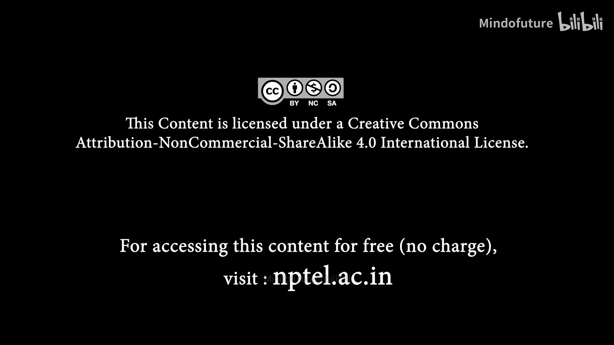
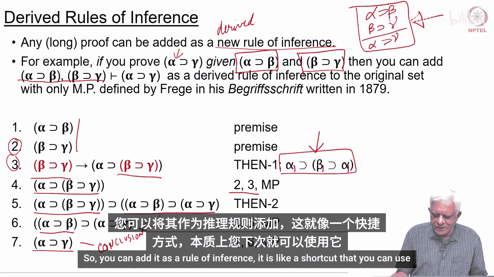

# 【印度理工学院】知识表示与推理 ｜ Knowledge Representation And Reasoning p22 P22_演绎定理 -BV1c4zNBmEyF_p22-

Okay， so we are back to Pro logic。And we are back to binding proofs we saw one。Approach to proof。

 which is。Natural deduction。Or direct proof， you start with the given facts。

You keep using rules to add new。Sentences to the knowledge base。Till the point that you have used。

Generated the goal sentence of the query。In our example that we studied in the last video was this will at go to college。

That was this prop T。And we managed to add it to the list thing。No。

The problem with natural reduction is that one has to choose a rule in each cycle and that you know leads to search essentially should I choose this rule。

 should I use that rule and so on。Eventually， of course， if you have enough time and resources。

 you will find。The proof。The deduction termor sometimes gives us different approaches to constructing proofs essentially。

So， what is the deduction theorem it says？That。Given some set of formulas。

And a specific formula alpha。And if these together， they entail the formula beta。

This is true that this enttaillement holds if and only if。This is entail。

This should not have been here。Ming。So if and only， you can show alpha。Employees beta。嗯。

Keeping the other formulas， the other formula set of formulas may be even empty for all you。

So for a sound and complete logic system this translates to。Again。

 I have made a mistake here this should not have been here。That， if you can show。

If you can derive beta given alpha and some other formulas。

Then you should be able to derive alpha implies beta。

Keeping those other formulas intact and as I said， this set may be an empty set also。So。

 instead of guessing and adding alpha to the set of premises。

 we can equivalent directly prove alpha implies beta essentially。So， supposing。

That this is a toology essentially。So， given。These are the premises that we solve from the earliest problem。

And the conclusion was t， it is equivalent to show。Then the followingology is a toology and。

You don't need any more premises。 so what is the totology you have taken those four formulas and constructed。

New formula here。<|OTHER|>So this is the third formula， this is the fourth formula。And then。

 of course， the conclusion。Has been added here。That is what the deduction theorem says that if you can take these four and and show this。

 then it is equivalent to showing this larger formula which is written in the bottom essentially。😊。

Sometimes you want to do the converse sometimes。To show。

That a given formula is a toological implication。What do we mean by totalological implication first of all that is an implication because that is what it is it uses a implied symbol and it is totaltological in that we want to show that it is true essentially so to prove that。

😊，Alpha implies beta as a totalological implication we can create what we can call an assumption box。

😊，And then within that box， we will assume that alpha is  true， so we will add alpha to the。

Assumption box and then we go around the business of proving beta。And then exit the assumption box。

So， for example。You want to show that this expression here is a autoology。嗯。

And we are talking about proofs we are not talking about。Constructing through tables。

 you could construct a through table this is a small formula with only Pq Rs。

hi are only four symbols so it will have two list of4 which is 16 rows and you can take that effort and do it。

 but we want to。Talk about proofs here and we want to use this。

Equivalence between the fact that alpha。That given alpha to show beta is same as saying that alpha implies beta is 2 and now we are doing the converse of that which is that。

To show that alpha implies be2 we are assume we are going to assume that。

The antecedent is given to you。We are going to assume this。

And we are going to assume it inside the box。So that as long as we are inside this box。

 this assumption box that we are calling it。Inside the box this is true because we have assumedood it essentially。

So that's what we say。We make this as an assumption。

Then we apply this rule of simplification and say okay p implies q is  true。

Then we get one of those fgue axioms， which says that p implies q implies not q implies not p。

And then we infer not give in place。Not be。So， the assumption was this。And the conclusion。Is this？

And the reduction theorem says that if you assume this。In the red rectangle and if you show this。

Then it is equivalent to showing。That this formula which is at the bottom。Is a toology essentially？

So， you can see that。😊，It is quite a simple way if you have a toological implication。

 if you want to show that something is a toological implication， you can start off by。😊。

Assuming the antecedent。In this case， alpha。And then using other whatever axioms you have and so on。

And then， showing that。You can derive beta and the direction theorem says that if you can assume alpha and if you can derive beta。

 then。😊，It is equivalent to showing where alpha implies beta is a。Total。

Lets look at another example here。So， we want to show that。This formula。P and Q implies R。

 the whole thing implies p implies  Q implies R。We will need to create three assumption boxes。

 So it's like。Nested assumptions。First， you assume。This whole thing。Which is P and Q。Employees are。

And then you assume。To show that。This is。Meaningful that you want to eventually come up to the right hand side you assume p。

 so that is the first nest assumption then you assume  Q。So。

 all these are assumptions essentially whatever is inside the box are assumptions。😊。

But once you have。P and once you have Q， then you have p and Q that is back in function that is simple。

And once you have P and Q， then the first assumption said that P and Q must imply R and therefore。

You can add R using mod spons， MP stands for mod spons。So you have now done with the internal。

That the innermost。Aumption we are finished with。We assumed  Q。

In the innermost assumption assumption box and then we showed that r is true。

 which the reduction theorem says is equal to saying that Q implies r is true。

Now we are in the second assumption box in which we assume P。So we assumed P。

And then we show that Q implies always is true。This is equivalent  to saying that p implies Q implies r is2 and finally with the first assumption that we had made we come out of that and this becomes the antecedent this becomes the consequent and now we are shown that this is a。

😊，Totology。So， as you can see that for some things this can be a。😊，Mechanism for finding。

Shorter proofs， essentially。Now， another thing that one can do to find shorter proof is to add more rules of inference now frege said that modest spence is enough but if you look at the website that I had pointed to you to you will see that even for simple formulas which areterologies the proof can be quite long essentially。

😊，So here' is one example here。That I will show you that。What we trying this？Say here is that。

If you have a long roof of some tailellum。Then you can add that as a new rule of inference and when you say new we basically mean derived。

So， the example that we will look at is that。😊，If you are given alpha implies beta and if you are given beta implies gaharma。

Then， if you can show。😊，That alpha implies gamma。And when you says show， we mean you can prove。

Then you can add。That these two things that were given to you。Can derive alpha implies gamma。

 So what will be this new rule of inference that you will infer。 It will say alpha。Iice beta。

Beta in place。有吗？In place。Ander。In place in Go。Now， of course， if you。😊。

Go back to the rules of inference that we saw with our common rules of inference。

 this was one of those rules of inference， I think it was called hypothetical syllogism。But fgue？😊。

Said that you don not need all that essentially what you need is simply mod componentsence and you can prove everything which means that。

If you give me alpha implies beta and if you give me beta implies gamma。Then， I will prove。

I will be able to show that alpha implies gamma but we are saying now is that okay if you can prove that then why not add it as a new rule of inference and next time that you see this pattern you can use it directly without going through the long proof essentially now this of course you can see it is a bit like transability that if alpha implies beta and beta implies gamma it makes sense that alpha should impmma so why not add it as a rule of inference。

And these kind of rules are called derived rules of inference。So here we have these two premiseases。

Beta。Epha implies beta and beta implies gamma is given to us we take then one now remember that then one looked like this。

And this is just to again highlight the fact that alpha beta and gamma here in this then one are variables。

 what we have really done is that this alpha we have replaced by beta implies gamma and of course in both places and beta we have replaced by alpha essentially。

嗯。So， it is basically an instance the what you see on the left hand side。😊。

Beta implies gamma implies alpha implies beta implies gamma is just an instance of alpha implies beta in。

Imply alpha It is a bit confusing because alpha occurs in both of them and and beta occurs in both of them。

 but you can see that I could have called this as。Yeah。I could have called this one is alpha 1。

 beta 1， alpha 1。No， that would also be an instance of this thing。

But so hopefully that confusion will not exist。 So we have this。😊，As an instance of den。と。So。

 of course， from2 and3 as you can see。😊，From two and three， we can infer four。And then。

You can see that the left hand side of this axiom matches4 so we can infer the right hand side which is here。

And then again we can use modpoence because this alpha and beta is what is the first statement and from that we can show alpha。

In place gamma。So， having gone through this proof， we can now add this。😊，So。

 this was the first two things were given to us。😊，These are the premises， this is a conclusion。

And now we are simply saying that okay given these two premises this is a valid conclusion so you can add it as a rule of inference it is like a shortcut that you can use the next time essentially。

😊。

