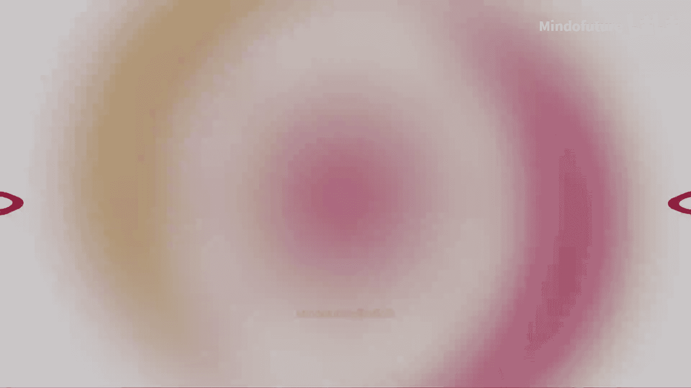
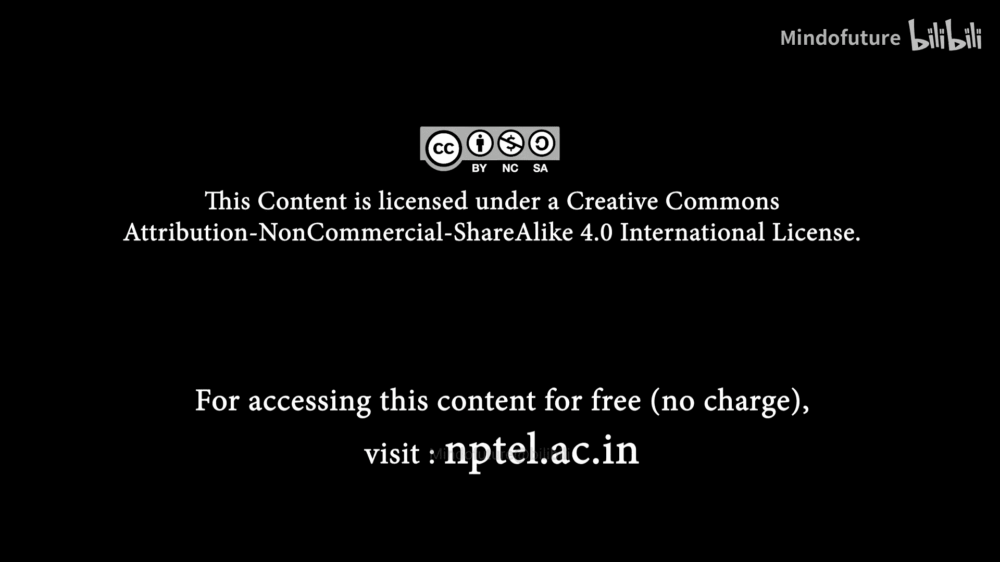
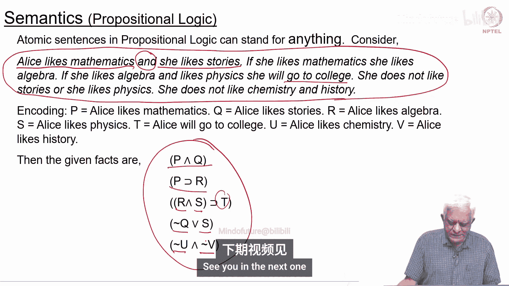

# 【印度理工学院】知识表示与推理 ｜ Knowledge Representation And Reasoning p23 P23_命题逻辑语义 -BV1c4zNBmEyF_p23-

So welcome back。We have been。Talking about the first。Logic that we are。

Discussing which is proportional logic。We discussed the notion of。

Atomic sentences and compound sentences are well form formulas。

And we saw as to how you can construct more sentences。The next。

Stages that if you want talk about truth values。How are the truth values of sentences related？

And we have been saying that truth values， which is。

Or the meaning whether it sentence is true or not？I based on the meaning of the or the the semantics of the。

Connectives， so。This is what we。Im going to do now。So， we see that there is a valuation function。

What is the valuation function it takes？Any element belonging to this function we will call as v it takes element any any atomic sentence which is basically a proportion symbol and it will map it to。

😊，True or false so which means， for example， I could be I could write something like this。That。

Value of Q。Is equal to true。So， I I take every symbol and say that it is either true or it is false。

 so this is a mapping from the set of symbols to the。To this set， which is a two valued set。

Those two values we are calling true in false。And this is what the valuation does。😊。

It says that okay p2  Q is false r is false and so on， whatever the case may be。

 so there could be of course many valuations。If there are n symbols。

 there would be two ways to n valuations。But that's for the valuation。Function does， essentially。No。

Note that it is not that the user is going to specify this essentially。The user may specify。

The truth values of certain other sentences。Whi we will call as input knowledge base the set of premises or the set of axioms we solve raage axioms。

 are not they are not propositions right but they are like complex formulas。So。

 often the input knowledge base is a collection of atomic and compound formulas。😊。

And then the task is key okay， I tell you that all this is true。

Then I ask you about some particular sentence saying that is that sentence true that is what we are concerned with logic is that given some things which are true what else is。

2。But what we can do is。Define the semantics of。All formulas。Using。The semantics of the。Logical。

Connectives。So， for example。We can say。If alpha is true。And beta is true。Then。The exhibition。

Epha and this and symbol and beta will be true will evaluate to true。So。

 when you say value of this is true or value of otherwise value of this is false essentially。Now。

 you can see that this。😊，Condition。I essentially describing the suit table in a succint form essentially I mean this is what you would have done in the through table that you would have said okay alpha is true beta true alpha and beta true alpha is falses beta true alpha and beta is falses alpha is falses alpha is through and beta is falses then alpha and beta is false so those four rows you would have described like that this is just another way of describing the same root table。

😊，And you can see that。😊，The fact that we have used this particular symbol。

Is only incidental it is of course very convenient to use a symbol that we are calling and and therefore the semantics of and is clear to us that both must be true only then is the compound home or true but it is not that connection as I was saying is subtle essentially you know you must keep in mind that you could have just used a different symbol by constructing the suit table and you could have used a different symbol in the language that we are defining whether binary connective symbols are there and but you could still establish the connection between。

The notion of the semantic notion of and that both constituents must be true。And the。

Well form formula which uses that connective essentially so of course it is so much easier to simply say I use the same connective in the in in the root table and also here。

😊，But it it is like we are overloading the symbol and you must be aware of that essentially。😊，So。

In general， when we talk about formulas， so we have this language。

That we have constructed we started with our atomic sentences， let us say Pqr。And then。

 we constructed the。More compound formulas we use a different logical connect and keep adding new formulas so are this how can we talk about the truth values of these formulas。

So， in general。The entire set of sentences in。Propositional logic。Can be。Getterized。As。

3 kinds of formulas。 the first kind， which we have been talking about already is the set of。

Ttological formulas or the set of toologies。These are formulas which are true for every valuation that the formula may be having some  five variables or 10 variables or 10 proposition symbols it does not matter。

😊，Whatever valuation you give to those constituents proportional variables。Pro propositional symbols。

 the formula will be。Always true So whatever the valuation that you choose remember that what the valuation says。

😊，P1 is true p2 is false p2 p3 is true and so on you can choose whatever every such choice is a valuation function what we are saying fortertologies is that you irrespective of what valuation you choose you can let p be anything  Q be anything r be anything。

Our formula will always be true， So these are called toologies， of course。

 you know by now that there are simple formulas， for example。B。All。Not b。

Whether P is true or whether p is false， this formula will always be true。

Of course this has only one provisional symbol but this this holds for everything essentially so this this this ven diagram that I am trying to draw is this set of toologies essentially。

😊，Then there is another set of formulas which are called satfiable formulas。

These are formulas for which there is at least one valuation。That makes the formula true。So。

 it is not the case that for any valuation it will be true。

 but you can find at least one valuation that will make it true。

And if you have heard of the well known problem call sat which is you know the。

On which the whole complexity theory is based， the sad problem simply says that you are given a proportional formula。

And you want to find a valuation which will make it true essentially so is there formula satisfiable？

😊，And that SAAT is just a short form for satisfiable essentially and this is a big industry in itself you know writing programs too。

To to find satisfiable formula to find out whether a formula is satisfiable or not。Anysing。No。

 obviously。Totologies are satisfiable because in fact you choose any valuation and the toology would be true what satisfiable formula are saying that you can find at least one valuation for which the formula will be true so clearly the set of satisfiable formulas will be a proper superet of the set of toologies。

So， here it is shown in the rectangle the rectangle is a set of。Satisable formulas。

That something which looks close to a semicicle is a set of totologies。

Now that leaves the third kind of formulas which are called contradictions。

These are formulas which are false for every valuation that you can think of you choose whatever you want to think of。

😊，And this formula will turn out to be false essentially false。So。

 just look at these two sets the set the satisfiable set and the set of contradictions。

 these are called also unsatisfiable formulas。So， the set of set of unsatisfiable formulas they are basically disjoined essentially。

嗯。You can see that if something belongs so unsatisfiable。

 that means there is no valuation we will make it。True。

 so it can be part of the the satfiable formula and conversely if something is。

Satisfiable which means that there that is one valuation which makes it true then it cannot be the set of unsatisfiable formulas so these two are you know destroyjo sets essentially。

😊，And that's what we have shown here。So， these are the three kind of formulas that you can construct with using。

Professional logic and other logics also as well。No。

It is an interesting point you should spend some time and think over this as to we have these three sets。

 we have this set of satisfiable formulas。We have the set of toologies and we have the set of unsatisfiable formulas so let us say we have given them these names this S U and T essentially。

How do we compare which set has more formulas？Nin。That does interesting。So first， of course。

We should remember。And this is something that you should think about。😊。

Because you are going to be talking about infinite sets。So， the set of toologies is infinite。

We say that P or not p is a totalology， so if p or not p is a total G and Q or not q as a totalology then you put them together also it will also always be true essentially。

Then we have looked at。😔，theys axioms， this is one of them or is an instance of one of them and that we know is a artology essentially and in general if。

Alpha is a totalology and beta is a totalology。 Then you just take any。Not any you take， for example。

 the or connection and then that will be a toology essentially。So。

 you can keep growing the set of totalologies and it is going to be an infinite set。So。

 use a set of unsatisfiable formulas and there is a very simple e as you can observe。😊。

That if alpha belongs to the set ofterrologies。Which means all valuations make it true。

Then not alpha will belong to the set of unsatisfiable formulas。

That means no valuation makes it true essentially。So if all valuations make alpha true。

 then all those valuations will also make not alpha falses essentially。So， not alpha。

 so alpha would be。Not alpha would be。Unsatisable。Okay the simplest。

 unsatisfiable formula that we know is P。And not be。If P is true then this formula is false。

 if Ps false， also this formula is false。There are only two valuations for P and。

Both make it false essentially but the interesting thing is that there is a  one to one correspondence between the set of formulas and a set of unsatisfiable formulas for every satisfiable formula。

😊，There is a corresponding unsatisfiable formula and vice versa。So。

 that is why I tried to draw those two setss equal in size。

 though they are infinite sets and it it doesn not pay to try to you know compare。

Infinite sets and try to visualize if one of them is bigger than the other。So。

 it things really become interesting when you talk about the satisfiable formulas so is this set of satisfiable formulas larger than this we know of course from the diagram that we drew that it is a proper super set of。

The set ofterologies essentially。嗯。Because there are formulas which are not toologies but for which there may be some satisfying valuation so those will not be in set ofologies but they will be here so they will be lying somewhere here essentially。

😊，Now， for every。Formula in the pathology， it is true that it is also sat because that is the definition of being a。

Subset anyway， essentially。For every。Alpha。Which is a toology we can find a beta。Such that。

Alpha and beta。Is satisfiable。But alpha and beta is not a toology。How can we do that？So， supposing。

We have taken this formula， which is a。Totalology。 so we can say that， okay。

 I have this formula P or。Not B。And Q okay， a simple formula。But you can see。😊。

That this formula belongs to。This formula belongs to the set of satisable formulas。

But this formula does not belong to the setup。这里。Satisable formula orologies。

It does not belong to the set ofterologies。So， for every alpha which is a toology， for example。

 v saw p or not p we can produce a beta in this example Q says that alpha and beta belongs to a set of satisfiable formula obviously this will be true whenever Q is true。

But it is not a totalology because when  Q is false this whole formula becomes false。

 so that is one thing。But what。Quite intriguing is that。

For every formula which is a satisfiable formula。It is true。That。

We can find a formula which is a toology。So， there is a mapping from the set of satable formulas to the set ofterologies for you you show me a sat formula。

And I will show you toology or I just simply take the two formulas and。If you give me alpha。

 I will just say that alpha or not alpha is going to be a topology which is true essentially。

So it is a point to ponder about。On the one hand we are saying that the set of satisfiable formula is a proper superset of the set of troologies。

On the other hand， we are saying that。Therefore for every every element in satable formulas。

 every formula and satisable set I can show you one formula so there is also a mapping essentially。😊。

So， that is why you know dealing with thinking about infinite sets is a bit of a problem at times。

 the simplest example that comes to mind is if you are trying to compare the set of，😊，For example。

 integers and natural numbers essentially。Clearly one of them is a proper set of the others。

 but you can always find a mapping essentially。When you talk about semantics。😊。

We also talk about meaning essentially， so we will just define the semantics and then we will move from there。

呃。As we said。The meaning you have a set of symbols and it stands for something that is only in your。

Head recentlyly， so here is a small。😊，嗯。Knowledge base that we will work with expressed in English。

 we will convert it into professionalal logic。And it's about this。Girl， Alex， Alice。

Maybe she is from Wonderland， but anyway。嗯。It is about this Alice and it says Alice likes mathematics and she likes stories。

We will break this down into。😊，To separate。Propositions， and we will use the and connective to。

Represent it， essentially。Then， you say。If she likes mathematics。She likes algebrabra。

That is because algebra is a part of mathematics。If she likes algebra and likes physics。

 then she will go to college。Then we are saying she does not like stories， or she likes physics。

And we are finally saying that she does not like chemistry and history。

I'm sure you know people like that。What is the encoding we are doing so as I said， the first。😊。

We will let P stands for Els likes maththematics Q stands for ElIS like Sties。

R stands for Ls likes algebra， S stands for L likes physicsic。

T stands for Alice will go to college U stands for Alice like Che。

And we stands for Alice Lakes history， So we are just taking some random。

Ppositions and saying that this is what each of them stands for。

 but basically this will pertain to the story that we are talking about。😊，Then the facts that are。

Given here。This whole story that we are。Or this knowledge base that we are talking about。

Is equivalent to this， essentially。We have reduce it to。Ppositional logic。So。

 you can see that each of them comes from this original knowledge base itself P and Q stands for Alice likes mathematics and she likes story P implies R stands for。

If she likes mathematics， then she likes algebra。Then R and S is what if she likes algebra and she likes physics。

 so R is algebra s is physics。😊，Then。She will go to college then we have said this stands。

 she will go to college。And。She does not like stories or she likes physics so does not like stories or she likes physics remember that this is inclusive or this is not the exclusive or。

And finally we said that she does not like chemistry and she does not like history。

 so we just said it as two statements， not of you which is does not like chemistry and not of we。

He does not like history so this is given to us okay so you don not have to question it these are the premises that are given to you。

The question that we will want to ask is that if this is given then what else is true。In particular。

We will ask the question。That will she go to college， will Alice go to college？

But we will do that in the next video after you have digested all this stuff。Okay。

 see you in the next one。

