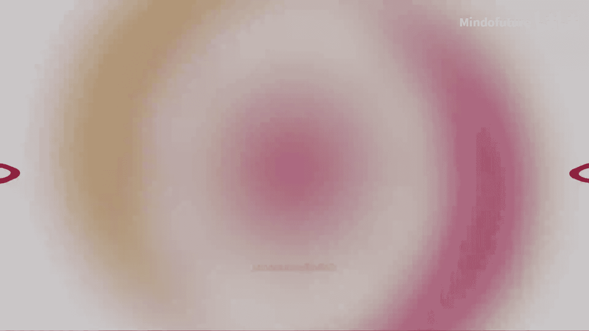
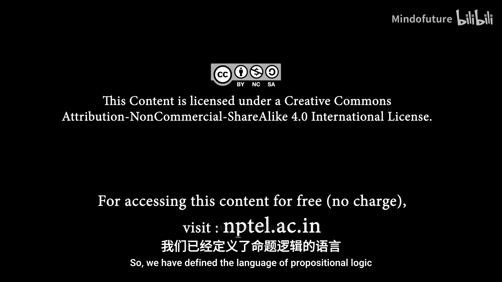
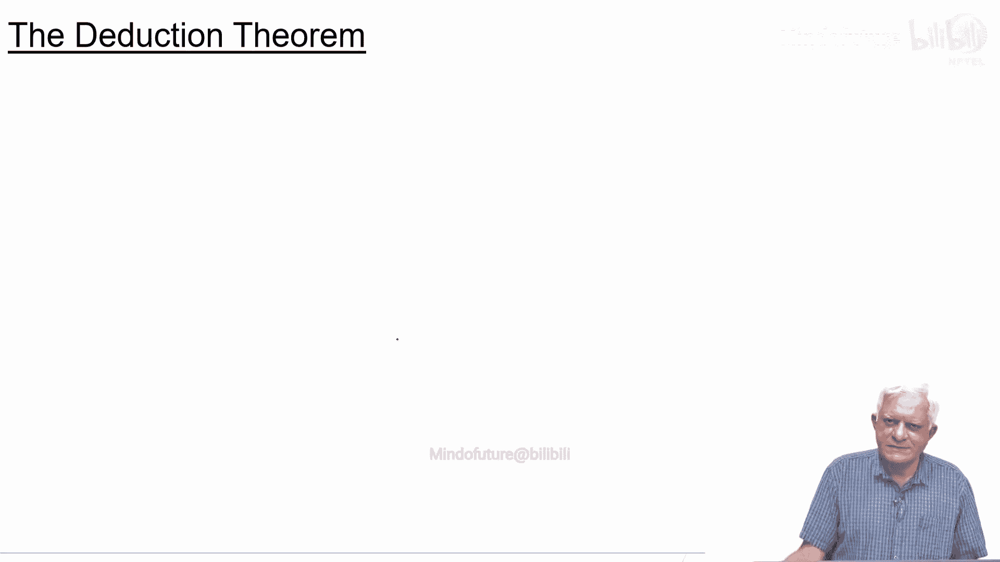

# 【印度理工学院】知识表示与推理 ｜ Knowledge Representation And Reasoning p24 P24_证明自然演绎 -BV1c4zNBmEyF_p24-

Okay， so we have defined the language of proportional logic。We have talked about。

The syntax of proportion logic， we have talked about the semantics of Proal logic。And we have seen。

 for example， how you can。Represent certain knowledge base intoal logic。

Now we want to talk about proofs essentially。Okay， so。

And we will look at proofs in the context of proportional logic and they will give us insights into proof in general。

😊，Which you will carry forward to when you go to rich languages because rich languages are the ones which are。

In fact， more useful。So， in terms of。Logic。When we talk about true statements。

 we like to call them a theorem。You know， for example。

 the Pythagoras theorem the Pythagoras theorem is called a theorem because we know that it is true essentially and the task of a logician is to be able to derive it。

From。Certain。Seets of axioms so， for example， in the case of Pythor theorem you may be talking about Euclide and geometry so they test a certain set of axioms which are associated with that essentially and then you should be able to derive that statement which is the theorem。

The process of establishing that it is a theorem is called theorem proving。😊。

And it has been an activity which has been。😊，Going on for the last。

7ty years ever since machines computers were invented。And people having been。Writing programs， too。

Autoomatically generate proofs of serumorems。Now it is。

A syntactic process hereem proving is concerned with the syntactic process of constructing a proof what is a syntactic process it is basically you are doing pattern matching you see a pattern and you are allow to add something new to the knowledge base or to the set of sentences。

There are many algorithms for tail improving， many styles of tail improving。

We will look at a few of them in this course。The first one that we will see is direct proof。

 which is also called natural deduction because that is the way that you would have written。

 for example， proof in school。Also sometimes called Hilbert style proofs。

Or we will look at indirect proofs or mostly we will say proof by contradiction。

And we will look at two methods， one is called the tableau method and the other is called the resolution reputation method。

 but we will not look at the resolution rep method in proportional logic。😊，嗯。Oh。

We will come back to it when we look at first photo logic because it has it shows its real power there essentially。

So， we will begin with natural deduction or direct proofs or Hilbert style pose so remember that we had this encoding of this story about AliceIS。

All this knowledge base about Alice and Alice likes maths， Alice likes stories。

 Alice likes algebrabra， Alice likes physics。These are the atomic propositions。

Alice we'll go to college。Alice likes chemistry， Alice likes history。

 so a lot of facts about Alice and what we were told is that these。😊。

Comms are true that P and Q is true which means Alice likes maths and Aliceis likes stories P implies r is true。

 which means if Alice likes algebra，No， sorry， P plusq says。

P is Alice likes maths then r is Alice likes algebras so if Alice likes maths then she likes algebra and likewise we had the other statements that were given in the story but now we are working only with the。

Propersonal logic andcod of the study so that we can do symbol manipulation。

And come up with whatever we want to show。So， we often have a query of a goal and our query is going to be that is this proposition T。

😊，Alice will go to college is this true in other words we are asking will Alice go to college？

So let's look at how you would have done it if you were doing this in school。

Which is basically keep adding new sentences。So， in a direct proof we choose rules of inference。

 we decide which rule we want to use and add the consequence to the knowledge base essentially。So。

 here it is。😊，This is what is given to you， Alice likes maths and she likes stories。嗯。And so on。

 so this is a knowledge base that we are starting with essentially we have not used one or two of those statements。

😊，Because actually we will see that they are not。They don't play a part in the。

In the proof essentially。嗯。So， we have not written the entire knowledge base here essentially we have just written what we need essentially。

So， we。First。Simplify we take this formula p and Q and say we can get p and we can getq out of it and that is a rule of simplification that P had studied essentially。

Now to get Q。😊，Strictly speaking， we must first replace。B。

And Q with Q and P because the rule that we wrote said that the first element in the conjunction is something that you can impfer essentially of course we understand the semantics。

😊，And we know that P implies P and Q。Is logic logically equivalent to Q。

N T the rule of commativity of and and we could have replaced it there but in this natural style proof of reduction we must actually first add Q and P to the formula and then derive Q but we often take these shortcuts and they are kind of acceptable。

😊，The program of course will not work in the if you are writing a program。

 then you would have to introduce this step of adding this new formula Q and P essentially。

Then we have R， how do we get R well we have。Be here。And we have P in place。😔，Are here。

 so modponence and we get。All， essentially。So， that is what you return here from2 and5。

 so two is here and5 is here。And then we apply the modponence root in。

We got likewise from four and 6， we got。😊，S， what does  force say force says is that Q must be false。

😊，All S must be true。But we have said in6 that q is true。

 so therefore s must be true because q is not false。And therefore， we get S。

Then we can use the rule of conjunction which is okay R is given to us s is given to us。

 so therefore R and s is given to us。And then finally we can rule use the statement number 3 which says that R ands implies t and therefore we can infer t using motor pullence again essentially so this is the natural direction style of proof or the direct proof that we often。

😊，Have been using during our study of。Mats in school and beyond， essentially。

We can also show the proof to be。😊，In a pictorial form as I directed a cyclic graph。

And so on the top row are the axioms， or not the axioms。

 these are the premises that have been given to you。😊，And then。

Thearrow show you how you arrive at new sentences so from p implies Q Q came to p that was one thing we did then we also came to Q in a similar fashion。

Though I could have gone。As I said， here Q。😔，NP。As a new formula。

And from this I could have done this。We will take it with a little bit of flexibility here。

Then from Q and not  Q or S， we can get S。From PA and this thing we can get R。

 then from S and R and S we get this and then from this we get the this thing。

So this is just another view of。😊，Showing the proof。And we will use this approach。嗯。

Once in a wide universe coive now the interesting thing about maths is old logic if you want to see is there a proof is the product that is published so if you。

😊，If you read the proof of， let's say the Pythoral theorem。

Then you are just looking at the final product that this is a proof。

 these are the things given to you and therefore this is true and therefore this is true and therefore this is true and so on。

😊，Finding the proof is。😔，Another matter thats that's where。Your。

Effort goes into it and that's where your training as a mathematician or logician goes to it and。

That is something of course we are interested in and we will see that finding a proof is essentially a process of doing some kind of search。

 which role of inference to take and what facts to match it with and you know what inferences to make。

Ier。Process that we have to somehow automate we are interested in automation here remember。So。

 finding proofs。The proof of alpha the proof of alpha that alpha is a theorem that we have been trying to prove。

The proof of alpha is the end product。That is a justification of the sentence alpha being true。

 so we have the proof and therefore we accept it to be true。

It represents a chain of inferences linking the given facts to the desired goal or the conclusion essentially。

As we saw in the directed recyclingcycl graph a little while ago。

Proofs are themselves found by a process of search essentially okay so there was this famous full color theorem。

😊，What is a focal theem it says that。Any par map， so you know。

 you have regions or countries if you want to see。All kinds of this thing you construct any map that you can draw on a piece of paper。

 which is called a planar map。And you want to of course， color them from different colors using。

Because you know， that's how we draw maps， so this could be red， for example， this could be red。

 this could be blue。This can be red or this cant be blue because it is adjacent to them so this should be green。

 for example。And then this can be yellow。Then this can be。Let's say pink。And this can be。

 let's say white， and this can be black， and this can be。嗯，没见的。So， I have colored this map。

 what is objective to color it in such a way that。😊，You can。

Distinguish between the different countries or regions essentially。What the four color theorem said。

Was。That。If you have a map which can be drawn on paper like this， which means it is a par map。

Then four colors are enough to color the whole map essentially。You don't need more than four colors。

This theorem took a long， long time to prove essentially some some some things are like that。

 you know， you must have heard about Permats last termorem。And how， for a few hundred years。

We did not have a proof for it， and eventually。The logician and drew vis are proof。So。

 proof finding is not a straightforward process so it takes a lot of effort。

 a lot of search and in fact the fog theorem was proved by a theorem provinging program so which is why I have also mentioned it here essentially。

😊，And that program would have done some kind of exploration of you know what rules to apply in what order and things like that and eventually come up with that。

So， what happens is that。😊，You have done all this headbreaking work， you know。

 apparently Andrew Wes worked on format serum4。20 years， essentially and。

Then finally you present the proof which looks like a neat structure but it doesnt show the kind of efforts that mathematicians put in you know trying to come up with a proof essentially and if you look at the Pythgraphas genomeer for example there are you know many。

 many different kinds of proofs which have been given which are you creative are much more creative than the others and things like that。

😊，It is only the final proof which is communicated or published essentially this process of natural reduction。

😊，Can also be called as forward reasoning it is a data driven chain of reason inferences by data driven we mean we start with the data and move towards the goal essentially we will see later that there can also be goal goal directed search algorithms but basically what this does is that you are you start with some data you keep making inferences till the point where you have added。

The goal so lets say this is this was the goal in this particular problem and then this is another problem that you are trying to missing what this does not show that this only shows a final proof what it does not show is that maybe you made some inference here and then maybe you made another inference。

There and then from this you made an inference there and so on all that is not shown the trial and error that people do all programs do is not shown what is shown is the final proof essentially。

that's our product that we want to produce essentially。So。

 this process is called forward chain in the sense that you are going from data towards distinct pick rule with matching facts。

 add the con to the knowledge base and you keep doing that。😊。

Till the goal is added to the knowledge base and this process is called forward reasoning or forward chain。

 we will compare it with。😊，Backward reasoning or backward trainingning when you move to first order logic officially。

The key question， of course， is which rule and what facts essentially？Okay。

 so let's take another break here， we want to move towards other approaches to proofs and we will start with the reduction theorem。

😊，Which I mentioned in the past， I hope I did mention it before I mentioned it in the past。

 but in any case we will present it here。And see that it gives us some。

Additional tools for making proofs so we will do direction theorem in the next video when you come back。

😊。

