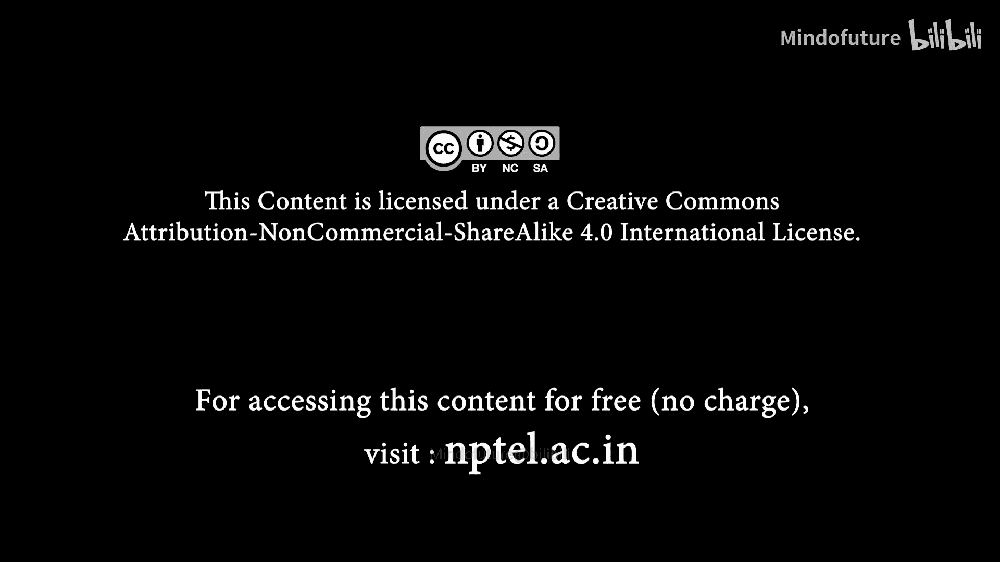
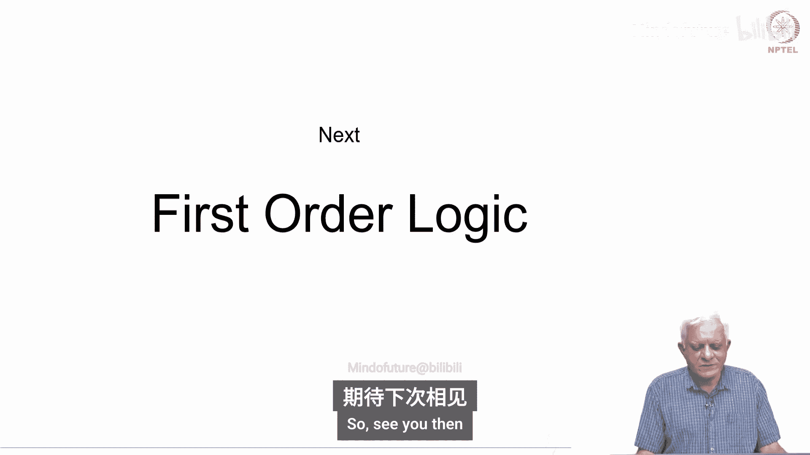

# 【印度理工学院】知识表示与推理 ｜ Knowledge Representation And Reasoning p25 P25_表方法 -BV1c4zNBmEyF_p25-

We are into indirect proofs。And in indirect proofs， we are looking at proof by contradiction。

And we want to say。That if you want to show that some formula if alpha is a we want to show that alpha is some formula which is a toology。

Then what we will do is。Take the negation of the alpha。And look for a model。So。

 if the negation of alpha is not satisifiable， that means alpha must be a toology and that is going to be our approach which is called as a tabux method。

😊，So， tableau is like a picture that you are creating。So。

 given any alpha the tabau method looks for a model for n alpha， so we have been saying that。

The way it does is that it eliminates。😊，Logical connectives。And tries to say， okay。

What are the values for the constituents， the atomic formulas， PQ RST？

which are consistent with the this thing and whether it is a model or not actually so it collects the sets of propositions that go into making that formula。

And their negations so things like proportionulss are like p。

 their neations are like not p and between both of them these are also called litals essentially that is a term that we will also use later。

So it is trying to look for a set。That is a model。And if it cant find this set。

 then it says that I cant find a model so your。I can find a model for not alpha and therefore alpha must be totalology。

So if you are looking for a model for P。😊，N Q。Then both P must be true and both Q must be true in the once you have removed the connectives and put and collected this set of litals which must be true。

On the other hand， if you are looking for a model for p implies q， then you can have。😊。

Two different models one model in which  Q is true so  Q must be present or not p must be present。

 of course both can be present at the same time also。

 but if either one of them is present then we have a model essentially。So。

 there are two possibilities of finding a model for P。In place Q。So。

 we would write this as if you have p implies Q then either。In the model。Not p must be3。

Or in the model Q must be there so you can go down either path and this is a kind of tabau that we will create。

😊，If some interpretation。我心。Model has P。And not P。Or if some interpretation has both P and not p。

 then it cannot be a model。And if it。If you cannot find any interpretation which is a model。

Which means if there is no model for not alpha。Nin。Alpha is a totallylogy。Thats the time loop method。

 So let's look at。That in action here。We said that the basic idea behind taboo method is to eliminate connectives essentially so we want to break down a compound formula。

😊，And we will see the rules that we use of four connectives。

 you can extend it to other connectors if you want to build a tab method for other connectives。So。

 we will look at these four connectives， we will start with the negation and we will see for each connective。

😊，How to handle the formula？And how to handle a negative formula。

So let' us start with the negation which is the simplest connective。And。If you have not of eggs。

And x is a proposition。That means there are no more connective inside。

Then there is nothing you can do there is a little so you will leave it like that essentially。😊。

But if you have not n of x， which is a negation of n of x。

Then you can replace it by x and we know that there is a rule of substitution which allows to do that even Fgue's calculus had such an rule of implication。

If you have n as a connective， then if you have x and y。

Then in your collection that you are trying to build。

Both x must be present and both y must be present。We will call this as a column， essentially。

On the other hand， if you want to show n of x and y。

The rule for and says that either norex must be present。Or not why must be present in either case。

That will be a model essentially。So， the other rules are for disjunction or。

As you can imagine for x or y to be true。The interpretation must have either x to be true or it must have y to be true anyone will do both will also do of course。

But if you want to show that not of x or y。I true then not X must be true and not y also must be true only then the whole formula is true。

And likewise for implication， which is in many ways our favorite connective。

To show that x implies y is true， it is enough to show that not x is true or it is enough to show that y is true。

 both can also happen at the same time， but to show that x implies y is false which means not of x implies y is true。

 both x must be true and not y must be true。We saw this yeah。In the last few slates。So。

 let' us see how the triau is constructed。😊，Add the negatived goal to the set of fluasees we have already discussed this right？

😊，嗯。Lising。Pick and un formula in the tableau tableau is this pictorial diagram that we are trying to construct。

In the re blue and eliminate the main connective essentially。So。

 after you have eliminated the main connective， we can mark that formula as used and we will see this in an example it become very clear。

😊，And we can in fact throw it away essentially we don't need it anymore。

So here we are saying when market is used essentially， it can be removed。

The constituents are added to each column below 8 essentially so as we saw just now some connects will just extend the column。

 some connectors will bifurcate the column into2。Two different columns essentially and neither one can be a model。

So， each column is going to be an interpretation。And the termination of column can be done in two ways。

If a column has both x and not x。Then。It cannot be a model。Because， you know。

 both cannot be true at the same time， it is unsatisfiable and it can be closed。Otherwise。

If there are no more connectives to eliminate。Then it must be satisifiable and then that is a model so this is e for searching for a model by breaking down the constituents applying the rules that we saw how to break down how to eliminate and how to eliminate all how to eliminate implies and so on eventually we are set can left with a set of literals literals are either atomic formulas all the neations so things like P not p Q not Q and so on and if we have a set in which both P and not p are there for example。

Then it cannot be a model。But if there is no such contradiction in sight， then it can be a model。

So lets show that mod spency sound。We start with its negation as you can see。😊。

That is the proof by contradiction approach of which model checking is an example and the tab method is a way of doing that。

So， we add the negation。And this is the first。Connective the main connective we can always eliminate only the main connective。

 So the main connective here is imp imply， So we want to eliminate that So we use the rule for。

Eliminating something from。Negation of。Alpha implies beta。

 so you will get that alpha must be true and not beta must be true。So。

 alpha is in this case the first part which is antecedent and beta is q not beta is q so not beta minus be 2。

Next， we eliminate and。And that is a simpler rule as you remember both must be true so p must be true and not q must be true so as you can see we have drawn this red line across those formulas we have used them we don't need them anymore so whatever else remains which is not on which is not canceled is part of the。

Interpretition that we are building essentially。But of course。

 we need to break down further so next time we have to eliminate this implication again it bifurs。😊。

Set into2， either not p must be true or。You must be true。The first column is closed。Because both P。N。

 not p。A in the column。The second column is also closed， so this this line that we have drawn here。

 this bar that we have drawn there is just a sign that it is closed。

This is also closed becauseq is here and notq is here so in that column in the right hand side column。

😊，Also。I not a model the left hand side is also not a model and there is nothing else left to eliminate so there is no model。

Which means。What we wanted to show that P and。B in place  Q in place  Q is。

Aterology and therefore motorpon is sound essentially。

Let us look at the abductive rule that we spoke about earlier so if you remember that is  Q and p q implies p。

So let's do the same process here， the same thing we will do。First， supplier negation。

Because that is what the method is， take the negation of the goal。And then start eliminating。

Connective one by one， essentially。So。Like before we eliminate the implication。

 we get something very similar except that Q and P are in different places now。😊，嗯。

We eliminate the and so we get Qs be true and p implies place Qs be true。

 then we eliminate the implication。And we get that not P must be true and Q must be true。

Now you can see。That there are no more connectives that you。

Can eliminate remember that when you have something like not of P。

 then that is itself a literal So there is no further thing you can do you are only left to formulas which are either。

Propositions or negations of promotion so so no more connectives are left essentially which means。

As you can see in this example， both the columns are。😊。

Models essentially what do the columns say both the columns say the same thing in fact they say that not p is true andq is true。

Is a model for this thing。So since we can find the model。That means not a alpha is satisifiable；

 that means alpha is not a trotology and therefore abdion is not a sound rule of inference and that is something that we have。

😊，Been saying for a while， essentially。No。Let us look at our Alice problem and see how you would solve it using。

Oh。That have blue method。So we have the premises。 so thats a column that we are constructing。

 We add the negation of the goal to to the。嗯。Column and that is approached by contradiction remember take the negation of the conclusion and add it to this thing and we will see that we are unable to find an interpretation in which the premises are true which means the first four statements。

And the conclusion is false， which means not of t is true。

 So there is no model for what we have written on the left hand side。1，2。

34 will also be the order in which we will。Process because we are saying we are processing the formulas in the order presented the reason we are looking at this example。

Iスと。Show that certain orders are better than other orders， but this is just to illustrate this。

So I am just showing you this whole process somewhat。Fast。

 but once we have this entire tableau you can look at it and see that it is indeed what is happening we are processing the formulas。

In the order in which they。Have been given to us so first we process p andq and so what we get is p here and  Q here。

Then we process p implies r， so what we get is not p here and this becomes close as you can see because p and not p are present and we also get r essentially。

Then we process。RN S implies T。So we get not of Rns。I have written this in different order。

Simply to accommodate the diagram。And T here T makes it closed because tea is not tea is present and so this is also closed。

Then we back down not R of。And is。Which means。嗯。We break down not Q or S。

That is how we get this nq here and then we that is how we get this s here。

And finally we break down this one， so this is the fifth one that is broken down so not R and not s not R and not s。

 so we will get n R and not s here。And all these things are closed essentially。So。

 this is a tableau we constructed in which we process the formulas in the order that they were given to us。

😊，Now， order of eliminating connectives can be important。😊。

And we saw that there are certain connectives。😊，Which introduce branching in the tableau。

And it's best if you。Process them after you have connected the ones which do not advance so for example P and Q does not advance if you are going to simplify P and Q。

You will add P and you will add Q。Whereas if you are simplifying p or q then one model will be p1 another model other interpretation will have Q and then that way the tableau will grow essentially if you want to keep it compact it is better to do the。

😊，Ones which are not branching first and do the branching months later。

So look at this following two rules here。This is a different set of this that we want to show to be unsatisfiable and it is unsatisfiable。

This is。A compact T blue。And it is compact， because we processed the。

Fmulas in a different order not in the order they were given。So， we first。

Processed not p and not s then we processed not q or S and so on as you can see they produced a vertical column without any branching only in the end we processed p and  Q and then of course because p is here and not p is here we could close this branch and when  Q is here and not q is here we could close this branch and it is a reasonably compact。

W blue。Stucture， but if we had processed them in the order in which the formulas were given to us you can see that you will get a slightly bigger tabau essentially so there is it is a nice heuristics to have。

😊，I to process。The formulas which do not include branching first and then go to the formulas which include branching as you can see the three of the tabau on the left hand side is smaller than the tabau on the right hand side。

😊，So let's look at the。Proving one of regges。Axi the axioms can be produced in different ways we could have constructed the through table which is what I asked you to do earlier。

But let's do it using。The tableau method here。This I have taken from。This book。By Raymond Muian。

 who is a master。In logic。And you must look for his books， Rays Mill has many books。

Which have logical puzzles。And so on， maybe we will do one of them later in the course。

 one puzzle that is。But this link will take you to the book there is a soft copy available so if you just press on this link or you just look for this the book is called logical La and by think so this I have taken this。

😊，Prove from his。Book， essentially。So， we want to show the。

That phasegueus axiom is  true and we want to show。They the order of processing。

Connectives is important essentially of course here initially we don' not have any choice because there is only one main connective so we must we will have to process that。

😊，But subsequently when we get more formulas in the column then which one to pick is going to change the。

Size of the tableau that we will construct。And this is a nice example which I got from Sulian's book and he is also one of my favorite authors。

And I would encourage you to look for his books。And this one logical labyrth is。

Fortunately I found it is available online so this link will take you there。So。

 after you have processed one。😊，So， this this is a notation that here has introduced which I have copied that you know you are saying。

😊，That this has been arrived after processing the formula which has got labeled one essentially and there was no choice there was only one connective to begin with。

😊，But then。After processing the second formula， this is what we get。

We had p implies  Q implies r so to make that true either not p must be true or  Q implies r must be true。

 so we have seen this essentially right。Then we process the third word。

What is the third one that something negation of some implication？

And that does not introduce branchlanching， so we get one here。

And this one here So p implies Q must be true and the other one must be false so this is why this negation of that comes in here。

 but you can see。That this whole thing is repeated here。So。

 that is something that happens you have to do this in every branch of your tableau essentially。

Then this is after。After 4 there is nothing you can do because the formula number 4 is just negation of p so the next one to do is 5 and this is what happens after 5 and 5 is only in the right hand branch so you had Q implies R so either Q must be false or r must be true and so that is what we have here essentially。

😊，Then we go to number six。Which is similar p in plus q。So， either P must be false or Q must be true。

Then we go to number7。Which is that P must be true or r must be false。And Arist peoples。So。

 to make n of p implies r true you must make p through and r false but the moment you make p through this becomes closed so we have left it here and it happens in both the branches and why what is happening here is because there is not of P and so that is kind of influencing both the branches here essentially。

We have not written our ideally you would have added R if there was a need to do so。

 but because the branch got close or the column got closed we have left it there。

Then we have gone to5。No， then we have done after eight。Wwhich is p implies  Q。

 so again not p or  Q and this is again repeated here as you can see not p or  Q。So after eight。

 we go to nine。And we find that the end of nine。9 is again this not p or or the same thing that we did with 7。

7 and 9 are identical so the same process happens but it happens more times on the right hand side branch and you find that everything is close in in this case because there is P here here there is and there is not  Q and then p and then not s here there is some S somewhere。

Soly。This is a mistake。They should have been our。And because。

Not R is there and R is there this has got closed， so I need to correct that。So it's not S， it's R。

So， finally。😊，Let us see if you can find a shorter tabau for the same problem that we are trying to solve this is a negation negated axiom。

Of then to a。And the first step is the same because there is only one connective to break down。No。

Instead of breaking down two。We have broken down three essentially。😊，And3。

Does not introduce branching it says。That。For this。

 either p implies q must be true or the consequent must be false that is not p of r must be true。

Then instead of processing two， we are processing 5 as is mentioned here。

And phi says that p must be true or not r must be true。For this formula to be true。

Either P must be true or not R must be true to make p implies r falses。

 you have to make p2 and r falls。Now， of course you have to end up using branching again。

 but you can see that you know， things will close down much。Faster。

 so here we have used the second sentence finally。And then we have used the sentence4。

And then we have used the sentence 9 and then we have finally come up with this。

Shorter proof as you can see， this proof is much shorter than the one we saw that in which we just blindly。

😊，Processed formulas in the order that they were produced。So。

 first we produced first we used one of course there was no choice in the in the previous proof we produce one then we use produce 2 and 3 we use 2 first then 3 and so on in this example we after we have produced 2 and 3 we didnt use2。

But we used three essentially。So， by making a judicious choice of which connective to use and it is not very hard it is a simple heuristic that keep the branching connectives for as late as possible。

😊，And you can see there。This will give you a shorter proof， essentially。So。

 this should complete our study of Proal logic。The main reason why we studied proion logic was。

To give us a feel of what proofs are like essentially because the language itself is very simple。😊。

But the proof techniques will carry forward to the next language that we will study。

 which is first solar logic。Which is really in some sense， the bulk of。

Work in mathematics is done in first sort logic and we will come to this。In the next session。Okay。

 so see you then。

