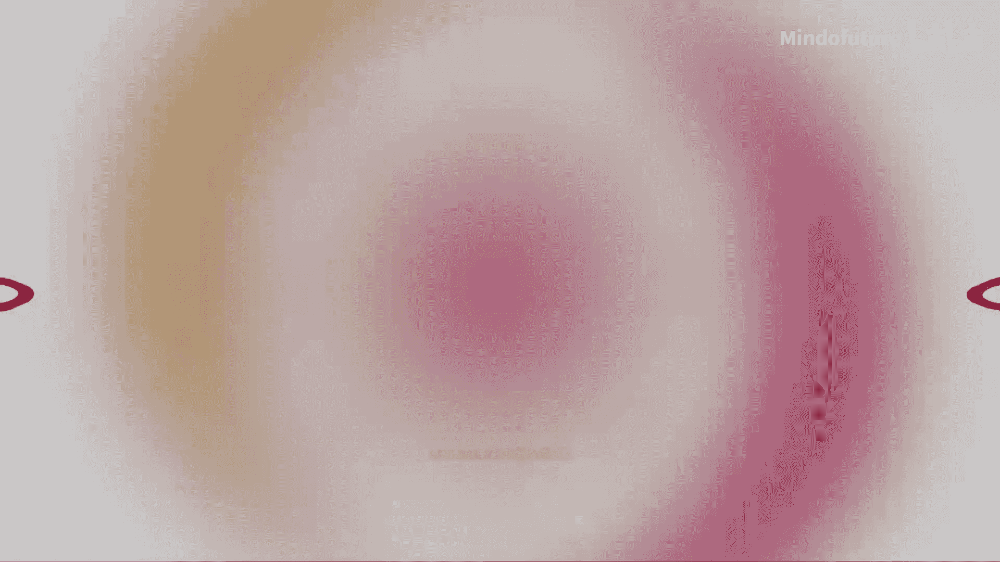
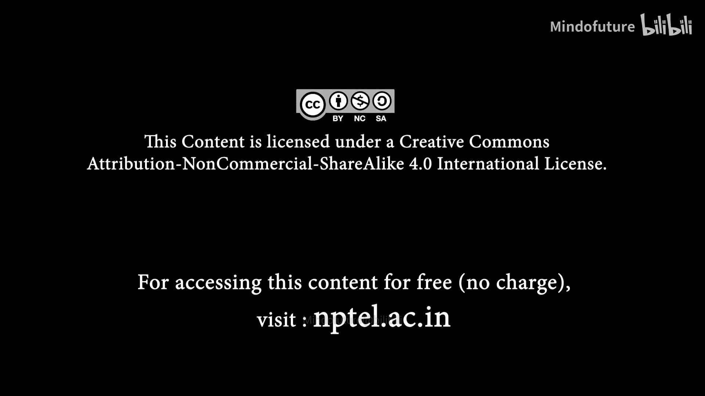
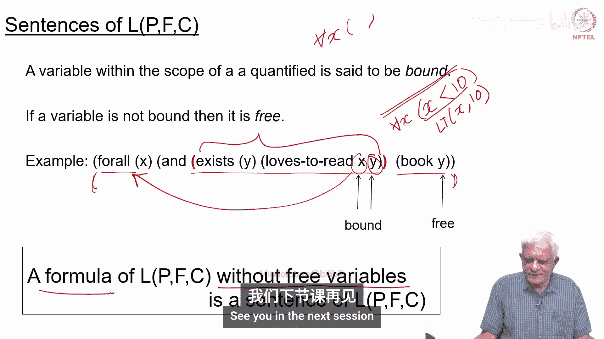

# 【印度理工学院】知识表示与推理 ｜ Knowledge Representation And Reasoning p27 P27_一阶逻辑语法 -BV1c4zNBmEyF_p27-

Okay， so we are back。And we have started the study of first a logic。

We got an overview in the last session。And now。As is becoming our practice。

We start by defining the language。Remember that logic language is a formal language and we start by defining the syntax of the language。

Then we will talk about what are the sentences of the language then we will talk about what is the meaning of those sentences and also we will talk about。

How to arrive at truth values of sentences， so all that will happen， but we start with syntax。

Like in Pro logic there is going to be a logical part of the vocabulary which is kind of constant and it not doesn not depend upon which domain you are talking about。

And it is very similar to what was there in proportion logic we have a set of connectives or operators so our old friends and our not implication。

We have a set of brackets and so on。But in first sort logic。

 there are more things which are also part of the logical。Vocabulary。

Of course constant symbols like top and bottom of field member。

 they were part of proportional logic also as well they are part of this logic。Has been。

Apart from that。We have a set of variable symbols， which we will will call this set V。

And basically it is got a set of symbols and each of them we will say is a variable symbol essentially so we can say v1。

 v2 v3 or you can say x by z or x 1， y 1 z1 and so on essentially。So。

 this variable symbols will be used to stand for。Those individuals who we have not identified。

And it has two new symbols these are called quantifiers。We will look at them in some detail。

The first one is called the。Universal quantifier。And it is normally red is for all so if you want to say all men are model。

Then you would use the universal quantifier。The other one is。Return like a left side， right E。

And it is that as there exists。And it is called。An existential country。So， if I say for example。

 there exists an even number， then I would use this quantifier to make that statement so I am saying。

That there is at least one even number in my domain， essentially。Sometimes we。

Introduce a special symbol。In logic。Which is the equality symbol which of course all of us are familiar with because we do arithmetic and algebra all the time。

And this red is equals。But when we do add this symbol and we will see that it has certain special properties that give us certain deductive abilities which come from those special properties of equality so for example it is symmetric and transitive and reflexive and so on which we can exploit as we will see when we look at theem proving in logic。

So， sometimes we say we have firster logic and sometimes we say we have first logic with equality which means we have added this extra symbol and along with that the properties of those symbols essentially。

Then， as we said earlier。For every logic we have to have a。

No logical part or the domain specific part and in first or logic the vocabulary for the domain specific part constitutes of three sets so if you compare this with proportional logic in proportional logic we said we have a set of proportional symbols。

P1 p2 p3 or pqr here we are saying that we have three other sets and they are as follows。

A set of predicate symbols we will call this set P。

 some books call this R because predicates and relations are intricately connected to each other but it doesn not matter we can we will call it P here。

A set of predicate symbols and it is just a set of symbols and typically we may say P1 p2 p3。

And PQ are its on。This looks very much like the propositions in proposition logic。

 but remember we are defining a new language here， these are not propositions。

 these are predicate symbols。Its to me。More commonly as we have been doing。

 we will use symbols like man mortal。Greater than remember again that these are just symbols specifically they stand for they are part of the alphabet of first logic。

😊，The fact that we have used a symbol man does not mean。

That we are talking about humans it is just a symbol just keep that in mind but because we often tend to use variable names which are meaningful to us and which is what we intend to them to stand for we often use these symbols but as far as a machine is concerned。

This is just a symbol essentially I could have jo written P there essentially or any any symbol。

And and for all you know this man could have stood for something like let us say a horse essentially what conceptually we call a horse I might have given this that this symbol of man we define the set of horses essentially so that comes later but obviously we don't do that kind of you know things which will confuse the hell out of us we would read。

We will use a symbol man when we intend to talk about men。So， this is a set of。Preddicate symbols。

 then we have a set of function symbols essentially。Riccate symbols。

We stand for relations between things。So we said for example teacher。

Or something like that albeit essentially function symbols will stand for functions in the domain。

 What do we mean by functions functions。A mappings。Which。In the simplest case， take some。

Individual or another individual。And map it to something else， essentially。So。

 these are function symbols we will look at them we look at the semantics and syntax。In detail。

Commonly commonlyly we will use function symbols like F1， f2， F3 or Fg and H。

But more often than not because to make life easier for ourselves。

 we might use the term successor so successor is a functionos you are talking about numbers。

Successor is a function。 The successor of two is3。 The successor of three is 4 and so on and so forth。

 Likewise， sum is a function。 So we will define some as a binary function。 It will take2。

Iputs and give us one output， recently。Each functional symbol has an lT just like each proposition symbol。

 each pret symbol also should have an lT。That means how many arguments they take essentially。

And we will see this indext as we go along。But I am sure all of us are familiar with this。

 essentially。The third set is the set of constant symbols， these are symbols。Which。Stand for。

Kn individuals in the domain essentially。Typically in a formal sense。

 we might use c1 c2 C3 or sometimes ABc and so on。But more often we would use symbols like0 so we know that the0 we want it to stand for the number0 Socrates is the symbol that we want to stand for that individual who we are calling Socrates the Arling is a symbol for this city in India which we。

We call doling and so on， essentially。The three sets together define the language so the language is made up of these three sets。

 the set of proposition preddicate symbols， the set of function symbols and the set of constant symbols all some books might write RFC。

 the set of relation symbols function symbols and constant symbols。So， that's all。

Vocabulary now to talk about。How do we build sentences using this vocabulary before we build sentences we build something called terms。

So， there is as some logic books will say there is a family of terms or there is a set of terms。

The basic constituents of FL expressions are terms essentially the constituents essentially。

The set of terms which we will use this。T like symbol here of this language is defined as follows first of all。

 the constants and the variables are terms so that should give us a hint。That when we say terms。

 we are talking about individuals， essentially， So consent are individuals。

That we know that are known variables are individuals that are not known essentially。

 but basically they are terms which means。They will refer to some element in the domain。

Then more terms are defined using the function symbols。So， formally。

We say that if if T belongs to the set of variables。

Then T should belong to the set of terms physically。So， all variables are term， we just said that。

If t belongs to a set of constants， it belongs to a set of terms。Then if there are n terms。T1。

 T2 up to T N。So， they are all terms that we have said here， they belong to this set。

And we have a function symbol which belongs to the set of function symbols。

And it is an n place function symbol that means it will take n arguments。Then， this expression。

Where f followed by a bracket followed by those n terms。Followed by a closing bracket。

 that is also a term essentially。And therefore it belongs to a set of terms。

 so these are the terms of the language and intuitively informally terms will stand for individuals in the domain essentially。

So， for example， amongst humans， mother is a term。😊。

Mother is a function and mother of x is a mother of x it refers to a specific individual but if he said brother of X then brother is not a function but his brother would be a relation essentially。

😊，Why is that because it is not an uni there is no mapping from every x to that ex brother because for example。

 x may have three brothers essentially。So x would be a relation， so we would say something like。

As we will see shortly atomic formula that brother Suj Ramish is a formula， essentially。

Whereas functions。Basically take some terms as input。And map onto some new term， essentially。So。

 if I say for example， my function symbol is plus if I write it like this。They never say。7。

 and I say 13。Here。Then it is a term essentially why because its two arguments are t1 and t2 t1 is 7 t2 is 13。

The function name is plus。And this is the way we write terms in logic。

 the function name followed by bracket， followed by the。

Pilrameterters followed by a close closing so this stands for a term for individual what is individual we know that is is 20 essentially。

So terms stand for individuals。Now we come to formulas， formulas are of our interest to us right。

Because a logic。Is a set of sentences。And sentences are something which can be true or false and we are heading towards that。

 see terms cannot be true or false，7 cannot be true or false or something like that you know or 7 plus 13 cannot be true or false。

 They are just in elements of the domain。 we are heading now towards things which are can be true or false。

So， first we will define the atomic formulas。In proportional calculus。

 atomic formulas by the proposition symbols。And then we apply the logical connectives。

Something similar will happen here， but first we need to define the atomic formulas for first a logic。

So， the set of formulas is defined using terms and predicate symbols okay so those will be the constituents of defining atomic formulas。

By default， the logical symbols bottom and top are also formulas。

That was the case in Pro logic as well。Now the set of wellform formulas。F， we will call this set F。

I is defined as follows first we define the set of atomic formulas。As we said。

 bottom and upper atomic formulaless。Then there are two more kinds of atomic formulas。

 One is that if we have two terms。T1 and T2 there are tas that is what we have written here。Then。

You take a opening bracket。Write the first term and put the equality sign in between and write the second term。

This is the atomic formula。T1 equal to T2。It is a formula it is going to be true or false so if I say 3 equal to 7 you will immediately tell me it is not true but it has a truth value and that is the important thing。

So， that is one kind of atomic formulaas and they will occur in the FO with equality if you don not have a equal symbol then of course we wont have these kind of formulas。

😊，The other kind of term， which is a more common kind of term。

Is again as follows that if we have n terms t1 up to Tn。The of。Terms。

 they belong to the set of terms。And there is a predicate symbol P which belongs to the set of relation symbols or prediiccate symbols。

And it is an n place precate symbol then we use that p and again we start the opening bracket list the n terms。

Close the bracket。 And now we have another atomic formula actually。 So these are the two kind of。

Atomomic formulas apart from bottom and top。One is when two terms become equal t1 equal to t2 the other is when there is a perddicate symbol which takes an appropriate number of arguments and constructs the simplest form of sentence which is called an atomic sentence atomic formula we see there is a slight distinction between sentence and formula in first logic。

嗯ello。But we will come to that， essentially。So now we have atomic formulas。The rest。

At least to some extent is like is the case in proportional logic。

We use logical connectives to construct more formulas once we have some set of formulas。

 So we have atomic formulas。 will say all the atomic formulas are formulas to start with and then。

We will keep using logical connectives to construct more and more formulaes。So， the set of formulas。

So here I use the symbol F here is defined as follows。If it if alpha is an atomic formula。

Then it's a formula。 This is what we did in。Proroppositional logic as well。

 And like in proportion logic。If alpha is a formula， then not of alpha is also a formula。

 so I think we have decided to use this not symbol。So I will change that。

And likewise for and and all and imp these are for binary connectives and that is for the binary connective so that is something that we are already familiar with you give us two formulas。

😊，Give us a binary connective we will put it together by saying bracket first formula connective second formula close bracket and we have a new formula。

What about those other things that we mentioned？The quantifiers， essentially。So。

 let' us look at that。If alpha is a formula。If alphapha belongs to f。And x is a variable。Then。

 for all x alpha。Here's a formula。Now， notice that we are not seeing anything about alpha at all。

Epha can be any formula。X can be any variable。But once we put it together。

This sequence of symbols for all sign。The variable name。And then bracket open and the formula。

The formula can be a compound formula， it can contain anything。Then that itself is a new formula。

And this will be red for all x alpha essentially where alpha is a formula that is the input to this。

😊，So， here is a true formula which I could write for。

 I would say something like for all x for all n letacy n is a variable leteracy。

N is greater than n minus1。Okay， Im mixing up terminology here。嗯。This is。A preddicate symbol。

But when we talk about。Arithmetic we often use it in the in fixed format。

I could have written like this。Lets say if GT stands for greater than in。N minus1。

 it would be the same thing essentially， so hopefully there will not be confusion between that。

But it is a formula which uses the variable n。It uses a function minus1 also if you notice here or minus。

And it gives us a new formula， essentially。Likewise， we can use the other quantifier。

 which is called as existential quantifier。And so， if we construct this thing we use this quantifier。

 then a variable name and then a formula in brackets then we have a new formula and this will be read as there exists in x such that alpha is true essentially。

Now this mathematical notation is nice and it looks elegant now。

 but if you intend to write programs to do logical de and logical reasoning it is not so easy to handle with that and you will end up using some names and so on and what。

These two。Authors Chaia can Mcdon， they wrote this book in I think 1986 or something quite a nice book。

嗯。They introduce this notion。Which doesn't use mathematical symbols。So。

 it it use they use this list like notation and in those days in the 80s this language called lisp。

Was very popular。So。This list stands for list。N P stands for processing。

And many people said that Lisp is the language for AI and so on。

 but somehow it was never standardized and you know it kind of little bit went out of fashion so there are still people who use LispP。

Especially in high kind of scientific enterprises。Like NASA， for example。嗯。

But what this list language used was a list structure so everything was expressed as a list in the list language so this expression is a list as you can see this has three elements one is for all symbol then it is got a sublist in some sense which has only one element and another sublist which has got some formula alpha the alpha itself will be in some list notation and so on。

So if you intend to write programs， perhaps it makes sense to get used to this kind of representation essentially。

Okay， so here you。In standard mathematical notation。

 you would say all men are human beings for all X man X implies human beings。Human exercisely。

 So if you were to write mortal X here。When we would get our old formula。

 all men are mortal essentially。If you writesracious rich or happy。

 which is a short form for sayingsraius rich or Suraius happy。This one says Su is is rich。

 this one says Su is happy it belongs to a set of rich people belongs to a set of happy people。So。

 he belongs to one of these two sets and that is why we could belong to both also because this is the inclusive walls。

That's how we would explicit it essentially。All citrus foods are non human。Which we know is true。

 of course。And。Interestingly。This statement some men are bright recently。

 this particular affirmative as Aliceotle called it。Is used with the。Anthe。

You need to think about that and maybe at some later point we will discuss this as to why that is the case when we talk about manipulating symbols we will see that it makes sense。

To do that So this is a standard mathematical notations which logicians have been use using since ages if you want to write programs you could use str and magnoosis。

Notation and for the same formulas， this is the notation in。嗯。

That list that list notation essentially okay in which we don't use this mathematical symbols and connectives and things like that。

 everything is just characters。From the set A to z。

So you can see that manex and Viex is in the in fixed form there。

 whereas in their notation and comes first and then the two arguments this is。

This can also be extended to three arguments， for example。

 if you wanted to say it would be quite easier， of course you can extend the mathematical notation also to three arguments。

This implication sign。Is written as if？Then the if part followed by the then part。

 the if part is citrus food x。And the then part is human x。

Human x is also written in the list notation。The first element of a list is the predicate name or the function name as the case maybe。

All the connective and then the arguments follow essentially so it has a very uniform standard notation。

Let's now define the sentences of this language。A variable。Within the scope of a quantifier。

 so a scope of a quantifier is what follows that right So we said for all x。

Then whatever we write in these brackets is the scope of the quantifier recently。So。

 if there is a variable。Which is。In the scope， so if there is a variable x inside this brackets。

 then we say that the x is bound by the quantifier for all x essentially。

If a variable is not bound then it is free essentially so we have two kinds of variables bound variables and free variables the quantifier can be either universal quantifier or existential quantifier。

😊，Here's an example。Some sentence have written。For all legs。This。Part。And this part。

 the and is written before as we saw in this notation。So， we have two variables here x and y。

The scope of this y exists y。Hes only this much。That is where the bracket ends so those red brackets that I have drawn they end there。

So， this exists this occurrence of y the first occurrence of y is in the scope of the quantifier。

 so that is mound essentially this occurrence of x is also in the scope of this quantifier because it comes within that bracket。

The whole bucket goes like this。So， this x and this y is bound。

 but this other occurrence of y is free essentially。

Because it doesn't come in the scope of the quantifier。So you need to just get these definitions。

 right？Then we say that a formula so we decide we have seen how to construct formulas now we start with atomic formulas。

 then we use logical connectives， then we use quantifiers and we get formulas wellform formulas according to the syntax that we have defined。

Not all those formulas are sentences。Only formulas without free variables。All sentences。 Why is that。

Supposing I were to write this。X less than 10。 I could have written it as less than。

X10 doesnt matter。 They are the same different notations。

 but both of them are formulas of the well defined formulas of this thing。

But these are not sentences。Why， because we cannot say whether they are true or false in principle also essentially because we don' not know what is x essentially。

That is because x is free in this formula x could take any values essentially。

But if I were to add a point ofifier。See for all x here。Then it。

I no longer a free variable it is bound by the quantifier and what this quantifier is saying。

Is that for every。X that you can think of。The formula inside must be true essentially but you know that that is not the case。

 for example， if x was to be 12 then it will not be true so which means and we will see this formal definition of those values in a moment this whole formula will not be true so a sentence of first a logic。

Is a well form formula or a formula。Without any free variables and that is a set we will work with essentially。

So， we will stop here and come back and look at the semantics of。The language。Here有。

So see you in there。Next session。

