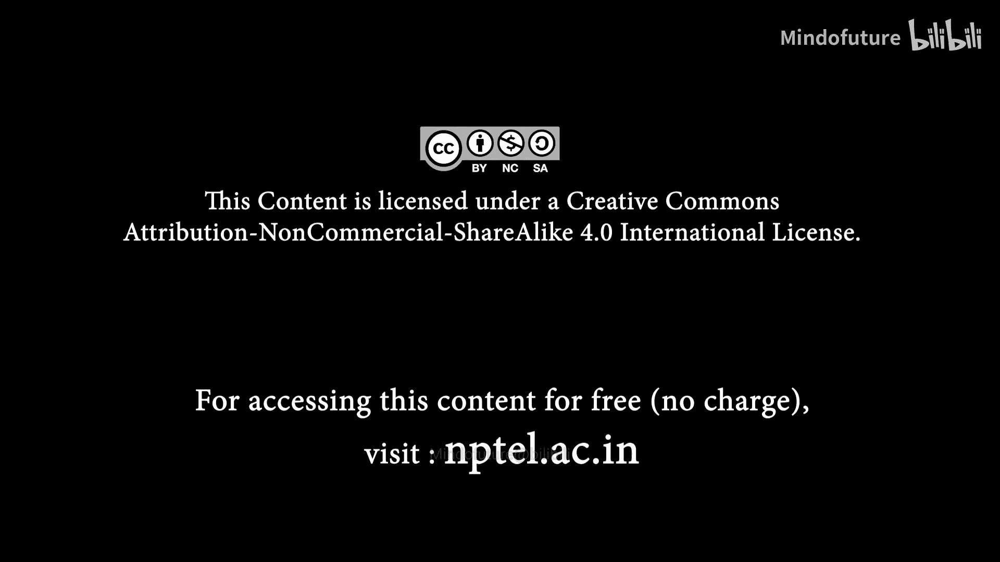
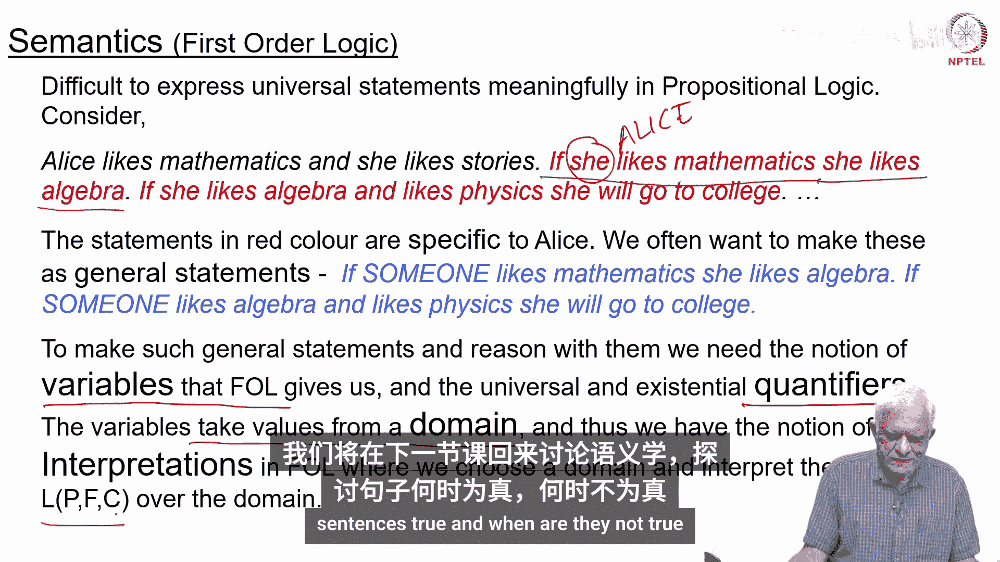

# 【印度理工学院】知识表示与推理 ｜ Knowledge Representation And Reasoning p28 P28_一阶逻辑全称实例化 -BV1c4zNBmEyF_p28-

Okay， welcome back。So， we have been looking at first order logic we have。

Just finish defining this syntax。嗯。We started with a vocabulary which included things like variables and relation symbols or predicate symbols。

 function symbols， constant symbols， and then we first defined a family of terms or the set of terms and terms stand for some individuals in the domain。

And then we define atomic formulas。And they were。Two atomic formulas， apart from bottom and top。

One based on equality and one based on predicate symbol。

And then we use logical connectives to create more formulas and then we use quantifiers to create more formulas。

And then we said that of all these well defined formulas that we are creating。

Those formulas in which there are no free variables， those are sentences。Okay， so now let's move on。

Oh。Because of the fact that we have these new quantifiers。For ourlics。Px。And there exists X px。

 we need to introduce two new rules of inference essentially。

So the most common rules of entrance that we use。The first one is called universal instantiation。

We will use the term UI for that。What it says。Is that。If for all X px is true。

What does that mean it means？That for every x that you can think of in the domain。Px must be true。

 which means that if you choose a specific。Individual a， which belongs。

 which comes from the set of constants that you have。Then。P of A must be true。So。

 as you can see this is logical but like we did in the case of professional logic at some data point maybe we can even show and it is not very hard to show that this is a sound rule of inference essentially。

Another rule that we use is generalization。Whi says。u。That if P of a is true。

For sum a where a comes from the set of constants as we know known individual constants are known individuals。

Then we can say that there exists in Xp explicitlyly。Again， it makes sense because。

That when you say that exists in X px， then we are saying that at least one individual says that px is true and we have started off by saying that that p of a is true essentially。

So these are this thing but we need them because we are doing everything formally essentially。So。

 one place as you can guess， where we can use these two rules。Is when we are reasoning with the。

Sentences， So this is the first you。Rule universal in sation。 We said that all men are mortal。

How did we say that we say that for all eggs。If x is a n。Then next is mortal。

Now we can take an instancecense of this sentence and we can say if Socrates is a man。Then。

 sub is mortal。Remember that this implication can be read as if then。So， if。And then。Of course。

 in the language that we just discussed list notation by Chanac and MacDon they don not choose the term then。

 but it is kind of implicit but in many programming languages of course you use then。

And the other instance would be that if this is true for Socrates then it must be true for some individual and we can write that there exists a man。

X implies multiple X now， notice。And I will leave this as a small thing for you to ponder over what is this sentence saying essentially？

It is not saying some mineral model because we kind of hinted that we have to use the and sign here。

 but nevertheless this is just the illustration of the rule of generalization。

 it says that if this holds then this other thing will also hold。We also need rules of substitutions。

Because we often want to replace one formula with another formula。And the deal laws are。

Some of the most we immigrant laws in professionalal logical， So if you remember。

This thing where we said。That。For example。Not。Helpha。And be。Is equivalent2。Not alpha。Or not bitter。

If you remember this law， this was from the proportional logic。

What do we do in Dorgans law we push this knot somewhere inside so when you push this knot inside the bracket then it distributes over the constituents but it flips the sign of the connective essentially。

A similar thing is happening here when you push this knot across the quantifier。

It goes to the other side of the quantifier。But it changes the nature of the quantifier。

You started it for all legs。And then you ended up with。There exists X， and the knot has moved inside。

So， a little bit of a preview about the semantics of these connectives。

We said for all X means for every x。So。If they were only， let us say two people。

 lets say Socrates and Aristottle essentially。And we will say for all eggs mal manics。

 supposing we were to say that。There are two people only two people in the domain。

 so when you say for all eggs mans it means。That every x in the domain is a man。

Which could very well have been written as。Man Socrates and man Aristotle。

 which would be of this kind， essentially alpha or beta。And we were to negate that。

Then you will push it inside。Then， we will get。The negation of so what is the negation of everybody is a man？

The negation of that is。There exists an X who is not a man essentially。

 that is a negation of that the opposite of that essentially。

And that is what we are saying in professional logic and something similar we are saying before。

In first order logic。 So when we。To think about first logic is to think of the。For all。

Quantifier as a kind of a universal connective A and B and c and D and e up to for every element of the domain and the existential quantifier is like a disju essentially a or B or C or d at least one of them must be true for a or B or C or D to be true so it helps you think a little bit if you think of the universal quantifier as。

A generalized andt。And the universe and the existential quantifier。

 either generalized or essentially。And then of course this degan law will become equal become easy to understand the other ones are kind of commutative laws which say that you know you can change the order of the quantifier it doesn not matter you can for either of the two quantifiers。

 but you cannot change。The order of different quantifier So if I and we will see this if you say for all x there exist the y。

This is not。Cannot be。Change to。There exists a y for all x we will see later as we do。

 but that cannot be done for the same quantifier it does not matter in which order you write the quantifiers。

Okay， so when we looked at this Alice example in first sort in proportional logic。

We said things like Alice likes maths and she likes stories then she said we said。

If she likes mathematics she likes algebrabra now this is a statement about Alice。

Its very specific to Els essentially it's like saying if Socrates is man， then Socrates is。Mortal。

But we want to say things like all manner models， so if likewise we want to say that if anyone likes maths。

Or everybody who likes maths likes algebra then we have to use first neuro logic so we want to say something like this。

If someone likes maths， then she likes algebrabra if someone likes algebrabra and likes physics then she will go to college。

To make such general statements。And reason with them。We need the notion of variables。

That first neuro logic gives us。And the notion of quantifier every man。

For every x that you can think of if x is a man， then x is a mortal， every man is mortal。

 all men are mortal。The variables as we have just seen takes take values from a domain and thus we have the notion of interpretations in first order logic where we choose a domain and interpret the language。

LPFC over the domain essentially。Okay， so we want to talk about semantics of first all logic language。

嗯。Let's do that in the next video。So that you have a bit of a time。都。Understand this。 how the。

Rules of inference that we have just defined can we use later。 so we will come back。In the next。

Session。And talk about semantics when are sentences true and when are they not true。

