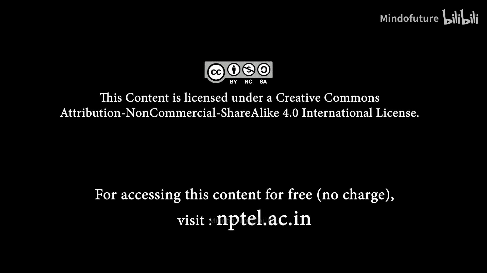
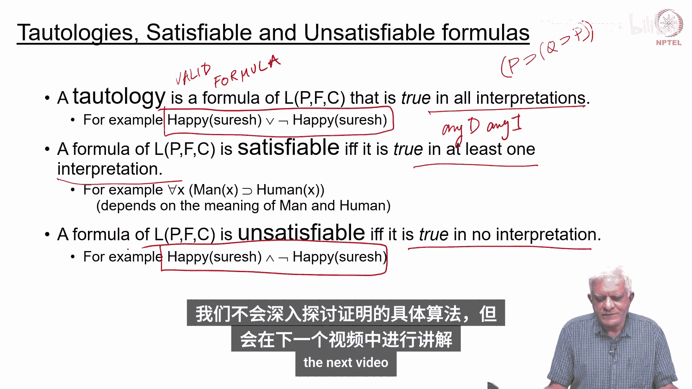

# 【印度理工学院】知识表示与推理 ｜ Knowledge Representation And Reasoning p30 P30_一阶逻辑真值指派 -BV1c4zNBmEyF_p30-

So， welcome back and let us continue our study of first logic we have defined the syntax。

 we have defined the set of sentences。We have defined the semantics。

In turn in the sense of interpretation as to what do sentences mean。

And we said that you give us some set of sentences and what they mean will depend upon what is the domain that you are talking about and we saw this example in the previous session where we said that the same knowledge base could mean different things if you are talking about different domains essentially。

Let's now come to close assignment because we want to be able to。

Decide as to when is the sentence true。Remember that formulas in general may or may not be true because they may have free variables。

 but sentences sentences are formulas without free variables。And therefore。

 they will have to be either true or false， essentially。So。

 how do we do this and let's do this first。Then we will move on to chair improving。

So like in professional logic， we are now trying to define a valuation function。

 Now we are calling it well。Like Shakespeare said。Rose by any other name is just as sweet。

It doesn't matter what the name is essentially。So we are defending the value function。Well。

 we will take the set of formulas。And map them to this two valued set。

 which is two or false for us essentially。So essentially we want to say which formulas are true。

 which formulas are false essentially。How do we define that we start with the simplest sentences。

 the atomic sentences top is always true by definition bottom is going to be always false by definition。

An atomic formula of the kind。T 1 equal to T2。Remember。

 that is an atomic formula even into2 are terms equal to is equality sign enable our logic。

And we are saying， is this formula 2 or not？But to decide that。

We have to say you give me an interpretation mapping。And you give me an assignment function。

And then I will tell you whether the formula is2 or not。And。

The way to decide whether this formula t even equal to 32 is  true or not under the interlation I and the mapping a。

Is if and only if。The two terms under the same mappings。Mapping an assignment。

They are mapped to the same element， so they are the same see by the time we have done this。

This thing， we are transported from。A formula of this t192 are terms we are transported from terms in the language。

Which are just you know， symbol structures。Two elements of the domain， essentially。

So if there is some domain D。We say。That。This maps onto some element。Under this IN A。

Depends on whether it has variables， whether it has constants and whatever the case may be interpretation and functions interpretation will tell us functions and constants assignment will tell us where a maps to where where variables map to whatever it is so we are taking care of both interpretation and assignment and we are saying this term maps to this element。

And this term also maps through this element that is what we mean by equal that they map to the same element if they map to the same element。

Then， our original formula is true。Okay so we have figured out how to。Give。Truth value to this。

One kind of atomic formula。The second atomic formula we had was that if Q was a。

Peddicate name and T1 up to T N will。Terms in first order logic。

The arguments to predicates are always terms we will see perhaps that， you know。Can we kind of。

Be more express than that can we allow something more。

 we will think about that later as well as we are concerned in first logic the arguments to preicates that terms。

And so a formula， an atomic formula of the kind which says a predicate name Q in this case。

 which takes the n terms as argument。We want to find out whether that it is true or not。So。

 you say first you tell us what is the interpretation and what is the assignment and then we will say that yes that formula is true if and only if。

Once we map the terms onto the individual elements in the domain。And we create a couple out of them。

Then we will just check whether the tuple belongs to the image of the。Relation。

 the predicate essentially that image is a relation and the relation is a。😊。

Subt of and decrease decrease if you remember， essentially。So。Essentially。

An atomic formula which uses a pdiiccate symbol is true。

If it corresponds to a tu which is present in the domain， essentially。So here are some examples here。

We say color reallyly equal to white is true。So， before we do that。You must。Figure out。

 we have not yet come at a convention as to how we will distinguish function names from。

Predicate names。One way to do it is to use capitalize names for predicate names。

And lower case names for function names， so that of a syntactic way of doing that。

But even without that， you should realize。That this is an atomic formula which uses equality which means。

The input to this formula which are the two terms t1 and T2。They must be terms essentially。

 which means color lily is a term。Which means color is a function essentially。

 so it is a function which takes anything and maps onto something called a color essentially。

So Lily is pink or lily is white or rose is red or。

Whatever the case may be that it takes something and。

As an input and maps onto a color essentially the color is also we are assuming is an element in the domain essentially。

So， we have a domain， for example， like this。And which is a subset of a larger domain。

In which we have， let's say， white。And black。And red and so on。 So let's say。

A simplistic approach to colors is that。There are colors in the domain and white of course will map to what we have called white in the domain。

By now we have got used to that idea。And lets say color Lily also maps to white essentially。

 which is to this。So if that is the case。Just like we said here。

If they both map to the same element in the domain。Then we say that the formula is true。

 so color lily。Is a color。Wwhichch means in the domain it must be some color white is also a color which means in the domain in in the subset of colors it must be a color and this formula will be true if both of them map to the same color。

Which， of course， as far as we are concerned， is going to be white。But it's a mapping， you know some。

Somebody might you know， if they want to pull your leg。

 they will map white onto blue and then you would be wondering why is this lady blue。

 but that is a different matter。So if they both refer to the same color， then that formula is2。

So in a similar fashion， the president of USA。And the commander。Of the US Army。

 the commander in chief， maybe of the US Army。Is true。

If again they refer to the same person essentially， of course in this case。

 the person is not even identified。It。At any given point it is identified。So currently， for example。

 the president of USA is Biden， so this president USA will map to Biden and Commander USA Army also will map to Biden in which case this sentence is true。

If less than is a predicate。Then less than 5，7 is true。If。

This tuple that we make out of  five and 7 belongs to the less than relation so we are assuming。

That this lesson relation is a long table in which there are two columns。

And the first column number should be smaller than the second column number essentially so5 and 17 must be there in some row if you think of it as a relational database then。

As long as this tuple belongs to that relation。Then， we say。That， that。Sentence。

 it is an atomic sentence it is a sentence because it has no free variables we do not need quantifiers to make sentences。

We need quantifiers only if we have variables。So， this sentence less than 517 is true。

 provided this pair of 5 and 17。Is let's just say in our understanding of what it means to say that something is less than that。

 that understanding could have been an explicit table。

 essentially of everything that is less than everything else。 Of course。

 we don't do construction tables。 That's why math is more interesting。 but thats a。

Princiipple behind it。In a similar fashion， if I say。The sentence brothers Su Ramish is true。So。

 here， I have skipped out。The mapping part。 remember that So under the interpretation and and of course So is a constant。

 So only under a。I should have written that a here essentially but anyway so I hope that doesnt cause any confusion likewise this brother is under the mapping eye that is what we said here right。

That the relation name or the predicate name in the mapping eye gives you relation in the domain。

 so we are assuming that the same names carry forward so that doesn not cause any confusion。So。

For formulas with connectives， logical connectives it is the same thing that we did in first proportion logic so it is exactly the same。

So，If a formula is true， then navigation addition of that formula is false and so on and so forth。

 one more example we can see that。If alpha is true and beta is false。N。Alpha implies beta is falses。

In any other case， it is true essentially。Short way of describing the truth table for alpha for for employees。

 essentially。So we can define the truth assignment。Essentially using the fruit table， essentially。

Now we come to quantified formulas。So a formula of the form there exists alpha。There exists x alpha。

 such that alpha is 2。If there is some value of x for which the formula alpha becomes true essentially。

In a similar fashion。A universally quantified formula for all like alpha， which says for all。X。

This formula alpha must be2。I is true if it is true for any x that you choose essentially that is a meaning of lot all men are mortal means you give me any man。

And that man will turn out to be mortal。Formerly。We can define it as follows。嗯。

So remember this x is a variable essentially， of course it is a quantified variable。But what。

Variables are。Subject to assignments， essentially。So， we say。That an assignment B。

 what is an assignment assignment gives values to variables。

We say it is an x variant of an assignment a。If these two assignments， which are functions from。

Vables two elements in the domain。We say it's an exp variant。😊。

If they map all variables to identical elements except for this variable call x。

 so that is why we say it is an x variant。So if they agree on all variables， accept x。So。

 we use this notation。And then we say。Get a formula， like。There exist。X， alpha。

I true whenever formula is true we have to say okay。

 we are specifying the mapping and we are specifying the assignment。It's true， essentially。

We say that such a formula is true。If。There is another mapping B。Which is an expval of a。

And it's true for that mapping， essentially。In other words。

 the formula alpha is true for some value of x essentially。So if I say。There exists x。Yiwen。X。

And if I am talking about natural numbers。Then it is true because I can produce a natural number see six and say that。

6ix is even， so therefore it is true that this formula is true。In a similar fashion。

A universally quantified formula is true。If see in existential formulas we set for some assignment。

And universal formulas we see for all assignments that any experience you take。

This formula must be true y x variant because x is a quantifying variable x is being quantified for all x or there exists x so you take any exp variant。

off。Whatever assignment that we are talking about a take any b so you can change x to whatever you want and the formula must be through and that is intuitive meaning of for all x that you take any value of x and the formula will be through。

So finally through a set of sentences。So remember that a set of sentences。

 a sentence in FL is a formula without any free variables。

This means that all variables in the formula quantifier it essentially。

As a consequence of this and you should think about this a little bit。😊。

There the sentences are true or false independent of the assignment mapping essentially so when we said。

That there exists x。嗯。Yiwen。Eggs。We said this formula is true for natural numbers。

 this formula is true if the domain is natural numbers it does not depend on the assignment essentially it is independent of the assignment mapping you don not。

Have to you know， give me some specific list thing。This formula is true。

Why is it true because by definition it says。That there exists some exp。

 which means this exists some value of x。This exists some assignment in which this formula will be true。

And that is where this formula is to and we don't need the assignment function。

That' is why we need work with sentences in first or logic， we don't work with sentences like。😊。

Yiwen。Hggs。That is a formula， but it is not a sentence because it is got a free variables。

 we cannot determine the full value of such a statement， such a formula。Okay。

 so we have said that the meaning of terms。And sentences。Offi。Ffo。Is given by the interpretation。

Wwhichch means you choose a domain and you choose a mapping as to what do the predicates mean。

 what do the functions mean， what do the constants mean or refer to？We say。That an interpretation。M。

So you have chosen some D， you have chosen some I。Of a set of sentences。

Sometimes people use the term theory for a set of sentences。

 so this kind of thing language and physics people talk essentially so we have this theory of gravity。

And then。Whi is basically a set of equations and sentences， and then they say， okay。

 is there a model for this theory or something， so can we verify experimentally whether。

The theory has a model or not in exactly the same sense， we say that a set of sentences。

 which you will call as a theory。In the language that we are chosen。An interpretation M is a model。

If all the sentences in this set are true in that interpretation。So。

 at a surface level when you read this it is similar to what we said in proportional logic we said that an interpretation。

😊，In which case that was an assignment is a model if all the sentences in our knowledge has become true essentially we are saying something similar here。

Is that an interpretation is a model if all the sentences in knowledge base become true。

Except that here we are talking about。All this mapping between the language and the preddiiccate symbols and function symbols and so on so we are choosing a domain and we are choosing an mapping and that is an interpretation so whatever domain and mapping that we choose。

If that makes the set of sentences through， then we say it's a model。

And these terms that we had seen earlier tortologies。Satisfiable and unsatisfiable formulas。Also。

 have definitions here。ATology is a formula。Of the language that is true in all interpretations。

Which means。See， in proportion I'm kind of repeating this a little bit in proportion logic。

 when you said all interpretations it means all valuations essentially So we said that you give me a formula like P。

Employees。Q implies P。And we said it is a totalology。

Because you give me any value of P and any value of Q and this formula will evaluate your true essentially。

What you are saying in first logic is you give us any model any any interpretation you give us any domain and you give us any。

Mapping and this formula will be true。So it is true in all interpretations。Which means any。D。Any are。

You choose this thing and this formula will be true。And， of course。

 there are simple formulas like this。I'm sure。When we read it。

 we read it as saying that So is happy or So is not happy。So， we have an image of people essentially。

 but it doesnt matter whether whether the domain is talking about people。

 whether the domain is talking about numbers， whether the domain is talking about plants。

It doesn't matter what is the meaning of happy essentially。It。You choose a domain。

 you choose any interpretation。And this sentence。In our language。

Will be true irrespective of what interpretation you choose what domain and many which interpretation you choose。

Always true sentence which is always true。 Sometimes we always we also call this that it is a valid formula。

So， a formula。Is satisifiable。If it is true in at least one interpretation。For example。

 all men are human recently。If my meaning of man。Was lets say our standard meaning of man which is human or let's say a person。

And if my meaning of human。Was。Let's say。Inanimate。Or dead。Or something like that。

Then to say that all persons are dead would not be a true statement， right？So。

 in that interpretation it would not be true but what we are saying here is that you can choose some domain and some interpretation in which this formula will become true and then of course in the domain and interpretation you would have chosen some appropriate meaning for man and for human essentially。

There are no concerns in this。And there are no functions。

But you can choose an interpretation which will make this true which is a。嗯。

Which is true in our world that all of us are humans， essentially。Human is different from human。

Finally， formula is unsatisfiable。Or a contradiction。If it is true in no interpretation。

Anything that you， any interpretation you choose， any meaning of happy you choose。

 any meaning of mapping of Sure you choose to。Individuals。You can never make this formula too。嗯。So。

 what is more important is that。When we create a knowledge base which has sentences。

 which has quantifiers and things like that。And then we say does this knowledge base have a model？

What it means。Is that。You can create。A domain and an interpretation in which that knowledge base will become true and we are interested in that model and then you know everything that we are talking about pertains to that model。

We are less often interested in toologies and unsatisfiable formulas in the first order context essentially。

So。Now， we have got a good idea of。First a logic， we looked at the syntax。

We looked at rules of inference， we looked at semantics， how a meaning is given by an interpretation。

We also looked at truth functional semantics as to how。One decides whether sentences are true or not。

So， like we have been doing let we will move to proofs after this and we will see。

How proofs can be found in first logic we have already seen that we introduced you new rules of inference which are specific to first a logic。

One was a universal ination rule which says that for all XPx。

 then p must be true for some specific individual and generalization which says that p is true for some specific individual it must be true for some exist there exists some Xx and we saw a couple of rules of substitution de law pushing the north inside quantifiers and things like that。

All that machinery is available with us now。And we want to see that if。

Given a knowledge base and given a query， can we now。Prove that that。Sentences to。If it is true。明苦。

We learn logic can we build a complete logic that if it is entailed then we can prove it essentially and we won look at some algorithms to proof essentially。

But we will do that in the next video， so see you then。

