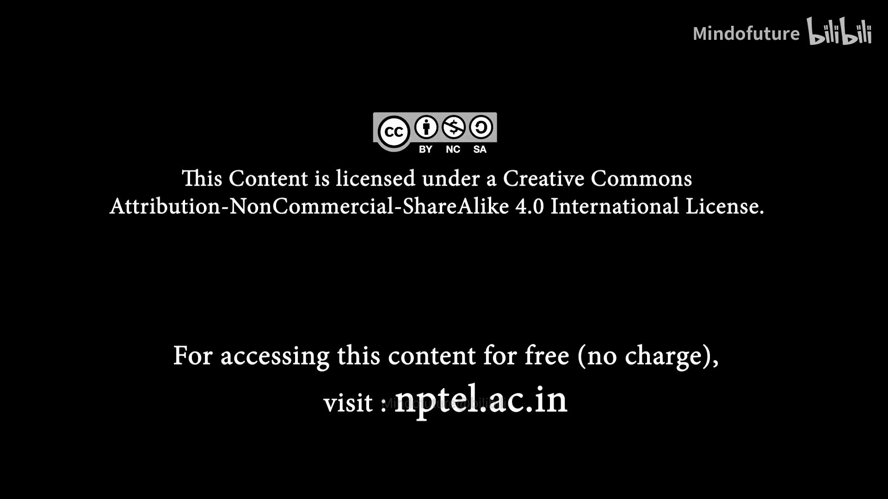
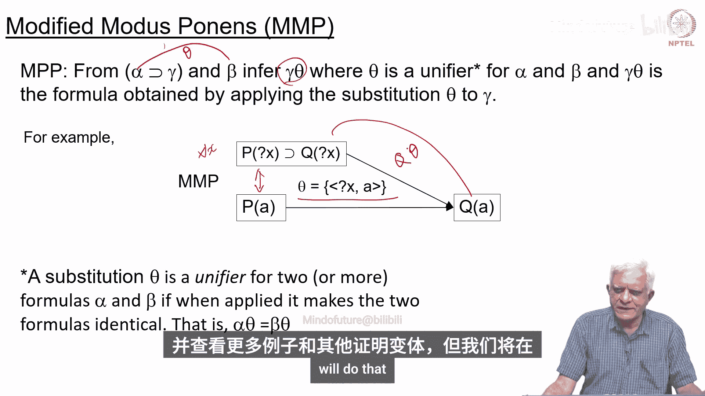

# 【印度理工学院】知识表示与推理 ｜ Knowledge Representation And Reasoning p31 P31_修正的肯定前件 -BV1c4zNBmEyF_p31-

We have looked at first hetero logic， we have looked at the language， the syntax。

We have looked at the semantics， both the meaning which is derived from interpretation。

Based on a domain and a mapping， which is also called the interpretation mapping。

And we also looked at how。Truth functional semantics is defined for。First of all。

Logic which is also based on the domain because when we say that an atomic formula is going to be true。

 if whatever it is saying in the domain that must be true in the domain。So for example， if I say。

And that Suta is the sister of Ambiika。Lin。In the real world that must be the case for this statement to be true and we expect that in the real world that would be stored as a relation so maybe we have a relation in which all sisters are listed and then you can just go and check up there whether that is true or not。

So it comes from the domain。Now， we want to move on to proofs as that is our main objective in studying logic as to how to。

How to derive the formula or how to find a proof for the formula。And also。

 our focus at least at the back of our mind should be that how do we。

Autommate this process essentially， so we are looking for algorithms， which will allow us to do that。

So， let's begin with our。😊，Good old Alice problem。Now we have expressed it in first a logic。

And as you can see， instead of saying that if if Alice likes maths， then she likes algebrabra。

 we are saying if someone likes maths。Then she likes algebra essentially so we are making a general rule。

 It is like simply like the other statement that we started with when we talked about first logic is that all manner model。

The other thing。In in a way， we are saying everyone who likes maths likes physics。

 So it likes algebra。And like what if， if if， if。Someone likes algebra and physics。

 then they will go to college。So we are accepting that as a premise。 Okay。

 so this need not be the only true statement。 So it should not be seen as a reflection of。

The world outside because even people who study political science and economics。

 they also go to college and very often they do much better work than some of us who study science。

But it is just to illustrate this whole idea of logic， essentially。

So when we express that in first order logic。We use this universal quantifier for all x and we say。

And we are using predicates so that we have discussed that instead of using atomic sentences。

We are using predicates and sentences are constructed out of predicates， essentially so。

Likes X math is an atomic formula。It is not a sentence because its got a variable in it。And。Likes X。

 algebra is also an atomic formula。And when we put this logical connective implication between them。

 we get a formula which is likes x math implies likes x algebra。

Once we put a universal quantifier outside it， then it becomes the sentence because now we are saying。

For everyone in the domain， if x likes maths， then x likes algebrabra is。

So we can determine whether it' is true or not。 Okay。

 so it may be possible that there are some people who like maths and。Who don't like algebra。

Then of course the statement would be false but we don not question that we say this is a premise that has been given to you and we are just figuring out how to express it in first order logic。

So， likewise， the line number3， it says that for our legs。

If x likes algebra and x likes physics then goes to college X essentially remember。That。

We introduced two new rules of inference in this。 the one that we are more concerned with is called universal iniation。

 That is what we will use now。Okay， sometimes I mess up with smellings。What does the rule say？

The rule says。That if you have some universal formula for all eggs。And。

So I am just writing it in a slightly different form now。嗯。You have this formula alpha。

This is the scope of the universal quantifier the brackets。And this squared brackets。V。

Signify that there is x somewhere in the formula alpha， essentially。

We are saying that we can replace that by alpha。And wherever there was x v replaced by a。So。

 the simpler way that we had expressed this earlier was we had said for all eggs。😊，Let's say Px。N p。

Yeah。Where pay is from the that we are talking about Pa is a predicate that we are talking about。

This this version is more general we are simplying alpha is a formula it could need not be an atomic predicate it could be。

A complex compound sentence essentially So we want to use that。

 this is our knowledge base that we just saw and we can generate the proof in a manner similar to inproal logic。

 So， for example， from statement1。We use simplification and get that Alice like maths。

 Then we get Alice like stories， then we。Get the formula that if Alice likes math。

 then Alice likes algebra。And this is where we have used the rule of universal ination and the universally quantified formula from that we have inferred a proposition or a sentence which is without variabless which is about Alice in particular。

Now we can infer that Alice likes algebraibbra because we know that she likes maths。

And we can also infer that she likes physics。Because。The sentence number four is a knowledge basis。

That she likes stories。All she likes physics。Exactly。

That she doesn that either she doesn't like studies or she likes physics。

But we had said earlier that she likes stories， so we had derived that。

And then from that one and this number four， because we know she likes stories and it must be true that she likes physics and that's the rule of disjunctive syllogism。

 We infer that she likes physics。 Now we can say using conjunction that she likes algebra and she likes physics and we can again now get an instance of the rule about people who like algebra and physics they will go to college。

And say that because at least likes algebrabra in physics。

 she will go to college and from 11 and 12 me。Get the influence that we are interested in。

 essentially。So， there is an extra step of universal in which was brought in。

That was to generate the formula for which from which we could do motorponons。 Now， of course。

 this highlights the fact that motorponence works when there is an exact match， essentially。

 So when we say that。When you say that。This is a antecedent likes Alice maths。

 then she likes physics。Then， it must match exactly。The same pattern。 So it's like string matching。嗯。

It must match perfectly essentially that is why we could not take this and match it directly with this。

Because there it has an x inside and here it says Alice inside So the logical way to do this is to first use the use of universal iniation。

Generate a a specific rule。Or implication and then use that for mod components。So， this is a。

Forward chain algorithm that we are talking about when you say forward chain。

 we mean we are going from。The given facts or data towards the goal essentially so you see okay the all this that has been given to me is true then what else is true essentially。

And we saw that that that foring using these。Universal rules is a two step process。 First。

 we have to guess a rule which is applicable in the current domain。 So given the rule that。

Px for all x px implies  Qx。We infer the rule that Pa implies Q A。 Now， that's a question。

 You should think about that。 if you are implementing it as it is， how would you。

Make this guess as to what should you iniate x with essentially but that is a problem that。

We often do when we kind of look ahead and say， okay， we are not talking of some arbitrary a。

 we are talking about some specific a。So， for example。

 we are talking about Alices in the problem that we saw just now or we are talking about Socrates when we talk about mortality。

 So we know， of course， but as an algorithm， how do you guess that's a question that you should ponder the word。

 Of course， what you could do is you could try out different a。

 try out different instances and see if you can derive the。Gal that youre interested in。

 but that could be a cumbersome problem。 And as we will see， first sort logic is。

Can be quite expensive at times。So once we have got the instance of the rule。That is PA implies QA。

 then we can apply models components because now the matching is perfect we say PA here。

 PA here and we can infer QA essentially。What we will do now。

Is to look at something called the implicit quantifier notation that collapses the two step inference process into one step essentially what do we mean by implicit quantifier is that we will not explicitly write the quantifier so the quantifier is this year So thats thats what is been given to us for all X px implies qx but if you want to write programs to process all this stuff then you have to represent that and you know make sense of that and we have already seen that instead of using this mathematical notation sometimes using a list like notation can be more。

Comfortable。But even there why why do we want to represent these quantifiers and all if we can find a way to not represent them and that is what we will do in the implicit quantifier form where the quantifier would be implicit essentially it would be there it is just that we would not have written it down essentially okay so how do we do that。

What we do is。We take a universally quantified variable。

 every universally quantified variable and prefix it with a question mark。

 So this is just a way of marking out that these are these variables are universally quantified。

 Anything which starts with a question mark is a universally quantified variable。

What about if a variable is not universally quantified it could be existentially quantified we are talking about sentences。

 remember we are not talking about formulas which may have pre variables essentially。So。

 in this sentence it will be either universal every variable would be either universally quantified or existentially quantified and in the simplest case we will replace existentially quantified variables which are not in the scope of any universally quantified variable with a column constant essentially it it is just a special kind of a constant which differs from the constants that we have in our language remember our languages proportional first order logic with。

L， which is， which is made up of sets of。Peddicate symbols， function symbols and constant symbols。

 So this scum constant is not one of those。 It is a new constant。 So we just。

Find a way of inventing new names。And used as as constants。 essentially。

 they are called scum constants because of the。Loition to。Solm， who first gave us this idea。

 essentially。Notice that I use the term mathematicians and logicians。嗯。Interchanibly。So。

 this is a implicit quantifier notation for the same four formulas that we saw when you are talking about this thing。

 so you can see that。In the first instance we have replaced x by question mark x。

 what does this mean that implicitly which is not there there is。For all x sitting outside。

 but we are not going to write it， we are going to simply write what we have written here。

And which is。This formula， and we will keep it in mind that it is universally quantified。

Veryable when I say we will keep it in mind。 that means our algorithms will keep it in mind and they will process them in an appropriate way。

 essentially。And the second sentence， there was no variable。

 so that doesn't change in the third sentence Also， there was a universally quantified variable。

 so that has been replaced by a question mark X in the fourth sentence。

 there was an existentially quantified variable。 Remember， we said that there exists in x。So that。

Man X and bright X。 And we had said that this is。Correct way of writing that some men are bright using an implication sign would not be correct。

And you should think about that essentially try to negate that that if you if you have a sentence like some men areb。

 what is the negation of that the negation of that is。Nou。All men or no。

The negation of some men are bright is that there is no one who is bright and there is no one who bright is is you can say that everyone is not bright and if you were to say that then it would be for all X man X implies not bright X that would be correct essentially。

But。You try to negate this formula that we have here man X and brightx。

And you will see that when you negate it， you get the implication automatically。Okay。

 so those are the this is the implicit quantifier form and。In the list notation that。

Some of you may want to use when you are writing programs。

 it is the same thing essentially this x gets replaced by question mark x and。X。

 when it was existentially quantified it gets replaced by a column constant。

 so the way we have invented name is we use the team S for column。And put some number after that。

 you know， the way people can construct passwords nowadays， something， something  one，2，3。

Just inventedvent a new one， every time。Okay， so。Next， we want to talk of。Process。Call substitution。

And then。A phenomena called unifier， essentially。Out of。Substitution， which is called a unifier。

 So first， let's talk about a substitution。 So a substitution， and we often use these letters， beta。

 gamma， Kelta datata and so on for。sububstitution， it's basically a pair。Of two things。

 one is available。And the other is a value， essentially。

So the substitution says that we are going to substitute。

The variable with whatever we have specified as a second element of the pair。

 which is the value we are calling it。So， a substitution theta is a collection of such pairs essentially or a set of such pairs each denoting the value to be substituted for that particular variable essentially。

So when we apply the substitution， let us say this theta to a formula called alpha alpha。

 then the new formula。Becomes alpha theta， we denote it by saying that this is a formula alpha to which we have applied the substitution theta essentially。

A unifier。For two formulas。A substitution is simply saying that。😊，For variables。

 I am going to substitute with something else。 A unifier is comparing two formulas。And it。

These formulas that let them be alpha and beta。And a unifier for the two formulas。

 alpha and beta is a substitution that makes the two formulas identical。When you say identical。

 it means syntactically identical that you know if you were to look at it treat it as a string。

 then they should look the same。If that is the case， if you can find such a formula。

We we say that alpha unifies。With beta， what will be the impact of that。

 the impact of that will be that alpha theta is equal to。Beta。

 theta that when you apply the substitution to both the formulas， they will become equal essentially。

So a unifier theta if it unify is a set of formulas that is possible。

 it doesn' not have to be two formula。 It can be a set of formulas， Al 1， alpha2 up to alpha n。

If when we apply the substitution to all of them， they all become equal and they become equal like this。

Gamma， I think we can， and we call that as a factor， essentially。So thats the notion of a unifier。

unifier is basically a collection of variable value pairs， which makes two or more formulas equal。So。

 now we have want to do away with this universal ination step。And what we do is， we introduce this。

Rule call modified modponentence essentially。What does this say？It says。That' from Alpha and Gamma。

And from beta。You infer， gama Theta。Now， the problem is that we have written alpha normally what we would do is we would equate alpha and beta and match them if they worked then we could use motor componentss。

But what if they are different we have seen， for example。

 we may have a universally quantified formula which is in the implicit quantifier form。So。

 they are not they are not identical essentially so what do we do we find the theta which will make them。

Identical so that is a unifier for alpha and beta so once we can find such a unifier then of course we can go ahead and make the inference but we have to be careful that we must apply this unifier or the substitution to gamma as well essentially。

So， this rule modified mod spencies that from alpha。And gamma。

That is for alpha implies gamma and beta infer gamma theta where theta is the unifier for alpha and beta。

And gamma Theta is a formula obtained by applying the substitution theta to gamma。

So I hope that's clear。We would write this rule as follows。

 So notice that the first formula here is a universal formula。

 There is an implicit for all x somewhere here， but its not mentioned here。And we。

 it's not part of the code that you' are writing。And the other fact is P of a， essentially。

So how do we unify these two。We find this theta which says replace x with a essentially if you replace x with say a。

 then you can go and make that inference， you can move from the left hand side of the antecedent to the right hand side of the anticce which is what we do in forward chainning。

But you must use the substitution theta so that from Q of x。

 we apply the theta and we get Q of a essentially。So， this is Q。This is already， X theta。Yeah。

 this is。Cute theta， in some sense。So， that is a modified mod componentsence rule。

We will work with this one， and we will look at some more examples， and。

Look at other variations of proofs， but we will do that after a break。

