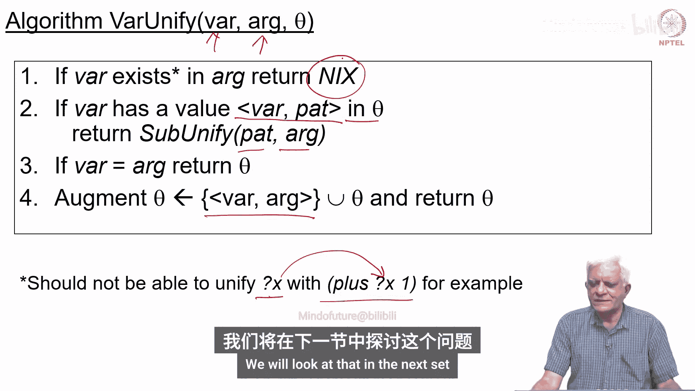

# 【印度理工学院】知识表示与推理 ｜ Knowledge Representation And Reasoning p32 P32_合一算法 -BV1c4zNBmEyF_p32-

Bokeso we are back and we were looking at。This modified motorsponence rule。Which。

Works with first sort of formulas in the implicit quantifier notation。

And is a one step process So earlier we said first year to do universal in then you can do modponence Now we are saying in one step you can do this modified mod sponence which has inside it built a。

Substitution that you are allowed to substitute variables with some values and that of course will also solve the problem of the guesswork that you are talking about as to what should you iniate x to here because we know that you are going to match it with P of a we simply say that okay we want a unifier for p of x and p of a when I say p of x I am not mentioning the question mark but whenever it is an x it is a variable。

And we go forward and infer Q except that in Q also we will have to apply the substitution which is x with a。

So we get Q of E。Let's look at an example of that。嗯。So here is the formula alpha。

which says that tennis is a sport so here is a formula alpha which says that tennis is a sport and Alice likes tennis。

And then we have a rule which says that if。Something which is we are calling y if y is a sport and if x likes y。

 then x watches y from this we want to infer that。Alice， watch is tennis？It seems。Sound enough。

So what we do is we find a unifier。So， alpha unifies with beta。

 so we want to unify the antecedent of the rule with the fact that is given to us。

And the unifier is replace x with Alices， replace y with tennis and that we get the instance of that rule and then we can do the modponence。

In the same steps， this thing and infer。넬다트 있다。Which means you apply theta to this and x is Alices。

So x goes to Alice and y goes to tennis and we have made this inference decision。Much easier to。

Implement rather than do the two step process that we were talking of earlier。

Which also involved a guess。See rules in in the real world。😊，May have。Conjunctions as antecedents。

 it is not that px implies qx， but it could be p1 x and P2x and p3x and P4x。

Implies Qx or there may be other variables also。How do we handle that so supp this is what is given to us that p p of x y and r of y implies q of x。

And then we are given that p of a Z a is a constant。And R of Z， can we infer Q of V。

 that's a question。No。That's a rule。 That's。The rule that is given to us is。

Has a conjunct inside it essentially， but what if the facts that were available to us were。

Individual facts。Okay， let me not。 I tell。These are effects。What is the fact like P is？

Question mark that mean？嗯。So， the fact itself is a universal statement， it says that for all Z。😊。

P is Z， whatever the P does， but for all z that's true and the second one is saying for all Z。

How is it is true， essentially？So， there can be facts like that that every number is smaller than its successor。

 for example， in number 3。But if we had these two separate facts then we would have to first use the rule of conjunction remember remember that this proof is an entirely syntactic process this thing so first we would have to generate the conjunction formula and which is of course。

We have this rule of conjunction which says that if you have two facts you can alpha and beta then you can say alpha and beta is a f if you have a fact alpha and if you have fact beta then you can say alpha and beta is a is a formula this thing。

which you can add to the knowledge base so once you add that then of course you can use our good old rule which had the conjunction and infer Q fee essentially。

But。Perhaps what one could also do is that one could。

Allow this to be itself a rule of inference which says that if you have conjuncs as antecedents and if you have those constituents of the conjunct available independently so this is available independently this is available independently。

The rule should be able to do it in one step again we don' not want to introduce that extra step of having to use the conjunction rule essentially that is a small optimization we can do when we are writing programs essentially。

So， now that we have this modified motor spoonence you can see that we have a shorter proof for our AliceIS problem。

It is as long as it was when we looked at propositional logic。

 we don't have the universal in stepped anymore instead what we have is the use of modified motor componentss which has a built in matching unification process involved essentially。

So this algorithm。OfFind the unifier is called unification。We look at that。Yeah。

Before we look at the algorithm， let us look at a few facts about formulas which which have variables in them universally quantified variables。

We say that a sentence alpha。Is more general than a sentence beta。

If there exists a non empty substitution lambda such that alpha lambda is equal to beta non empty substitution。

 that is an important word。You cannot like we do in satary and and other regions of maths。

 you could say strictly more general than or you know more general than includes equality。

But let us not get into that so we will assume that when we say more general then we assume that it is strictly more general than essentially so it is just like saying a set a is a subset of itself。

 we don't want to say that essentially so when we want when you say it is more general we mean it is more general which means that there is a non empty substitution lambda。

So here is some examples。Everyone loves a good teacher is more general than everyone's dad loves a good teacher。

And it is also more general than Sus loves a good teacher。So。

 the first one everyone loves a good teacher as you can see simply says that if x is a good for all x。

 if x is a good teacher， then for all by y loves x essentially everyone loves a good teacher。😊。

The second one is。That for all X is a good teacher。😊，Then。Dad of boy now。Remember， we had said。That。

The arguments to preddicate in post order logic can only be terms。

 which means that of is a term it is not。A predicate。

It is a function essentially so obviously everybody has a unique that so we can define a function like that and now we are saying。

That this one is。呃。Also， this is also a valid rule if everyone loves a good teacher shirt that means。

😊，Everyone's dad also loves a good teacher because everyone's dad is part of everyone anyway essentially。

But in the last example is clearly more general because in the last example we are saying Sureh loves a good teacher in the first sentence we are saying everyone loves a good teacher so that is obviously more general essentially。

We can now talk about a generalized universal instantiation which so earlier we said that you can substitute an x with a constant a essentially。

So now we are saying that you don't need to do that。 you can even you replace it with a function。

 so you can go from y to something which is。Which uses a function inside it， essentially， of where。

Because why says every。Y in the domain and this one is also pointing to something in the domain or the other。

 so it must also be true essentially。So we know this notion of general more general than now。

 So now let's look at some inferences that you can make in。Forward training。So。

 we have two facts here everything we can talk of everything as a fact。

 some people distinguish between facts and rules a rule is something which has an if and component。

 so the first fact here is a rule， the second one is a fact we will use the term interchangeably they are all sentences in your knowledge base some of them are facts some of them are。

Have this conditional implication， essentially。So， the first fact says or the first rule says。😊，That。

If y is greater than equal to z。Then z is smaller than equal to y so that is just finding a relation between greater than smaller than that there。

Opppoite of each other， essentially。That's one fact， one rule essentially the second。Fact says that。

X is greater than that everything is greater than equal to。😊，Zero essentially for all legs。

X must be greater than0 or x must be equal to 0 and which is the relation greater than or equal to that we have defined here what can we infer from these two facts we have said that。

If y is greater than z， then z is smaller than y greater than equal to。😊。

And then we are saying that x is greater than it。0ero all the time。So， one thing that we can infer。

 as you can see is the following。We can say。That is x。Is 7。It's a valid substitution。

We can also say y equal to 7。And then we can say z equal to 0。

And then you can see there are the antecedent。Of the rule will become identical with。No。

Second fact that has been given twice us。So， the they will respectively we transform them into if 7 is greater than 0 then 0 is less than 7 and the second one will say7 is greater than 0。

And therefore， of course we can make an inference。That0 is smaller than or less than 7 essentially。

 but we can use another substitution this is a smaller substitution。It is says。That。

Replacease y with x。That's allowed。Okay。The value can also be available。Thereの。

Restriction on that so the second one is saying replace y with x and replace z with 0。

And what do you get？You get that 0 is smaller than equal to anything。

It is also a valid influence it is got from the same rules this kind of a unifier is called the most general unifier。

And one way of looking at it is that。The conclusion that it produces is more general than。

The conclusion that it produces from a more specific unifier。Most general unifiers are useful。嗯。

Because the inference that we make is the most general conclusion that you can draw。

And from there you can simply use the rule of universal inensation to。😊。

Deiveve the actual thing that you might be interested in so if you are interested in talking about0 and 7 you can say for that what is the relation between0 and everything else and then say okay that also applies for 7 because7 is。

😊，One of the numbers in the domain essentially， so lets quickly look at the unification algorithm。😊。

So， what does the unification algorithm do it takes two or more formulas as input and returns the most general unifier for the formulas when you say returns it computes essentially。

Let us say we are working with a list notation， then there are three kinds of elements in our formulas。

嗯。They can be less。Or they can be constants， or they can be variables。So， basically predicates。😊。

Will go as list。Functions will go as list。Formulas with logical connectors will go as list only the most atomic units。

Terms， the most simplest of terms will be constants of variables essentially。So， we should。

Basically build up power substitution by looking at the structure of the two formulas that we are trying to match。

Now， you can observe。The two constants can only unify or match if they are identical， you can say。

That 77 unifies with 8 you know because both of them are constants the only way they can unify by saying that7 unifyifies with 7 so if one formula has 7 and another the other formula has 7 then you can go ahead and unify that decision。

Two lists tool lists are unified element by element so you。

 first of all the must be of the same length then you compare the first element second element third element and if all of them unified then you can say that we have unified the two list。

So， we scan the tool list。Simultaneously。And。Build up the substitution。Now。

 a variable can match any other variable or it can match any constant。Or it can match any list Okay。

 so what list is a general。😊，um。Structure that we are talking about here。It can matter so a variable。

😊，Can match another variable， a constant or a list。

 but we will see that there is a restriction that the list must not contain the variable essentially。

One thing you have to be careful about。Universal formulas， universally quantified formulas。

Is that because you are writing this program to do this， you must be careful。😊。

To use different variable names in different sentences。

Even though semantically it is not required it is not necessary semantically because look at these two sentences that we have。

The first one says。If 7 is greater than equal to x。Then x is smaller than equal to 7。

The second one is。😊，Greater than or equal to。Everything is greater than or equal to 0 essentially。

And in both the cases we have used the variable name x now obviously there is nothing wrong in that。

😊，Because essentially what boths are saying for our legs here。Well all eggs here。

They are simply saying that for every x you can think of it true the second one is also saying that for every x you can think of it true。

 but when when we get around to this process of finding unifier and all we run into a problem here because if you have used。

X in both the formulas then you cannot substitute x both with 0 and 7 so the substitution must have one value for the variable x so should you put0 or should you put 7 neither will help you。

What you need to do is to not use those。Same variable naming two formulas so the solution is rename variables。

So， every time you write a new formula you will use variable name， you can use x1 in the second one。

 x2 in the second3， third one， x4 in and so on， you must just use different variable names essentially and then there is no problem。

Because if you have replaced now x and z has the two different variables now you can see that you can unify z with 7 and unify x with 0 and everything is fine essentially。

So， when。One rule cardinal rule that you must do if you are writing programs to do forward chainning or in fact any other form of reason is that you must standardize variables apart essentially every formula must use a different variable name。

Because even though the formula is universal， the two formulas are independent of each other。Okay。

 so the algorithm unify。It returns to MJU MGU user。Most general unifier。

And it takes two the algorithm unify takes two arguments。

 Argon and and r2 and it returns to MG so we are writing algorithms in the functional style where it is a function which will return something to you。

What it does is to call another function which is called sub unify。By adding a third argument。

 now this is the standard factors you must have seen in many places。

And the idea of the third argument is to build a substitution theta。

Peace by piece as you are scanning the two formulas or maybe even going looking at the nested formulas because no list can have nested lists and so on。

 as you are doing this whole traveral you are constructing the substition piece by piece we need some place to hold that substition and that is what the。

Third argument is mentioned to2。And of course， we initialize it at the m list because initially we don't have anything。

So， our initial call。😊，To subunify would be the same two arguments that we unify has。

 but we have added an empty list to that as a third argument and that empty list is where we will hold the substitution。

Remember that the substitution is the collection of。

variableariable value pairs and as in when we find a value for some variable we will add it to that list。

So subunify in some sense， is a main thing。What does it do。If Rgon and R2 are both constants。

 then they must be equal。Otherwise you return some failure message we have used thisn。

 I think thisn was used by Chania and magdomoma， so I am also using that。If a1 is a variable。

 then you can call another algorithm called where unify。😊。

The the thing about where unified is that the first argument to。Where unify。Will be a variable。

And the second argument can be anything of course。So， if Rgon is available， as we have said here。

 call bio unify。In a similar fashion if a 2 is variable again called where unified but this time a 2 has come as the first argument to where unified so the first argument to where unify is variable。

😊，If we have reached this point that that neither are the constants nor are both of them variables。

Then they must be list essentially and then we first check whether the length of the tool lists are the same。

If they are the same， then for each corresponding element of the two lists now remember a going and a2 a list by this point。

We call subunify recursively building up the substitution theta as you go along。

So the last piece is algorithm very unified。The first argument is a variable。

 the second argument can be anything and theta is what we are building up as we go along。So that。

First check that we must do is。That if variable exists。In。

R variable is the first argument r is the second argument if variable is inside that a this thing then you cannot not unify that。

😊，If variable has a value already in theta， so what is the value some variable called pattern and this is in theta。

Then we subunify those two things， the art that we are trying to unify and the pattern that it is already unified with then we must be able to make them the same。

If variable is already equal to a， then you don't do anything。Finally。

We augment theta by adding this。Pair variable ag what is variable a variable is the a are the two inputs we gave to this program。

😊，And then we add it to Teta， so we take our union if you are thinking of theta as a set。Now。

 the first point， if variable exists in argument then return next and here is an example which says why you should do that supposing you are trying to unify x with。

Plus x1， so plus is let us say its a function。Wwhich stands for addition then you cannot unify this x with this with this pattern essentially because if you if you say substitute x with plus x1 then there is that x inside what do you do with that do you keep substituting infinitely we don't want to get into that sort of a thing it doesnt make sense also so we will simply say that if x if x exist inside。

The pattern then return next say that we can't unify this。Okay， so here， so that was the basic。😊。

unification algorithm that we have studied it is a general algorithm it doesn't necessarily apply only to first orderlog for any kind of patterns in which we can distinguish between functionss and by functionss some people refer to everything like function symbols predicate symbols logical connectives everything all these can be thought of as funs so as long as you can distinguish between functionss functionss are things which put to more than one thing together essentially so as long as you can distinguish between functionss for us the functionss are less here because you know everything is in a least notation so as long as you can distinguish between functionss and variables and constants this algorithm will work for unification essentially it is not specific to first order logic。

Okay。So， what we have done here。We set variables constants。

And but there were some other kinds of constants involved here。

 which was scum constants that we talked about。And scm constants are used in the implicit quantified notation。

Only when the existential quantifier is not in the scope of some universal quantifier。

 what if it is we will look at that in the next set。

