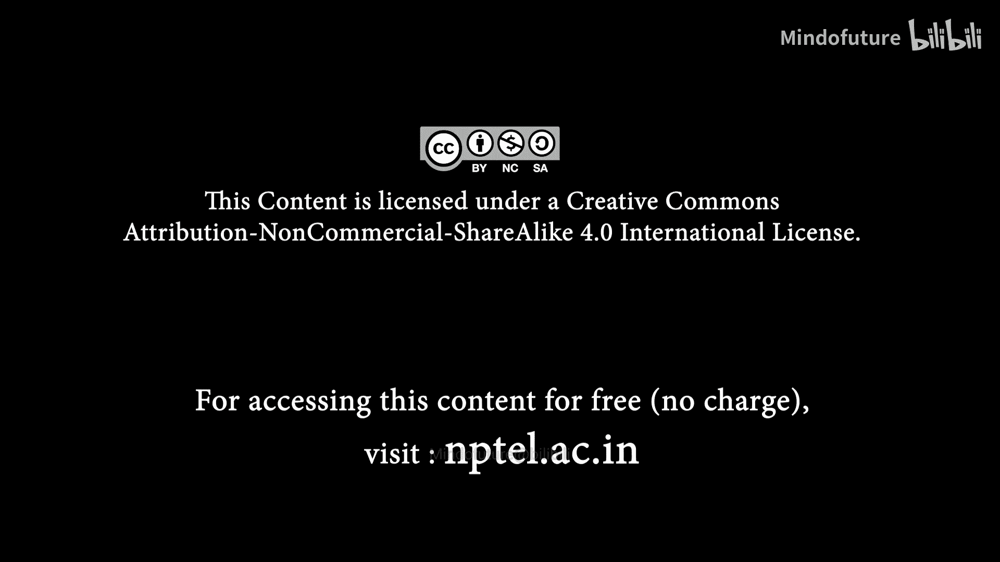
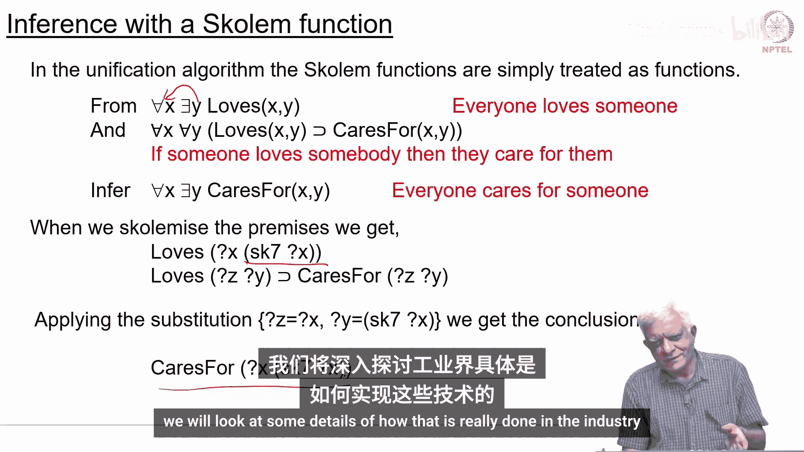

# 【印度理工学院】知识表示与推理 ｜ Knowledge Representation And Reasoning p33 P33_斯科伦化 -BV1c4zNBmEyF_p33-

So， welcome back in the last session， we looked at the unification algorithm。😊。

Which is used while making inferences。In。Implicit quantifier。Form or implicit quantified notation。

We saw it in the context of forward training， but as we will see as we go along。

In any other form also， we will use implicit quantifier form。So we will not any any hence。

 we will not use the quantifier symbols。Leting。So， what we had said was that for universal quantified variables。

 you replace you prefix a question mark in front of the variable name。

To mark that it is universally quantified， which means implicitly there is a universal quantifier sitting at the very left of the formula。

😊，But it says that if not， we are not written it down。

What about existentially quantified variables so we did mention some case here。

 but let us talk about that。When the existential quantifier is not in the scope of any universal quantifier。

Then the variable quantifier is replaced by a scum constant。

Remember we said that columnm was a logician or mathematician who came up with this idea first。So。

 look at this。Examples。This is。Some students are bright or some student is bright essentially。

 which we are writing as exists that。Students Z and write their decision。

So I will return them in both the the the forms that we have looked at the。

Expressions in red are in mathematical notation， the expressions in black are in least notation。

 but they are talking about the same thing essentially。😊，The second one is there exists a goal。So。

 that。For all boys。The boy likes the girl essentially。 Okay， some very popular girl。

You could have said it like this。So， these will be colonized because because the existential quantifier is not in the scope of any universal quantifier。

😊，We will just replace them by sc constants。So in the first example， we will simply say。Yeah。

Instead of Z， we will simply write S1 there essentially。In both the positions in the second example。

 we will replace。That why that girl y for all exists why we will replace y with Sk2。

Notice we have chosen a second。Constant name Sk1 and Sk2。Vas x， which was。Universally quantified。

It remains universally quantified in our formula and we use that notation that we have implicit quantified notation of putting a question mark below that。

Now， what when it is within the scope of a universal quantifier？So。

 when the existential quantifier is in the scope of one or more universal quantifiers。

Then the existentially quantified variable。Becomes the scum function of the corresponding universally quantified variables。

So this example should make that clear。So。Here is the first example。It is。So。

 let us read that logical thing which is in the red， which is kind of a little bit easier to read。😊。

Even though the first one is easier to process if you are writing programs。So。

 the sentence is saying therefore all x for all y， there exists as z。S that。X is less than 0。

And why is less than it？So we are obviously talking about numbers or something here。

 So we are saying that you know。You take you give me any to x and y and I will give you a number which is greater than both of the MSSD。

So， here the。Variable Z is in the scope。Of the two variables， why。You can see。

That for all x for all y in the top line that is the scope the whole sentence is the scope for that。

Because the notation in this form was you write the variable name。And then in brackets。

 you write whatever is inside the scope of that。Also。

 you would notice here that we have kind of club X and Y together instead of saying。

Like this for all X for y， we have set for all X Yd。Both are allowed。

You could have also written for all x y。Okay， so there's another。Example here。This is for all eggs。

If x is a boy， then。There exists of。Y， where y is a girl and x likes y。

So you can see that this also is a kind of little bit of。😊。

Illustration of how to write first so logic sentences。u。The first sentence is。That， there is。A girl。

Okay， we saw that in the previous example。 there's a girl who。哦。Hu。

We saw this here that there is a girl who every boy likes essentially。😊。

And then now we are seeing something different。Now we are saying every boy likes some girl。Now。

 in the English language know this could be confusing。 you could simply say every likes some girl。

Or everyone likes some girl or something either。What is the real meaning of that essentially so when we write this in logic you can see that the meaning is clear。

😊，In one case， there is a girl who everyone likes。That could have been also said as everyone likes some girl。

In the second case。😊，For every boy， well for in this case， there are boys for every boy。😊。

There is a girl who the boy likes。We could have said that also in English as every boy likes a girl。

 essentially。😊，So， is that a girl specific to the boy or is it for everyone is not clear in English language。

 English language is that way ambiguous， but logic makes it very clear essentially。😊，So anyway。

 in this example on this page the。The two。Sentences both have。u。Existentially。

Qulled to quantified variable in the scope of universally quantified variable。In this case。

Y is in the scope of x and in this case。Z is in the scope of both x and y。So。

 the scum functions must be constructed appropriately。

And they will be that in the first case when z is the scope of both x and y。嗯。

It becomes a column function， so we we use similar names for functions also because the context makes it clear so this function is called SK 57。

And it is a function of both x and y essentially in some sense we are saying the value of z depends upon the value of x and y in that sense。

 it is a function。 It not a function in the sense that2 plus4。

Will always be6 so here it is see here the function is some kind of a dependency that that the value of that。

That will make this sentence true， depends upon the value of x and y。

So that's why its a function of both essentially， and in the second example， we have Sk 16。

 which is a function of x essentially。Because that girl is specific to that boy， essentially。Now。

 remember the rules of substitution we had talked about earlier just a very quick recap。

 we had the de mors laws which said that。You can push the。Not inside。

We can push it across the quantifier。But it will change the nature of the quantifier。

So when you move the knot inside。The universal quantifier becomes existential and the existential quantifier becomes universal。

 essentially， and I have suggested to you that if you think of the universal quantifier as a very long and it's true for the first element in the domain Second element third element but think of it as a proposition formula。

Then the de law， you can see that it's doing the same thing here as well。

And we had said that you can always exchange the order in which you write same quantifiers。

Essentially。嗯。And we have seen with this boy girl example that changing the order。

Changes the meaning if the quantifiers are different。So if I say for all eggs。There exists sub y。

 such that P， X， Y。This is not equal to。That exists away。Sa that for all x。B xy。In the second case。

 the y is。Fixed first and then we are saying that for every x that is true in the first case we are saying for every x there is some obviously the meaning is not the same。

And therefore， you cannot swap。Different kinds of quantifiers in an expression。

 but if they are the same like in the examples given here then you can solve them and it doesn not change anything。

Sometimes it is not so clear as to whether a variable is universally quantified or whether it is existentially quantified so lets look at a few examples to you know help us clear that part。

😊，嗯。So， here I have said that whether a variable is universally quantified or existentially quantified has to be decided very carefully。

 one must keep in mind。😊，That the negation sign influences the nature of the quantifier thats why we。

Did the recap of the demagan laws essentially。That if you push the negation inside。

 it will change the quantifier。So think of this sentence。We want to say。No one is immortal。

Or anymortal man doesn not exist， they are the same thing right。

Which is another way of saying all men are mortal。 So when you say all men。Our model。

 the negation of that is。No man is。The the of that is there exists some man whose。Not mortal。

So when you want to say that。An immortal man does not exist。 So immortal， we will see。

We will treat it as。Not mortal， essentially。That's how it's been written here。

So immortal is same as not mortal essentially。We want to say that an immortal man does not exist。

We are saying。It is not the case that there exists in x。Such that。Xs。Man and。X is not mortal。

What is the nature of x here？Syntactically there seems to be existential quantifier there we there exists inx。

😊，So， on the surface it is bound by an existential quantifier； that is what I have said here。So。

 one might mistakenly scize it as saying that replace it with a columnm constant。

But that only talks about a specific albeit unspecified。

Individual law individuals so this column this sentence with this column constant says。

That is not true。So， essentially this sentence will have the existential quantifier outside essentially。

There exists x such that both these things are not true。

The correct way to columnizer formula is to first push the negation sign inside so once you push this negation sign inside。

Once you push it across。The quantifier。It' will become。universal 권。And then you can see。

That it is a universally quantified variable。You are saying that for every x。It's true。

It is not true that x is a man。And x is not mortal。嗯。So。

 the simple lesson is you must push the negation inside before you decide。😊。

Whether the variable is universal or existential。So。

 look at this sentence if there exists a number that is even and odd。Then the earth is flooded。

Now we have written this as。So， this is an antecedent if there exists number such that x is even an x is0 and then the consequence is earth is where it is not connected with x at all。

We could now use some of our rules of substitution here。By saying that this implication。

 we will replace it by。😊，This thing and by adding a negation of this remember that we said p implies Q。

Is equal in not e or Q That' is what we have done here。Then we push the negation inside。

And that's what we get。And we do a little bit of more of this processing。

And eventually we get the same sentence that。X is a number and x is even and x is odd this implies that the earth is flat but。

Quantifier has become universal。So， what this seems to suggest。Is the following？Is。That。

 because in this。Antecedent。There is an existential quantifier。So， the antident is p here。But。

There is a hidden negation in that already essentially。So， if we push。

If we do if we do this process that we just saw。You can see that this is really。

A universally quantified statement So when we say if there exists a number。

 so if we say if there exists a unicorn。Then something， something， something。We are equal， equally。

Equally saying that for all unique for all xs that are unicorns or for all。

Numbers that are both odd and even。They will imply that。The earth is flat， essentially。

Another example will make it。Finallyally， clear。I hope。So。

 this says that a directive without a sidekick is successful。You know。

 if you have watched detectives， serials。They always have a sidekick essentially。

 you know Sherlock Holmes at Watson。And everybody has somebody on the side。This also shows that。

A quantifier in the antecedent of a implication statement。Has to be treated carefully。So。

 what is this saying a detective who has a sidekick so for all eggs？😊。

If x is a detective and there exists sub y such that y is the side peak of x。Then， x is successful。

So what we are saying now， be careful。This existential quantifier is in the antecedent of the implication sign。

And therefore， theres a。Not hidden there already。So be careful how you think of why is it universal or is it？

Existential on the surface， it looks existential。But。If you now simplify this formula。Again。

 we have done the same thing have we have replaced this thing with this thing and added a negation before that。

Then we have simplified this， we have pushed the negation inside。

Then pull the universal quantifier out that can always be done and we will look at a procedure later when we will do this。

And then we have basically a universally quantified variable so what this is saying。😊，Is that？

For all x for all y， if x is a detective and y is the psychic of y。

Y is the sq of x then x is successful， which is what we said in the first place that for all x if x is are detective and they exist a y。

😊，So that y is the psychic of x？In。Then x is this thing。So。

 the lesson to learn is that whenever there is a quantifier。In the antecedent。It usually means the。嗯。

Other quantifier if you pull it， if you manage to pull it out essentially。So， very quickly。😊，啊。

Supposing we have column constant in our knowledge base because we have existential statements can we use them in proofs。

 so here is an example。The first sentence is。There exists in x such that x is even the second sentence is for all x if x is even then x is not odd and you want to infer that there exists。

Number， which is not odd。We colonize them as follows， the first one says。Some even numbers。

 so instead of using an SK name I just use a name like this。So there is some sc constant。

 which is an even。Number so this column constant is a constant we don't know what it points to all it says is that there is something in the domain which satisfies this property。

That' is because in the existential se we don't know which x you are talking about。

The second one is of course universal it says for every x if x is even then x is not odd。

And we can simply just go ahead and use our standard substitution unifier and infer that。

There is some even number， which is not odd。So， that works。

A constant a scm constant can also be thought of as a function of LT0。But that's besides the point。

Scholar functions are also simply treated as functions essentially。😊，So。

 here is an example the first sentence is。For all x exists a Y such that x loves y everyones loves someone。

The second sentence is。For all x for all y， if x loves y， then x cares for y。

 if someone loves somebody， then they care for them。

From this we want to infer that everybody cares for someone now。Obviously， it follows logically。

 it is entailed。嗯。Because you are first you are saying everybody loves someone and then you are saying that who you love you take care of them so obviously everybody takes care of someone but scization should not get into a way of making this inference and that is what we want to show here。

The first sentence。Has a column function because y is in the scope of this universal quantifier there。

 so it gets transformed into Sk7， which is the sc function of x。The second one is entirely universal。

 and then we use this。Substitution， we can。Come up with a desired conclusion， which is。

That everyone cares for someone essentially。And that someone is not arbitrary。

 it's somebody they love actually。Okay， so in some sense we are done with forward chain we are done with colonization implicit quantifier form when I come back I want to。

Talk a little bit about the application of forward chain in the real world industry world we will start with a small introduction here。

And later in the course， we will look at some details of how that is really done in the industry。

