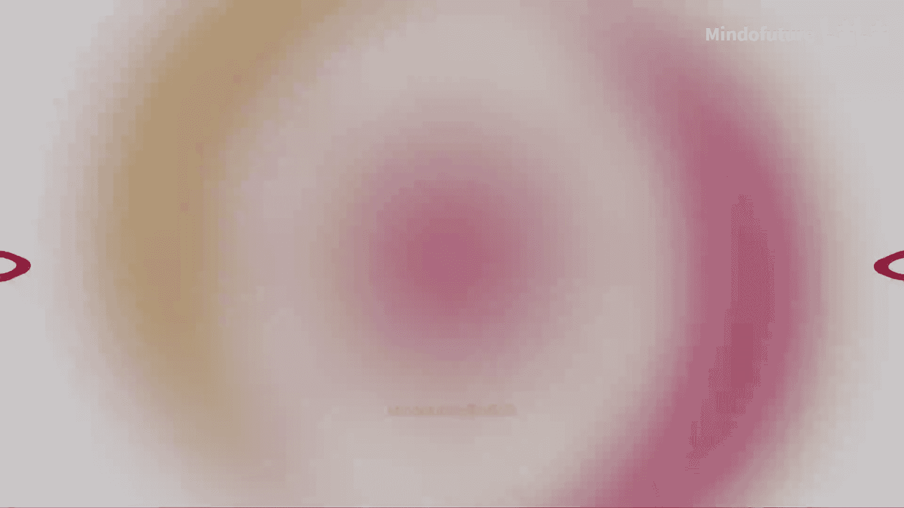
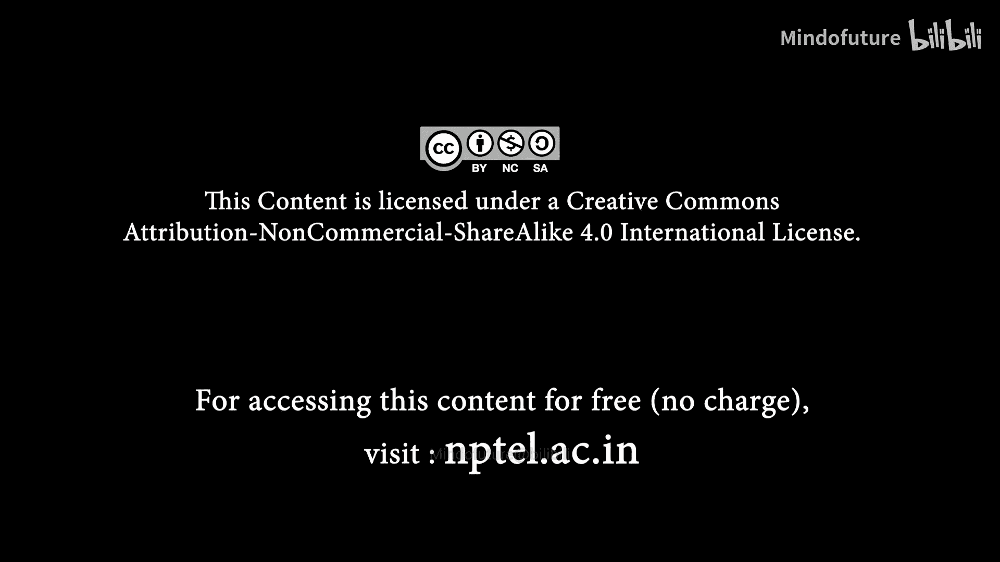
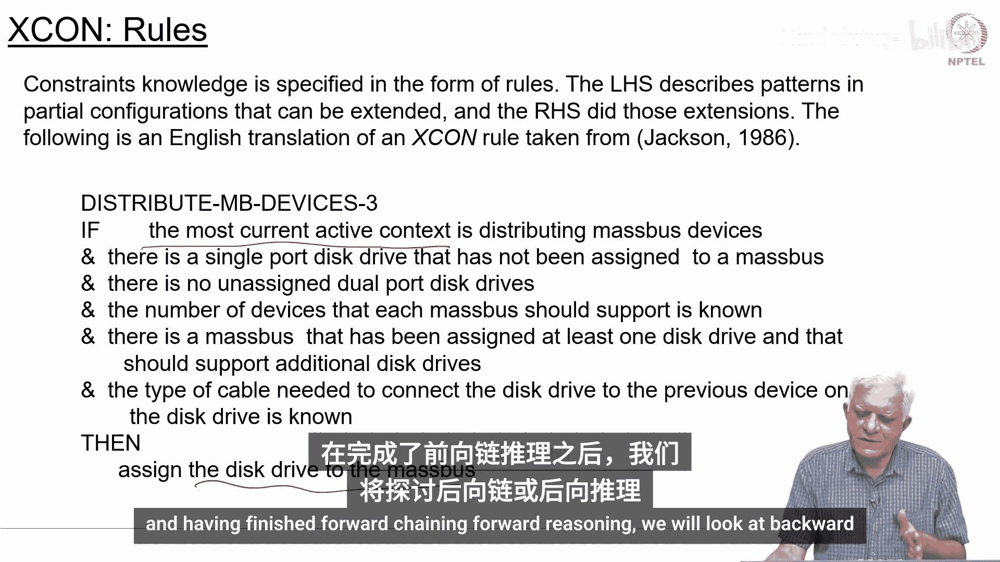

# 【印度理工学院】知识表示与推理 ｜ Knowledge Representation And Reasoning p34 P34_专家系统 -BV1c4zNBmEyF_p34-

So， we are back， we have looked at first our logic， syntax， semantics， tools values。

Rules of influence。Forward training。Implicit quantifier form。

And how to treat existentially quantified variables using this method of scization。

We will take a short theour。And I would like to talk about。What was happening in the 1980s。

Which was in the world of AI。The era of expert systems。Rule based expert systems。

So what had happened？Was that people were writing these programs which could do these kind of influences and so on and。

They wanted to implement applications in various domains。Where do you get that knowledge from？

That something implies something else。They said。We will go to the experts in the domain and they evolved a whole approach of knowledge acquisition that they would interview them and somehow extract the rules from them。

And they would extract the rules， that is why they are called rule based systems。

And they call them expert systems because the rules were extracted from experts and the hope was that the program that they built would perform。

Like a human expert decision。In some cases， this was successful。 In some cases。

 it was not possible because it was difficult to extract。The rules that people were using implicitly。

But nevertheless， it was a very successful successful phase of application of this， this thing and。😊。

It used this notion of rules， that' is why we are bringing it in here essentially。So。

 as I said in the 80s， the idea that you can capture the knowledge of human experts in the form of rules。

The rules is important essentially and you know that is where we are making inferences。

L to the development of expert systems。Rle based systems or production systems as they were called were used in general in general to decompose a problem and address it in parts essentially every rule would kind of address a part of a problem and eventually if you had a whole bunch of rules and you had a problem then you know eventually by applying rules different rules it would get solved that was the idea the rules would come from experts essentially。

So， in the most abstract form a rule orproduction is a statement of the form left hand side。

 right hand side， which is like an implication statement in which the computation flows from the left hand side to the right hand side。

 which is what we are calling us forward chainning so if you know the left hand side then you can kind of conclude the right hand side。

In practice， production rules can be used both in forward direction and backward direction。

So once we are done with this rule based。Introduction。

 we will actually move towards back backward reasoning or backward chaining and we will see that that is another way of doing inferences which has its own advantages。

And in fact， rule based systems were also built in backward training and we will look at a language called prologue。

Which does backward changing essentially。But in general we are now looking at the data driven aspect of it which is forward chaining the production looks like pattern followed by action in the forward chaining context in the backward reasoning context it is more logical in。

The pattern is in the given database and the action could be something add a new statement or even delete a new statement we have not talked about deleting statements here。

But in rule based export system， you could delete statements。

And that ends up in a slightly more complex logic which is sometimes called as a non monotononic logic because you know you prove something and then you delete it later then it is no longer true。

And that is why it is called non monorononic the set of true statements can go up and go down and go up and go down。

 but we are not getting into that right now。We want to just look at this。And connect with the fact。

That forward reasoning， forward chain in logic is tied up to this export systems area。So。

 the rule way system looks at part of a state， triggers some action then when a pattern is matched and this process goes on essentially。

Here is an example of a rule in a language called ops5。

That off was you know somewhat ambitiously named as official production system language。

 was it came out of CMU where some of this work was done。As mentioned here。

And Charles Foge whose work we will see later in the course was one who did this。

 but here we are not talking about expert systems and not we are just looking at the language essentially or the nature of a rule。

So。Let's look at both the rule in English and in this opwi language。

Let us call the rule as it has a name called interchange。And our task is to sort an area essentially。

What this rule says。That if there is an element at index i。And who's。Values in。

And if there is another element at index J which is greater than I， but whose value m is less than n。

 then you just swap those two。Elements bring M to so。

Bring m to index I and bring n to index G so that the smaller number comes first and。嗯。

It's an ascending。Ay of numbers essentially so what this rule is simply saying spot2 numbers out of place。

And swap them essentially as simple as that and you can imagine if you think about this。

This one rule will actually sort your whole area， just run it a number of times。

It will spot two numbers out of place and change them； of course it will not be efficient。

And that's why we don't use this approach， but it will do the task for you。In this language of Si。

 which is just a very quick introduction。嗯。😔，嗯。Rehaber。😔，This not。Which is。Attribute。And value。

When I say value， Im even allowing things like。😊，Relational symbols and things like that。

 essentially。So， the same thing is said in this particular language if in the array at index I there is a value n and if in the array at index j which is greater than I there is a value m which is less than n。

Then modify the two two locations。 the first one should contain M and the second one should contain n。

This is just an example of a rule and there are many many things you can do simply by expressing your program as a rule essentially。

So， here is one system which was became very popular this was called R one or xcon xcon meaning。

It was a。Cn is for configuration and X comes from wax machines。Which was。

A very popular machine in the mid 80s。Deck wax， De was a company。Digital E cooperation。

What this program would do is that it would help。People configure their machines that they were buying。

 In those days， machines were not as。Simple as going and buying a small mobile which is which is a computer nowadays。

 you have to you know have a room for the machine first。And then。

Put in your specs and get this whole big machine， which occupiedcc。Significant part of the room。So。

He this was written by McDomo， McDonmot is the samemot who is part of you know Cha and Mcdont the book。

Which was very popular。He developed a forward chain roadway system for configuring the computer systems this thing。

So。Okay， so I said wax x stands for expert and con stands for configs。

Was built for the computer company deck essentially。And it was quite successful。

 it processed over 80，000 orders with accuracy of over 95% essentially there is a small anecdote of why it was called Rgon and then change to Xcon to some it is not clear whether this is true or not but anyway apparently magdond。

He said that three years ago I wanted to be an knowledge engineer and today I R1 so this R1 is where R1 comes from but。

You must always take this with a pinch of salt。So it' is a power changing ruleway system that work from requirements towards configurations without backtracking there is a nice book on expert systems by Peter Jackson。

Also written in 1986 and you can read more about this if you get access to this book。

So it had knowledge about components。For example， you know what are the required specifications of every component and knowledge about constraints so you know how should components feed into each other。

And essentially it did this whole process。By this rule waste。

Search it's a kind of a search which it was doing。So。

 it stored component knowledge in the separate database and this is an example of。

The kind of knowledge that we are not particularly interested in that is just to illustrate this idea that。

When you are talking about a universe module， then it is of a type disk it and it supports something buffer an NPR。

 or whatever， whatever。And rules。Or of the if10 kind that is what we want to illustrate here。Theing。

So， this rule says， for example， if the most current active context。

This context was an idea used in Obwiwape to channelize computation because if you have hundreds of rules which rules do you match。

The language allowed you to set context and say in this context only these rules are applicable。

So if the contest is distributing Mapa devices， then if all these conditions are true。

 which we will I will not read out， you can read them at leisure。

Then assign are described to the mass specifically so if these conditions are met。

Then you will say that， okay， this is a display you're using and so on。

So that was a very quick introduction to。嗯。Rule based systems。嗯。

We will come back to gold waste systems。In fact， we will come back to forward changing rule based systems and we will look at this work of Charles Fuji。

We said that if you have these hundreds of rules。And if you have this hundreds of pieces of data。

And you want to match rules with data。And in every cycle。Once you match something。

 you decide which of the matching ones you will actually execute。

Then that will go and make some change in the data so you do the match all over again。

And then keep going through this cycle this was called a match resolve execute cycle。

 we will visit that a little bit later once we are done with logic a little bit。

We spend a little bit of time and there is a very nice algorithm called Re algorithm which uses a structure of called retail network。

mm。Which is very popular in industry even now essentially。We will come back to that later。

Now well take a break。Come back to logic。And having finished forward chain forward reasoning。

 we will look at backward chaining or backward reasoning。

So we'll see you in the next session。