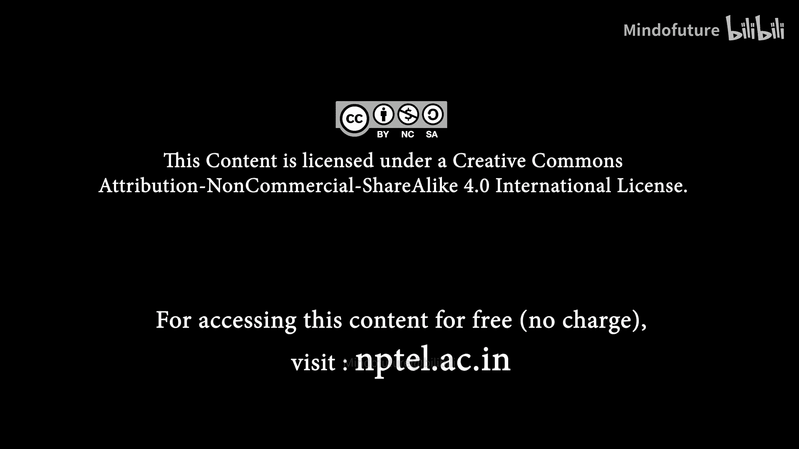
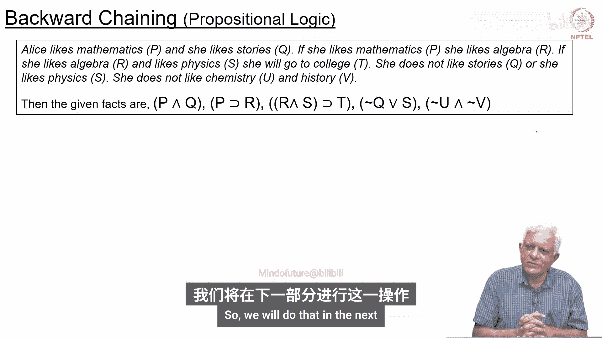

# 【印度理工学院】知识表示与推理 ｜ Knowledge Representation And Reasoning p35 P35_反向链接系统 -BV1c4zNBmEyF_p35-

Okay， so we are finished with the power trainingning。One problem with forward chainning。

Is the following。That's supposing you have a knowledge base， Kb。And like we often do。

 we want to to prove a certain theorem or of certain statement that we want to ask。

Is alpha true or not。Is alpha entailed by the Kb but that we cant check so we insert asked。

Is alpha derivable from the Kb？The algorithm that we have seen so far。

Is power trainingning what does power trainingning say if some rule is applicable？

Then add a consequent to your knowledge base and your knowledge base keeps growing essentially。

So what would happen is that some rule would apply here， some rule would apply here。

Then some rule would apply here。😔，And in general， the knowledge base would keep expanding。

There are two or three problems with that one is。That。The plumlunging factor is very high。

 essentially。If you are going to blindly keep adding facts。

 then the the number of facts that you will end up adding before you get to this alpha that you are interested in could be quite large and grow exponentially that is one of the reasons why。

嗯。When we talk about forward cheatning again in the context of rule based systems， we will。

Introduce some kind of strategy for saying that of all the rules that you can apply which one should you choose but we will come back to that later one major disadvantage of forward chaining is that the branchning factory is very high。

And。Therefore， it's difficult to implement an efficient search algorithm。

What we do in backward thinning is that we move from goal to the fact。So， if if we have this alpha。

 then there may be two or three different ways in which of which alpha is a consequent。So。

 we only want to start searching with those two or three possible rules。

 so some let us say beta 1 implies alpha beta 2 implies alpha beta 3 implies alpha。

Then we would want to check whether， okay， can you arrive at this alpha using one of those three rules essentially？

And you can see that because we are focused on a specific goal。

The branching factor of search here would be smaller， essentially。

There have been people who have said that backward reasoning or goal direct reasoning is the way humans also operate and that is because it is more efficient and that is basically because you know。

It's got a small branchuncing factor if you are doing forward trainingning you know as if you are daydreaming and you know you know just keep inventing new things inventing not inventing adding new facts to your knowledge base and suddenly if I know I found what I wanted。

Backward training is more goal directed and can be efficient in many domains。

But let's look at the mechanism of backward cheating now。You are given a rule。

Although implication statement， alpha implies gamma。

And you are given a gold beta essentially you want to somehow prove that beta is true。

When can we use this rule？So， from beta。If you can。Match bitterta with gamma。Using when。

Substitution theta or unifier Theta。Then we can say it。Then if you want to show that beta is true。

 that beta is the goal。You can。Move res to the goal。Let's show that Alp is 2。I make alpha as a goal。

 but not just alpha。Epha with the theta substitution applied just as we had this substitution playing a role in modified mod componentss。

 we also have substitution as a role playing in backward chain。

What is theta theta is a unifier for gorma and beta， as as I said here。

 if you can find this theta then。You can go and infer alpha but not just alpha。

 you must infer alpha into theta。So， that's the process of。Backward jning。You have got a goal。

 lets say Q of a， you have a rule which says p implies Q。

You use the substitution x equal to a because that is in the goal。And you。Infer a new goal。B요비。

So notice that we are now。Demarketing the set of facts and the set of goals。

Goal is what we want to show to be true facts are what we know to be true。

To avoid confusion between facts and goals。We are just marking them with a marker goal here。

In factors， you could just keep them in separate files or in separate databases or whatever the case may be as long as。

You don't confuse facts with goals。So， what we are saying here is that from the goal Q A。

 if you can find an appropriate rule for which Q A will match the right inside。

Take the substitution and infer the left hand side of that rule， which is P。

And say that my new goal is P of。This process has to stop somewhere and this process will stop。

If the goal that you are trying to prove。Matches some fact essentially so if you so you want to show goal P of A and in your database or knowledge base there is P of A。

 then you are done essentially。You don't have to。That' is when the the chain process will stop why is it called chaining because you are going from one side of the implication statement to the other side。

When you are going from the left hand side to the right inside side， we call it forward chainning。

 when you are going from right hand side to the left hand side， we call it backward chainning。

So here is a look at this backward in process。And see that essentially we are doing logically we are doing the same thing。

Essentially making valid influences。So， this is a backward training rule that we just saw。

That you start with the goal key of a and you end up with a goal P of a。

And because you find that in your knowledge base， you stop the process。Now， just imagine。

That instead of seeing that。Q of a is a goal。We assume negation of Q of E。Okay。

 so one bracket seems to have been hidden here。We assume not of Q ofP。Now。

 obviously I hope this rings a be。That's what we did when he talked about proof by contradiction。

 essentially。Assume the negation of the goal。And then go around making your inferences。

So here we are assuming this Q of a。The fact that it's in a colored box means that it' is an assumption。

 its not。Affect。But it is added as a fact essentially it is a negation of the goal essentially。No。

Our original rule was p of x。Imps Qoffi。Collickect。And we know from the rules of substitution。That。

P of x implies Q of x is the same thing as。Not Q of x implies not p of x essentially。

That was another the rules of substitution we had seen。Now， if we start with。Not Q of E。

And we work with p of x implies not p of x。Then we can infer。Not P of A。

Which is the rule of modest tool and successfully。So backward trainingning。In a way。

Is it like doing motor to lens。You can also think of it as doing mod opponentence。

Because if we instead of using the rule p p of x impliesq of x。

 we look at the new rule which is here。Which is。Not cure of X。

Implies not p of x then of course this Qofpha will match the antecedent。

And then we its like we are doing motor componentss and we end up with not P of E。So。

 whichever way we look at it， whether we are thinking of it as forward training in motor students or。

😊，Backward training with motor studentss， we are assuming。The negation of。

The goal which is not of Q of a and we are coming to a conclusion。Not of P of V。

But this is an assumption。And he said if you assume that not Q of a is true。

Then you can show that not P of famous be true。But that' is a contradiction， obviously。

As shown on the left here。So。What is the outcome of the discovering this contradiction？

Is that you have to end up by saying that our assumption was wrong。So。

 this assuming that Q of A is false is long， so Q of a must be true and that was the goal that you had in mind essentially。

So， logically。😊，There is a similarity here。Motor tolerance is closer to backward heading because you are going from Q to P。

嗯。But you could also think of it as modest opponentents because you instead of saying that p implies Q we are saying not Q implies not p。

And it becomes a little bit like forward chi。The branching factor thing also you must keep in mind that you are only going to work backward from the。

Assumption that you are making not here。You are not going to make those forward changing inferences from the rest of the knowledge base。

 which would make it。Truly forward Jen， but logically both of them are doing valid inferences is what I wanted to discuss here。

So， backward reasoning is goal directed， we only look for rules。Which。

The consequent matches in which the conequent matches the goal。The result。

This results in low branching factor in the search tree。

The number of rules that will come into contention will be smaller。And。It is。In fact。

 the foundation of this whole field of logic programming。We will come back to that a little bit。

 we will see a little bit of it when we are looking at backward training。

Maybe will come back to that later again when we looked at the resolution method。And then of course。

 we will look at the language pro essentially。So we'll do quite a bit of that， essentially。Now。

 the interesting thing about backward chain is that we can do what is called deductive retrieval。嗯。

So， retrieval in the sense of database retrievals that you want to ask a query。Is there a student。

Who joined in 2020。Who has done。Less than the required number of credits or something some query and you will you will retrieve answers yes。

Sles is this student or Suleika is this student and so on and so forth。But in database。

 you can only retrieve what is there in the database essentially。In deductive retrieval。

You can also retrieve things which can be inferred from the database。

 so that is where logic comes into play。And it' is quite a powerful mechanism to use essentially。So。

 when we say retrieval， we mean that the goal need not be a specific proposition don not just show that Q of a is true。

😊，I can ask is there something from Q of x which is true？So， that makes it a general query。

You are allowed to make such general queries in deductive refrie and that is quite an interesting。

Feature。Yeah。So， you can have variables in your queries and formulas with variables can obviously match facts。

So here is an example。If you want to have a gold Z。

You don't want to just show that soccer case is model。You want to ask。

 is there someone who is mortal？So if you write a goal with a variable。

Which on the surface looks like a。Universally quantified variable， but。It is a goal。

Then it must be treated as existential。So， this question mark inside a goal should be treated as。

Existential， essentially。So when I write this as a goal。I am asking， is there a Z？Sa that。

There exists that model Z is true， so it is still a query about mortality。

But it is not a query about Socrates or Aristotle or any such person。

 it is saying is there someone who is mortal？And the way to express that。

An implicit Qifier form is to use the question mark essentially。Now。

 if you think a little bit about this you will see that it will make sense。

 especially in the context of what we just discussed with where we said that。A goal。

Can also be thought of。As saying that， assume the opposite and then do something essentially。

So if I have to produce， if I want to show that there exists red。Motal Z。

 so I will just write Z here M here instead of model。If this is my goal。😊，ち。

But if I am using this other approach I am saying let me assume that this is false。

 what does it mean？Negative goal。就说。Not there exists， red。Mortal z。

This is an assumption all you are adding the negative goal and like we did when you saw the tabau method you add the negation of the goal and then you show that you know this is not possible there is something wrong the whole system is inconsistent there is no model。

 there is no interpretation that will。Be true and therefore you can't make this assumption that is a general idea of proof by contradiction。

So， if you are going to assume the negation of the goal。

And it is a goal which is existential in nature。That there exists in Z m of Z a model of Z or model Z。

Then you will add the negation which is you put the negation sign in front of it。

But now you remember that you have to be careful with scization。

So what you do is you move from there to for all Z。Not。MZ。Which you will scize in。And。Not M。There。

 because now。By the rules。Of scization that we saw。We have a universal quantifier there。

And therefore， this whole thing must be quantified as。The universal variable。

That is one way of looking at it the other way of looking at it is that we have different rules for queries and queries and goals and we have different rules for facts in fact question mark comes below a universal statement in the universally quantified variable。

In goals or queries， the question mark comes in existentially quantified variables and that is what we have written here。

That if we have a goal。Which is mortal Z， where Z is a。

This thing is basically saying that it is in existential query which says。

Is the statement that there exists as Z mort Z， is this a true statement？But in the implicit form。

 we will write it as a。Question mark really will recently so you have to be careful about that if you are thinking of it as a goal。

😊，Then you must think of it as an exist that that you must remember that it is a goal and therefore it is existential if you are saying you are going to add the negation of the goal then it becomes a fact。

But that fact will lead to a contradiction and therefore， but it is a universal practice。

 essentially。The interesting thing about。😊，Using variables in goals。

Which is what we are talking about retrieval， which is what we do in databases。

I that in addition to answering yes or no that yes it is true or no it is not true。

 if it is true it will also give you a value which is what you are doing interested in retrieval so in database you can only retrieve what is there in the database。

In deive rerie， which is logic programming you can。

Retieve things which can be inferred in addition to what are already there recently。So。

 it can also return a value and that makes it quite interesting。

So let's look at a couple of examples。So， our good goal that we are talking about， our goal is。😊。

Is there someone who is mortal remember that this is an existential goal。And of course。

 our rule is that it all when are mortal。So we do backward chain here。Substitute。X with z。

And we get a new goal that is there someone who is a man essentially？Then of course。

 this will will find in our knowledge base or database， yes， Plato is a man。

So you can return that Pto is a mortal。Yes， the courtes is a man。 So you can return that。

So Cur this is mortal。Aristole is a man， and you can return that。 Aristotle is mortal。

The goal was about mortality； the facts are about being men essentially or human or this thing。😊。

But we are able to link the fact that we know that Plato is a man Socrs is a man， Arotle is a man。

We have the rule that all men are model。And we are able to link this with the fact that when we said。

Is there someone whose modeltal？We could。Do this logical。Deleuction。In the backwards chain form。

And answer yes to this query， yes， this is true， but also give you a name or a value for the variable。

Z yes， Z can be Plato or Z can be Socrates or Z can be aistotle。So。

 that is an additional advantage you get out of。Doing backward chain。

 you can use existential queries。And retrieve answers for those queries， essentially。

Let's take a break here and we want to look at a few examples of。嗯。Reboard training。And see。

 in what way does。The search proceed。For that。So we will do that in the next。

