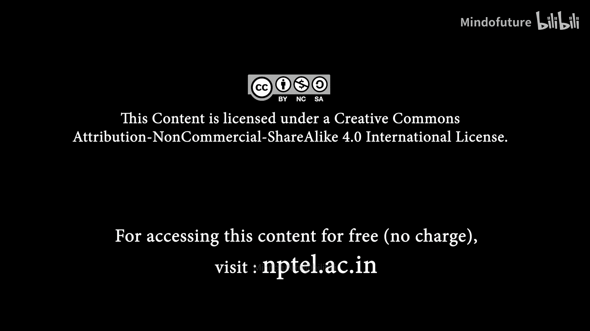
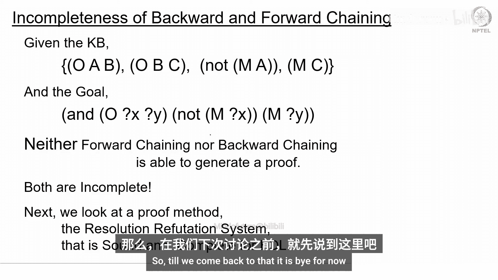

# 【印度理工学院】知识表示与推理 ｜ Knowledge Representation And Reasoning p36 P36_演绎检索 -BV1c4zNBmEyF_p36-

Okay， so we are back。 We have been looking at this process of backward chain or backward reasoning in logic。

In particular， in first a logic。And we found that there is this very interesting possibility of treating this backward retraining。

As a retrieval mechanism。Where we are looking for answers， essentially。That is there some。

Entity which satisfies certain properties and so on。 So that' is more like retrieval。

It may also involve a bit of search essentially you know， trying to say okay， this is not the entity。

 this is not the entity and so on。So that lay that raises this very interesting possibilities and we should try and get a feel of that。

No， essentially。But。Let's start by looking at how backward training can be implemented essentially。

 So remember that what is given to you is a knowledge base。 So， for example。

 in this our standard knowledge base that we have。Not standard in the sense of our favorite knowledge base about Alice。

 it has this statements P and Q P implies R R and S implies T not Q or S and not Q and not we。

We want to。See how backward training would operate。 So our goal is， of course， this。Statement T。

 so is stay true or not。In forward sharing we kept adding new facts till we struck upon t in backward we are more focused we start with T and ask what is it that will make t true is that they are in the knowledge base or not。

So， is t2， we answer this backward gen。First， we have transformed our， our。Program a little bit here。

We have replaced。Not Q or S by saying Q implies as it just makes life a little bit simpler。

And we have broken down。This formula。Not you and not way into two separate formulas essentially。

The rest of the program is the same。And。The way that we。Mage。

Backward training is that we maintain us。Goal set and what this goal set contains。

Is the things that you want to show to be true essentially？Our termination criteria will be。

When that goal set becomes empty， which means you have shown whatever you want it to show。So。

 lets see we want to see whether the goal is true， so tea is the given goal and we put it in this set。

And。M think。Then because we have a rule which says that rule number4。

 which is that R and S implies t。Vi。Replace we remove t from the gold set and add Rn S instead so this question mark。

Not the question， mark the。讲吗。Should be treated as an and essentially because it's a set， we are。

Not writing and， but treating at a set of statements which。A。Which we want to show to be true。

 So we will of course handle them one by one。 So lets say we handle r so we will remove R from the knowledge base from the goal set。

And we find that there is a rule which says it rule number three in fact。

 which says that p implies r。 So we are saying instead of showing R。

 you can show p and that is good enough。P is there in the。

Knowledge based the very first statement piece true。

 so we don't have to do anything further there no more chain is required。That leaves us with S。Now。

 we can backward chain statement number 5， which says  Q implies S and says that instead of showing S。

 show whether Q is true。And luckily for us， Q has been given to us as a fact， essentially。

 So we are left with the。The empty。Goal set， and we can terminate at that point。

So this is how we operate here。 We start with。Adding the goal to the goal set。

 we keep progressgressing to sub goals as we can call them。Till we don't have any sub goals left to。

Soll or to show essentially depending on from which perspective you are looking you sometimes tend to use slightly different terminology from the search perspective with from Android3。

 for example， you would say solve essentially and which is what we will also see in a short way。

So if you have conjunctive ancedents。In first order logic。And you have a goal of the kind。Al。

Question mark X， which means， remember。Is the state is there an x？

Sub that R of x will be true essentially。And the rule is that P of x and Q effects implies our of。

Then。We start with。The goal are of x。And then it means we have to replace it with two goals。

 p of x and Q of x。Essentially。We can think of this as an and node if you want to visualize the search space。

嗯。Because eventually these programs are going to do search in some form。No。

We can think of this as an and node and then and or graphs are standard graphs which。

We can study independently。To solve R you must solve both P and Q。And therefore。

 you go from R to P and Q。And this。This line here， it says that this is an end note that is not a choice。

You have to do both of them。So let's illustrate this with a small toy example。

Which is talking about toys。And we are in particular。

 talking about something categorizing toys as nice toys。Some rules which we have worked from some。

And we have two rules， one says。That if x is green。

 the first rule says if x is green and if x is circular。Then， it's a nice story。

The second rule says if x is red。N x is a squared。Then it's a nice to。

 So green and circle lead in square。What we know about various objects。

Is it a is green so as you can see the facts as they call them。

Everything is in the knowledge base in practice。A is green， B is green， C is a circle。C is red。

D is red， D is also square eases circle。If we visualize this as as a search tree。

 then it is an and or tree。And you can see。That， if you want to solve。For the gold， nice toy X。

You can either apply rule 1。Which is going this site。 or you can apply this thing。

 So this is an all choice， either this or that。But if you have to apply a rule1。

 then you must show that x is green and you must also show that x is a circle。

 so that is why this is an and node here essentially。

And then of course we have the facts that if you want to show that something is green。

 you can show that yes a is green or you can show that B is green。

 so you can try both options and that is again an all choice。So。

 to show that there exists a nice toy in our knowledge base。

We will have to a search over this space somehow and that is what backward training has to do。

 essentially。It's a little bit different from forward training because in forward training。

 you didn't care if you made some I irrelevant deductions or irrelevant influences。

 they would sit in the knowledge base somewhere， but you were not bother about that because the moment you saw your goal。

 you would say that I have succeeded essentially。 But in backward training， you have to。

Be more focused in the sense that you want to show that something is true。And。

It's not that you can keep growing your。Set of goals in fact what we have seen in the process is that you replace a goal with sub goals。

 replace that sub goals with sub sub goals and so on。

 but we what we will see now is that if that process doesn' not work you will need to backtrack and try something else essentially。

So backward training has an element of search in it it will have an element of backtracking in it forward training does not have that you know you just keep growing the knowledge base and it keeps growing and growing at some point the goal appears and you are happy。

But。It's not so easy to handle existential goals in forward chain。 exactly。

 it could be possible because we have。We have the rule of generalization， which says that。If。

 for example， Q of a is true。Then it is true that there exists an xq of x， so you could use that。

 but that every step you have to do that extra step of generalization。

Which also could be subsumed by matching at some point。So。This is our。Search 3。

 our goal is that is there a nice toy。In the knowledge base， which we apply rule one and say。

That we have two sub goalsals now that x must be green。An x must be a circle。

If X is to be a nice toy， but the nice toy has been removed from the goal set。

Then we will look for x must be green。We find that yes， a is green， as you can see。

In the knowledge base here。We can throw it away and。Now we have to show that a is a circle。

But when we look at our。Collection of circles we find that we don't have a in that so that will fail essentially so x equal to a but the next goal will fail because this was an and note that you have to show that something is green and something is the same thing is a circle。

It doesn't work for A， essentially。So the algorithm will backtrack and say， okay， maybe B。

 we can try B。B， because you know that B is green， then again we go and look for whether B is a circle or not and again it fails。

So you can see the pattern of search that is here， you went down one branch。Then you came back。And。

Tried something else and so on。 So there is a flavor of depth for search here。

So all that fails and we say there okay， we can't find a toy which is。Green and which is a circle。

 So lets try the second rule。 The second rule says that look for something that is red and which is a square essentially。

So the same kind of process happens。We go down looking for something which is red and the first thing we find is that C is red。

So we say yes C is red， but now we must show that she is a square。

But C is not a square because there is only one square thing in this thing。

 so we have to backt trackrack from there。And。Then we say， okay， let us see D d is red。

So is d squared？And in this small nice example that I have constructed D is indeed a square。

Search has succeeded a goal set has become empty we have found a value for x， which is x equal to d。

And we can say yes。Do this。And we can say。X equal to D。The day is the toy that you are looking for。

So。You can see that。Retrieval has been done through logical deduction。

And it is the power of logic that you can do this thing。 In fact。

 the whole idea of logic programming is that。You can， whatever you can do in programming。

You can do it logic and we will look at that a little bit later not now that how even arithmetic can be done。

Using logic， essentially。 So logic programming is a powerful。I dear。It says。That logical reasoning。

 which means logical deduction。Can be used for doing any kind of computation， essentially。

And it also focuses on the fact that。We are doing。Gold based reason。 So there is some。

Semblance of efficiency there， essentially。We will revisit this question of backward training。Again。

 later， when we talk about efficiency。So， the solution。

If you are thinking of this as search is a subre。Which is highlighted in the slightly thicker arrows here。

That yes， yes also what you are looking for。That nice toy。 You follow this rule， too。

 and you can show that something is red， and you can show that D is red。

 and you can show that D is a square。 So you have。Found your toy。

But you in the process you have also shown that the statement that there exists a nice toy is true。

And doing is just one side of the other side of the same coin。So。

 here is a preview of our actual prologue program， we will look at prologue a little bit later in this course。

And。The way to read forlock programs is again we will see this in more detail later。

Is that rules are written in a slightly different fashion in Pulo。So， the。

Let me state the problem here。 The problem is。That。You are。Making an outing plan。 Maybe you've got a。

New job or something。Or maybe you have got very good grades in the courses that you are doing and it's time to celebrate。

And you are making an outing plan and the outing plan is。嗯。

Let you do something in the evening then then you watch a movie and you go for dinner essentially so that is expressed in the first line。

Which is。Should be seen as a logical statement but we can defer that to later let us look at the fourth line which which is one confident of the outing plan which is dinner。

And。What this line says。Is what the logics sentence written here says。Is that。If x is a restaurant。

And your friend who is coming with you for the celebration likes X。

Then that X will fit the dinner plan， essentially。So the rule， of course， is if。

Then it's a dinner plan into log。Because it is goal directed because it is backward inning because you are searching from goal to facts。

 we write the goal first and we write the facts after that because matching can be done。

As you go down the file， essentially。So， you write dinner plan first。And this sign can be read as if。

X is a dinner plan。If you access a restaurant。And your friend likes eggs。In prologue。Upper case。

Here's a variable。This is a prologue convention in our logic discussion we said you can mark the mark a variable by a question mark Prologue has its own ideas and they say upper if you have variables they must be an upper case。

 if you have constants they must be in lower case so for example。嗯。

Since we are talking about the restaurants。If you want to talk about sal number one。

This is a restaurant in， restaurant chain in Chennai。 It started with Chennai。

 and it's now there all over the world。It begins with lower key。

 so this is just prolo convention constant are。Begin with lowercase variabless begin with uppercase。

So we have these rules， essentially。An outing plan。X， y， z。

Is true if you want to think of it like that。If there is an evening plan which is true a movie plan which is true and a dinner plan which is true and for each of the three we have rules in an evening plan is an outing X。

嗯。If X is an outing and your friend likes x， what are outings outing we have said you can go to the mall which is the most common thing nowadays you can go to the beach if you happen to be in Chennai。

Or maybe you can go for a walk if you happen to be in the mountains， which is not mentioned here。

And we have given you choices of for movies， the metrics， artificial intelligence， Bu sh，7， samurai。

And。2 restaurants。And we have also given you some data about what your friend likes， I think。So。

 this logic program。Will search through this thing。

 so I I keep repeating that you know backward winning involves search it will search through these things。

Till it finds values for x y and z which are the three variables here。And then。

Of course not only will it say that yes， you have a nice outing plan。

 it will say the outing plan is this and this and this essentially。And as we just discussed。

Backward training of prologue。We will construct an and or tree， which is also called a gold tree。

Which is the same piece of data that I gave you in in the form of a prologue prolo program is shown here as a tree essentially。

 So the stuff in the red is the fact that you know that， for example， one show is a movie。

That your friend likes going to the beach and all these facts which are there in red listening and the other other things are parts of rules。

 essentially。And。The backward training will do this thing that we have started that will first。

Put the goal as in the goal set。And initially。The substitution is empty。

And then you will break down the goal into those three components。

And then you will try out the components one by one， essentially。So， the evening plan。

First you look for an evening plan， it will say that you are looking for an outing such that your friend likes the outing。

And then after that， the other two goals。Which were there。

Which will also remain continue to remain there。 So evening plan actually。Move。

And replaced by outing plan in life。F their plan。And then it will try through various things。

 as you can see， it will try them all and then。It is say。You to find that。

Every every option that you tried with them all did not work。

 then you would backtrack and try the beach。And then you know。

 a little bit of file and whatever will happen and eventually you will come up with the plan at which point you will find that。

在哪。You have the empty goal set and you have the solution x equal to B。W is equal to the movie。

 the matrix？And there is dinner that that I want to go。

So not only have you shown that this statement that is there an outing plan or is there exists an X Y z such that outing plan X Y z is true？

Lousey programming and prologue in particular will come back and say yes。Ex is the beach。

 y is the matrix and there is Sal。So this is。Showing the power of logical reason and showing that。

Logic can be used。For Comp in general for programming。In particular。So， this is the。

First three episode and the three notes highlighted here as the solution that it is fine it would have done this trial and it would have tried out。

Mall。And it would have tried for all， it would have tried every other combination and seeing whether it's working or not。

Did we come back to the log？Later in the course， after we are done with the basic part of logic usually。

这。No。Yeah这个。Okay。I want to end with this problem that we have seen earlier。Oh。

This very small knowledge base， which was a proportional knowledge base， but our。

Qury will be first order query。The knowledge resource。If you remember four statements and。

Where O was the binaryary predicate and was the uninary predicate ABC were constant symbols。And。

We first asked when we describe this on basis as to what what is this。Talking about。 and we saw that。

 you know， any。Set of sentences can be interpreted in more ways than one。

 and we already saw this essentially that the meaning of。What this binary predicate means。

 what this un predicate means， what are the constant talking about？

Is externally supplied It's in the mind of the beholder or the user this thing。

 and we are seeing two examples there one or the blocks world example。

And we had said that the false statements translatelate to these facts that A is on B and B is on C。

And A is not Manoon， which is a statement here and B is Manoon。

 of course we did not know what this was， so Ive added there is a question mark it's missing some the knowledge base。

Yeah。So we don't know whether B is Maloon or whether he is me only official and we saw another one interpretation in which the Doos's people and O stood for looking at M stood for marriage and EVC were three people。

And we said that Betty is looking at Kitp。The four statement winter。Betty is looking at Kitbert。

 Rie is looking at Betty， Kitbert is married。OurT is not meant。

But we do not know about the volatile status of Betty。Yes。Now， given this。Knowledge base。

Without going into the semantics， whether we are talking about the blocks world or whether we are talking about human people looking at each other。

We want to ask this query。Enfor other logic。Yeah。With the quantifiers， we are saying。

Does there exist in X there anyway， That that。O X， Y is true。Notor of Mx is true。And and。

In implicit quant form， you will not have the missing， but because it is an existent query。

They would come with a question mark， remember that inqueries。

 a question mark denotes an existential variable does there exist an x， does there exist sub y。Yeah。

Of course， for us， it is often difficult to。Thinkh in such abstract。World。

If you look at the two examples if we saw， then the interpretationds of this query。

 this is a personal logic query。Because it has a variable。

 it has variables and it has quantifiers so in the blocks world。

That query would mean is there a non maroon block on a maroon block now if you remember we had three blocks A B and C A was not maroon B B we did not know whether it was maroon or not maroon and C which was at the bottom was maroon。

The question we are asking is it or not non meroom block block on a meoon block。In the word of equal。

 we asked the question which I had asked you earlier also。Is a ordinary married person。

If you want to say unmarried， but no just to be logical。

Unmarried the same is not married if a not married person these a not married person looking at a married one。

然。That's a。Question that I would like you to think about。 What I would like you to do is to。Buse。

The video at this point。And think about this question for a few minutes。

 maybe five minutes or as long as you feel like and come back。Wch the answer is that is the query。

Or is this statement if you want to say， which is a logical statement xs X y and Ox y nor MY。

Does this statement is this statement entailed by the knowledge base。

 the knowledge base is given to you， which is a professionalal knowledge base the query is first order query it is an existency query that is there an next and y which satisfies this property。

Yeah。Is it entailed in the first list？And secondly， if it is entailed， is there a proof for that。

So I I wanted to take a break here。Pause the video， think about this。And then come back。

To the same video。把。Okay， so I hope you have given some thought to this the answer to that query is。

Yes。I should write to you， yes。It is clearly entailed， so though it may not be clear to。Yeah。On theに。

It's true that the statement is true， it is entailed essentially。

That in the world of people that yes。嗯。An unmarried person is looking at a married person。

In the Bloxwell person， a non maroon block is sitting on a maroon block。

You should think about this and see where this is entailed。嗯。But。

Given this knowledge base and given this query that we have。It is在那个星规。

Neither forward training nor backward trainingning is able to generate a proof we should try this also you will just both just try out some methods and see。

These I think some some things in forms of implication or something and then do what training。

 and you will find that。One cannot construct a proof for this goodies。Which means what which means。

Theyre both forward trainingning and backward trainingning。Incomplete。Yeah。In first， near income。

The query is the first sort query， remember that。And so what we will do next is to look at a method which is complete in personal logic。

 this method is called the resolution reputition system。

 it's a very recent message which was discovered I think in 1965 or something by Robinson and。

We will look at that， next， and。ISp some time studying this。Till then。

Poonder over this fact that here is some simple query。

Whose answer hopefully is clear to you after some time。嗯。But there is no proof。

That this statement is true。We go to a complete method， which is the resolution liquid method。

 which I had mentioned some time ago is another method of proof contradiction。But it's complete。

 which means that anything that is entailed can be shown by this method。

 which is obviously a very useful thing to have。So till we come back to that， it's by for now。

。