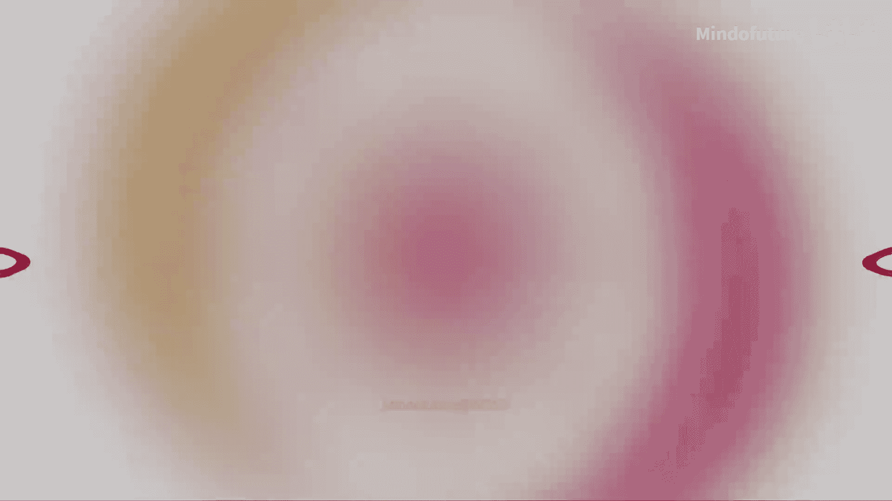
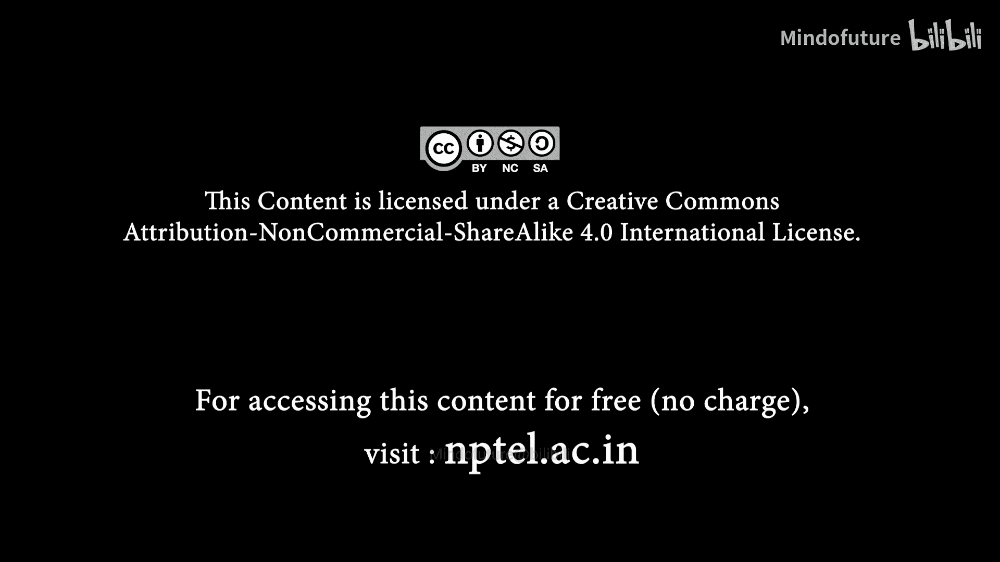
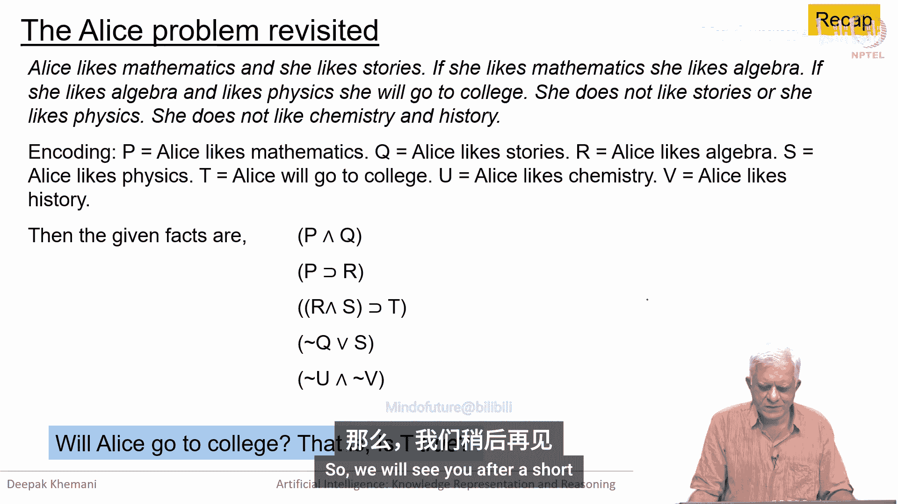

# 【印度理工学院】知识表示与推理 ｜ Knowledge Representation And Reasoning p37 P37_归结反驳法 -BV1c4zNBmEyF_p37-

So welcome back。We are continuing our study of first alog。We have gone through the syntax。

 the semantics。And we have looked at two proof algorithms。Forward training or data driven algorithm。

And backward trainingning or goal driven algorithm。

Both the algorithms are quite interesting and we are not done with them yet。

We will come back to see how forward training can be made more。Interesting。

And also we will come back and check how backward training can be used to implement a language like prologue。

 which is us。Style of logic programming language。Which basically says that。

You can use logical reasoning。For competition。 So we'll come to that later。

But we have one issue to address before we do all that one and that is that。

Both forward chainning and backward chainning were not complete and we did that。

By showing an example that in which they could not find the proof， we'll start with that example。

And then we will introduce this method called the resolution Reputation method。

 which has been shown to be complete for first logic。So this is the example that we had。

Close with last time this is just a recap and you remember that we had this knowledge base which had these four formulas。

Whose symbols we had not at that moment clarified。But here we have said that O stands for on in one of the interpretations that we saw O stands for on M stands for Maloon。

And the three symbols， consent symbols ABC Stan for block and the knowledge base said the following that a is on B。

B is on C。A is not maroon。C is Maloon， but we don't know we didn't say anything about the color of we。

 maybe we don't know。Okayッ。We saw that another interpretation of the same knowledge base which is given on the top those four formulas。

could be in terms of people and then O could be looking at it a binary relation or binary predicate M is married。

 which is a unary predicate。And three consent symbols， they stood for three people， essentially。

And then we saw that。What that same knowledge base can be interpreted as is that Betty is looking at Cuberr Archie is looking at Betty。

 Archie is not married。Ct birth is married。And we did not know about Betty because it's the same knowledge base we don't know about that。

没就。Element as to whether the property of M which in this case happens to be married is there or not essentially。

So， that was。What has been given to us？The question we had was。Whether。

There exists two elements out of A B and C because that is our domain has only three elements so there exists in x and there exists y such that。

O X， Y is true。Not Mx is true and M is true。So， in the。Interpretations that we saw。

In one world we are asking is there a non maroon block on a maroon block。

 remember the middle block we did not know whether it was maroon or not。And。

In the people's world we said is a non marriedri person looking at a married one essentially again we did not know about one of them whether that person was married or not essentially。

😊，And then I had asked you to think about this that this is clearly true that the answer is yes essentially and we can discuss the answer it can be in two cases so。

😊，If the middle block which is AB C， A B is the middle block， there are two cases Bs。He me Maloon。

Or B can be not maroon if b is maroon， then because a is on B the statement is true。If these。

Not maroon then because B is on c the statement is true so in one of each of those two cases the statement is true。

 but we still do not know what is the color of B。And we do not know as to which non meoon block is sitting on。

Which myoon block？What we do know， what we can infer。Using。Logic。

Is that some non maroon block is sitting on some maroon block。Even we though we don't know which one。

And then we had said that power chain and backward chain are incomplete。

 neither of them is able to generate a proof of the statement that we have the goal that we have and we had said that we will look at this method called the resolution reputation method。

Which is both sound and complete for first a logic， so it' is a very useful method to have around。

So let's look at that method first。As usual lets begin its proportional logic。

 it is a simple logic and some of the ideas that we want to discuss can be discussed more easily here before we apply them to first autoer logic。

And。The resolution method requires。😊，That the formula is in connctive normal form。Or cF。

 as it is popular not。We say that a formula f is in conductive normal form if it has the following structure that the formula is a。

Set of。Sub formulas join together by and。 So see even and。

C 2 and C3 up to cn lets say where there are n formulas。Each C is called a clause。

And each clause is a disjunct of literals so each C is。A formula in which D1， D2， D up DK。

Are joined together using the or connective。And。Inside the clause。

 the only connect is or that is this thing。Each lital， each D is either a proposition。

Or an atomic formula or the negation of a proposition atomic formula。So， this。

Structure of formula is called cf and you can observe that the set of connectors that we are using。

The three that I had said are popular。And or and not。So。

 we are using this three set at the highest level we are using and at the as we go nested inside the formula inside the nested formula we use or and at the innermost level is the negation negation is only applied to atomic formulas。

 so this is only place。When negation is applied， you cant say negation of A and B and that kind of stuff。

We will often write this as a set also many books do that。So that。

Formula is a is a set so this and this comma here is like an and and the comma at the next level of nested net is in or essentially and of course the negation will be there somewhere inside there。

So it's like a set of sets。The first subset and the second subset and the so this is the sentences in the knowledge base。

Now， it can be shown that any formula can be converted into c F because otherwise it would not be useful we have already said that we can express any formula that we want using。

The three three connectives and or or not， but now we are saying something more is that not only that you can also rearrange the formula so that it is in conjunctive normal form。

 which is a set of clauses。And each clause is a disjunct of certain literal essentially。Now。

 this conversion。Generally results in an increase in the size of the formula now generally conversion into cF results in the increase in the size of the formula and that is important because whenever we are writing programs we often measure complexity in terms of the length of the input and the length of the input if it is increasing in this process that means our programs for generating pool will also be more expensive。

😊，Sometimes it can reach even exponential number of clauses。How do we do this conversion。

 we basically use this set of substitution rules that we have discussed associivity， distributivity。

 contrapositive implication， deance laws， some application of these rules we can convert this into any formula into cF。

So I will leave you to think about this， I am sure you have studied this somewhere essentially。So。

 what is the resolution rule Okay so that is a new rule of inference that we are looking at apart from the rules that we had seen earlier。

And it was shown by Robinson who invented the resolution method and it was quite recent in 1965。That。

This rule is enough to make all the inferences that you need to make essentially and what does the rule say the rule says that if the first clause is。

ItContains a literal cube。And if the second clause contains the literal node queue。Then。

In the resultant clause。You take the rest of the。Literals in from each clauses and put them together to form a new clause essentially。

So you can see that the thinking about。Formula as sets also helps essentially so from this set you remove Q from this set you remove minus not Q and then you take the union of other two sets essentially。

Now， of course。This doesn not look very useful at this moment。

 but eventually we will see that this works in。Reducing our formula。Sufficiently to。

What is called a null clause I am jumping the gun here。

 but lets see so this rule is enough to prove that what you wanted to prove is true。

For a smaller formula。From R or Q from p or not  Q， we eliminate  Q and not  Q。

 and we are left with R or P simply more interestingly。

 if we had something like this if we had R or  Q。And if we had not Q here。We would。

Reduce it to R essentially so you can see glimpses of other rules in the resolution rules as well it is a general enough rule to subsume most other rules。

Is this rule a valid or sound sound rule we have already seen how to do that in this case。

It suffices to show。That this formula that I have written here。Is a toology What is this formula。

 this formula is the antecedents。Connected by an and。

And on the right hand side are those same anncedents。

 antecedents plus the new formula which is the resolved essentially all be。And。

If you show that this is a topology， that means that if you started with。The left hand side here。

 which is R or Q and p or not Q。And you ended up with the right hand。

 which is what you would do by adding this new。Cls to that then they are logically equivalent essentially。

And we will exploit that fact， essentially。Now you might remember the reduction theorem。

 it said that given a set of premiseases alpha 1， alpha 2 of 2 alpha n and the desired gold beta we want to determine if the formula alpha 1。

 alpha 2 alpha n whole thing implies beta is true or not this follows from the reduction theorem which said。

That if the premises。Untiltail。The conclusion。Then this formula should be a toology。

 It is entailed by nothing there are no premises for that essentially。

And that is a principle that we are going to use again。

 we use it for the tabau method and something similar what is what we will be doing here as well。

Also， observe that。This formula is a totalr logic。If you add a negation sign。Before that。

 then that formula will become。Unsatisfable formula。

We have already seen that the negation of herterology is unsatisfiable or a contradiction。

 essentially。😊，We are going to follow again the proof by contradiction we had said that there are two methods which use proof by contradictions with the tableau method。

And the resolution method。 And we are going to do that again， essentially。So。

 we want to show so we are going to take a formula that we want to show to be a toology。

 add a negation sign before that and then we would want to show that that is unsatisfiable because it was shown by Robinson that the method is a refutation method that it is complete if you want to show that a set of clauses is unsatisfiable essentially。

So， that is what we are doing we are basically eliminating the implication from this here if you want to show that alpha 1 and alpha 2 up to alpha n implies beta then we can push the n inside and replace implication by n and or so this implication has been replaced by this n and this or and once we put the n again inside then you can see that what you get is the original formula plus the negation of the goal essentially so we have a formula which is in cF form。

I'm assuming alpha1 alpha2 and alpha n in that form。So， if this set of clauses is unsatisable。

 then so is the original formula that we started with which means that that original formula without the negation is a plotology and that is what we want to show。

😊，What does the resolution refet do it does the same thing there is a little bit of repetition in these slide here so you will have to bear with me。

😊，Show that this formula is unsatiistable we converted into cF the form that is required by the resolution method and。

We make sure。That。The final form of the formula， which is in the last line shown here a alpha alpha 1 prime。

 alpha 2 prime and so on。That they must conform to the CF structure。

We may need to convert each of the premises and the negatived goal into clause form denoted by alpha 1。

Alpha 1 prime and beta prime essentially so alpha 1 itself could have other other connectives。

 but eventually want to reduce the input knowledge base， which is。Going from alpha1 up to alpha n。

 it should be in close form。II am using the term clause form。

 which is just another name that we often use for CNF。Because it's a set of clauses， essentially。

So what's the basic algorithm for？😊，Doing the resolution。Given a set of clauses。

Pick any two clauses and add the rent to the set。Which two clauses？

At some point we will try to discuss that， but basically our goal would be to。嗯。

Add smaller and smaller closes as we will see。And we will look for strategies which do that essentially。

If at any time a generator is all that is an empty close。Betweens。It's nothing。

 How can we generate an empty class， We could generate it if we had P and if we had。Not B。

Then we would generate the empty clause， we often denote the empty clause by a box。

If you are using the graphical notation。And the empty clause is known to evaluate the false。So。

 what does that mean it means that we have reduced a formula to a contradiction or we have shown that our formula is a contradiction。

And that is why the method is called the refutition method that you that you add the negation of the goal and then show that it leads to a contradiction。

So， as I said， above an empty clause can be generated from two clauses。

Let's say S notice by the application of the resolution rule。

And if the connctive formula has both S and notice。Remember， it's in CF form。Then it must be false。

 essentially。So， to show that a formula is unsatisfiable， let the original formula be p1 p2 pN。

 that is what you want to show to be unsatifiable。It's a conjunction of n clauses。

So this we add a sequence of resolves R1 R2 R。 Each resolve is obtained by taking two clauses from。

Our knowledge base。And adding the resolve to that， how do we pick two clauses， two clauses。

 one of which has a positive vi and the other one has that same negative littleal essentially and then we can remove that little from there。

The database at all stages will be logically equivalent because。The resolution rule is sound。

 and I hope that you would have shown that the formula that we had was a totology。So。

 this is what is happening you start with p1 p2 up to pn。Then you add r1， then you add r2。

 then you add r3， and you keep doing that till you add the nu clause to the formula essentially。Now。

 since the last set of clauses evaluates the false， why does it evaluate the false？

Because remember that this is like a conjunctive formula P1 and P2 and and and so。These are closes。

So， inside they may have some rejunctions， but there is an and connecting all of them。

And when you say something and false。It must be false。So if you draw the two table for alpha and。Phs。

You can show there this is。Fs。Because false by definition is falses。

 so the value of alpha doesnt affect this。So， if you can add the nu loss to your set。

 then you have shown that。The original set which is p1 up to pn， must be unsatisfiable。

So essentially if you are writing a program to do this your strategy to select clauses must be to eventually go。

 as I said to go towards smaller and smaller and smaller clauses and if one of the clauses is a unit clause which means it has only one this junk then you can see that if we start with a formula of length 4 you will reduce it to a formula of length 3 then if you find another unit clause somewhere then it will become length 2 and then so on and so forth eventually if it is length 1 and you find its negative vi somewhere then you have brought it down to length zero so one of the strategies that that people use is2。

Prefer unit clauses essentially， but maybe we will mention strategies explicitly at a later point of time。

So， this is a resolution refutation method。😊，It was devised by Alan Robinson in 1965。

 he showed that the resolution aputation method is complete for deriving the null flow。

A proof by resolution method is a proof by contradiction we have already said that。

We start with a set of flumes， negate the goal and add it as another clause。

And show that it leads to contradiction， something that is false or not possible。

If the input formula is unsatisfiable， then Robinson showed that there always exists television of the null clause。

Which is， of course， comforting。Next， we will look at some examples。So。

 we will start with our earliesties problem but。Let us do that。After a break。

 when we should look at some more examples together。So we will see you after a shot。

