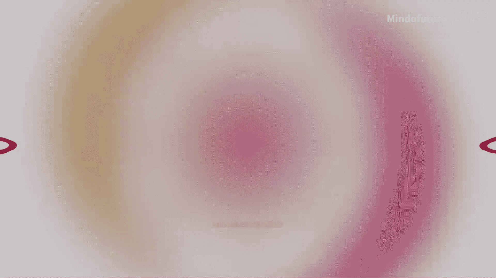
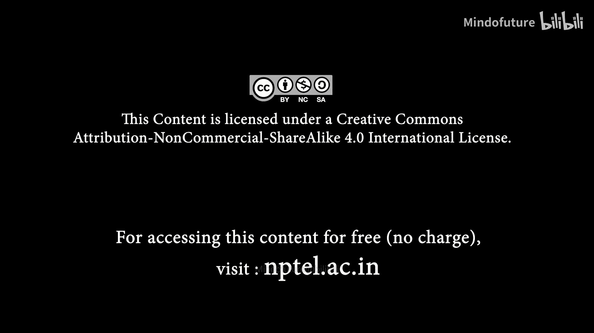
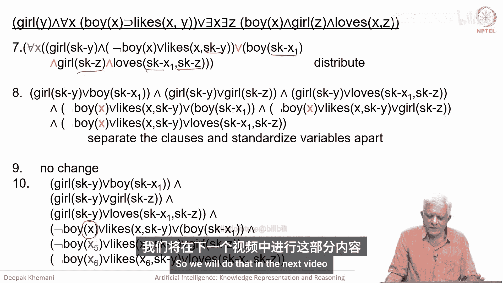

# 【印度理工学院】知识表示与推理 ｜ Knowledge Representation And Reasoning p38 P38_一阶逻辑子句形式 -BV1c4zNBmEyF_p38-

Okay， welcome back。So， we have looked at the resolution。😊，Method and the resolution rule。

Whether the resolution rule say for proportional logic， it says that if you have a set of clauses。

Union。The clause not Q。😔，And if you have another set of clauses， which I am not writing here。

 what union this the clause。Q so these two Q and not q are singleton clauses。Then in the resolution。

Rule。You remove not Q， you remove Q and you take the union of these two sets and make it as a new clause。

So， let's apply that to our。Favorite problem， the Alice problem。So。

 if you remember that these are this is a knowledge base given to us P and Q P implies our R orRS implies t not  Q or S and。

Not you all be not you are and not we so we had to first convert this into clause form this is not in close form essentially okay how would we make it into clause form we would make this a separate clause and make this a separate clause okay so we don' not want to keep that。

So that those are two clauses。We will translate this into not p。OrQ。Which becomes into。

Which becomes a close。 So now we have three clauses。We will translate this one into。

And you should work this out， not R。Or not as。40。So that's the fourth clause that we have。

The fifth formula Q not Q or s is already in close form and the last one。

 we will break it down into two clauses， so we will end up having。We do。3，4。5，6，7 clauses。 Now。

 it is in close form。Each clause。Has only earth is junk inside essentially。Okay。

 so this is what we are trying to do。 This is just the。

Conjuction of this whole this whole taology that we want to show to be true and we take each of the premises and convert it into a clause which is what I just showed the first premise P and  Q gives us two clauses as does the last one we also add the negation of the gold。

Not t as a clause to the system and then we repeatedly apply the resolution rule essentially。

What does the method say that just take two clauses which can be resolved together and resolve them and add the resolve to the。

Knowledge base。Stillill。You have derived the empty clause or the null clause。

It has been shown that this method is decable for proportional logic。

 what does it mean to say it is decable it means that there is an algorithm which will always dominate by saying yes or no essentially。

So it's sound and it is complete and it's decable。So。

 let us do that with our thing as we said these are the clauses now notice that in every line the only。

Logical connective is either not or or essentially the and is。

kindind of reflected in the fact that each of them it the first clause and the second clause and the third clause and the fourth clause and so on so that is the c form essentially so these are the。

8 clauses the eighth1 has come because we added the negative gold as well to the set and now we want to show that。

This leads to deriving the empty clause。Whi we have convinced ourselves would mean that this set of eight formulas put together as a large congent is going to be unsatisfiable。

So here is the proof for that。First from4 and 8， what is 4 and88 has got as you can see。Notaught tea。

4 has got t we will remove that and what we get is not r or not s。Then， from。嗯。1 and3。We will remove。

Not P and P。And producer So notice that this is doing the same thing as what mod opponentence was doing Mo opponentons said that p and p implies R。

You can add R and this rule is doing also the same thing it is saying that from p and not p or R you add R。

 so it is not that we are doing something radically different it is just that the form is different and therefore the rule that we are applying is different。

Then we get not s from 9 and 10。 So the two last two things we。Ded we can cancel not R and R。

 we get n s， we get not  Q from 11 and 5 so the last thing we had was not s and then 5 says not  Q or s so we can cancel that Q。

L1 is not s and from not S and so this not S we cancel with this s。And we get not Q。

And then from not Q and Q Q is clause number2， we get the empty clause。

 so we have shown that this set of formulas unsatisfiable。里面不。

That what we have now at this stage is these 13 formulas。

We have a conjunct of these 13 formulas so p and  Q and not p or R and so on and so forth right up to the end where we have not s not  Q and empty clause but the empty clause is evaluates to false and therefore this whole empty whole formula will evaluate to false because it is something and something and something and something and false。

Why does empty clause evaluate to false as we can see here， we got it from。Not Q， which is here。

And we had Q which was clause number two and we got the empty clause what is not Q and Q it is obviously a contradiction。

So if I were to write it as not Q and Q。Then there is nothing that will make this true essentially。

And that' is what implicitly we are saying。There is an implicit and between one and two，1 and 3，1。

3 and4 in every way。We can also show the proof as directed acycl graph which is often more convenient when we are talking about the resolution method。

So， when you implement it， you will implement it as something different。The clauses in orange。

 which is not tastesd。Is a negative。G실。So， the same steps that we did in some order you can do them and eventually you have derived the nu clauseosis。

Now， there can be。Many choices that we can make we have said as to which two rules to pick here so in in the animation that I showed you we picked this as the first rule then we picked this as a second rule and scroll So if you go back and see。

This was first rule， this was the second rule， then and so on。

But you could have done them in any order， essentially。

As long as you derive the nu close so here is an alternative derivation in which we use n t only in the end。

😊，And you can see that what you see in the gray part is the proof of the。

Proposition T that is what we wanted in the original place to show that T is true。

We can use the resolution rule to arrive at T here as we can see here。

But it is not complete for arriving at at as at arriving at positive goals， essentially。

What Robinson showed was that if you add this do this last step of adding the negation of the goal。

 then you can always derive the nu close essentially。So let's move to first auto logic。

Which is what we are studying。We use the term clause form in first alog and in first a logic we say that a formula is in clause form。

If it has this particular structure。Where all the quantifiers are on the left and there are only the。

Universal quantifiers。Now you might recall that we had find a way of we had devised method for representing formulas in the implicit quantifier form and in some sense that is what we are doing here also so in the implicit quantifier form if you remember we eliminated the existential quantifiers totally and we did that by using either scm functions functions or smaller constants。

So in the classroom。We have a set of clauses。Each C is a close。

Made up of a disjunction of litals as before and each lital is an atomic formula of its negation。

The clause has only universal quantifiers。And the consequence of having universal quantifiers is that we can ignore them essentially if that is all we have。

 the only quantifiers we have are universal quantifiers。Then we can。

Ignore them and writing programs would of course become simpler essentially we don't have to add extra text。

 In other words， we are working with the implicit quantifier form essentially。Again。

 it can be shown that every formula can be converted to close form。And this is shown by scm。

Trals sc and that is why we use that phrase scization there and the scum functions and so on。

It begins by taking an existential closure of。The formula alpha that is given to us so if there is any free variable inside。

Then。We put an existential statement outside that。So。

 this is a procedure for converting this into close form standardized variabless apart。

Across quantifiers we have seen that that is necessary because otherwise unification may not work sometimes we saw that if two different formulas had used the same variables。

Then you cannot unify them if you remember the example was something like this that we have P and A and x where A is。

嗯。イズ。Consent and x is a variable。 And if we had P and。X and B。

 then we could not unify these two formulas y because either you can say x equal to a or you could say x equal to B。

 you can do both。Whereas using the fact that you are used x in the first formula and also x in the second formula is not a great idea because what you are saying is that for every x for every element in the domain p is true Pa x is true and for every element in the domain P。

X b is through， so you might as well say for every element y in the domain p y b is through。

 so if you replace this by。W， and that will not change the meaning of the formula。

Then they will unify because then you would say。Y is equal to a and x is equal to b and your unification will work so that we saw is called standardizing variables across quantifiers。

Eliminate all occurrence of operators other than and or and not this is what you would do if you were doing。

Let see in。Push the negation operator all the way in use D mors laws so remember we had this D mor laws which said that if you move push the negation inside it changed the structure of the formula if it was an and it would change it to R and if it was a universal ill quantified formula it would become existentially quantified formula。

W both of these are similar。Events， but you can do that。Push the quantifiers to the right。So。

 that ensures that the scope is as tight as possible。

 so you know that which quantifier is talking about which sub formula。

Eliminate the existential quantifier this is through the process of scization。

The variables which are existentially quantified will be replaced either by scm functions or by columnm constants。

Move。The universal quantifier all the way to the left and that can be done。When you can try that out。

Distribute。And overall， that is because we want to have the。Formulas in。

Cluse form where each clause is a disjunct and。The set of clauses is joined together by an and essentially。

And then， simplify。So let's look at a small example。😊，Just to illustrate this algorithm。

 but you should construct some arbitrary。First order sentences and convert them into close form and you will see that normally the length of this。

Formula will increase， essentially。Okay， so one step I missed which is that after you have simplified you rename variables again so that you have this standard you have standardized them apart essentially。

So here's a formula。😊，It's a somewhat random formula。You could try and interpret it if you want。

 our interest is not into。Understanding what this is saying。

but what this is saying is that why some girl and for all。Boys， X， the like way。

All there exists in x and there exists as z so that x is a boy and z is a girl and x loves z is so some random formula。

😊，Ohh。But we want to see how to convert this into。Close phone。So first。

 of course we want to standardize variables apart。You can see that there are two occurrences of x here。

One in the universal quantifiers on the left and one on the existential quantifier there。

 we simply rename them by。The second one by a different variable name essentially and we have done that here。

We're calling it x1。Then， we eliminate the。The implication connective and replace it by。Not and or。

 so we know how to do that。Then in the third step that was there in the algorithm。

 there is no change in the fifth sorry fourth step and fifth step there are no changes。

And we are left with this formula。Well。This is the same formula which is there in  three because there is no change from there to here。

But I just reiterate it in。Moreう。Readable format。And what we do next is that we move the universal quantifier to the。

Left the first step I I kind of forgot to mention is that you first put an existential quantifier at the end for any free variable。

 why was a free variable there and we do that。So this is what we have。 Now we have a formula。

 which has。Only universal quantifiers。And。So。There should have been another universal quantifier。X1。

No， there is only one only one quantified variables， all the others are。Scoolum constants。

 none of them is a scum function of anything， so all these are scm constants。

Whatever name we give it doesn' not matter they column constant and there is only one variable which is x。

So， we distribute and over not and we get a slightly bigger formula you should work this out。

Separate the clauses and standardize the variable circuit apart。

And in the end this is what we get we set up clauses so each line in this or each row in this last formula is a close。

And the clause has a whole bunch of scm constants。And there is。Some column。

 some universally quantified variables。In the original formula if you remember。

 there was only one universally quantified variables the others was existently quantified。

 they remain existential。😊，So， this gives us some idea of how to convert this into close form and now we will。

Look at some proofs in。P a logic as before we will start with our favorite AliceIS problem and then look at some problems that we could not solve earlier and look at some things which are more interesting。

So well do that in the next video。

