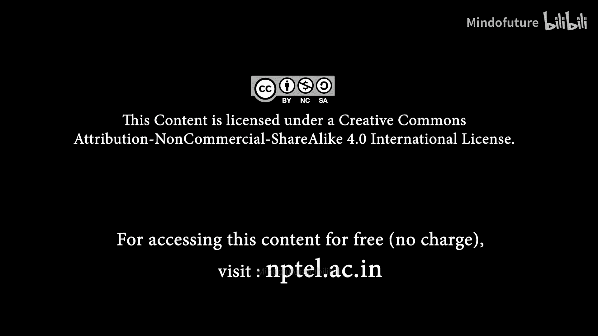
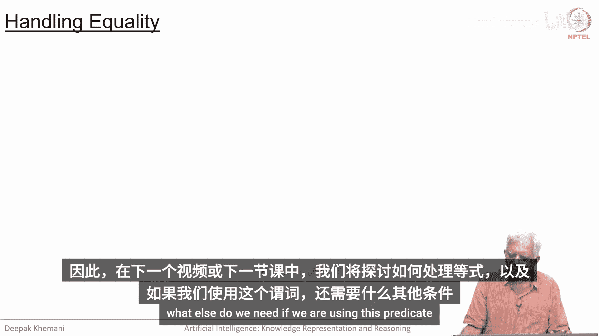

# 【印度理工学院】知识表示与推理 ｜ Knowledge Representation And Reasoning p39 P39_一阶逻辑中的归结反驳 -BV1c4zNBmEyF_p39-

But you come back， so we have been looking at the resolution reputation method。😊。

And we first looked at it for professional logic and we saw。That。

The procedure is as follows that you。嗯。You take the given knowledge base。

 you negate the goal and add it to the knowledge base。

Convert this whole thing into cf or clause form。And then repeatedly apply the resolution rule by taking some two clauses and adding the resolve and you keep doing that。

Tly empty the empty clause。As a result。And then we said， okay。

 let us look at this method in first logic and we saw how to express the formula in a form which is suitable。

For application of the resolution method and the form that is suitable is that is called the clause form in which we have eliminated the quantifiers and we have。

Arrange the rest of the formula。Into cF like structure， cognitiveive normal form like structure。

And taken care to standardize variables apart in every conjunction essentially。

Now we are interested in bindinging proofs。So， as is proportional logic。

 the procedure for finding a proof is similar。Convert each frame mice into clause form。

Neggate the goal and convert it into clause form and now it is a conjunction of clauses。

Add the negativeed goal to the set of clauses。Choose two clause such that the opposite sign details in them can be unified。

 So if some some atomic formula and。One clause has an atomic formulaula。

Other clause has a negation of the atomic commla， then you can remove that from both。

Resolve the two clause using the most general unifier and we have seen what is the procedure for constructing the most general unifier and the add the re to the set essentially。

Repeat steps 4 and5。Taylor nu。Resolvevent is produced。

Very similar to what it is in professional logic。Except that we have to handle all these variables and quantifiers here。

What is the resolution rule for？First all logic。For the sake of completeness。

 we assume that each clause can have multiple instances of the same lital with maybe different variables or different constants。

Thrown into the picture。So。For example， in these two clauses c1 and C2 c1 has a set of clauses which are l1 or L2 or l k and what we are trying to say here is that。

They look similar essentially in the sense that L1 may be use the same predicate name and L2 will use the same predicate name as El1 their variables may be different and things like that。

So if we can find a most general unifier。For all the allies and all the ariseies。

Then you can see that alls are positive atomic formulas。

 arrays are negative litals and we can cancel all of them together and what would be left would be all the P formulas and all the Q formulas。

And we would construct a new formula which has all the Ps and all the Qs。But making sure that the。

Substitution theta that we use for con constructing the NG is applied to this formula。M。

This is for the sake of generality， when we do solve small problems especially in quizzes and exams。

 we don't have this complex things except you know once or twice you might suddenly find a clause which has two instances or three instances of the same formula。

Maybe in thequizzes， we can look at those。So we begin with our oldest。Pattern of reasoning。

The Sotic argument。W said。😔，That if。We have the clause， all manner mortal。

Which we earlier said was for all eggs spanex implies bottle legs， but now into clause form。

It is expresses not of man。Not man X or motor legs。

Clt to is man Socrates and the negative goal that we have added is。Not of what we wanted。

 what we want is that mountain Socrates。This is the goal and we ne it and add it to the listing After that it is just a small process here。

From C1 and C2 we can generate mor Socrates by saying that。X is replaced by Socrates。

That is what we wanted。But。Because of the fact that we are using the resolution refutition method。

 our goal now is to derive the empty clause and that is straightforward here because we have the negation of the goal we already derived the goal in R1 and so R2 becomes the empty clause。

When we started with。First of our logic， we said that we have the rule of universal ination。

And you can see that this substitution is in a way like doing instantation we are replacing the formula by。

By replacing the variable in the formula with a constant in this case。So we can see the proof here。

As a。Dag or is iscycl click。Gra directed recyclingcycl graph。

And you can see that in the shaded person is what captures the forward chainning in the forward chainning from man Socrates and all manner model we implied we inferred model Socrates and so in some sense this。

Resolution rule subsumes forward chain， whatever you can do with forward chain， you can also do with。

Resolution method， a resolution rule， of course， for the sake of completeness。

 we have added the negation of the goal， which is shown in orange here and derive the neural clause。

 That is the goal in resolution the method is to derive the neural clause。

You can see that you can see this same。Resolution tag。As doing backward training。

So if you think of this orange formula。The negative formula has。A goal。

And we had seen this parallel that when you， when you， when you say that something is a goal。

You could add the neg and you could think of it as a goal so if you are thinking of it as a goal then supposing we use the phrase show。

Morton。Socrates。Then in backward training， we replace it by saying。Sure。Man。Socratesす。

That was backward Jen and exactly the same step is happening here that from not modern Socrates which is a negativeed goal we get a new negativeed goal if you want to call it non not man Socrates。

😊，And that can be satisfied reallyly because it is there in the knowledge base and so we can say there are no more goals to be so if you remember the backward chain procedure。

😊，That is being subsumed by。Resolution rule。 So the resolution method is， in some sense。

 a generalization of both whatever backward training can do and whatever forward training can do。

 The resolution method can also do。So， here is Alice problem so notation that I have used is a little bit mixed remember that we had this Cha and magdaot list notation in which there were no mathematical symbols。

😊，嗯。So， I have used that notation， but I have used mathematical symbols also here because sometimes I find it easier to。

Read those formulas here， essentially。Soう。Otherwise， I would have written this as。Yeah。Not。All。Lakes。

X m。Likeakes， X。Yi。This would dive in the in in purely in the list notation。

 but I use a mixture of of those who thinks that instead of using this prefix。

Connectors I use the in fixed one， which is more。Readable， at least for， at least for me， I think。

So this is the Alice problem converted into close form。

And this last one is the negative gold clause as we have been seeing exactly。So this is what we have。

The clauses all drawn neatly on this slide。H。And the negative goal closed essentially and we can go through the steps one by one so first we cancel this likes Alice stories with not likes Alice stories and Morigues likes Alice physics which is a resolution rule。

Then using that and using the rule that if she likes algebra and if she likes physics then she will go to college he reduced it to a new rule which says if she likes algebra。

Then she will go to college。Because the fact that he likes Alice' stories has already been。嗯。

Takeing care of。Then somewhere independently we say that that she if she likes maths。

Then she likes algebrabra and then we said that she likes maths and then from that we infer that she likes algebrabra。

 which is like doing motorpos， but now we are doing the。Resolution rule， essentially。So， from that。

 the fact that she likes algebra and from the clause which said that either she likes algebra or she goes to college so。

We inferred that she goes to college， that's what we wanted to show。

But since we are doing the resolution theition method， we go one more step and show that。

We can derive the nu clause from the negative。So in this。

 some of these examples that we have seen which are tiny examples the。

The conclusion is actually proved。For example here and then the process is completed by negating it with the goal but it is not always the case and if that was the case then you know forward training would be same as as resolution method or backward training would be same as resolution method but that is not the case there is some situations where。

Negative goal plays in。Earlier lowwell， essentially， in fact。

When people work with the resolution reetition method。

 people say that you must try to use the negative goal as。Early as possible。

Because of the fact that if there is a contradiction in the augmented。Knowledge base。

What is augmented knowledge base the knowledge base augmented with the negation of the goal and if there is a contradiction in the augmented knowledge base it must be because of the negatived goal essentially because you know ultimately we are doing proof by contradiction so some people say that you know。

You must try to use either the negative goal or its descendants as early as possible so this strategy。

In iss called set of support strategy。Set of support strategies says。

They try to use the negative goal as early as possible here we have used it in the very end so as a small exercise I will ask you to start by using the negative goal in the first resolution step and then try to use either that or what was derived from that and you will see that that also works well essentially。

The other strategy we talked of was unit strategy。I didn't write this in slides。

I hope this will suffice to for you to remember， unit strategy says。

That use a unit clause like this one as far as possible。

 why because unit clauses will reduce the other clause by length 1 so you can see that here we have a clause of length2 it got reduced to a clause of length 1。

And when we use this unit clause， then this clause of length 3 got reducedius to the clause of length 2。

And then that got reduced to a clause of length1 and then that got reduced to a clause of length0 So unit clauses obviously have this tendency of shrinking the other clause because they cancel off that negative negative little。

And so， that is one good strategy the other is that because you want to derive the contradiction you use the set of support strategy which says that use either the negative goal or its all its descendants in that we will come back to this relation of set of support strategy later。

Let us address this problem that has been bugging us。Ever since we introduced it in first a logic。

 we said。That you are given this knowledge base。O of A B， O of B。M is not a。

A is not m and C is M and from that we had this goal。

That there exist n x and a remember that these are existentially quantified variables。

Says that x is not M。And y is M？And or whatever。Between x and y O is looking at x is looking at pi or x is on y depending on your interpretation。

So， that was what we could not do then， so let us now see how this happens in the resolution method。

So we started with the premises。4 promises that we had and we navigate the goal and add that as a。

Additional clause to that。Now you will see that we will start using this negative goal。Ptty soon。

In fact， the very first thing that we derive。A from 4 and 5， what is 44 is MC。And what is 5。

 it says that there is something which is not time。So why is not M？So if you say y equal to c。

Then we can eliminate that， but we must substitute y for c so this c has come because it was y to start with。

Sincely， and now we have a new formula。Similarly from 3 and 5， what is 33 says a is not m。No。

 if you say。In in。In formula number five， if you see that。X must be a that substitute x with a。

Then if we do that。We can cancel that not MA。Whi'ch this one here。This gets cancelled with this。So。

 we are left with the other two dischargejus in the clause and this y。

Has carried forward here now from 1 and 7。We can cancel O A B。

Because here it says not o of a with something and if that something happens to be B then we can cancel that and what will be left is the other part which is。

Not m that thing and that thing is b because we are said y is equal to b so we get not m essentially。

In a similar fashion， we get M from 2 and62 says OBC。

And 6 says this formula which is not of O something something not of O something c。

 we can cancel that not of O something C which is here with OVC which is here。

And we would be left with the remaining part， which is。M of B because x has become B。And now。

 of course， we have the empty close。So you see that something that we could not do in force our logic in forward chain or in backward chain。

 we can do in the resolution method。 So not only does the resolution rule subsume forward chain in backward chain。

 It can do more than that essentially。 And this is what we have seen here。

And we have also seen that in this example the negative goal played a role in deriving the null clause it was used quite early in the proof。

So， the the two other simpler examples that we saw in which it came in the very end。

Like the police in some of our。Bllywood films， this is not always the case for problems which are more complex。

It has to play an early role。And you can see if you think about this。

 you can see that this will come to a large extent because of the occurrence of the or in the this thing。

In some formulas， essentially， So the disjunct is not so straightforward to。Deal with， essentially。

The same proof if you read it in the blocks world domain。You can now read it as on AB， on BCC。

 not maroon A， not maroon C， show that there is an x and y says that x is maroon and y is not maroon and x is on y。

That's a negative goal， sorry。And then the same proof。

 it says that I rename the predicate names with what we used in the。Earlier proof。

The same thing would apply here except that in this proof the names are what I used to use earlier。

 so Jack and Anne and John instead of cut be and Archie that I had used，But that doesn't matter。

 I mean， what's in the name？So， you can again show that the empty clause can be derived essentially。

 so this shows this illustrates。The fact that the resolution method is complete it could solve problems that forward chain and backward chain could not solve essentially。

Well take a break。And we'll come back。And。Talk about equality。 when we started。

With talking about first logic， we said that there is a special symbol。

 special predicate call equality and if you use that then。It's called for ser logic with equality。

 So in the next video or in the next class， we will。See， how。

How to handle equality as to what else do we need if we are using this pdicate？

So see you。